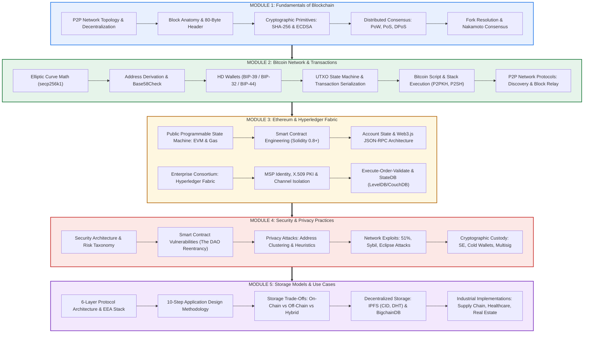

# BACSE350: Blockchain Technologies & Applications
# Master Study Guide, Course Syllabus & Comprehensive Navigation Index

---

## Executive Course Overview

**BACSE350: Blockchain Technologies & Applications** is an advanced computer science and engineering curriculum covering the mathematical, cryptographic, distributed systems, architectural, and security foundations of decentralized ledger technologies (DLT). The course traverses the evolution from peer-to-peer electronic cash systems (Bitcoin) and decentralized state machine computing platforms (Ethereum) to enterprise consortium architectures (Hyperledger Fabric), decentralized storage networks (IPFS, BigchainDB), and multi-layer enterprise security engineering.

This master document serves as the **central study portal, cross-module syllabus roadmap, architectural catalog, and exam preparation companion** for the entire course. It bridges the theoretical rigor of distributed consensus with production-grade engineering implementations, mathematical proofs, and real-world industrial case studies.

---

## Master Course Navigation & Module Directory

| Module | Title | Primary Source Materials | Concept Document | Merged Reference PDF | High-Fidelity Diagrams | Key Focus Areas |
| :---: | :--- | :--- | :---: | :---: | :---: | :--- |
| **01** | **Fundamentals of Blockchain** | `Unit-1-Aug4.pdf` | [Module 1 Guide](BACSE350%20Blockchain%20Module%201.md) | [Module 1 PDF](BACSE350%20Blockchain%20Module%201.pdf) | 6 SVGs | P2P networks, 80-byte header, Merkle trees, ECDSA secp256k1, Lamport Byzantine Generals, PoW / PoS / DPoS, Nakamoto consensus, forks. |
| **02** | **Bitcoin Network & Transactions** | `UNIT-2Address.pdf`<br>`Unit-2Aug4_merged_watermark.pdf`<br>`UNIT-2Transaction.pdf`<br>`Unit-2Node_Discovery.pdf` | [Module 2 Guide](BACSE350%20Blockchain%20Module%202.md) | [Module 2 PDF](BACSE350%20Blockchain%20Module%202.pdf) | 5 SVGs | SECP256k1 EC math, Base58Check, WIF, BIP-39/32/44 HD wallets, UTXO model, Bitcoin Script stack execution, P2PKH/P2SH, P2P gossip discovery. |
| **03** | **Ethereum & Hyperledger Fabric** | `Unit-3_PART-A.pdf`<br>`Unit-3_PART-B.pptx`<br>`Unit-3_PART-C-HL.pdf`<br>`Unit-3_PART-C-HL-setup-network_07.pdf` | [Module 3 Guide](BACSE350%20Blockchain%20Module%203.md) | [Module 3 PDF](BACSE350%20Blockchain%20Module%203.pdf) | 5 SVGs | EVM stack machine, Gas economics & EIP-1559, EOA vs Contracts, Solidity 0.8+ development, Fabric MSP / PKI, EtcdRaft ordering, CouchDB StateDB, Chaincode lifecycle. |
| **04** | **Security & Privacy Practices** | 12 Source Documents (Notes & Slides on Risks, Attacks, Privacy, Wallets, Multisig) | [Module 4 Guide](BACSE350%20Blockchain%20Module%204.md) | [Module 4 PDF](BACSE350%20Blockchain%20Module%204.pdf) | 6 SVGs | Technical vs Inherent risks, The DAO reentrancy attack, Privacy heuristics & clustering, 51% & Eclipse attacks, Hardware wallets & EAL6+ SE, M-of-N Multisig, Governance. |
| **05** | **Storage Models & Use Cases** | `Unit-5_COMPLETE.pdf` | [Module 5 Guide](BACSE350%20Blockchain%20Module%205.md) | [Module 5 PDF](BACSE350%20Blockchain%20Module%205.pdf) | 6 SVGs | 6-Layer functional architecture, 10-step design methodology, On-chain vs Off-chain cost trade-offs, IPFS (CID, DHT, Bitswap), BigchainDB, Supply chain & Healthcare case studies. |

---

## Complete Course Syllabus Roadmap



---

## Detailed Module Summaries & Core Takeaways

### [Module 1: Fundamentals of Blockchain](BACSE350%20Blockchain%20Module%201.md)
* **Foundational Tenets:** Explores the shift from centralized client-server silos to peer-to-peer decentralized networks. Resolves the fundamental double-spending problem without relying on a central clearinghouse.
* **Storage & Header Mechanics:** Deep-dives into the 80-byte block header format (Version, Previous Block Hash, Merkle Root Hash, Timestamp, nBits difficulty target, Nonce) and binary Merkle trees enabling $O(\log N)$ Simplified Payment Verification (SPV) proofs.
* **Cryptographic Primitives:** Dissects asymmetric cryptography, the secp256k1 curve ($y^2 \equiv x^3 + 7 \pmod p$), and the SHA-256 trapdoor one-way hash function.
* **Consensus Theories:** Provides mathematical proofs of impossibility for the Two Generals Problem over unauthenticated lossy networks, alongside Lamport’s Byzantine Generals Problem proof requiring $N \ge 3m + 1$(strictly$> \frac{2}{3}$ honest supermajority) to guarantee safety under arbitrary Byzantine faults.
* **Consensus Models & Nakamoto Consensus:** Compares Proof-of-Work (Hashcash, dynamic difficulty adjustment), Proof-of-Stake (validator bonding, slashing conditions, Nothing-at-Stake mitigation), and Delegated Proof-of-Stake (21 active witnesses, round-robin block production). Explains tie-breaking via the longest/heaviest chain rule, orphan block eviction, and mempool recovery.

### [Module 2: Bitcoin Network and Transactions](BACSE350%20Blockchain%20Module%202.md)
* **Address Derivation Mathematical Pipeline:** Traces 256-bit entropy generation to private keys, public key scalar multiplication $K = k \cdot G$, uncompressed (65-byte, prefix `04`) versus compressed (33-byte, prefix `02`/`03`) coordinates, and RIPEMD-160(SHA-256($K$)) double hashing to produce a 20-byte payload, finalized with Base58Check encoding.
* **Deterministic Wallets & Hierarchical Derivation:** Analyzes BIP-39 mnemonic phrase generation (128–256 bit entropy, PBKDF2 HMAC-SHA512 key stretching) and BIP-32/BIP-44 tree paths (`m / 44' / 0' / 0' / 0 / k`), contrasting normal derivation with hardened derivation ($i \ge 2^{31}$) to guard against parent private key compromise from leaked child keys.
* **The UTXO Transaction Model:** Explains atomic transaction consumption under the Rule of Entirety. Discusses the elimination of account balances in favor of discrete cryptographic outputs, explicit outputs versus implicit miner transaction fees ($\text{Fee} = \sum \text{Inputs} - \sum \text{Outputs}$).
* **Raw Transaction Serialization & Byte Anatomy:** Deconstructs raw hex serialization including little-endian TxIDs, VarInts, Outpoint indices, sequence numbers, locktime, and the 107-byte ScriptSig DER signature.
* **Bitcoin Script Stack Machine:** Demonstrates the Turing-incomplete execution of Forth-like stack opcodes. Traces standard P2PKH script execution (`OP_DUP OP_HASH160 <PubKeyHash> OP_EQUALVERIFY OP_CHECKSIG`), P2SH (BIP-16), multi-sig scripts, and provably unspendable data storage via `OP_RETURN` (up to 80 bytes).
* **P2P Network Discovery & Propagation:** Covers node bootstrap via hardcoded DNS seeds, fallback lists, and local `peers.dat` caches; TCP port 8333 handshakes (`version`/`verack`); and gossip-based inventory dissemination (`inv` $\rightarrow `getdata` \rightarrow$ `block`).

### [Module 3: Ethereum and Hyperledger Fabric](BACSE350%20Blockchain%20Module%203.md)
* **Ethereum Execution Environment (EVM):** Analyzes the EVM as a 256-bit quasi-Turing-complete stack machine operating with a 1,024-element stack depth, volatile byte-addressable memory, and persistent key-value storage trie slots.
* **Gas Cryptoeconomics & EIP-1559:** Details the solution to Turing’s halting problem via execution metering. Explains the EIP-1559 London hard fork fee structure ($\text{Fee} = \text{GasUsed} \times (\text{BaseFee} + \text{PriorityTip})$), where BaseFee is burned, creating algorithmic ETH supply adjustments.
* **Account Models & State Transitions:** Contrasts Externally Owned Accounts (EOAs, controlled by private keys) with Contract Accounts (controlled by EVM bytecode), analyzing the 4-tuple state structure: $[\text{nonce}, \text{balance}, \text{storageRoot}, \text{codeHash}]$.
* **Solidity Smart Contract Engineering:** Details syntax, storage layouts, function modifiers, checked arithmetic in Solidity 0.8+, event indexing with 256-bit Bloom filters, custom errors, and secure payment withdrawal patterns.
* **Hyperledger Fabric Enterprise Architecture:** Contrasts public permissionless ledgers with private permissioned consortiums. Details channel-based privacy partitioning, dual-component ledger structures (immutable block history + pluggable StateDB like LevelDB/CouchDB), and specialized node roles (Endorsing, Committing, Anchor, and Orderer peers).
* **Execute-Order-Validate Concurrency Model:** Explains Fabric's 3-phase transaction pipeline eliminating non-deterministic execution bottlenecks: (1) Parallel transaction proposal simulation and Read-Write Set generation; (2) EtcdRaft crash fault-tolerant ordering; (3) Validation System Chaincode (VSCC) policy checking and Multi-Version Concurrency Control (MVCC) commit.
* **Identity Management & Chaincode Lifecycle:** Demystifies the Membership Service Provider (MSP), Fabric CA, X.509 PKI certificates, `msp/` directory structures, and the 4-step chaincode package/approve/commit lifecycle.

### [Module 4: Security and Privacy Practices](BACSE350%20Blockchain%20Module%204.md)
* **Risk Taxonomy & Classification:** Categorizes blockchain vulnerabilities into Technical Risks (software bugs, protocol design flaws, cryptographic vulnerabilities) and Inherent Risks (scalability trilemma constraints, economic irreversibility, regulatory friction).
* **The DAO Hack Case Study:** Conducts an in-depth code autopsy of the June 2016 exploit where 3.6M ETH was drained due to state updates trailing external calls. Formulates the Checks-Effects-Interactions (CEI) design pattern and reentrancy guard mutators.
* **Privacy Vulnerabilities & Blockchain Forensics:** Explains how pseudo-anonymity fails under blockchain intelligence heuristics: Common-Input-Ownership clustering, Change-Address identification, peer-to-peer gossip network sniffing, and dust attacks. Introduces Privacy-Enhancing Technologies (PETs): CoinJoin, Ring Signatures, Confidential Transactions, and Zero-Knowledge Proofs (zk-SNARKs).
* **Network & Consensus Attacks:** Explores the mechanics of 51% majority hashrate attacks (double-spending via alternative heavy branch reorganization), Eclipse attacks (monopolizing victim peer connections), Sybil attacks, and Timejacking attacks.
* **Cryptographic Key Custody & Defense-in-Depth:** Develops a 3-tier custody model (Hot, Warm, Cold). Evaluates Common Criteria EAL6+ Secure Elements (SE) preventing physical side-channel/fault injection, alongside Shamir’s Secret Sharing (SSS) for seed recovery.
* **Multisignature Schemes & Decentralized Governance:** Outlines $M$-of-$N$ threshold multisig script architectures, off-chain signature aggregation, on-chain versus off-chain governance dynamics, and hard forks versus soft forks.

### [Module 5: Blockchain Storage Models and Use Cases](BACSE350%20Blockchain%20Module%205.md)
* **Layered Architectural Stack:** Formulates the 6-layer blockchain reference model (Data, Network, Consensus, Incentive, Contract/Execution, Application Layer) alongside the Enterprise Ethereum Alliance (EEA) cross-industry standard.
* **10-Step Application Design Methodology:** Outlines the rigorous engineering framework required to evaluate, design, instantiate, and deploy decentralized systems, including the 10 immutable parameters established at network genesis.
* **Storage Economics & The Blockchain Trilemma:** Details the prohibitive cost of on-chain data storage ($20,000 \text{ gas per 32-byte word} \approx \$50,000\text{–}\$60,000\text{ per MB}$ on Ethereum), transaction latency, and storage bloat. Discusses the tension between permanent blockchain immutability and data privacy mandates (GDPR "Right to be Forgotten").
* **Hybrid Storage Architecture:** Introduces the off-chain payload storage pattern paired with on-chain cryptographic anchor verification. Provides an end-to-end production Solidity contract (`HybridDocumentRegistry.sol`) demonstrating SHA-256 digest notarization.
* **InterPlanetary File System (IPFS):** Details content addressing via CIDs (CIDv0 Base58 vs CIDv1 Multiformats: multibase, multicodec, multihash), UnixFS Merkle DAG chunking (256 KB slices), Kademlia Distributed Hash Table (DHT) $O(\log N)$ XOR distance routing, Bitswap credit/debt block exchanges, and pinning services.
* **BigchainDB Decentralized Database:** Explores the fusion of blockchain immutability and distributed database performance (MongoDB clustering + Tendermint BFT consensus) supporting high-throughput queryable JSON documents under a Create-Read-Append-Burn (CRAB) paradigm.
* **Real-World Case Studies:** Analyzes 12 end-to-end industrial workflows across Mortgage Lending Automation, Cross-Border Remittance (Corda), Land Registry & Title Deeds, Digital Advertising Fraud (Basic Attention Token), Music Royalties & Fractional Copyright Licensing, Content Crowdfunding, Pharmaceutical Drug Traceability, Cold Chain IoT Monitoring, Healthcare EHR Consent Management, Clinical Trial Data Integrity, and Health Insurance Fraud Prevention.

---

## Master Architectural Diagram Catalog (All 28 High-Fidelity SVGs)

All 28 diagrams have been handcrafted as modular, valid XML SVG vector graphics in the `diagrams/` folder. They feature modern typography, high-contrast accessible palettes, clear workflow callouts, and clean viewBox definitions.

```
./diagrams/
```

### Module 1: Blockchain Fundamentals (6 Diagrams)

| SVG Filename | Dimensions | Architectural Subject | Description |
| :--- | :---: | :--- | :--- |
| [`mod1_network_topology.svg`](diagrams/mod1_network_topology.svg) | 1100 × 680 | Network Architectures | Contrasts centralized client-server bottlenecks (single point of failure) with decentralized peer-to-peer (P2P) mesh networks. |
| [`mod1_block_linking.svg`](diagrams/mod1_block_linking.svg) | 1200 × 760 | Block Anatomy & Merkle Trees | 80-byte block header breakdown, SHA-256 cryptographic back-pointers, and binary Merkle tree root hash generation. |
| [`mod1_digital_signature.svg`](diagrams/mod1_digital_signature.svg) | 1150 × 720 | Asymmetric Cryptography | Full ECDSA lifecycle: private key scalar generation, public key point multiplication, signing algorithm, and verification check. |
| [`mod1_byzantine_generals.svg`](diagrams/mod1_byzantine_generals.svg) | 1200 × 760 | Distributed Agreement | Compares the Two Generals uncoordinated lossy channel paradox with Lamport's Byzantine Generals $N \ge 3m+1$ threshold. |
| [`mod1_consensus_comparison.svg`](diagrams/mod1_consensus_comparison.svg) | 1200 × 750 | Consensus Mechanisms | 3-column architectural comparison of Proof-of-Work (PoW), Proof-of-Stake (PoS), and Delegated Proof-of-Stake (DPoS). |
| [`mod1_longest_chain.svg`](diagrams/mod1_longest_chain.svg) | 1180 × 720 | Fork Resolution | Dynamic fork resolution via heaviest cumulative PoW (Nakamoto consensus), showing orphan block eviction and mempool recovery. |

### Module 2: Bitcoin Network & Transactions (5 Diagrams)

| SVG Filename | Dimensions | Architectural Subject | Description |
| :--- | :---: | :--- | :--- |
| [`mod2_address_pipeline.svg`](diagrams/mod2_address_pipeline.svg) | 1150 × 720 | Key Derivation Pipeline | Sequential cryptographic pipeline: 256-bit entropy $\rightarrow$SECP256k1 public key$\rightarrow$HASH160$\rightarrow$Version Byte$\rightarrow$Double SHA-256 Checksum$\rightarrow$ Base58Check address. |
| [`mod2_hd_wallet_tree.svg`](diagrams/mod2_hd_wallet_tree.svg) | 1150 × 780 | HD Wallet Derivation | BIP-32 and BIP-44 hierarchical deterministic derivation tree (`m / 44' / 0' / 0' / 0 / k`), contrasting normal vs hardened derivations. |
| [`mod2_utxo_lifecycle.svg`](diagrams/mod2_utxo_lifecycle.svg) | 1150 × 720 | UTXO State Machine | UTXO consumption, rule of entirety, transaction input/output binding, change return, and implicit miner fee calculation. |
| [`mod2_node_discovery.svg`](diagrams/mod2_node_discovery.svg) | 1150 × 780 | P2P Peer Discovery | 3-step bootstrap process: DNS seed lookup, TCP port 8333 connection handshake (`version`/`verack`), and peer address sharing (`getaddr`/`addr`). |
| [`mod2_block_propagation.svg`](diagrams/mod2_block_propagation.svg) | 1150 × 780 | P2P Block Propagation | Gossip inventory dissemination sequence: `inv` announcement $\rightarrow$`getdata` request$\rightarrow `block` transmission \rightarrow$ consensus verification. |

### Module 3: Ethereum & Hyperledger Fabric (5 Diagrams)

| SVG Filename | Dimensions | Architectural Subject | Description |
| :--- | :---: | :--- | :--- |
| [`mod3_ethereum_architecture.svg`](diagrams/mod3_ethereum_architecture.svg) | 1100 × 780 | Ethereum System Topology | Multi-layer client stack: Execution clients (Geth), Web3 JSON-RPC providers, EVM stack machine, state trie storage, and EOA vs contract accounts. |
| [`mod3_smart_contract_lifecycle.svg`](diagrams/mod3_smart_contract_lifecycle.svg) | 1150 × 780 | Smart Contract Lifecycle | End-to-end Solidity workflow: Remix IDE compilation $\rightarrow$EVM Bytecode & ABI generation$\rightarrow$transaction signing$\rightarrow$deployment$\rightarrow$ runtime state changes. |
| [`mod3_fabric_architecture.svg`](diagrams/mod3_fabric_architecture.svg) | 1180 × 820 | Hyperledger Consortium | Modular enterprise architecture: Multi-channel data isolation, Endorsing peers, Committing peers, EtcdRaft ordering cluster, and StateDB (LevelDB/CouchDB). |
| [`mod3_fabric_transaction_flow.svg`](diagrams/mod3_fabric_transaction_flow.svg) | 1200 × 900 | Execute-Order-Validate | Fabric 6-stage transaction pipeline: Proposal simulation, RWSet generation, Endorsement assembly, Raft ordering, VSCC verification, and MVCC commit. |
| [`mod3_fabric_msp.svg`](diagrams/mod3_fabric_msp.svg) | 1180 × 820 | Identity & PKI Infrastructure | Membership Service Provider (MSP) and Fabric CA: X.509 PKI certificate generation, `msp/` directory layout (cacerts, signcerts, keystore), and Channel MSP policy enforcement. |

### Module 4: Security and Privacy Practices (6 Diagrams)

| SVG Filename | Dimensions | Architectural Subject | Description |
| :--- | :---: | :--- | :--- |
| [`mod4_security_risks_taxonomy.svg`](diagrams/mod4_security_risks_taxonomy.svg) | 1200 × 840 | Risk Classification Tree | Comprehensive breakdown of Technical Risks (software flaws, smart contract bugs, network attacks) vs Inherent Risks (trilemma, economic finality, governance). |
| [`mod4_reentrancy_attack.svg`](diagrams/mod4_reentrancy_attack.svg) | 1200 × 860 | The DAO Vulnerability & Fix | Execution sequence of the reentrancy exploit: fallback recursive drain before internal balance zeroing, contrasted with the Checks-Effects-Interactions (CEI) fix. |
| [`mod4_privacy_attacks.svg`](diagrams/mod4_privacy_attacks.svg) | 1200 × 860 | De-Anonymization & PETs | Blockchain forensic clustering: Common-input heuristic, change detection, network gossip sniffing, dusting attacks, and Privacy-Enhancing Technology mitigations. |
| [`mod4_network_attacks.svg`](diagrams/mod4_network_attacks.svg) | 1200 × 860 | Network & Consensus Exploits | Topology and sequence of a 51% double-spending deep reorganization attack, alongside an Eclipse attack isolating a victim node's peer routing table. |
| [`mod4_wallet_security_tiering.svg`](diagrams/mod4_wallet_security_tiering.svg) | 1200 × 860 | Key Custody Architecture | 3-tier custody model (Hot, Warm, Cold), EAL6+ Secure Element internal bus isolation, and Shamir's Secret Sharing (SSS) $(k, n)$ polynomial threshold distribution. |
| [`mod4_multisig_workflow.svg`](diagrams/mod4_multisig_workflow.svg) | 1200 × 860 | Threshold Signatures & Governance | $M$-of-$N$ threshold multisignature transaction signing pipeline, two-layer blockchain governance models, and hard fork vs soft fork divergence rules. |

### Module 5: Storage Models and Use Cases (6 Diagrams)

| SVG Filename | Dimensions | Architectural Subject | Description |
| :--- | :---: | :--- | :--- |
| [`mod5_layered_architecture.svg`](diagrams/mod5_layered_architecture.svg) | 1200 × 920 | 6-Layer Functional Stack | Complete 6-layer protocol hierarchy (Data, Network, Consensus, Incentive, Contract, Application) aligned with the Enterprise Ethereum Alliance (EEA) reference stack. |
| [`mod5_design_methodology.svg`](diagrams/mod5_design_methodology.svg) | 1320 × 1020 | Application Decision Framework | 10-step blockchain evaluation and design methodology, mapping qualifying criteria, platform selection, 10 genesis instance parameters, and integration APIs. |
| [`mod5_storage_models.svg`](diagrams/mod5_storage_models.svg) | 1280 × 880 | On-Chain vs Off-Chain vs Hybrid | Comparative storage architecture, economic cost trade-off matrix, and 4-stage hybrid data lifecycle (off-chain payload + on-chain cryptographic anchor). |
| [`mod5_ipfs_architecture.svg`](diagrams/mod5_ipfs_architecture.svg) | 1280 × 880 | IPFS Protocol Deep Dive | Content addressing architecture: CIDv0 vs CIDv1 multiformats breakdown, UnixFS Merkle DAG chunking (256 KB), Kademlia DHT routing, and Bitswap data exchange. |
| [`mod5_supply_chain_use_case.svg`](diagrams/mod5_supply_chain_use_case.svg) | 1280 × 840 | Pharmaceutical Track-and-Trace | End-to-end supply chain monitoring: GS1 serialization, multi-custody barcode handoffs, IoT temperature sensors, and automated smart contract provenance auditing. |
| [`mod5_healthcare_use_case.svg`](diagrams/mod5_healthcare_use_case.svg) | 1280 × 880 | Healthcare EHR Architecture | Decentralized health record management: Off-chain encrypted medical storage, dynamic patient consent smart contracts, clinical trial audits, and fraud-free billing. |

---

## Cross-Module Architectural Matrix & Technology Comparison

### 1. Blockchain Platform Taxonomy & Comparison

| Comparative Parameter | Bitcoin (Module 2) | Ethereum (Module 3) | Hyperledger Fabric (Module 3) | BigchainDB (Module 5) |
| :--- | :--- | :--- | :--- | :--- |
| **Network Type** | Public Permissionless | Public Permissionless (or Private) | Private Permissioned Consortium | Permissioned Consortium / Public |
| **Primary Design Goal** | Decentralized Digital Currency | General-Purpose Decentralized Computer | Enterprise Business Collaboration | Scalable High-Throughput Database |
| **Consensus Protocol** | Proof-of-Work (PoW / Hashcash) | Proof-of-Stake (PoS / Gasper) | Crash Fault Tolerant (EtcdRaft) or BFT | Byzantine Fault Tolerant (Tendermint) |
| **Transaction Processing** | Sequential, In-Order Mining | Sequential State Machine Execution | Execute-Order-Validate (Parallel proposal) | Parallel Pipeline Validation |
| **State / Ledger Model** | Unspent Transaction Output (UTXO) | Account / State Trie Model ($[\text{nonce}, \text{bal}, \dots]$) | Dual Ledger: Append-only log + StateDB | Asset-centric JSON document model |
| **Native Cryptocurrency** | Yes (Bitcoin - BTC) | Yes (Ether - ETH) | No (Deterministic enterprise ledger) | No native token required |
| **Smart Contract Language** | Bitcoin Script (Turing-incomplete) | Solidity, Vyper (Turing-complete) | Go, Java, TypeScript (Chaincode) | Python / JS Driver APIs (CRAB rules) |
| **Throughput (TPS)** | ~7 TPS | ~15–30 TPS (L1) | 3,000–20,000+ TPS | 10,000–100,000+ TPS |
| **Finality Time** | Probabilistic (~60 min / 6 blocks) | Deterministic (~12–15 min / 2 epochs) | Immediate / Deterministic (< 1 second) | Immediate / Deterministic (< 1 second) |
| **Identity / Membership** | Anonymous / Pseudonymous (PKI) | Pseudonymous (EOA Keypairs) | Strict X.509 PKI via MSP | Public key cryptographic signatures |

### 2. Consensus Mechanism Evolution

| Consensus Class | Representative Protocol | Finality Guarantee | Fault Tolerance Threshold | Energy Consumption | Vulnerabilities / Weaknesses |
| :--- | :--- | :--- | :--- | :--- | :--- |
| **Proof-of-Work (PoW)** | Bitcoin (Hashcash) | Probabilistic (Nakamoto rule) | $< 50\%$hashrate ($> 50\%$ causes double-spend) | Extremely High (Gigawatts) | 51% Hashrate Attack, Selfish Mining, Pool Centralization |
| **Proof-of-Stake (PoS)** | Ethereum (Proof-of-Stake) | Deterministic (Casper FFG 2/3) | $< 33.3\%$malicious stake ($> 33\%$ stalls finality) | Negligible (< 0.05% of PoW) | Nothing-at-Stake (fixed by slashing), Stake Cartelization |
| **Delegated PoS (DPoS)** | EOS, Tron, BitShares | Deterministic (21 Witnesses) | $< 33.3\%$ dishonest block producers | Low | Voter apathy, Witness collusion, Governance bribery |
| **Crash Fault Tolerant (CFT)** | Hyperledger Fabric (EtcdRaft) | Immediate / Absolute | Up to $f < \frac{n}{2}$ crashed nodes | Negligible | Cannot tolerate malicious / Byzantine adversarial behavior |
| **Byzantine Fault Tolerant (BFT)** | Tendermint, PBFT | Immediate / Absolute | Up to $f < \frac{n}{3}$Byzantine nodes ($2f+1 > \frac{2}{3}n$) | Negligible | High$O(n^2)$ network communication overhead; limited node scaling |

### 3. Decentralized & Distributed Storage Comparison

| Storage Architecture | Primary Data Structure | Addressing Scheme | Query Capability | Primary Use Case | Cost Profile |
| :--- | :--- | :--- | :--- | :--- | :--- |
| **On-Chain EVM Storage** | Merkle Patricia Trie | 32-byte Storage Slot Index | Key-Value lookups only | Critical state variables, token balances | Prohibitive (~\$50 k–\$60 k / MB) |
| **InterPlanetary File System (IPFS)** | UnixFS Merkle DAG | Cryptographic Content ID (CID) | Content Hash lookup via DHT | Media, PDFs, Web3 metadata, Large blobs | Free P2P / Modest Pinning Fees |
| **BigchainDB** | MongoDB Document Store + Merkle Tree | Transaction ID / Asset ID | Rich MongoDB JSON queries (Regex, filter) | High-speed audit logs, structured IoT records | Node infrastructure hosting cost |
| **Arweave / Filecoin** | Blockweave / PoST Storage Sectors | Transaction Hash / Piece CID | Hash lookup + GraphQL indexing | Permanent archival data, cold storage | One-time endowment / Storage deals |

---

## Core Mathematical, Cryptographic & Economic Reference Card

### 1. Elliptic Curve Cryptography (SECP256k1)
Bitcoin and Ethereum utilize the Koblitz elliptic curve defined over the finite field $\mathbb{F}_p$:
$$y^2 \equiv x^3 + 7 \pmod p$$
* **Field Prime ($p$):**$2^{256} - 2^{32} - 977 = \text{0xFFFFFFFFFFFFFFFFFFFFFFFFFFFFFFFFFFFFFFFFFFFFFFFFFFFFFFFEFFFFFC2F}$* **Base Point / Generator ($G$):**
  - $G_x = \text{0x79BE667EF9DCBBAC55A06295CE870B07029BFCDB2DCE28D959F2815B16F81798}$-$G_y = \text{0x483ADA7726A3C4655DA4FBFC0E1108A8FD17B448A68554199C47D08FFB10D4B8}$* **Curve Order ($n$):**$\text{0xFFFFFFFFFFFFFFFFFFFFFFFFFFFFFFFEBAAEDCE6AF48A03BBFD25E8CD0364141}$* **Public Key Derivation:**$K = k \cdot G$(Scalar point multiplication using double-and-add algorithm; computing$k$from$K$ is the Discrete Logarithm Problem, computationally infeasible).
* **Coordinate Compression:**
  - Uncompressed: $\text{0x04} \,||\, x \,||\, y$ (65 bytes)
  - Compressed: If $y \text{ is even} \implies \text{0x02} \,||\, x$; If$y \text{ is odd} \implies \text{0x03} \,||\, x$ (33 bytes)

### 2. Hash Functions & Address Derivation
* **Bitcoin HASH160:** $\text{HASH160}(K) = \text{RIPEMD-160}(\text{SHA-256}(K))$ (Yields 20 bytes / 160 bits).
* **Double SHA-256 Checksum:** $\text{Checksum} = \text{First 4 bytes of } \text{SHA-256}(\text{SHA-256}(\text{Prefix} \,||\, \text{Payload}))$.
* **Bitcoin Base58Check Encoding:** Converts $[\text{Version} (1) \,||\, \text{Payload} (20) \,||\, \text{Checksum} (4)]$ into alphanumeric characters excluding ambiguous glyphs `0`, `O`, `I`, `l`, `+`, `/`.
* **Ethereum Address Derivation:**
  $$\text{Address} = \text{Last 20 bytes of } \text{Keccak-256}(K_{\text{uncompressed}}[1:65])$$
* **EIP-55 Mixed-Case Checksum:** Converts address characters to uppercase if the $i$-th nibble of$\text{Keccak-256}(\text{lowercase}(address)) \ge 8$.

### 3. EVM Gas Economics & EIP-1559 Pricing
* **Total Fee Calculation:**
  $$\text{Total Fee} = \text{Gas Units Consumed} \times (\text{Base Fee} + \text{Priority Tip})$$
* **Base Fee Adjustment Algorithm:**
  $$\text{BaseFee}_{t+1} = \text{BaseFee}_t \times \left(1 + \frac{\text{GasUsed}_t - \text{GasTarget}}{\text{GasTarget}} \times \frac{1}{8}\right)$$
  - Target Gas: 15,000,000 units. Maximum Gas: 30,000,000 units.
  - Maximum single-block Base Fee adjustment: $\pm 12.5\%$.
  - All BaseFee revenue is algorithmically burned (`0x000...000`), exerting deflationary pressure on ETH supply.

### 4. Distributed Consensus Mathematical Proofs
* **Lamport Byzantine Generals Threshold:** To tolerate $m$Byzantine traitors, the system must contain at least$N$ nodes such that:
  $$N \ge 3m + 1 \iff m \le \left\lfloor \frac{N - 1}{3} \right\rfloor$$
* **BFT Supermajority Quorum:** In a consortium of $n$ validator nodes, consensus requires a two-thirds supermajority vote:
  $$2f + 1 > \frac{2}{3}n$$
* **Bitcoin Mining Difficulty Target:**
  $$\text{Target}_{\text{new}} = \text{Target}_{\text{old}} \times \left(\frac{\text{Actual Time to Mine 2016 Blocks}}{20,160 \text{ minutes}}\right)$$
  - Clamped to an adjustment factor between $[0.25, 4.0]$ every 2,016 blocks (~2 weeks).

---

## University Examination Blueprint & High-Yield Strategy

### 1. High-Frequency 2-Mark Short Questions & Quick Answers

1. **What is the double-spending problem and how does blockchain solve it?**
   * *Answer:* Double spending is the risk that a digital currency unit is duplicated and spent more than once. Blockchain solves it via a decentralized append-only ledger governed by distributed consensus (e.g., PoW/PoS) and cryptographic transaction linking, rendering historic spends immutable.
2. **Why is the Bitcoin block header size fixed at 80 bytes?**
   * *Answer:* The 80-byte header contains 6 fixed-size metadata fields: Version (4B), PrevBlockHash (32B), MerkleRoot (32B), Timestamp (4B), nBits (4B), and Nonce (4B). This compact size enables SPV lightweight nodes to verify transactions without downloading multi-megabyte block bodies.
3. **What is the purpose of HASH160 in Bitcoin address generation?**
   * *Answer:* $\text{HASH160} = \text{RIPEMD-160}(\text{SHA-256}(K))$. It shortens the 33/65-byte public key to a compact 20-byte hash and provides defense-in-depth: if ECDSA is ever cracked by quantum Shor’s algorithm, the public key remains hidden behind one-way hashes until a transaction is broadcast.
4. **Distinguish between EOA and Contract Accounts in Ethereum.**
   * *Answer:* Externally Owned Accounts (EOAs) are controlled by private cryptographic keys and have no EVM code. Contract Accounts are controlled by stored EVM bytecode, execute logic when triggered by transactions, and have their own storage trie.
5. **What is an orphan block and how does the network handle it?**
   * *Answer:* An orphan block is a valid block that is not part of the longest/heaviest chain (e.g., produced during temporary mining splits). It is discarded by consensus; its miner reward is forfeited, and its valid transactions return to node mempools for subsequent inclusion.
6. **Why is Bitcoin Script deliberately Turing-incomplete?**
   * *Answer:* Bitcoin Script lacks loops and arbitrary recursion. This eliminates infinite execution loops, guaranteeing deterministic termination in $O(N)$ time and protecting network validators from denial-of-service (DoS) attacks without needing complex gas metering.
7. **What is the Checks-Effects-Interactions (CEI) pattern in Solidity?**
   * *Answer:* A security coding pattern that prevents reentrancy attacks by ordering execution: (1) Check preconditions (`require`), (2) Effect internal state changes (e.g., zero user balance), and (3) Interact with external addresses (e.g., transfer ETH).
8. **What is the role of the Membership Service Provider (MSP) in Hyperledger Fabric?**
   * *Answer:* MSP is an abstraction interface that maps cryptographic identity certificates (X.509 PKI issued by Fabric CA) to roles and permissions (admins, peers, clients) across organizations and channels.
9. **Explain the difference between CIDv0 and CIDv1 in IPFS.**
   * *Answer:* CIDv0 is a 46-character Base58 string starting with `Qm` (hardcoded to SHA-256 and UnixFS). CIDv1 uses multiformats (multibase prefix + multicodec type + multihash digest), allowing upgradeable encodings like Base32 for case-insensitive DNS interoperability.
10. **What is the difference between a Soft Fork and a Hard Fork?**
    * *Answer:* A Soft Fork is a backward-compatible consensus tightening (unupgraded nodes still accept new blocks). A Hard Fork is a non-backward-compatible consensus divergence (unupgraded nodes reject new blocks, causing a permanent chain split unless all nodes upgrade).

### 2. High-Yield 5-Mark Architectural & Analytical Questions

* **Question 1: Compare UTXO vs Account-based state models across 5 architectural parameters.**
  * *Parameters:* State storage representation, transaction parallelism/concurrency, privacy preservation, smart contract complexity, and double-spend detection mechanics.
* **Question 2: Detail the 3-phase Execute-Order-Validate transaction lifecycle in Hyperledger Fabric.**
  * *Explanation:* Endorsement simulation on endorsing peers (generating Read-Write sets without committing state) $\rightarrow$EtcdRaft ordering cluster packaging transactions into blocks without validation$\rightarrow$ Committing peer VSCC endorsement policy checks and MVCC read-write conflict invalidation before StateDB commit.
* **Question 3: Walk through the mechanics of a 51% Double-Spending Attack.**
  * *Explanation:* Attacker pays merchant on public chain; simultaneously mines a secret private chain forking prior to payment. Attacker waits for merchant confirmation, delivers goods, then broadcasts the longer private chain. Honest nodes accept the longer chain via Nakamoto consensus, reorganizing out the merchant payment.
* **Question 4: Contrast On-Chain, Off-Chain, and Hybrid storage models.**
  * *Explanation:* Detail the cost trade-offs ($20,000 \text{ gas per SSTORE}$ vs zero on-chain byte costs for payloads), throughput limits, privacy/GDPR implications, and how hybrid models pair off-chain IPFS CID storage with on-chain cryptographic anchor verification.

### 3. Comprehensive 10–15 Mark Master Essay / System Design Questions

* **Design Problem 1: End-to-End Decentralized Healthcare Record System.**
  * *Requirements:* Propose an enterprise architecture combining Ethereum/Solidity (or Hyperledger Fabric) with IPFS for Electronic Health Record (EHR) management. Detail patient consent access control, role-based encryption, dynamic revocation, audit logging, and HIPAA/GDPR compliance.
* **Design Problem 2: Pharmaceutical Cold-Chain Supply Chain Provenance Network.**
  * *Requirements:* Design a Hyperledger Fabric multi-channel architecture tracking drug serialization from manufacturer to patient. Diagram peer topologies, MSP organization identities, IoT temperature threshold chaincode triggers, and VSCC endorsement policies.

---

## Original Course Materials Cross-Reference & Archive

All 22 primary course materials provided by the university department have been organized and verified inside the `original/` subfolder:

```
./original/
```

| Original Filename | Format | File Size | Course Module Association | Syllabus Topic |
| :--- | :---: | :---: | :---: | :--- |
| `Unit-1-Aug4.pdf` | PDF | 3.91 MB | **Module 1** | Fundamentals of Blockchain, P2P networks, 80B header, Merkle trees, ECDSA, Byzantine generals, PoW/PoS/DPoS, forks. |
| `UNIT-2Address.pdf` | PDF | 998 KB | **Module 2** | Cryptographic key derivation, SECP256k1 EC math, coordinate compression, HASH160, Base58Check address generation. |
| `Unit-2Aug4_merged_watermark.pdf` | PDF | 500 KB | **Module 2** | Python implementations: Entropy, Mnemonic BIP-39, Master private key, XPUB watch-only, MultiSig P2SH scripts. |
| `UNIT-2Transaction.pdf` | PDF | 2.15 MB | **Module 2** | UTXO model, Rule of Entirety, raw hex byte anatomy, Bitcoin Script stack execution, P2PKH/P2SH validation. |
| `Unit-2Node_Discovery.pdf` | PDF | 1.21 MB | **Module 2** | P2P network discovery, DNS seed bootstrapping, port 8333 handshake, peer address exchange, block propagation. |
| `Unit-3_PART-A.pdf` | PDF | 6.98 MB | **Module 3** | Ethereum system architecture, node types, Web3.js providers, EVM stack machine, Gas economics, EOA vs contracts. |
| `Unit-3_PART-B.pptx` | PPTX | 5.86 MB | **Module 3** | Solidity smart contract programming, Remix IDE, compiler, data locations, inheritance, modifiers, events. |
| `Unit-3_PART-C-HL.pdf` | PDF | 1.89 MB | **Module 3** | Hyperledger Fabric enterprise architecture, channels, MSP, StateDB (LevelDB/CouchDB), peer node roles. |
| `Unit-3_PART-C-HL-setup-network_07.pdf` | PDF | 6.40 MB | **Module 3** | Hyperledger network deployment, test-network Docker containers, channel creation, chaincode lifecycle commands. |
| `Security_Architecture_Blockchain_Risks_Lecture_Notes.pdf` | PDF | 151 KB | **Module 4** | Security architecture principles, CIA triad in DLT, foundational security controls and risk profiles. |
| `Technical and Inherent Risks of Blockchain Technology.docx` | DOCX | 32.9 KB | **Module 4** | Technical vs Inherent risks classification, protocol design flaws, economic irreversibility, trilemma. |
| `Risks in Blockchain.docx` | DOCX | 25.4 KB | **Module 4** | Consensus vulnerabilities, The DAO hack autopsy, ATM reentrancy analogy, scalability trilemma analysis. |
| `Privacy Attacks in Blockchain.docx` | DOCX | 23.0 KB | **Module 4** | Detailed de-anonymization mechanics, address clustering heuristics, network sniffing, dusting exploits. |
| `Blockchain_Privacy_Attacks.pptx` | PPTX | 50.1 KB | **Module 4** | Visual slide presentation of blockchain privacy attacks, heuristics, and Privacy-Enhancing Technologies (PETs). |
| `blockchain specific attacks and non blockchain attacks.docx` | DOCX | 18.2 KB | **Module 4** | Formal classification: Blockchain-specific attacks (51%, Eclipse, Sybil, Timejacking) vs Traditional non-blockchain attacks. |
| `Attacks over blockchain.pptx` | PPTX | 494 KB | **Module 4** | Slide deck breaking down 51% reorganization attacks, Finney double spend, Eclipse network isolation, and Sybil threats. |
| `Limitations of Blockchain.docx` | DOCX | 19.1 KB | **Module 4** | Analysis of blockchain limitations: Low throughput (TPS), high latency, storage bloat, GDPR right-to-be-forgotten conflict. |
| `User Security Best Practices in Blockchain.docx` | DOCX | 25.6 KB | **Module 4** | End-user operational security: Phishing mitigation, seed phrase custody, hardware wallet verification, address verification. |
| `Physical Bitcoin Storage hardware wallet balancing and diversifying risks.docx` | DOCX | 26.1 KB | **Module 4** | Physical cold storage, paper wallets, titanium plates, hardware wallet Secure Elements, risk diversification strategies. |
| `Hot_and_Cold_Blockchain_Wallets.pptx` | PPTX | 49.1 KB | **Module 4** | Visual slide deck analyzing Hot vs Cold wallets, online vulnerability surface, air-gapped signing workflows. |
| `Multisignature and governance.docx` | DOCX | 1.66 MB | **Module 4** | $M$-of-$N$ threshold multisig script schemes, on-chain vs off-chain governance, protocol upgrade voting, hard/soft forks. |
| `Unit-5_COMPLETE.pdf` | PDF | 3.55 MB | **Module 5** | 6-layer architecture, 10-step design methodology, On-chain vs Off-chain, IPFS, BigchainDB, real-world case studies. |

---

## Merged Course Module PDF Directory

For complete end-to-end reading and offline reference, all converted lecture slide decks, handouts, and notes have been assembled into 5 consolidated module PDFs:

```
./
```

* 📄 **[`BACSE350 Blockchain Module 1.pdf`](BACSE350%20Blockchain%20Module%201.pdf)** (42 pages, 3.91 MB) — *Fundamentals of Blockchain*
* 📄 **[`BACSE350 Blockchain Module 2.pdf`](BACSE350%20Blockchain%20Module%202.pdf)** (77 pages, 4.79 MB) — *Bitcoin Network and Transactions*
* 📄 **[`BACSE350 Blockchain Module 3.pdf`](BACSE350%20Blockchain%20Module%203.pdf)** (180 pages, 19.46 MB) — *Ethereum and Hyperledger Fabric*
* 📄 **[`BACSE350 Blockchain Module 4.pdf`](BACSE350%20Blockchain%20Module%204.pdf)** (109 pages, 5.09 MB) — *Security and Privacy Practices*
* 📄 **[`BACSE350 Blockchain Module 5.pdf`](BACSE350%20Blockchain%20Module%205.pdf)** (58 pages, 3.56 MB) — *Blockchain Storage Models and Use Cases*

**Total Consolidated Course Volume:** 466 professionally merged pages across 36.8 MB.

---
*BACSE350 Blockchain Architecture, Technologies, Security & Design — Master Concept Series & Study Guide*
