# BACSE350: Blockchain & Cryptocurrency Technologies
## Module 1: Fundamentals of Blockchain (Master Comprehensive Study Guide)
**Course Code:** BACSE350 | **Faculty / Course Lead:** Dr. Sandhya P, SCOPE, VIT-Chennai  
**Document Classification:** Master Comprehensive Examination & Conceptual Reference Document  
**Target Audience:** Engineering Undergraduates, University Exam Aspirants, Blockchain Protocol Engineers

---

## Executive Module Overview & Syllabus Alignment
This master guide synthesizes all theoretical principles, cryptographic mechanisms, network protocols, consensus algorithms, and architectural models comprising **Module 1 (Fundamentals of Blockchain)** of the BACSE350 curriculum. It directly integrates lecture notes (`Unit-1-Aug4.pdf`), foundational architectural principles (`Unit-5_COMPLETE.pdf`, pp. 2–6), and academic literature (Nakamoto 2008, Lamport 1982, Castro & Liskov 1999).

### Core Syllabus Topics Covered:
1. **Blockchain Fundamentals:** Historical context, definition, core characteristics, centralized vs. decentralized architectures, P2P network mechanisms, BitTorrent comparison, isolated address generation, cloud computing vs. blockchain paradigm, and the Oracle problem.
2. **Blockchain Storage & Block Size Dynamics:** Block structure, Satoshi Nakamoto's 1MB block size limit, block size inferences (bandwidth, propagation latency, orphan rates, centralization risks), and the Segregated Witness (SegWit - BIP 141) protocol upgrade.
3. **Layered Architecture of Blockchain:** Data Layer, Network Layer, Consensus Layer, Incentive Layer, and Application/Smart Contract Layer.
4. **Blockchain Taxonomy:** Public (Permissionless), Private (Permissioned), and Consortium/Federated blockchains with multi-parameter comparative analysis.
5. **Applied Cryptography in Bitcoin:** Symmetric vs. asymmetric encryption, Elliptic Curve Digital Signature Algorithm (ECDSA on `secp256k1`), private/public key mathematics, Bitcoin address generation pipeline, cryptographic hash functions (SHA-256 properties, trapdoors, avalanche effect, collision resistance), electronic signatures vs. digital signatures, signing algorithms, and verification flows.
6. **Consensus Mechanisms & Distributed Agreement:** The Two Generals Problem (unreliable communication channel proof), the Byzantine Generals Problem (Lamport's $N \ge 3m + 1$ proof), 4 BFT operational attack cases, Proof of Work (PoW, Hashcash, difficulty adjustment), Proof of Stake (PoS, forging, coin-age, slashing, Nothing-at-Stake), and Delegated Proof of Stake (DPoS, witness voting, round-robin scheduling, standby witness rotation).
7. **Block Processing, Assembly & Fork Resolution:** Full transaction lifecycle (signing, mempool, validation, assembly, nonce mining, broadcast), temporary network forks, the Longest Chain Rule (heaviest accumulated proof of work), orphan/stale blocks, and the 6-confirmation rule.
8. **Governance & Technical Challenges:** On-chain vs. off-chain governance, Hard forks vs. Soft forks, the Blockchain Trilemma, and real-world system vulnerabilities.
9. **University Examination Preparation Pack:** High-yield 2-mark definitions, 5-mark conceptual breakdowns, 10-mark comprehensive architectural derivations, common traps, and rapid formula cheat sheets.

---

# Section 1: Introduction to Blockchain & Architectural Foundations

## 1.1 What is Blockchain? Technical Definition & Core Attributes
From a computer science perspective, a **blockchain** is a distributed, cryptographically secured, append-only, and transparent database replicated across an autonomous peer-to-peer (P2P) network of computational nodes. State transitions (transactions) are batched into timestamped cryptographic packages called **blocks**, which are sequentially chained using cryptographic parent hashes.

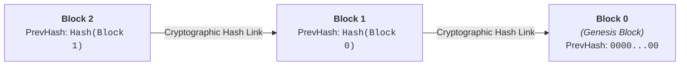

### The Six Fundamental Properties of Blockchain:
1. **Decentralized Control:** No single central intermediary (e.g., bank, clearinghouse, server administrator) exercises authoritative dominion over the ledger. Control is algorithmically distributed across all participating network peers.
2. **Immutability:** Once a transaction is validated and embedded within a block with subsequent blocks appended on top, altering historical records requires rewriting all subsequent blocks and redoing all associated proof of work—a task computationally infeasible against an honest majority.
3. **Cryptographic Integrity & Data Authenticity:** Every transaction is digitally authorized by its originator using asymmetric public-key cryptography (ECDSA) and irreversibly hashed (SHA-256), guaranteeing data integrity, authenticity, and non-repudiation.
4. **Transparency & Auditability:** In public networks, every historical state change, wallet balance, and block header is globally broadcast, verified, and accessible to any participating observer or auditor.
5. **Pseudonymity:** User identities are decoupled from real-world biometric or institutional credentials. Participants interact strictly through alphanumeric cryptographic addresses derived from public keys.
6. **Fault Tolerance & Autonomous Availability:** Because ledger state is redundantly replicated across thousands of independent nodes worldwide, the failure, disconnection, or hostile seizure of hundreds of nodes causes zero downtime or data loss for the network.

---

## 1.2 Centralized vs. Decentralized Topologies
A distributed system's architectural resilience is fundamentally dictated by its network topology and authoritative data flow.

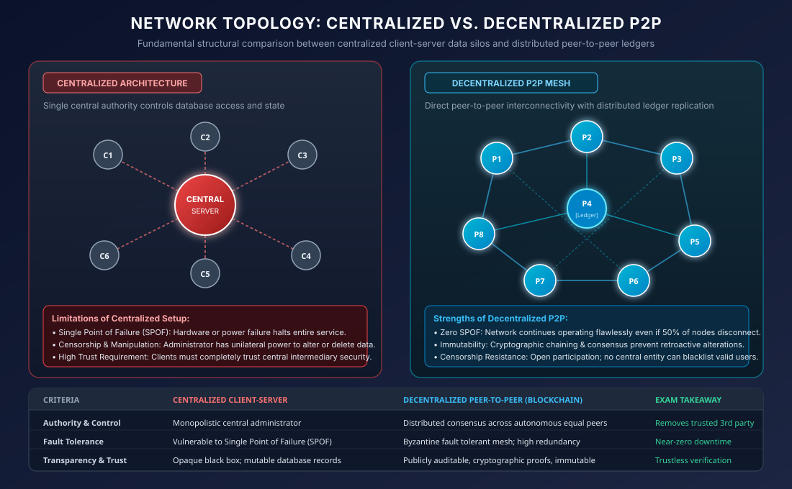
*Figure 1.1: Comprehensive comparison of Centralized Client-Server Architecture (left) versus Decentralized Peer-to-Peer Mesh Architecture (right).*

### Centralized Client-Server Architecture:
- **Topology:** Star topology where multiple peripheral clients connect directly to a single central server, database cluster, or mainframe.
- **Single Point of Failure (SPOF):** If the central server experiences hardware failure, power blackout, operating system corruption, or volumetric Denial-of-Service (DDoS) saturation, the entire network collapses instantly.
- **Trust Model:** Clients must place unconditional trust in the central entity. The server administrator retains unilateral capability to modify account balances, censor transactions, restrict access, or leak sensitive private records.
- **Throughput & Latency:** High transaction processing speed (thousands of transactions per second on centralized relational databases like PostgreSQL or Oracle) because state transitions require no distributed consensus rounds.

### Decentralized Peer-to-Peer (P2P) Architecture:
- **Topology:** Mesh network of autonomous peer nodes where every participant possesses equivalent communicative and protocol rights. Nodes act concurrently as clients and servers (servents).
- **High Fault Tolerance:** Redundancy is maximized. If 50% or more of nodes abruptly go offline, the remaining peers seamlessly continue block validation and transaction propagation without system interruption.
- **Trustless Verification:** Replaces institutional faith with cryptographic and mathematical validation. Every node independently executes deterministic protocol validation rules on every received block.
- **Throughput & Latency:** Inherently constrained by physical network propagation delays, geographic latency, bandwidth ceilings, and consensus confirmation intervals.

### Deep Comparative Matrix:

| Feature / Dimension | Centralized Client-Server | Decentralized Peer-to-Peer (Blockchain) |
| :--- | :--- | :--- |
| **Control Authority** | Central entity / Monopolistic administrator | Distributed consensus across autonomous peers |
| **Single Point of Failure** | High (Critical vulnerability at central server) | Zero (Resilient against massive node departure) |
| **Data Immutability** | Low (Database admin can `UPDATE` / `DELETE`) | Absolute (Append-only; cryptographically linked) |
| **Trust Requirement** | Requires implicit trust in 3rd party operator | Trustless; verified by cryptographic mathematics |
| **Transaction Latency** | Milliseconds ($< 10$ ms) | Minutes to hours depending on block confirmations |
| **Throughput (TPS)** | Extremely high (10,000 to 100,000+ TPS) | Low to moderate ($7$TPS in BTC,$30$ in ETH L1) |
| **Auditability** | Opaque black box; proprietary logs | Fully transparent and globally verifiable |
| **Censorship Resistance** | Nil; accounts can be frozen unilaterally | Extreme; valid cryptographic transactions cannot be stopped |

---

## 1.3 The Peer-to-Peer Paradigm: The BitTorrent Analogy
To contextualize decentralized data distribution, Dr. Sandhya P's lecture draws direct parallels between blockchain networks and the **BitTorrent Protocol** (created by Bram Cohen in 2001).

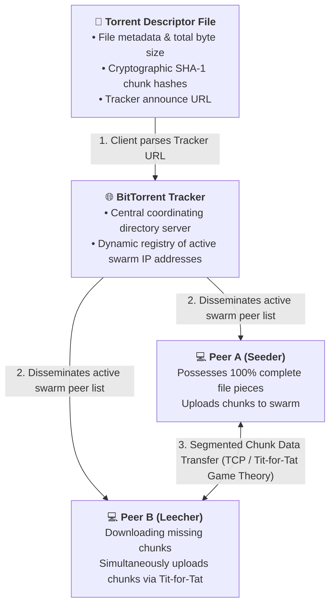

### Mechanics of the BitTorrent Protocol:
1. **The `.torrent` Descriptor File:** A lightweight metadata file downloaded via HTTP containing the file name, total size, cryptographic SHA-1 hashes of all individual file chunks (pieces), and the URL of the **tracker**.
2. **The Tracker & Swarm:** The tracker is a coordinating web server that maintains a dynamic registry of all active IP addresses downloading or uploading the file (collectively designated as the **swarm**).
3. **Peer Interactions (Seeding vs. Leeching):**
   - **Leecher:** A peer currently downloading missing pieces of the file from other swarm participants.
   - **Seeder:** A peer that has completed downloading 100% of the file chunks and leaves their client open to upload chunks to active leechers.
4. **Data Transfer Mechanics:** Files are segmented into uniform small chunks (e.g., 256 KB). Leechers download distinct chunks simultaneously from dozens of peers using TCP, exponentially accelerating aggregate throughput.
5. **Tit-for-Tat Incentive Algorithm:** BitTorrent enforces game-theoretic fairness via a "tit-for-tat" ranking algorithm: peers prioritize uploading chunks to nodes that upload back at high bandwidth, mathematically penalizing free-riders.

### The Critical Evolutionary Shift: BitTorrent vs. Blockchain
While both systems rely on decentralized P2P transport, their core operational goals diverge fundamentally:
- **BitTorrent transfers static, non-synchronized files:** Peers exchange independent, read-only data files (movies, software, datasets). If peer A alters a local file, it does not alter peer B's file, nor is there any concept of an evolving global shared state.
- **Blockchain enforces dynamic, synchronized global state:** The blockchain network not only transports transaction data across peers, but **enforces that every single peer maintains an identical, synchronized, byte-level copy of a dynamic ledger**. If any rogue node illegally modifies its local ledger, the network protocol detects the mathematical discrepancy and automatically isolates the rogue node.

---

## 1.4 Cryptographic Self-Sovereignty: Isolated Address Generation
A revolutionary architectural feature highlighted in Unit 1 is the ability for any user on Earth to generate a valid blockchain account **in complete physical isolation**, without connecting to the internet and without requesting permission from any registrar.

### The Traditional Banking Paradigm vs. Blockchain:
- **Traditional Banking:** Opening an account requires submitting government credentials (KYC/AML), passing credit verification, and having a bank administrator create a record inside a centralized relational database.
- **Blockchain System:** An account is simply a randomly generated 256-bit integer (the **private key**). Users generate their key pair completely offline (e.g., using `bitaddress.org` or paper wallet generators running on air-gapped computers).

### Mathematical Impossibility of Address Collisions:
How can millions of users generate random addresses without two users generating the exact same address?
- The private keyspace of Bitcoin is $2^{256} - 1$, which equals:

$$115,792,089,237,316,195,423,570,985,008,687,907,853,269,984,665,640,564,039,457,584,007,913,129,639,935$$

  (approximately $1.1579 \times 10^{77}$).
- The public address space (after SHA-256 and RIPEMD-160 hashing) is $2^{160} \approx 1.46 \times 10^{48}$.
- **The Birthday Paradox:** To achieve even a $0.000000001\%$ probability of an address collision, the global population would need to generate billions of addresses per second for thousands of years. The keyspace exceeds the estimated number of atoms in the observable universe ($10^{80}$). Hence, address uniqueness is mathematically guaranteed.

---

## 1.5 Cloud Computing Paradigm vs. Blockchain & The Oracle Problem
Modern enterprise software architectures increasingly contrast centralized cloud computing with decentralized blockchain networks.

### Cloud Computing vs. Blockchain:
- **Cloud Computing (AWS, Microsoft Azure, Google Cloud):** Provides centralized, elastic, high-performance compute and storage. Cloud instances execute opaque business logic on proprietary server infrastructure rented from monopolistic tech vendors.
- **Blockchain Paradigm:** Provides a trustless, transparent, replicated state machine. Blockchain execution is intentionally redundant: thousands of nodes execute the identical transaction to cryptographically verify state validity. It is optimized for **trust and verifiable correctness**, not raw computational throughput.

### The Oracle Problem:
A fundamental architectural limitation highlighted on slides 21–22 of Unit 1 is that **blockchains are deterministic, self-contained computational environments that cannot access data outside their native network**.
- A smart contract cannot natively execute an HTTP `GET` request to check real-world stock prices, flight schedules, weather data, or foreign exchange rates because doing so would introduce non-determinism (different nodes would receive different HTTP responses at different times, breaking consensus).
- **Oracles:** Third-party decentralized middleware services (known as **oracles**, e.g., Chainlink) that securely fetch, authenticate, and cryptographically sign external real-world data feeds, feeding them into the blockchain runtime environment for smart contract execution.

---

# Section 2: Storage Architecture & Block Size Dynamics

## 2.1 The Anatomy of a Block
A blockchain consists of an ordered sequence of blocks. Every block is logically separated into two distinct layers: the **Block Header** (fixed-size metadata) and the **Block Body** (variable-size transaction payload).

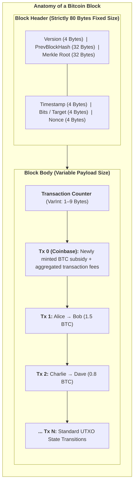

| Block Component | Section | Data Field | Byte Size | Description & Function |
| :--- | :--- | :--- | :---: | :--- |
| **Block Header** | Metadata | `Version` | 4 Bytes | Protocol version number tracking client software & BIP upgrade votes |
| **Block Header** | Metadata | `PrevBlockHash` | 32 Bytes | Double SHA-256 hash of previous block header; creates immutable chain |
| **Block Header** | Metadata | `MerkleRoot` | 32 Bytes | Binary tree root digest cryptographically committing to all transactions |
| **Block Header** | Metadata | `Timestamp` | 4 Bytes | Unix epoch time (seconds) marking when block was mined |
| **Block Header** | Metadata | `Bits` / Target | 4 Bytes | Compact floating-point encoding of the PoW mathematical difficulty threshold |
| **Block Header** | Metadata | `Nonce` | 4 Bytes | 32-bit counter iterated by miners to solve the Hashcash condition |
| **Block Body** | Payload | `Tx_Counter` | 1–9 Bytes | Variable-length integer declaring total transactions serialized in block |
| **Block Body** | Payload | `Coinbase Tx` | Variable | First transaction; mints block reward and collects accumulated transaction fees |
| **Block Body** | Payload | `Transactions` | Variable | Array of user-submitted peer-to-peer financial state transfers ($Tx_1 \dots Tx_N$) |

### The Six Fields of the Bitcoin Block Header (Strictly 80 Bytes):
1. **Version (4 Bytes):** Protocol version number tracking client software and soft fork voting flags.
2. **Previous Block Hash (32 Bytes):** The double SHA-256 hash of the parent block header. This field creates the unbreakable cryptographic chain back to Genesis.
3. **Merkle Root Hash (32 Bytes):** The aggregate cryptographic root hash of all transactions contained within the block body, generated via a binary Merkle tree.
4. **Timestamp (4 Bytes):** Current Unix epoch time (seconds since Jan 1, 1970). Must be greater than the median timestamp of the prior 11 blocks and less than the network-adjusted time plus 2 hours.
5. **Bits / Difficulty Target (4 Bytes):** Compact 32-bit floating-point representation of the current Proof-of-Work mathematical target threshold.
6. **Nonce (4 Bytes):** A 32-bit counter initialized to zero and incremented by miners during PoW hashing to discover a header hash below the Target.

---

## 2.2 The Binary Merkle Tree
Transactions inside the block body are organized into a cryptographic binary hash tree named after Ralph Merkle (1979).

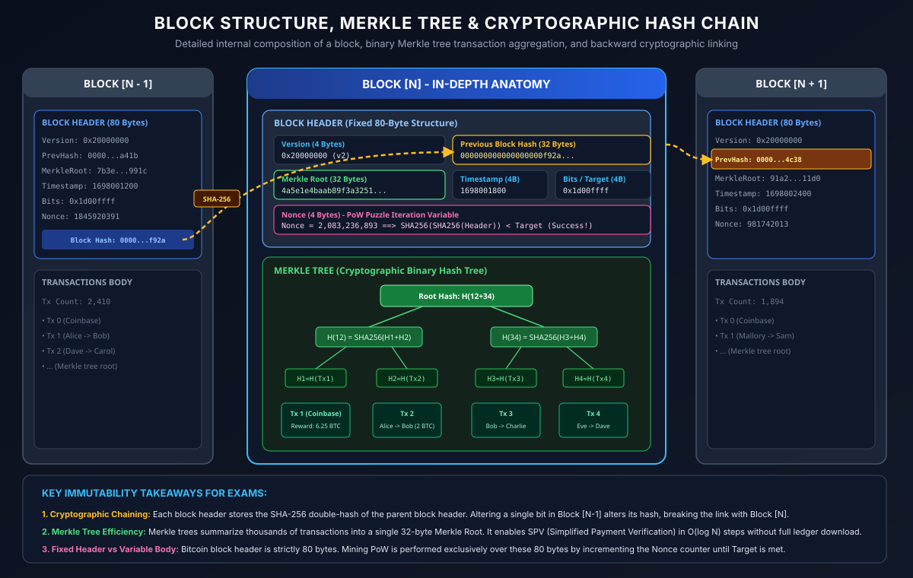
*Figure 2.1: Block linking architecture, internal 80-byte header composition, and Merkle tree transaction aggregation.*

### Mathematical Construction:
Given four transactions $Tx_A, Tx_B, Tx_C, Tx_D$:
1. **Leaf Hashes:** Compute the double SHA-256 hash of each individual transaction:
   $$H_A = \text{SHA256}(\text{SHA256}(Tx_A))$$
   $$H_B = \text{SHA256}(\text{SHA256}(Tx_B))$$
   $$H_C = \text{SHA256}(\text{SHA256}(Tx_C))$$
   $$H_D = \text{SHA256}(\text{SHA256}(Tx_D))$$
2. **Intermediate Parent Nodes:** Concatenate adjacent sibling hashes and double SHA-256 hash the combined string:
   $$H_{AB} = \text{SHA256}(\text{SHA256}(H_A \mathbin{\Vert} H_B))$$
   $$H_{CD} = \text{SHA256}(\text{SHA256}(H_C \mathbin{\Vert} H_D))$$
3. **Merkle Root:** Concatenate the intermediate hashes to produce the 32-byte Merkle root:
   $$\text{Merkle Root} = \text{SHA256}(\text{SHA256}(H_{AB} \mathbin{\Vert} H_{CD}))$$
4. **Odd Transaction Handling:** If a block contains an odd number of transactions, the final unpaired transaction hash is duplicated and hashed with itself.

### Merkle Tree Advantages in Blockchain:
- **Simplified Payment Verification (SPV):** Lightweight clients (e.g., mobile wallets) do not need to download the entire multi-gigabyte blockchain. To verify that transaction $Tx_C$ is included in Block $N$, an SPV client downloads only the 80-byte block header and an authentication path (a **Merkle Proof**) consisting of $H_D$ and $H_{AB}$. The client computes:
  $$\text{Root}' = \text{SHA256}(\text{SHA256}(H_{AB} \mathbin{\Vert} \text{SHA256}(\text{SHA256}(H_C \mathbin{\Vert} H_D))))$$
  If $\text{Root}' == \text{Header.MerkleRoot}$, inclusion is mathematically verified in $O(\log_2 N)$ time and space!
- **Instant Tamper Detection:** Changing a single satoshi or character inside $Tx_A$ changes $H_A$, which changes $H_{AB}$, which completely changes the Merkle Root, invalidating the 80-byte header hash.

---

## 2.3 Block Size Inferences & Complexities
In 2010, Satoshi Nakamoto introduced an explicit **1 Megabyte (1 MB) block size limit** into the Bitcoin Core codebase. Dr. Sandhya P's lecture outlines the precise technical inferences, trade-offs, and scaling debates surrounding this parameter.

### Why Introduce a Block Size Limit? (Anti-Spam Rationale)
- In early Bitcoin, there was no hard ceiling on block size.
- A malicious actor could generate a 100 MB or 1 GB block containing millions of bogus zero-fee transactions.
- Nodes attempting to download, parse, verify cryptographic signatures for, and store such monster blocks would run out of RAM, experience CPU starvation, and crash.
- Hence, the 1MB ceiling was deployed as a critical defensive firewall against volumetric network spam.

### Complexities & Dangers of Uncontrolled Bigger Blocks:
Why not simply raise the block size to 32MB, 128MB, or 1GB to achieve high transaction throughput?
1. **Exponential Node Storage Costs:** Larger blocks accelerate ledger growth exponentially. A 100MB block every 10 minutes generates over 5.2 Terabytes of ledger data annually, pricing regular hobbyist nodes out of the network.
2. **Bandwidth Costs & Propagation Delay:** Large blocks require significant time to propagate across global peer-to-peer gossip hops. Nodes in regions with lower internet bandwidth receive blocks seconds or minutes later than high-bandwidth data centers.
3. **Elevated Orphan / Stale Block Rates:** When propagation latency is high, miners frequently discover competing blocks at the same height concurrently because they have not yet received the latest block. This leads to frequent network forks and high orphan rates, wasting immense mining energy.
4. **Centralization Pressure:** High orphan rates unfairly disadvantage small, geographically distributed miners. Mining power centralizes into large commercial mining pools situated inside high-speed data centers in the same geographic regions, destroying decentralization.
5. **Initial Block Download (IBD) Bootstrapping Bottleneck:** A newly initialized full node must download and cryptographically validate every transaction since the Genesis block (2009). If historical blocks were massive, bootstrapping a new node would require months of CPU verification time.

---

## 2.4 The Segregated Witness (SegWit - BIP 141) Upgrade
In August 2017, Bitcoin Core implemented **Segregated Witness (SegWit)** as a backwards-compatible **Soft Fork** to scale transaction throughput without executing a hazardous Hard Fork.

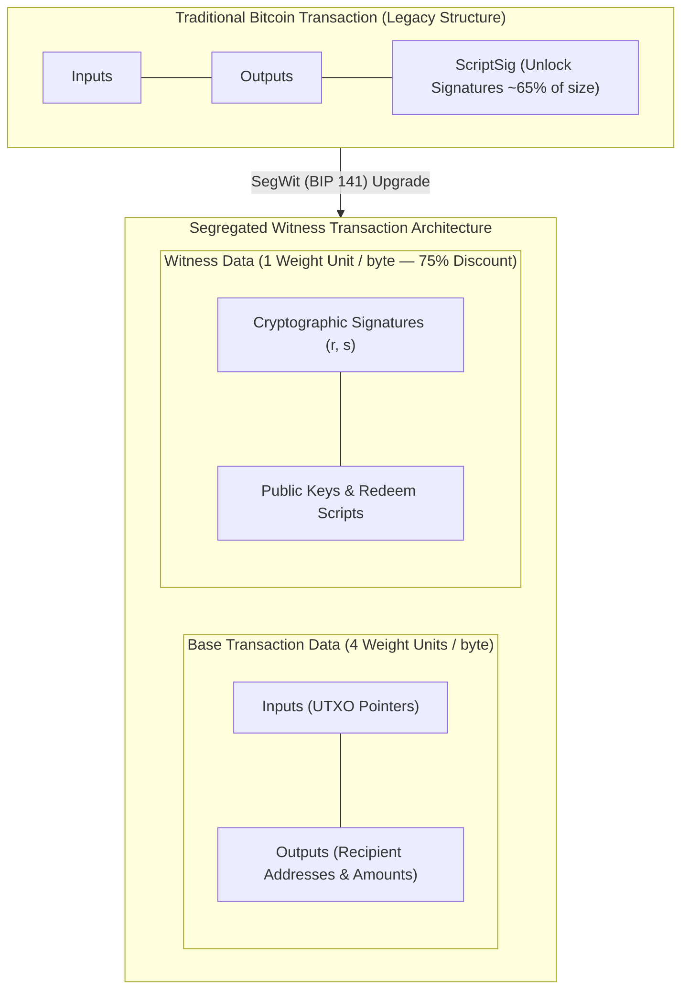

| Dimension | Traditional Bitcoin Transaction | SegWit (BIP 141) Transaction |
| :--- | :--- | :--- |
| **Signature Location** | Inlined inside inputs (`scriptSig`) | Segregated into separate Witness data structure |
| **Size Accounting Metric** | Byte Size (Capped at 1,000,000 Bytes) | Block Weight (Capped at 4,000,000 Weight Units) |
| **Weight Cost per Byte** | 1 byte = 4 WU (Uniformly counted) | Base data: 4 WU/byte; Witness data: 1 WU/byte (75% discount) |
| **Effective Block Capacity** | ~1.0 MB (~3–7 TPS) | ~2.0 MB to 2.4 MB (theoretical max 4.0 MB) |
| **Transaction Malleability** | Vulnerable (Signatures alter TxID hash) | Completely Eliminated (Witness excluded from TxID) |

### The SegWit Mechanism:
- **Separation of Witness Data:** SegWit mathematically decoupled the cryptographic signature scripts (`scriptSig` / witness) from the core serialization of transaction inputs and outputs.
- **Replacement of Size with Block Weight:** Replaced the rigid 1,000,000-byte limit with a **4,000,000 Weight Unit (WU)** limit defined by the formula:
  $$\text{Block Weight} = (\text{Base Transaction Size} \times 3) + \text{Total Serialized Size} \le 4,000,000 \text{ WU}$$
- **The 75% Witness Discount:** Because witness data counts as only 1 WU per byte while non-witness base data counts as 4 WU per byte, miners are incentivized to include SegWit transactions.
- **Effective Capacity Expansion:** This mathematical restructuring yielded an effective block capacity of approximately **2 MB to 2.4 MB** under standard usage (with a theoretical upper limit of 4 MB for witness-dense blocks), all while maintaining strict backward compatibility with legacy nodes.

---

# Section 3: Layered Architecture of Blockchain

Slides 2–6 of `Unit-5_COMPLETE.pdf` define the foundational **Layered Architecture of Blockchain Systems**. Modern distributed ledgers decouple their functionalities into five distinct, hierarchically stacked architectural layers:

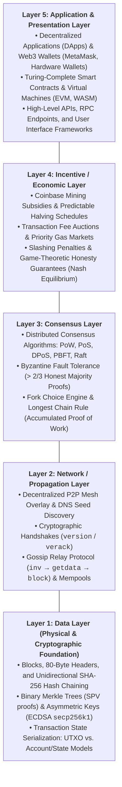

| Layer | Architecture Layer | Core Primitives & Technologies | Primary Operational Responsibilities |
| :---: | :--- | :--- | :--- |
| **5** | **Application & Execution** | DApps, Smart Contracts, EVM, MetaMask, RPC APIs | Front-end user interaction, decentralized business logic execution |
| **4** | **Incentive / Economic** | Coinbase rewards, Halving, Tx fees, Slashing | Aligning self-interested economic behavior with network security |
| **3** | **Consensus** | PoW (Hashcash), PoS, DPoS, PBFT, Nakamoto rule | Global state synchronization and fault tolerance across untrusted peers |
| **2** | **Network / Propagation** | P2P overlay, Gossip flooding, DNS seeds, Mempool | Node discovery, connection maintenance, inventory data broadcast |
| **1** | **Data Layer** | Blocks, SHA-256 chaining, Merkle trees, ECDSA | Low-level cryptographic data structures and disk persistence |

---

## 3.1 Layer 1: The Data Layer
The Data Layer serves as the bedrock of the blockchain stack, defining how state, transactions, and cryptographic proofs are structured, formatted, and immutably recorded on local disk storage.
- **Core Components:** Data blocks, transaction serialization formats (e.g., Bitcoin UTXO model, Ethereum Account model), binary Merkle trees, SHA-256 cryptographic hashes, and asymmetric key pairs.
- **Chain Structure:** Enforces that every block header explicitly embeds the cryptographic hash of its predecessor, creating a unidirectional linked list of blocks that anchors all historical state back to the hardcoded **Genesis Block (Block 0)**.
- **Cryptographic Protocols:** Implements low-level mathematical primitives including elliptic curves (`secp256k1`), digital signature generation/verification, and base encoding schemes (`Base58Check`, `Bech32`).

---

## 3.2 Layer 2: The Network Layer
The Network Layer governs peer-to-peer communications, node discovery, connection handshakes, and data transmission across the global internet.
- **P2P Discovery & Handshakes:** When a new node launches, it queries hardcoded DNS seed addresses to discover active peers. Nodes perform a two-way version handshake (`version` and `verack` messages in Bitcoin) to negotiate protocol capabilities and synchronize system clocks.
- **Gossip Relay Protocol:** Enforces epidemic propagation (flooding algorithm). When a node validates a new transaction or block, it broadcasts an inventory message (`inv`) to its connected peers. Peers request unseen items via `getdata` and receive them via `tx` or `block` messages.
- **The Memory Pool (Mempool):** Every validating node maintains an in-memory staging buffer (the **mempool**) containing valid unconfirmed transactions waiting to be selected and packaged into blocks by miners.

---

## 3.3 Layer 3: The Consensus Layer
The Consensus Layer is the core engine of trust in a blockchain network. It ensures that thousands of mutually untrusted, geographically dispersed, anonymous nodes agree on a single, authoritative, immutable state of the ledger.
- **Consensus Protocols:** Implements algorithmic mechanisms such as Proof of Work (PoW), Proof of Stake (PoS), Delegated Proof of Stake (DPoS), or Practical Byzantine Fault Tolerance (PBFT).
- **Byzantine Agreement Threshold:** Enforces that state finalization requires an honest supermajority voting threshold, mathematically proved by Leslie Lamport to be strictly greater than $2/3$ ($> 66.7\%$) of participating voting power to tolerate up to $1/3$ arbitrary Byzantine traitors.
- **Fork Resolution Engine:** Defines deterministic rules (e.g., Nakamoto's Longest Chain Rule / Heaviest Cumulative Proof of Work) to resolve temporary network splits and race conditions.

---

## 3.4 Layer 4: The Incentive (Economic) Layer
The Incentive Layer aligns the rational, self-interested economic behavior of participating nodes with the security and integrity of the overall network.
- **Block Rewards (Coinbase Subsidy):** Newly minted native cryptocurrency awarded to the miner/forger who successfully appends a valid block (e.g., Bitcoin started at 50 BTC in 2009, halving every 210,000 blocks to 25, 12.5, 6.25, and 3.125 BTC).
- **Transaction Fees:** Senders attach discretionary fees to their transactions. Miners prioritize transactions offering the highest fee-per-byte (or fee-per-weight-unit), establishing a dynamic market auction for block space.
- **Economic Penalties (Slashing):** In modern Proof of Stake systems, the incentive layer enforces slashing rules: if a validator signs contradictory blocks or goes offline, a portion or all of their locked capital is confiscated.
- **Game Theoretic Equilibrium:** Leverages Nash Equilibrium to ensure that honesty is strictly more profitable than attempting to defraud the network.

---

## 3.5 Layer 5: The Application & Execution Layer
The Application Layer sits at the top of the stack, providing human-facing interfaces, execution environments, and programmatic interfaces.
- **Execution Engines & Smart Contracts:** Turing-complete virtual machines (such as the Ethereum Virtual Machine - EVM) that execute deterministic computer code stored directly on the blockchain.
- **Decentralized Applications (DApps):** Front-end interfaces (built using HTML, CSS, JavaScript, React) connected to blockchain RPC endpoints via libraries like `ethers.js` or `web3.js`.
- **User Tools:** Non-custodial cryptocurrency wallets (MetaMask, Ledger, Trezor), block explorers (Etherscan, Blockchain.com), and decentralized identity systems.

---

# Section 4: Blockchain Types & Taxonomy

Blockchains are categorized based on their governance model, access permissions, and consensus participant eligibility into three primary paradigms: **Public (Permissionless)**, **Private (Permissioned)**, and **Consortium (Federated)**.

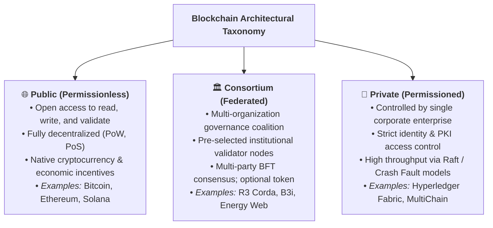

---

## 4.1 Public (Permissionless) Blockchains
- **Access Control:** Completely open and permissionless. Anyone on Earth can join as a user, run a full validating node, or participate in mining/staking without credentials.
- **Consensus Model:** Fully decentralized algorithms (PoW, PoS) with economic incentive layers to protect against Sybil attacks.
- **Data Visibility:** 100% transparent. Every transaction is globally auditable on public ledgers.
- **Examples:** Bitcoin, Ethereum, Litecoin, Monero.

## 4.2 Private (Permissioned) Blockchains
- **Access Control:** Strictly restricted to authorized members of a single enterprise or corporation. A central identity management service (e.g., PKI Certificate Authority) issues cryptographic credentials.
- **Consensus Model:** Lightweight, non-PoW consensus protocols (e.g., Raft, PBFT, Crash Fault Tolerant algorithms). No native cryptocurrency or incentive layer is required.
- **Data Visibility:** Granular read/write permissions governed by internal corporate access policies.
- **Examples:** Hyperledger Fabric, Multichain, Ripple (internal ledger).

## 4.3 Consortium (Federated) Blockchains
- **Access Control:** Governed not by a single entity, but by a pre-selected coalition of distinct organizations (e.g., a consortium of 15 commercial banks or shipping logistics providers).
- **Consensus Model:** Multi-signature Byzantine agreement protocols where block finalization requires the cryptographic signatures of a predefined threshold (e.g., 10 out of 15 institutional nodes).
- **Data Visibility:** Accessible strictly to consortium participants or authorized external regulators.
- **Examples:** R3 Corda, B3i (Insurance consortium), Energy Web Chain.

---

## 4.4 Master Comparative Taxonomy Matrix

| Feature / Dimension | Public (Permissionless) | Consortium (Federated) | Private (Permissioned) |
| :--- | :--- | :--- | :--- |
| **Network Access & Read Permission** | Public; open to any global user | Restricted to consortium member entities | Strictly restricted to single internal organization |
| **Write / Transaction Submission** | Anyone with native tokens for fees | Pre-authorized consortium participants | Authorized internal employees / departments |
| **Consensus Participants** | Anonymous global miners / validators | Pre-selected known institutional nodes | Centralized designated internal nodes |
| **Governance Structure** | Decentralized; community-driven | Multi-organizational federation | Centralized enterprise leadership |
| **Transaction Throughput** | Low ($7$ to $35$ TPS on L1) | High (\$1,000$ to \$5,000 +$ TPS) | Ultra-high (\$5,000$ to \$20,000 +$ TPS) |
| **Settlement Finality** | Probabilistic (Minutes to 1 hour) | Immediate / Deterministic (Seconds) | Immediate / Deterministic (Milliseconds) |
| **Energy Consumption** | High (in PoW) to Low (in PoS) | Negligible (No compute puzzle) | Negligible (Crash fault algorithms) |
| **Incentive / Token Layer** | Mandatory (Mining subsidies, fees) | Optional (Can operate tokenless) | Unnecessary (No native cryptocurrency needed) |
| **Immutability Guarantee** | Nearly impossible to roll back | High (Requires cartel collusion) | Low (Can be overridden by enterprise admin) |
| **Vulnerability to 51% Attack** | Requires massive hashrate/capital | Collusion of $> 33\%$ of consortium | Central authority controls 100% of network |
| **Primary Use Cases** | Sovereign money, DeFi, open Web3 | Inter-bank clearing, supply chains | Internal audit logs, inter-departmental state |

---

# Section 5: Cryptography in Blockchain

## 5.1 Symmetric vs. Asymmetric Cryptography
Slides 23–26 of Unit 1 establish the cryptographic underpinnings of blockchain security by contrasting symmetric and asymmetric key systems.

### Symmetric Key Cryptography:
- **Mechanism:** Uses a single shared secret key ($K$) for both encryption and decryption:
  $$\text{Ciphertext} = E_K(\text{Plaintext}), \quad \text{Plaintext} = D_K(\text{Ciphertext})$$
- **The Key Exchange Problem:** Before two parties can communicate securely, they must exchange the secret key over an insecure transmission medium. If an eavesdropper intercepts the key during this handshake, all confidentiality is broken.
- **Application:** Bulk data encryption (AES-256) where keys have already been securely established.

### Asymmetric (Public-Key) Cryptography:
- **Mechanism:** Uses a mathematically linked **key pair**:
  - **Private Key ($k$):** A closely guarded secret number known strictly to the owner. Used to generate digital signatures and decrypt incoming messages.
  - **Public Key ($K$):** A publicly disseminated mathematical derivative. Used by anyone to verify digital signatures and encrypt messages intended for the owner.
- **Resolution of Key Exchange:** The public key can be openly published on billboards or public websites. Anyone can encrypt a message using the recipient's public key; only the recipient's private key can decrypt it.

---

## 5.2 Elliptic Curve Cryptography & ECDSA in Bitcoin
Bitcoin adopts the **Elliptic Curve Digital Signature Algorithm (ECDSA)** over the specific standardization curve known as **`secp256k1`** (defined by the Standards for Efficient Cryptography Consortium).

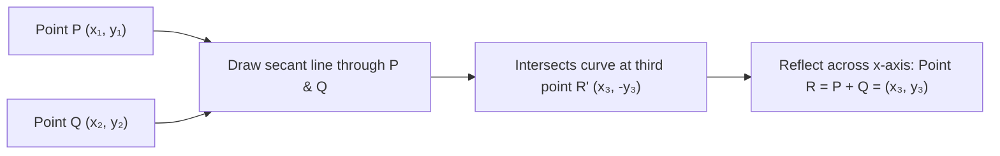

> [!NOTE]
> **Geometric Group Law on the `secp256k1` Curve ($y^2 = x^3 + 7$):**  
> The elliptic curve is mathematically symmetric across the horizontal $x$-axis. For any point $P = (x, y)$ on the curve, its inverse is $-P = (x, -y)$. Group addition ($P + Q = R$) is computed by drawing a straight line through $P$ and $Q$, which intersects the cubic curve at exactly one third point $R' = (x_R, -y_R)$, whose reflection across the $x$-axis yields the sum $R = (x_R, y_R)$. Point doubling ($2P = P + P$) uses the tangent line at $P$.

### The Mathematical Formula:
The `secp256k1` elliptic curve is defined over the finite field $\mathbb{F}_p$ by the Weierstrass equation:
$$y^2 \equiv x^3 + 7 \pmod p$$
where $p$ is a 256-bit prime number chosen specifically for computational efficiency:
$$p = 2^{256} - 2^{32} - 977$$

### Key Generation Pipeline:
1. **The Private Key ($k$):** A randomly sampled 256-bit integer selected from the range:
   $$k \in [1, n - 1]$$
   where the order $n \approx 1.1579 \times 10^{77}$.
2. **The Generator Point ($G$):** A fixed, standardized coordinate on the curve:
   $$G = (x_G, y_G)$$
3. **Public Key Derivation ($K$):** The public key is derived by performing **elliptic curve scalar point multiplication**:
   $$K = k \times G = \underbrace{G + G + G + \dots + G}_{k \text{ times}}$$
4. **The Discrete Logarithm Problem (Trapdoor Guarantee):** Point multiplication ($k \times G$) is computationally trivial to compute in $O(\log_2 k)$ steps using the "double-and-add" algorithm. However, given public key $K$ and base point $G$, reversing the calculation to discover private key $k$ is the **Elliptic Curve Discrete Logarithm Problem (ECDLP)**, for which no polynomial-time classical algorithm exists. Solving it requires on the order of $\sqrt{n} \approx 2^{128}$ operations—taking millions of years on modern supercomputers.

---

## 5.3 Bitcoin Address Derivation Architecture
A Bitcoin address is not identical to a public key; it is a compact, cryptographic digest designed to minimize transaction sizes and provide quantum resistance.

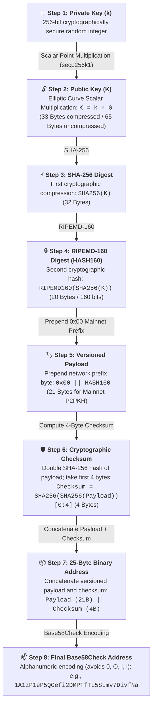

| Step | Stage Name | Input | Cryptographic Operation | Output Size / Format |
| :---: | :--- | :--- | :--- | :--- |
| **1** | **Private Key ($k$)** | CSPRNG entropy source | Random 256-bit integer sampling | 32 Bytes (256 bits) |
| **2** | **Public Key ($K$)** | Private key $k$, Generator point $G$ | Scalar multiplication: $K = k \times G$ | 33 Bytes (comp.) / 65 Bytes (uncomp.) |
| **3** | **SHA-256 Digest** | Public Key $K$ | $\text{SHA256}(K)$ | 32 Bytes (256 bits) |
| **4** | **RIPEMD-160 (HASH160)**| SHA-256 digest | $\text{RIPEMD160}(\text{SHA256}(K))$ | 20 Bytes (160 bits, Public Key Hash) |
| **5** | **Version Prefix** | Public Key Hash | Prepend `0x00` Mainnet version byte | 21 Bytes |
| **6** | **Checksum Calculation**| 21-byte Versioned Payload | First 4 bytes of $\text{SHA256}(\text{SHA256}(\text{Payload}))$ | 4 Bytes |
| **7** | **Payload Assembly** | Versioned Payload + Checksum | Concatenation: $\text{Payload} \mathbin{\Vert} \text{Checksum}$ | 25 Bytes |
| **8** | **Base58Check Address** | 25-byte binary structure | Base58 encoding (eliminates `0`, `O`, `I`, `l`) | 26–35 characters (Starts with `1`) |

### Why Double Hashing (SHA-256 followed by RIPEMD-160)?
1. **Bandwidth Optimization:** Compresses the 65-byte uncompressed public key down to a 20-byte hash, substantially reducing the on-chain footprint of UTXOs.
2. **Quantum Pre-Image Protection:** The actual public key is never revealed on the public blockchain until the recipient spends their coins. Even if an adversary possesses a quantum computer capable of cracking ECDLP (via Shor's Algorithm), they cannot derive the public key from the RIPEMD-160 hash because cryptographic hashes are one-way trapdoors.
3. **Base58Check Encoding:** Replaces standard Base64 by removing ambiguous visual characters (`0` vs `O`, `I` vs `l`) and appends a 4-byte cryptographic checksum to detect typing errors instantly.

---

## 5.4 Cryptographic Hash Functions & Their Core Properties
A **cryptographic hash function** is an algorithm that takes an arbitrary-length string of input data and compresses it into a deterministic, fixed-length bit digest (e.g., 256 bits).

### The Five Inviolable Properties of Cryptographic Hash Functions:
1. **Deterministic:** For any given input string $M$, the function always yields the exact same hash digest $H(M)$.
2. **High Computational Efficiency:** Given message $M$, computing the digest $H(M)$ requires negligible CPU time ($O(n)$ linear in input length).
3. **Pre-Image Resistance (One-Way Trapdoor):** Given an arbitrary hash digest $y$, it is computationally impossible to find any input $x$ such that $H(x) = y$. The only attack vector is brute-force guessing ($2^{256}$ operations).
4. **Avalanche Effect (Weak Correlation):** A microscopic 1-bit alteration in the input message completely randomizes the resulting digest, changing approximately 50% of the output bits in an uncorrelated pattern.
5. **Collision Resistance:** It is computationally infeasible to locate any two distinct messages $m_1 \ne m_2$ such that $H(m_1) = H(m_2)$. (By the Birthday Paradox, finding a collision in a 256-bit hash space requires $2^{128}$ computations).

### Pedagogical Analysis: Why Trivial Functions Fail
Unit 1 (Slide 38) presents the pedagogical example: *Can "take the first character of a string" serve as a cryptographic hash function?*
- `Hash("What time is it?")` $\rightarrow$ `'W'`
- **Property 1 (Deterministic):** Passes. `'What time is it?'` always hashes to `'W'`.
- **Property 2 (Quick to compute):** Passes. Extraction takes $O(1)$ time.
- **Property 3 (Pre-image Resistance):** Fails. Knowing `'W'` allows anyone to guess a valid pre-image instantly (`"Water"`).
- **Property 4 (Avalanche Effect):** Fails. Changing `"What time is it?"` to `"What time is at?"` yields the exact same output `'W'`.
- **Property 5 (Collision Resistance):** Completely fails. Any string starting with `'W'` collides.

### Prominent Cryptographic Hash Algorithms:
- **MD5 (128-bit):** Broken. Collision attacks discovered in 2004; obsolete.
- **SHA-1 (160-bit):** Broken. Practical collision achieved by Google in 2017 (SHAttered attack); deprecated.
- **SHA-256 (256-bit):** Part of the SHA-2 family designed by the NSA. Standard in Bitcoin; zero known collisions.
- **Keccak-256 (256-bit):** Winner of the SHA-3 competition. Adopted as the primary hash function in Ethereum.

---

## 5.5 Electronic Signatures vs. Digital Signatures
Dr. Sandhya P's lecture highlights the critical distinction between generic **electronic signatures** and cryptographic **digital signatures**.

| Attribute | Generic Electronic Signature | Cryptographic Digital Signature |
| :--- | :--- | :--- |
| **Mechanism** | Stylized bitmap, scanned wet-ink image, checkbox | Complex asymmetric mathematical algorithm (ECDSA/RSA) |
| **Tamper Detection** | Nil; document text can be altered without altering the image | Absolute; any bit change invalidates verification |
| **Reusability / Copying** | High risk; graphic can be copy-pasted onto another document | Impossible; signature $(r, s)$ is cryptographically bound to that exact data |
| **Verification Authority** | Subjective visual inspection or centralized server log | Objective mathematical verification by any node offline |
| **Legal Status** | Accepted in basic contracts, high fraud risk | Cryptographic standard for non-repudiation and financial transfer |

---

## 5.6 Digital Signature Lifecycle: Signing & Verification
A digital signature mathematically couples a specific message with a specific private key, allowing anyone with the corresponding public key to verify authenticity.

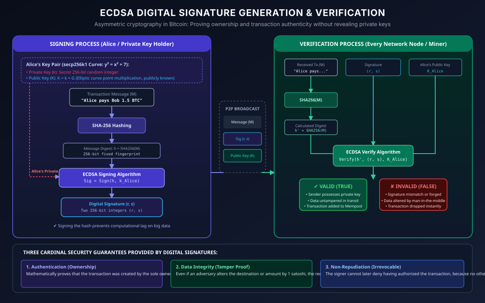
*Figure 5.1: Complete lifecycle of an ECDSA digital signature: signing phase by sender (left), transmission (center), and verification phase by network peers (right).*

### Step-by-Step Signing Algorithm (Sender - Alice):
1. Alice prepares the raw transaction message $M$ (`"Alice pays Bob 1.5 BTC"`).
2. Alice hashes the message to produce a fixed 256-bit digest:
   $$h = \text{SHA256}(\text{SHA256}(M))$$
3. Alice generates a cryptographically secure random nonce $k_{\text{eph}} \in [1, n-1]$.
4. Alice computes the curve point $(x_1, y_1) = k_{\text{eph}} \times G$, setting:
   $$r = x_1 \pmod n$$
5. Alice computes the signature proof component $s$:
   $$s = k_{\text{eph}}^{-1} \times (h + r \cdot k_{\text{Alice}}) \pmod n$$
6. The digital signature consists of the integer pair $(r, s)$.
7. **Why Sign the Hash Instead of the Full Message?**
   - Signing multi-gigabyte or variable-length messages directly using elliptic curve arithmetic is computationally expensive.
   - Hashing reduces any arbitrary message down to a strict 32-byte digest, ensuring signature generation and verification execute in constant $O(1)$ time.

### Step-by-Step Verification Algorithm (Verifier - Bob / Network Nodes):
1. Verifier receives Message $M$, Signature $(r, s)$, and Alice's Public Key $K_{\text{Alice}}$.
2. Verifier checks that $r, s \in [1, n-1]$.
3. Verifier independently computes the message digest:
   $$h' = \text{SHA256}(\text{SHA256}(M))$$
4. Verifier computes intermediate scalars:
   $$w = s^{-1} \pmod n$$
   $$u_1 = h' \times w \pmod n, \quad u_2 = r \times w \pmod n$$
5. Verifier computes the elliptic curve point:
   $$(x_v, y_v) = u_1 \times G + u_2 \times K_{\text{Alice}}$$
6. **Verification Condition:** If $x_v \equiv r \pmod n$, the signature is **VALID (TRUE)**; otherwise, **INVALID (FALSE)**.

### The Three Cardinal Security Guarantees:
1. **Authentication:** Mathematically proves that the message was approved by the sole possessor of private key $k_{\text{Alice}}$.
2. **Data Integrity:** If an adversary intercepts $M$ and alters the recipient address or amount by a single bit, the recalculated hash $h'$ will not equal $h$, causing verification to fail.
3. **Non-Repudiation:** The signer cannot claim after the fact that they did not author the transaction, because no other entity in the universe could have computed $(r, s)$.

---

# Section 6: Consensus Mechanisms & Distributed Agreement

A distributed consensus algorithm is a protocol through which a network of autonomous, mutually untrusted nodes achieves unanimous agreement regarding the global state of a distributed system.

---

## 6.1 The Two Generals Problem
The Two Generals Problem is a classic thought experiment in computer science demonstrating the **fundamental impossibility of achieving deterministic consensus over an unreliable, asynchronous communication channel**.

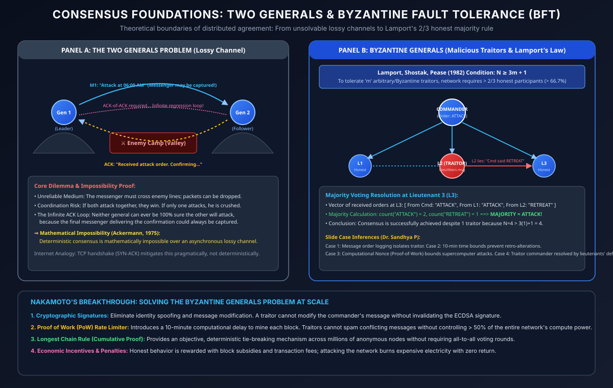
*Figure 6.1: The Two Generals Problem (left) and the Byzantine Generals Problem with Lamport's 2/3 honest majority threshold (right).*

### The Scenario:
- Two allied armies, commanded by **General 1** and **General 2**, encamp on opposite hills surrounding an enemy fortress located in a valley.
- The two generals must launch a simultaneous attack to capture the fortress. If both attack simultaneously, they conquer the enemy; if either attacks alone, the solitary general's army will be annihilated.
- The only way to communicate is by sending foot messengers across the valley, where they risk being captured, killed, or replaced by enemy forces.

### The Infinite Acknowledgment (ACK) Dilemma:
1. General 1 sends a messenger to General 2: `"Attack at dawn (06:00 AM)"`.
2. The messenger successfully arrives. General 2 wants to attack, but knows General 1 will not attack without confirmation that the message was received.
3. General 2 sends an acknowledgment (ACK): `"Received order. Will attack at 06:00 AM"`.
4. The ACK arrives at General 1. Can General 1 attack? **No!** General 1 knows General 2 is waiting to confirm whether General 1 received the ACK. If the ACK had been captured, General 2 would not attack.
5. General 1 must send an ACK-of-the-ACK.
6. This dynamic generates an **infinite regress of acknowledgments**:
   $$\text{Message} \longrightarrow \text{ACK}_1 \longleftarrow \text{ACK}_2 \longrightarrow \text{ACK}_3 \dots$$
7. **Mathematical Conclusion (Akkoyunlu et al., 1975):** Deterministic consensus cannot be achieved over an unreliable communication link. No finite sequence of acknowledgments can ever eliminate the risk of the final messenger being captured.

---

## 6.2 The Byzantine Generals Problem & Lamport's Proof
In 1982, Leslie Lamport, Robert Shostak, and Marshall Pease generalized the coordination problem to arbitrary networks containing active **traitors (Byzantine nodes)** who send false, conflicting, or maliciously coordinated messages.

### Lamport's Fundamental Theorem:
> For any distributed messaging system to tolerate $m$ arbitrary Byzantine traitors, the total number of participants $N$ must satisfy:
> $$N \ge 3m + 1$$
> Or equivalently: **strictly more than two-thirds ($> 2/3$ or $> 66.7\%$) of participating nodes must be honest.**

If traitors equal or exceed one-third ($m \ge N/3$), consensus is mathematically impossible under synchronous oral messaging.

### The 4 Operational BFT Cases from Dr. Sandhya P's Lecture:
Unit 1 (Slides 66–69) details four specific operational scenarios that must be resolved to achieve Byzantine Fault Tolerance:

#### Case 1: Traitor Lieutenant Sending Conflicting Messages
- **Setup:** 1 Commander and 3 Lieutenants ($L_1, L_2, L_3$). $L_2$ is a traitor.
- Commander orders: `Attack at 3:00 PM`.
- $L_1$ receives `3:00 PM` and relays to peers: `L1: C:3pm`.
- Traitor $L_2$ relays a false message to $L_3$: `L2: C:5pm`.
- **Resolution:** Nodes append ordered message routing histories. $L_3$ inspects the received message vectors:
  $$\text{Vector}(L_3) = [\text{From Commander: 3pm}, \text{From } L_1\text{: 3pm}, \text{From } L_2\text{: 5pm}]$$
  Taking a simple majority vote:
  $$\text{Majority}(3\text{pm}, 3\text{pm}, 5\text{pm}) = \mathbf{3:00\text{ PM}}$$
  The traitor's false command is outvoted and isolated!

#### Case 2: Historical Message Alteration & Time-Bounding
- **Setup:** The traitor $L_2$ realizes simple lies are detected. $L_2$ intercepts $L_1$'s message, modifies the historical record to forge Commander's orders, and forwards: `L2: C:5pm & L1: C:5pm`.
- **Resolution:** The network imposes strict **time-bounding windows** (e.g., 10 minutes per message round).
- Legitimate messages from $C$ and $L_1$ were timestamped at $t = 10\text{ min}$. For $L_2$ to re-forge previous history and construct the altered chain, it takes $t = 30\text{ min}$. When $L_3$ receives the message, it detects the latency violation and rejects $L_2$'s packet as an expired, fraudulent attack.

#### Case 3: Supercomputer Acceleration Attack & Computational Nonce
- **Setup:** The traitor $L_2$ utilizes a high-performance supercomputer to compute historical forgeries within the 10-minute time window.
- **Resolution:** The protocol binds message generation to a **cryptographic Proof-of-Work puzzle (Nonce computation)**. Finding a valid nonce requires brute-force hashing that scales with network difficulty. Even a supercomputer cannot guarantee solving multiple chained PoW puzzles within a single block interval against the aggregate compute of the rest of the network.

#### Case 4: Traitor Commander
- **Setup:** The Commander is the traitor, sending conflicting orders: `Attack` to $L_1$ and `Retreat` to $L_2$ and $L_3$.
- **Resolution:** Lieutenants cross-communicate their received commands. When they detect a tie or contradictory commander orders with no honest majority, the protocol enforces an automated fallback to a safe, deterministic **default action** (e.g., `RETREAT`).

---

## 6.3 Proof of Work (PoW) & The Hashcash Algorithm
Proof of Work (PoW) was adapted by Satoshi Nakamoto from Adam Back's **Hashcash (1997)** to solve the Byzantine Generals Problem in open, permissionless networks without central voting authorities.

### The Mathematical PoW Puzzle:
Miners must discover a 32-bit `Nonce` such that the double SHA-256 hash of the 80-byte block header is strictly less than a dynamically adjusted 256-bit `Target`:
$$\text{SHA256}(\text{SHA256}(\text{BlockHeader})) < \text{Target}$$

> [!NOTE]
> **Proof of Work Target Condition:**  
> $$\text{Block Header Hash} = \mathbf{000000000000000000028a4b6c\dots} < \text{Target Threshold}$$  
> *(The computed hash must begin with $k$ leading hexadecimal zeroes, establishing proof that substantial computational work was expended).*

### Difficulty Adjustment Algorithm:
To maintain an average block creation interval of **10 minutes** despite fluctuations in global mining hardware hashrate, the Bitcoin protocol recalculates difficulty every **2016 blocks** (approximately every two weeks):
$$\text{Target}_{\text{new}} = \text{Target}_{\text{old}} \times \left( \frac{\text{Actual Time Taken for Past 2016 Blocks}}{20,160 \text{ minutes}} \right)$$
- If the past 2016 blocks were mined in 10,080 minutes (hashrate doubled), the target is halved, making mining twice as difficult.
- **Safety Clamp:** Target adjustments are bounded by a factor of 4 in either direction ($[\text{Target}/4, 4 \times \text{Target}]$) to prevent wild difficulty swings.

---

## 6.4 Proof of Stake (PoS)
Proof of Stake eliminates the computational energy waste of PoW by replacing physical hardware and electricity with **economic capital (staked tokens)**. In PoS, blocks are not "mined"; they are **"forged"** or **"minted"**.

### Validator Selection Algorithms (Unit 1, Slides 82–84):
Validators lock a substantial deposit of native coins (e.g., 32 ETH) into a staking contract to earn the right to validate blocks. Selection is determined via three core mechanisms:
1. **Randomized Block Selection:** The algorithm searches for the validator possessing the lowest combination of hash value and proportional stake size.
2. **Coin Age Selection Algorithm:**
   $$\text{Coin Age} = \text{Number of Coins Staked} \times \text{Duration Coins Have Been Held (Days)}$$
   - Once a validator's coin age wins block forging rights, their coin age is immediately **reset to zero**, and they must wait an unfreezing period before forging again. This prevents high-stake nodes from monopolizing block production.
3. **Verifiable Random Functions (VRF):** Modern PoS networks use VRFs (cryptographic lotteries) to generate unpredictable, unbiased, and tamper-proof random numbers (seed hashes) to elect block proposers.

### The Nothing-at-Stake Problem & Slashing:
- **The Vulnerability:** In PoW, a miner who divides their hardware power across two competing chain branches cuts their mining efficacy in half ($W_1 + W_2 = W_{\text{total}}$). In naïve PoS, voting on multiple competing forks costs zero compute power, incentivizing validators to sign every fork to maximize fee collection.
- **The Slashing Solution:** Protocols enforce **Slashing Conditions** (e.g., Casper FFG). If a validator publishes two conflicting votes for the same block height (equivocation), cryptographic fraud proofs submitted by peers cause the staking contract to automatically **burn their staked capital** and ban the validator from the network.

---

## 6.5 Delegated Proof of Stake (DPoS)
Invented by Daniel Larimer (BitShares, Steem, EOS), **Delegated Proof of Stake (DPoS)** implements a system of **digital representative democracy**.

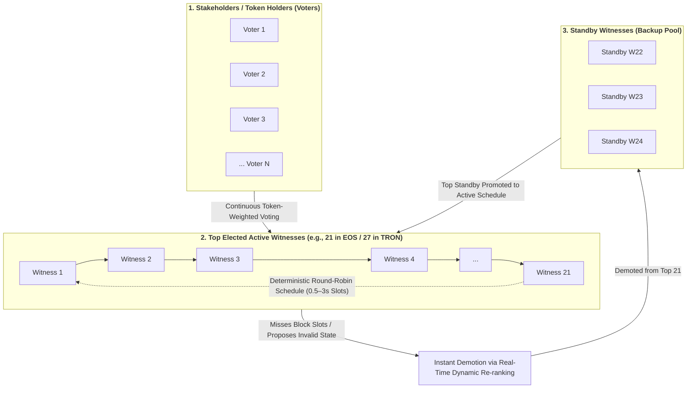

| DPoS Architectural Tier | Participants / Scope | Primary Operational Role |
| :--- | :--- | :--- |
| **1. Token Holders (Voters)** | Global cryptocurrency holders | Cast continuous token-weighted votes to elect trustworthy delegates; receive block reward dividends |
| **2. Active Witnesses** | Fixed Top $N$ nodes (e.g., 21) | Produce and validate blocks sequentially in rapid round-robin time slots (0.5 to 3 seconds) |
| **3. Standby Witnesses** | Ranked $N+1$ onwards | Maintain synchronized nodes ready to instantly replace offline or misbehaving active witnesses |
| **4. Slashing / Demotion** | Algorithmic protocol | Real-time vote reallocation automatically evicts malfunctioning witnesses within seconds |

### Core Operational Principles of DPoS (Unit 1, Slides 89–102):
1. **Representative Democracy:** Token holders do not validate blocks directly. Instead, they pool their token balances to vote for a small, fixed cadre of professional delegates or **witnesses** (typically 21 in EOS, 27 in TRON).
2. **Round-Robin Block Creation:** The elected 21 witnesses produce blocks in a deterministic, rotating round-robin order. Because witness identities and time slots are known in advance, block times drop to **0.5 to 3 seconds**, enabling thousands of transactions per second.
3. **Reward Sharing:** Elected witnesses share a significant portion of their block rewards with the community members who voted for them, increasing voter yield.
4. **Real-Time Malicious Activity Mitigation (Slide 99):**
   - If an active witness (e.g., $W_7$) goes offline, misses block slots, censors transactions, or proposes an invalid state transition, the community instantly redirects votes away from $W_7$.
   - The blockchain continuously re-ranks witnesses in real time. Within seconds, $W_7$'s rank drops, and the top **Standby Witness ($W_{22}$)** is promoted into the active 21-witness production schedule.
5. **Supermajority Block Confirmation (Slide 100):** A proposed block must be cryptographically confirmed by **$2/3 + 1$** of the remaining active witnesses (e.g., 15 of 21 witnesses), rendering forks near impossible under normal operation.

---

## 6.6 Master Consensus Taxonomy Comparison

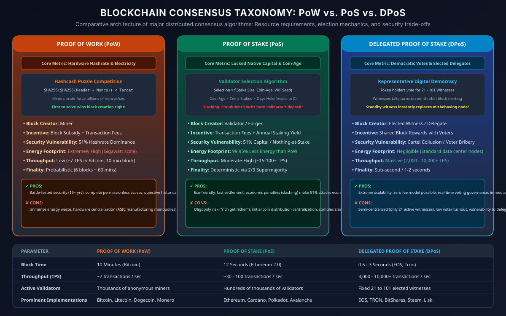
*Figure 6.2: Comparative architecture and parameter breakdown of Proof of Work (PoW), Proof of Stake (PoS), and Delegated Proof of Stake (DPoS).*

| Parameter / Metric | Proof of Work (PoW) | Proof of Stake (PoS) | Delegated Proof of Stake (DPoS) |
| :--- | :--- | :--- | :--- |
| **Core Resource** | Computational Hashrate & Electricity | Locked Native Capital (Tokens) | Stakeholder Voting Power |
| **Block Producer** | Miner who solves PoW puzzle first | Validator chosen via stake / coin-age | Fixed elected witness (21–101) |
| **Block Interval** | Slow (~10 min in BTC) | Fast (~12 sec in ETH 2.0) | Ultra-fast (0.5 to 3 seconds) |
| **Throughput (TPS)** | Low (~7 TPS in BTC) | Moderate-High (30–100+ TPS) | Massive (2,000–10,000+ TPS) |
| **Energy Consumption** | Huge (Gigawatts; environmental cost)| Minimal (99.95% reduction) | Negligible (Standard data center VMs)|
| **Attack Vulnerability** | 51% Hashrate attack | 51% Staked capital accumulation | Cartel collusion of $> 33\%$ delegates |
| **Slashing Penalty** | Nil (Burned electricity is the penalty)| Heavy (Deposit burned on double-vote)| Vote-out demotion / replacement |
| **Decentralization** | High (Open, permissionless) | High to Medium (Wealth concentration)| Low to Medium (21 active nodes) |
| **Leading Examples** | Bitcoin, Litecoin, Dogecoin | Ethereum, Cardano, Avalanche | EOS, TRON, BitShares, Steem |

---

# Section 7: Block Assembly, Validation & The Longest Chain Rule

## 7.1 The End-to-End Transaction Lifecycle
From creation to irreversible confirmation, a blockchain transaction traverses six distinct operational phases:

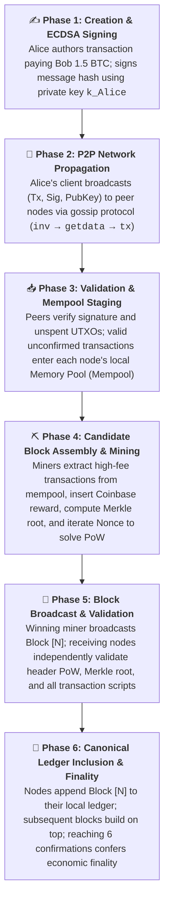

| Phase | Operational Stage | Primary Actor | Cryptographic & Protocol Actions |
| :---: | :--- | :--- | :--- |
| **1** | **Creation & Signing** | Sender (Alice) | Assembles transaction inputs/outputs; computes ECDSA signature $(r, s)$ over double SHA-256 message hash |
| **2** | **P2P Gossip Propagation** | Originating Node & Peers | Transmits `inv` inventory packets; adjacent peers request via `getdata` and receive via `tx` packets |
| **3** | **Mempool Staging** | Full Validating Nodes | Cryptographically verifies ECDSA signatures, checks UTXO double-spend locks, stages in memory buffer |
| **4** | **Candidate Block Assembly** | Mining Nodes | Prioritizes transactions by fee density, synthesizes Coinbase minting output, computes binary Merkle root, iterates Nonce |
| **5** | **Block Broadcast & Validation**| Successful Miner & Network | Winning block propagated via gossip; peers independently re-calculate header SHA-256 and verify PoW difficulty target |
| **6** | **Ledger Inclusion & Finality** | All Network Nodes | Appends block to local RocksDB/LevelDB state store; 6 block confirmations (~60 min) provide mathematical irreversibility |

---

## 7.2 The Longest Chain Rule (Nakamoto Consensus)
In a decentralized network subject to geographic latency, two miners may independently discover valid blocks at the same block height almost simultaneously (e.g., Miner A in Europe mines Block 103A at 14:00:02, and Miner B in Asia mines Block 103B at 14:00:03).

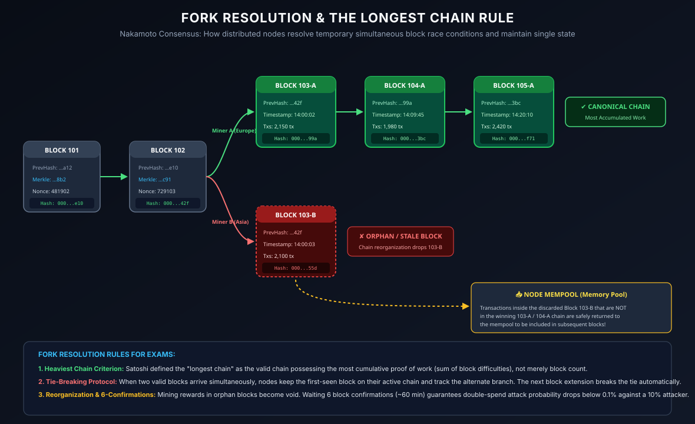
*Figure 7.1: Nakamoto Consensus fork resolution: simultaneous block generation, temporary network divergence, tie-breaking via the longest chain rule, and transaction return to mempool.*

### Fork Resolution Protocol:
1. **Temporary Network Partition:** Half the network receives Block 103A first and adopts it; the other half receives Block 103B first and adopts it. Both branches are mathematically valid.
2. **Tie-Breaking Rule:** Nodes maintain the first-seen block on their active main chain, but keep the competing alternate block in storage. Miners on Branch A build on top of 103A; miners on Branch B build on top of 103B.
3. **The Deciding Block:** Eventually, a miner discovers the next block—say, Block 104A building on 103A.
4. **The Longest Chain Principle:** The chain containing `101 -> 102 -> 103A -> 104A` now possesses a cumulative block height of 104, whereas Branch B remains at 103.
5. **State Reorganization (Reorg):** All honest nodes immediately switch to Branch A because it is the **heaviest chain** (possessing the most accumulated proof of work).
6. **Orphan / Stale Blocks:** Block 103B is officially orphaned. The coinbase mining subsidy inside 103B becomes completely void.
7. **Mempool Recovery:** Any transactions included in orphan block 103B that were not included in Branch A are automatically returned to the local mempool, ensuring user transactions are not lost.

---

## 7.3 The 6-Confirmation Rule
Why does Bitcoin convention dictate waiting for **6 block confirmations** (~60 minutes) before considering a high-value payment irreversibly settled?
- Satoshi Nakamoto formulated the double-spend attack as a **Poisson Random Walk**.
- An attacker seeking to rewrite history and reverse a payment must secretly mine an alternate private chain that overtakes the honest public chain.
- The probability $P$ that an attacker controlling fraction $q$ of total network hashrate (where $q < 0.5$) can overtake an honest chain after $z$ confirmations is:
  $$P = \sum_{k=0}^{\infty} \frac{\lambda^k e^{-\lambda}}{k!} \left( \frac{q}{p} \right)^{\max(z - k, 0)}, \quad \text{where } \lambda = z \frac{q}{p}, \ p = 1 - q$$
- When $z = 6$ confirmations, if an attacker controls $q = 10\%$ of hashrate, their probability of successfully reorganizing the chain drops to **less than $0.1\%$ ($P < 0.001$)**. After 6 confirmations, economic finality is practically assured.

---

# Section 8: Governance & Technical Challenges

## 8.1 Blockchain Governance: On-Chain vs. Off-Chain
- **Off-Chain Governance (e.g., Bitcoin, Ethereum):** Changes are negotiated through open-source developer improvement proposals (BIPs / EIPs), public forum debates, developer conferences, and miner signaling. Node operators choose whether to compile and run updated software.
- **On-Chain Governance (e.g., Tezos, Polkadot, MakerDAO):** Protocol changes are proposed as executable smart contracts and voted upon directly on-chain by token holders. If approved, the protocol automatically self-upgrades without human hard forks.

---

## 8.2 Hard Forks vs. Soft Forks

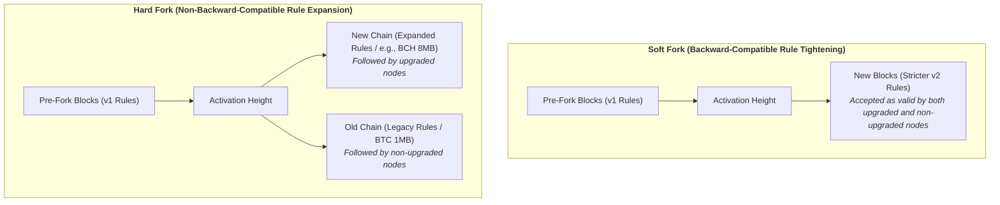

| Dimension | Soft Fork (Rule Tightening) | Hard Fork (Rule Expansion) |
| :--- | :--- | :--- |
| **Rule Validity** | Restricts valid transaction/block parameter space ($S_{\text{new}} \subset S_{\text{old}}$) | Expands valid parameter space ($S_{\text{new}} \not\subset S_{\text{old}}$) |
| **Backward Compatibility** | Fully compatible; non-upgraded nodes accept new blocks | Incompatible; non-upgraded nodes reject new blocks as invalid |
| **Chain Continuity** | Single canonical chain preserved (no permanent split) | Permanent bifurcation into two competing tokens if split occurs |
| **Upgrade Requirement** | Only miners/validators must upgrade to secure enforcement | All participants (miners, nodes, exchanges, wallets) must upgrade |
| **Historical Examples** | SegWit (BIP 141), Taproot (BIP 341), P2SH (BIP 16) | Bitcoin / Bitcoin Cash (2017), Ethereum / Ethereum Classic (2016) |

### Soft Fork (Backwards-Compatible Rule Tightening):
- **Mechanism:** Restricts valid block rules. Non-upgraded old nodes still recognize newly formatted blocks as valid because new blocks satisfy old rules.
- **Example:** SegWit (BIP 141) in 2017; Taproot (BIP 341) in 2021. Old nodes see witness scripts as standard "anyone-can-spend" transactions, while upgraded nodes validate witness proofs.

### Hard Fork (Non-Backwards-Compatible Rule Expansion):
- **Mechanism:** Relaxes or expands protocol rules. Old nodes reject new blocks as invalid protocol violations.
- **Consequence:** If community consensus is not unanimous, the blockchain permanently bifurcates into two distinct, competing cryptocurrencies.
- **Prominent Historical Hard Forks:**
  - **Bitcoin vs. Bitcoin Cash (August 2017):** Disagreement over increasing the base block size from 1MB to 8MB split Bitcoin into BTC and BCH.
  - **Ethereum vs. Ethereum Classic (July 2016):** Disagreement over rolling back the DAO hack split Ethereum into ETH and ETC.

---

## 8.3 The Blockchain Trilemma
Formulated by Vitalik Buterin, the **Blockchain Trilemma** posits that a decentralized state machine can only optimize for **two out of three** core attributes simultaneously:

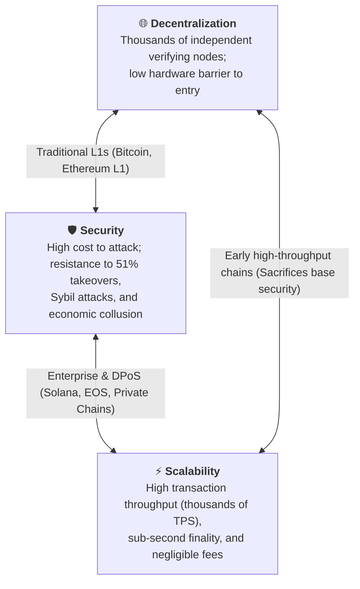

| Trilemma Corner / Trade-off | Optimizes For | Trade-off / Sacrificed Dimension | Prominent Protocol Implementations |
| :--- | :--- | :--- | :--- |
| **Decentralization + Security** | Censorship resistance, peer autonomy, network trust | **Scalability** (Lower TPS, high gas during congestion) | Bitcoin Core, Ethereum Layer 1 |
| **Scalability + Security** | High throughput ($> 5,000$ TPS), immediate confirmation | **Decentralization** (Validator cartel risk, high server specs) | Solana, EOS, TRON, Private Enterprises |
| **Decentralization + Scalability** | Low barrier node participation, high speed | **Security** (Vulnerable to 51% reorganization, weak finality) | Naive PoS / Unincentivized networks |
| **Layer 2 Modular Rollups** | Inherits L1 Decentralization + Security; executes off-chain | **Zero compromise** on foundational base-layer trust | Arbitrum One, Optimism, zkSync Era, Starknet |

1. **Decentralization:** Distributing verification across thousands of independent consumer-grade hardware nodes worldwide.
2. **Security:** Resistance to Sybil attacks, 51% takeovers, and economic bribery.
3. **Scalability:** High transaction throughput (TPS), low confirmation latency, and minimal transaction fees.

### The Inherent Trade-Offs:
- **Traditional Layer 1s (Bitcoin, Ethereum L1):** Optimize for **Decentralization + Security** (sacrificing Scalability).
- **Enterprise Blockchains / DPoS (EOS, Solana, Private Chains):** Optimize for **Scalability + Security** (sacrificing Decentralization by relying on expensive, centralized validator hardware clusters).
- **Layer 2 Solutions (Rollups, State Channels):** Anchor security and decentralization onto Layer 1 while processing transactions off-chain to resolve the trilemma.

---

# Section 9: University Examination Preparation Pack

## 9.1 High-Yield 2-Mark Question Bank

#### Q1: Define a blockchain in formal technical terms.
**Model Answer:** A blockchain is a distributed, append-only, cryptographically secured, and immutable ledger maintained across an autonomous peer-to-peer network, where transactions are grouped into timestamped blocks chained via parent SHA-256 hashes under a consensus protocol.

#### Q2: What is the primary difference between symmetric and asymmetric cryptography?
**Model Answer:** Symmetric cryptography uses a single shared secret key for both encryption and decryption, creating a key-distribution vulnerability. Asymmetric cryptography uses a mathematically linked key pair: a private key for signing/decrypting and a public key for verifying/encrypting.

#### Q3: State the 5 core properties of an ideal cryptographic hash function.
**Model Answer:** (1) Deterministic, (2) Fast forward computation, (3) Pre-image resistance (one-way trapdoor), (4) Avalanche effect (weak correlation), and (5) Collision resistance.

#### Q4: Why is an electronic signature inferior to a digital signature?
**Model Answer:** An electronic signature (e.g., a scanned image) can be copy-pasted without detection and cannot prove document integrity. A digital signature is cryptographically bound to the document's hash via the signer's private key; any tampering immediately invalidates verification.

#### Q5: State Lamport's theorem for the Byzantine Generals Problem.
**Model Answer:** To achieve consensus in a network containing $m$ Byzantine traitors, the total number of nodes $N$ must satisfy $N \ge 3m + 1$, meaning strictly greater than two-thirds ($> 66.7\%$) of participants must be honest.

#### Q6: What is the significance of the Nonce in Proof of Work?
**Model Answer:** The Nonce (Number used Once) is a 32-bit field in the 80-byte block header iterated by miners to generate an arbitrary header hash that satisfies the mathematical condition $\text{SHA256}(\text{SHA256}(\text{Header})) < \text{Target}$.

#### Q7: Define Coin Age in Proof of Stake systems.
**Model Answer:** Coin Age is defined as $\text{Coin Age} = \text{Staked Coins} \times \text{Holding Duration (Days)}$. Once a validator forges a block, their coin age resets to zero to prevent persistent block production monopolies.

#### Q8: What is an orphan block, and what happens to its transactions?
**Model Answer:** An orphan (or stale) block is a valid block that was part of a shorter temporary fork discarded by the network under the Longest Chain Rule. Its mining subsidy is voided, and its unconfirmed transactions are returned to the local mempool.

---

## 9.2 High-Yield 5-Mark Question Bank

#### Q1: Explain why Satoshi Nakamoto instituted the 1MB block size limit and discuss the complexities of arbitrarily large blocks.
**Model Answer Structure:**
- **Anti-spam measure:** Prevented adversaries from generating 100MB+ blocks full of bogus transactions that would crash node RAM/storage.
- **Complexities of larger blocks:**
  1. *Storage bloat:* Increases the cost of running nodes, pricing out regular users.
  2. *Bandwidth & propagation latency:* Larger blocks propagate slower across the P2P network.
  3. *Increased orphan rates:* Higher latency causes miners to discover blocks concurrently, elevating orphan rates.
  4. *Mining centralization:* Large mining pools with high-speed links dominate; small independent miners are eliminated.
  5. *Sync/bootstrap time:* New nodes require weeks to complete Initial Block Download (IBD).

#### Q2: Contrast the consensus mechanisms of Proof of Work (PoW) and Proof of Stake (PoS).
**Model Answer Structure:**
- Construct a comparison table covering:
  - *Resource:* Hardware compute & power vs. locked financial tokens.
  - *Block Creator:* Miner who solves puzzle vs. validator chosen via stake/coin-age algorithm.
  - *Energy:* Enormous gigawatt consumption vs. 99.95% eco-friendly reduction.
  - *Attack Threshold:* 51% hashrate dominance vs. 51% circulating staked capital.
  - *Malicious Penalty:* Wasted electricity vs. capital slashing (stake burned).

#### Q3: Differentiate between a Soft Fork and a Hard Fork with real-world blockchain examples.
**Model Answer Structure:**
- *Soft Fork:* Backwards-compatible tightening of rules. Non-upgraded nodes accept new blocks. Example: SegWit (BIP 141), Taproot (BIP 341).
- *Hard Fork:* Non-backwards-compatible rule expansion. Non-upgraded nodes reject new blocks as invalid, causing permanent ledger bifurcation. Examples: Bitcoin vs. Bitcoin Cash (block size debate, 2017); Ethereum vs. Ethereum Classic (DAO hack rollback, 2016).

---

## 9.3 High-Yield 10-Mark Master Architectural Questions

#### Q1: Detail the Layered Architecture of Blockchain and explain the role of each layer.
**Model Answer Structure:**
1. Draw the 5-layer diagram: Data, Network, Consensus, Incentive, Application layers.
2. **Data Layer:** Blocks, 80-byte header, Merkle tree, SHA-256 chaining, ECDSA keys, UTXO model.
3. **Network Layer:** P2P overlay, node discovery (DNS seeds), handshake (`version`/`verack`), gossip protocol (`inv`/`getdata`/`block`), mempool.
4. **Consensus Layer:** Proof of Work, Proof of Stake, DPoS, Byzantine Fault Tolerance ($> 2/3$ rule), longest chain fork resolution.
5. **Incentive Layer:** Coinbase block subsidy, halving schedule, fee market auction, validator slashing.
6. **Application Layer:** Smart contracts, EVM, DApps, RPC clients, non-custodial wallets (MetaMask).

#### Q2: Detail the mathematical and procedural lifecycle of an ECDSA Digital Signature in Bitcoin, explaining both signing and verification phases.
**Model Answer Structure:**
1. Draw the ECDSA lifecycle diagram (Alice -> Sign -> Transmit -> Bob -> Verify).
2. Detail the `secp256k1` curve equation: $y^2 \equiv x^3 + 7 \pmod p$.
3. Detail Private Key ($k$) and Public Key ($K = k \times G$).
4. Explain why the message is hashed first ($h = \text{SHA256}(\text{SHA256}(M))$).
5. State the mathematical signing equations ($r = (k_{\text{eph}} \times G)_x \pmod n$, $s = k_{\text{eph}}^{-1}(h + r \cdot k) \pmod n$).
6. State the mathematical verification equations ($w = s^{-1}$, $u_1 = h \cdot w$, $u_2 = r \cdot w$, $(x_v, y_v) = u_1 G + u_2 K$, check $x_v \equiv r \pmod n$).
7. Highlight the three core guarantees: Authentication, Data Integrity, and Non-Repudiation.

---

## 9.4 Common Pitfalls, Misconceptions & Exam Traps
1. **Trap: Confusing Block Size with Block Weight.**
   - *Error:* Stating that SegWit simply doubled the block size limit to 2MB.
   - *Correction:* SegWit removed the 1MB limit entirely and introduced a **4,000,000 Weight Unit (WU)** limit, discounting witness bytes by 75%.
2. **Trap: Believing a 51% Attack Steals Private Keys or Reverses Arbitrary Historical Blocks.**
   - *Error:* Assuming a 51% miner can steal coins from arbitrary wallets.
   - *Correction:* A 51% miner can only double-spend their *own* coins and censor other transactions. They *cannot* forge digital signatures, spend coins they do not own, or alter historical blocks deep in the chain.
3. **Trap: Assuming the Longest Chain Rule is strictly based on Block Count.**
   - *Error:* Stating that the chain with the most blocks wins.
   - *Correction:* Satoshi explicitly defined the canonical chain as the valid chain possessing the **most accumulated proof of work** (the sum of block difficulties), preventing low-difficulty alternate forks from overtaking the main chain.
4. **Trap: Confusing Public Key with Bitcoin Address.**
   - *Error:* Believing the address is simply the public key.
   - *Correction:* An address is the `Base58Check` encoding of the versioned, double-hashed payload: $\text{RIPEMD160}(\text{SHA256}(\text{PublicKey}))$.

---

## 9.5 Rapid Formula & Parameter Reference Card

$$\begin{aligned}
\text{Elliptic Curve (secp256k1)} &: y^2 \equiv x^3 + 7 \pmod p, \quad p = 2^{256} - 2^{32} - 977 \\
\text{Public Key Derivation} &: K = k \times G \\
\text{PoW Mining Condition} &: \text{SHA256}(\text{SHA256}(\text{BlockHeader}_{80\text{B}})) < \text{Target} \\
\text{Difficulty Formula} &: \text{Difficulty} = \frac{\text{Target}_{\text{genesis}}}{\text{Target}_{\text{current}}} \\
\text{Difficulty Retarget (2016 Blocks)} &: \text{Target}_{\text{new}} = \text{Target}_{\text{old}} \times \left( \frac{\text{ActualTime}}{20,160 \text{ min}} \right) \\
\text{Lamport's BFT Condition} &: N \ge 3m + 1 \iff \text{Honest Nodes} > \frac{2}{3}N \\
\text{Block Weight (SegWit)} &: \text{Weight} = (\text{BaseSize} \times 3) + \text{TotalSize} \le 4,000,000 \text{ WU} \\
\text{Coin Age (PoS)} &: \text{Coin Age} = \text{Coins Staked} \times \text{Holding Duration (Days)}
\end{aligned}$$

---
*End of BACSE350 Module 1 Master Document.*
