# BACSE350 Blockchain Technologies
## Module 2: Bitcoin Network and Transactions — Master Concept & Exam Revision Guide

> **Course**: BACSE350 — Blockchain Technologies  
> **Module**: 2 — Bitcoin Network and Transactions  
> **Curriculum & References**: Dr. Sandhya P, SCOPE, VIT Chennai; *Mastering Bitcoin* by Andreas M. Antonopoulos; Bitcoin Improvement Proposals (BIP-32, BIP-39, BIP-44, BIP-16)  
> **Key Materials Covered**: `UNIT-2Address.pdf`, `Unit-2Aug4_merged_watermark.pdf`, `UNIT-2Transaction.pdf`, `Unit-2Node_Discovery.pdf`, `BACSE350 Blockchain Module 2.pdf`

---

## Table of Contents
1. [Module Overview & Learning Objectives](#1-module-overview--learning-objectives)
2. [Bitcoin Address Generation Mathematics & Cryptographic Foundations](#2-bitcoin-address-generation-mathematics--cryptographic-foundations)
   - 2.1 [Private Keys: 256-Bit Entropy & Scalar Representation](#21-private-keys-256-bit-entropy--scalar-representation)
   - 2.2 [Elliptic Curve SECP256k1 & Generator Point Multiplication](#22-elliptic-curve-secp256k1--generator-point-multiplication)
   - 2.3 [Uncompressed vs Compressed Public Keys](#23-uncompressed-vs-compressed-public-keys)
   - 2.4 [Compressed vs Uncompressed Private Keys (WIF Format)](#24-compressed-vs-uncompressed-private-keys-wif-format)
   - 2.5 [Cryptographic Hash Functions: SHA-256 and RIPEMD-160 (HASH160)](#25-cryptographic-hash-functions-sha-256-and-ripemd-160-hash160)
   - 2.6 [Version Byte, Double SHA-256 Checksum, and Base58Check Encoding](#26-version-byte-double-sha-256-checksum-and-base58check-encoding)
   - 2.7 [Architectural Pipeline Diagram](#27-architectural-pipeline-diagram)
3. [Implementing Keys and Addresses in Python](#3-implementing-keys-and-addresses-in-python)
   - 3.1 [Step-by-Step Address Derivation Script (Class Colab Implementation)](#31-step-by-step-address-derivation-script-class-colab-implementation)
   - 3.2 [Entropy & BIP-39 Mnemonic Seed Generation](#32-entropy--bip-39-mnemonic-seed-generation)
   - 3.3 [BIP-32 Master Private Key & Extended Public Key (XPUB)](#33-bip-32-master-private-key--extended-public-key-xpub)
   - 3.4 [Multi-Signature Script Generation (2-of-3 MultiSig)](#34-multi-signature-script-generation-2-of-3-multisig)
4. [Wallets Architecture, Classification & Custody Models](#4-wallets-architecture-classification--custody-models)
   - 4.1 [Fundamental Role of a Blockchain Wallet](#41-fundamental-role-of-a-blockchain-wallet)
   - 4.2 [Non-Deterministic (JBOK) vs Deterministic Wallets](#42-non-deterministic-jbok-vs-deterministic-wallets)
   - 4.3 [Hierarchical Deterministic (HD) Wallets (BIP-32 & BIP-44)](#43-hierarchical-deterministic-hd-wallets-bip-32--bip-44)
   - 4.4 [Hardened vs Normal Derivation](#44-hardened-vs-normal-derivation)
   - 4.5 [Custody Models: Hot vs Cold, Hardware Wallets & Physical Storage](#45-custody-models-hot-vs-cold-hardware-wallets--physical-storage)
5. [Bitcoin Transactions & The UTXO Model](#5-bitcoin-transactions--the-utxo-model)
   - 5.1 [Concept of UTXO (Unspent Transaction Output)](#51-concept-of-utxo-unspent-transaction-output)
   - 5.2 [Account-Based Model vs UTXO Model Comparison](#52-account-based-model-vs-utxo-model-comparison)
   - 5.3 [The Rule of Entirety & Implicit Miner Fees](#53-the-rule-of-entirety--implicit-miner-fees)
   - 5.4 [Comprehensive Transaction Walkthrough: Alice, Bob, and David](#54-comprehensive-transaction-walkthrough-alice-bob-and-david)
   - 5.5 [Raw Byte Anatomy of a Bitcoin Transaction](#55-raw-byte-anatomy-of-a-bitcoin-transaction)
6. [Bitcoin Scripting Engine & Standard Transaction Types](#6-bitcoin-scripting-engine--standard-transaction-types)
   - 6.1 [Bitcoin Script Execution Architecture (Stack Machine)](#61-bitcoin-script-execution-architecture-stack-machine)
   - 6.2 [Step-by-Step P2PKH Validation Trace](#62-step-by-step-p2pkh-validation-trace)
   - 6.3 [Standard Transaction Types: P2PK, P2PKH, P2SH, MultiSig, OP_RETURN, Coinbase](#63-standard-transaction-types-p2pk-p2pkh-p2sh-multisig-op_return-coinbase)
7. [Bitcoin Peer-to-Peer Network Architecture & Protocols](#7-bitcoin-peer-to-peer-network-architecture--protocols)
   - 7.1 [P2P Overlay Topology & Types of Bitcoin Nodes](#71-p2p-overlay-topology--types-of-bitcoin-nodes)
   - 7.2 [Mining Pools & The Stratum Protocol](#72-mining-pools--the-stratum-protocol)
   - 7.3 [Node Discovery for a Bootstrap Node](#73-node-discovery-for-a-bootstrap-node)
   - 7.4 [Connection Handshake Protocol (version / verack)](#74-connection-handshake-protocol-version--verack)
   - 7.5 [Peer Address Exchange (getaddr / addr)](#75-peer-address-exchange-getaddr--addr)
   - 7.6 [Block Download & Propagation (Gossip Protocol: inv, getdata, block)](#76-block-download--propagation-gossip-protocol-inv-getdata-block)
8. [Comprehensive University Exam Preparation & Numerical Problems](#8-comprehensive-university-exam-preparation--numerical-problems)
   - 8.1 [Worked Numerical Problems](#81-worked-numerical-problems)
   - 8.2 [High-Yield Short Answer Questions (2–5 Marks)](#82-high-yield-short-answer-questions-25-marks)
   - 8.3 [Comprehensive Long Answer / Essay Questions (10–15 Marks)](#83-comprehensive-long-answer--essay-questions-1015-marks)
   - 8.4 [Summary Revision Flashcard & Common Pitfalls](#84-summary-revision-flashcard--common-pitfalls)

---

## 1. Module Overview & Learning Objectives

Module 2 covers the technical mechanics of the Bitcoin protocol, bridging cryptographic primitives, transaction construction, state models, and peer-to-peer networking. Students are required to understand not only the high-level concepts, but also the exact mathematical equations, raw byte encodings, stack execution sequences, and network messaging handshakes.

### Key Learning Objectives
1. **Cryptographic Key Derivation**: Trace the exact cryptographic path from 256 bits of pseudo-random entropy through the secp256k1 elliptic curve, SHA-256, RIPEMD-160, and Base58Check encoding.
2. **Key Compression Mathematics**: Explain the coordinate compression mechanism on the Weierstrass curve $y^2 = x^3 + 7 \pmod p$ and resolve why "compressed private keys" exist despite having identical mathematical values.
3. **Python Implementation**: Implement key generation, hashing, checksumming, Base58Check encoding, BIP-39 mnemonic seed phrases, and BIP-32 extended keys (`xpub`) using Python.
4. **Hierarchical Deterministic Wallets**: Master the BIP-32/BIP-44 tree derivation path (`m / purpose' / coin_type' / account' / change / address_index`) and distinguish between hardened and non-hardened child derivation.
5. **UTXO Execution & Scripting**: Dissect the Unspent Transaction Output (UTXO) model, the "Rule of Entirety", implicit fee calculations, and the Forth-like stack evaluation of `scriptPubKey` (locking script) and `scriptSig` (unlocking script).
6. **Raw Byte Serialization**: Deconstruct a serialized hex Bitcoin transaction byte-by-byte, including version, input outpoints, VarInt lengths, signatures, public keys, outputs, and locktime.
7. **P2P Network Protocols**: Detail the three-step bootstrap lifecycle of a new Bitcoin node: **Node Discovery** (DNS seeds), **Node Connection** (`version`/`verack` handshake), and **Block Synchronization** (Gossip protocol using `inv`, `getdata`, and `block` payloads).

---

## 2. Bitcoin Address Generation Mathematics & Cryptographic Foundations

Bitcoin addresses are human-readable alphanumeric strings that serve as cryptographic destination endpoints for payments. An address is not stored on the blockchain; rather, it is a cryptographic encoding of a public key hash or script hash.

### 2.1 Private Keys: 256-Bit Entropy & Scalar Representation

A Bitcoin private key is simply a random integer $k$ chosen uniformly from the range:
$$1 \le k \le n - 1$$
where $n$ is the order of the elliptic curve group defined by the **secp256k1** standard. For secp256k1:
$$n = \text{0xFFFFFFFFFFFFFFFFFFFFFFFFFFFFFFFEBAAEDCE6AF48A03BBFD25E8CD0364141}$$
In decimal, $n \approx 1.1578 \times 10^{77}$(approximately$2^{256}$).

- **Entropy Requirement**: The private key must be generated using a cryptographically secure pseudo-random number generator (CSPRNG) or a physical source of high entropy (e.g., flipping a fair coin 256 times, thermal noise, atmospheric radio noise). If an attacker can guess, bias, or reduce the search space of the entropy source, the private key can be discovered, leading to theft of funds.
- **Physical Representation**: A 256-bit number is represented as 32 raw bytes, typically displayed as a 64-character hexadecimal string.

---

### 2.2 Elliptic Curve SECP256k1 & Generator Point Multiplication

Bitcoin uses Elliptic Curve Cryptography (ECC) over prime fields based on the **secp256k1** curve standard established by Certicom.

#### The Curve Equation
The curve is defined by the short Weierstrass equation over a finite field $\mathbb{F}_p$:
$$y^2 \equiv (x^3 + 7) \pmod p$$
where the prime modulus $p$ is:
$$p = 2^{256} - 2^{32} - 977 = \text{0xFFFFFFFFFFFFFFFFFFFFFFFFFFFFFFFFFFFFFFFFFFFFFFFFFFFFFFFEFFFFFC2F}$$
This specific prime $p$ was chosen because of its special pseudo-Mersenne form, which enables high-speed modular arithmetic computation.

#### Generator Point $G$ and Scalar Multiplication
Every operation on the curve is performed using a predefined generator point (base point) $G$:
- $G_x = \text{0x79BE667EF9DCBBAC55A06295CE870B07029BFCDB2DCE28D959F2815B16F81798}$-$G_y = \text{0x483ADA7726A3C4655DA4FBFC0E1108A8FD17B448A68554199C47D08FFB10D4B8}$The public key$K$is an elliptic curve point derived by multiplying the scalar private key$k$with the generator point$G$ via repeated point addition and point doubling:
$$K = k \times G = G + G + \dots + G \quad (k \text{ times})$$

> [!NOTE]
> **Symmetry Across the X-Axis in $\mathbb{R}$and$\mathbb{F}_p$**:
> Because the elliptic curve $y^2 = x^3 + 7 \pmod p$is symmetric across the horizontal axis, for every valid curve point$P(x, y)$, its mirror reflection$P'(x, -y \pmod p)$ also lies on the curve.
> In the finite field $\mathbb{F}_p$,$-y \equiv p - y$. Because prime$p$is odd, exactly one of$\{y, p - y\}$is even and the other is odd. This reflectional symmetry allows public key compression: recording only the$x$-coordinate (32 bytes) along with a single parity prefix (`0x02` for even$y$, `0x03` for odd$y$).

#### The Elliptic Curve Discrete Logarithm Problem (ECDLP)
- Computing $K = k \times G$is computationally efficient (order$O(\log k)$ using the double-and-add algorithm).
- However, given the public key point $K$and the base point$G$, determining the scalar private key$k$such that$K = k \times G$is computationally infeasible. The fastest known classical algorithm is Pollard's rho algorithm, which requires$O(\sqrt{n}) \approx 2^{128}$ operations, rendering brute-force inversion impossible with existing classical computational limits.

---

### 2.3 Uncompressed vs Compressed Public Keys

Because the public key is a point on the Cartesian coordinate plane over $\mathbb{F}_p$, it consists of an$x$-coordinate and a$y$-coordinate:
$$P(x, y) \quad \text{where } x, y \in [0, p-1]$$
Each coordinate requires 256 bits (32 bytes).

#### 1. Uncompressed Public Keys (Legacy Format)
In original Bitcoin client implementations (Satoshi Nakamoto's early software), both the $x$and$y$ coordinates were fully serialized:
$$\text{Uncompressed PubKey} = \text{0x04} \,||\, X \,||\, Y$$
- **Prefix**: `0x04` (1 byte, 8 bits) signifies an uncompressed point.
- **$X$-coordinate**: 32 bytes (256 bits).
- **$Y$-coordinate**: 32 bytes (256 bits).
- **Total Length**: $1 + 32 + 32 = 65 \text{ bytes}$ (520 bits).

#### 2. Compressed Public Keys (Modern Standard)
Notice the curve equation:
$$y^2 \equiv (x^3 + 7) \pmod p$$
If the $x$-coordinate is known,$y^2$ is uniquely determined. Taking the modular square root yields two possible values:
$$y \quad \text{and} \quad (p - y) \equiv -y \pmod p$$
Since $p$is an odd prime, exactly one of$\{y, p - y\}$ is **even** and the other is **odd**:
- If $y$is even,$y \pmod 2 = 0$.
- If $y$is odd,$y \pmod 2 = 1$.

Therefore, the entire $y$-coordinate can be omitted from network transmission and storage if we preserve just a single bit indicating whether$y$ is even or odd!
- **Prefix `0x02`**: Used if $y$is even ($y \pmod 2 = 0$).
- **Prefix `0x03`**: Used if $y$is odd ($y \pmod 2 = 1$).

$$\text{Compressed PubKey} = \text{Prefix (0x02 or 0x03)} \,||\, X$$
- **Prefix**: 1 byte (`0x02` or `0x03`).
- **$X$-coordinate**: 32 bytes (256 bits).
- **Total Length**: $1 + 32 = 33 \text{ bytes}$ (264 bits / roughly 258-bit payload).

**Storage and Bandwidth Impact**: Compressed public keys reduce public key size on the blockchain from 65 bytes to 33 bytes, saving nearly 50% of the byte weight for every input signature script.

---

### 2.4 Compressed vs Uncompressed Private Keys (WIF Format)

A crucial technical distinction frequently tested in examinations is: **Do "compressed private keys" actually exist mathematically?**

> **Exam Fact**: Private keys are **NOT** mathematically compressed! A 256-bit integer cannot be compressed further without losing information. Both compressed and uncompressed private keys represent the exact same 256-bit scalar number $k$.

#### Why the Distinction Exists
From a single 256-bit private key $k$, one can mathematically compute:
1. An uncompressed public key $K_{\text{uncompressed}}$ (yielding Bitcoin Address A).
2. A compressed public key $K_{\text{compressed}}$ (yielding Bitcoin Address B).

Because hashing $K_{\text{uncompressed}}$and$K_{\text{compressed}}$ produces two completely different 160-bit hashes, **they correspond to two distinct Bitcoin addresses!**
If an old wallet exports a private key and a modern wallet imports it, how does the modern wallet know whether it should scan the blockchain for transactions sent to Address A or Address B?

#### The Suffix Solution: WIF Compression Indicator
To resolve this ambiguity:
- When a private key is designated to produce **compressed** public keys, a `0x01` byte is appended to the 32-byte private key before Base58Check encoding.
- This format is called **Wallet Import Format (WIF)**.

| Property | Uncompressed WIF | Compressed WIF |
| :--- | :--- | :--- |
| **Raw Payload** | `0x80` + 32-byte Private Key (33 bytes) | `0x80` + 32-byte Private Key + `0x01` (34 bytes) |
| **Prefix Byte** | `0x80` (Mainnet private key) | `0x80` (Mainnet private key) |
| **Suffix Byte** | None | `0x01` (indicates compressed pubkey) |
| **Checksum** | First 4 bytes of double SHA-256 (4 bytes) | First 4 bytes of double SHA-256 (4 bytes) |
| **Total Length** | 37 bytes | 38 bytes |
| **Base58 String** | 51 characters, starts with **`5`** | 52 characters, starts with **`K`** or **`L`** |

> **Key Takeaway**: Counter-intuitively, the "compressed" WIF private key string is actually **longer** (52 characters) than the "uncompressed" WIF private key string (51 characters) because of the extra `0x01` identification suffix!

---

### 2.5 Cryptographic Hash Functions: SHA-256 and RIPEMD-160 (HASH160)

Once the public key $K$ (compressed or uncompressed) is serialized into bytes, it is transformed into a 20-byte (160-bit) hash using a two-stage cryptographic hash cascade known in Bitcoin protocol terminology as **HASH160**:

$$\text{HASH160}(K) = \text{RIPEMD160}\Big(\text{SHA256}(K)\Big)$$

#### Stage 1: SHA-256 (Secure Hash Algorithm 256-bit)
- Input: 33-byte or 65-byte public key.
- Output: 32 bytes (256 bits).
- Purpose: Provides strong cryptographic diffusion, non-invertibility, and collision resistance.

#### Stage 2: RIPEMD-160 (RACE Integrity Primitives Evaluation Message Digest 160)
- Input: 32-byte output from SHA-256.
- Output: 20 bytes (160 bits).
- Purpose: Compresses the digest to 160 bits, creating a compact identifier.

#### Why Use Two Different Hash Algorithms?
1. **Defense-in-Depth / Cryptographic Redundancy**: If a mathematical flaw or preimage attack is discovered against SHA-256 in the future, the security of the funds remains protected by RIPEMD-160 (and vice-versa).
2. **Compact Address Size**: 160 bits (20 bytes) is significantly shorter to display, copy, and encode into QR codes than 256 bits, while retaining $2^{80}$collision resistance and$2^{160}$ preimage resistance.
3. **Quantum Resistance Pre-Spending**: On the Bitcoin blockchain, the actual public key $K$is **never exposed** until the recipient decides to spend the UTXO. Until then, only the HASH160 digest is recorded on-chain. Even if Shor's algorithm on a quantum computer could invert$K = k \times G$, it cannot reverse a cryptographic hash function like SHA-256 or RIPEMD-160!

---

### 2.6 Version Byte, Double SHA-256 Checksum, and Base58Check Encoding

A raw 20-byte hash cannot be safely handed to end-users because accidental typographical errors would result in permanent, unrecoverable loss of funds. Bitcoin solves this with **Base58Check encoding**.

#### Step 1: Prepending the Network Version Byte
A 1-byte version prefix is added to the 20-byte public key hash:
$$\text{Versioned Payload} = \text{Version Byte} \,||\, \text{HASH160}$$
- For **Bitcoin Mainnet P2PKH** (Pay-to-Public-Key-Hash): Version byte is `0x00`.
- For **Bitcoin Testnet P2PKH**: Version byte is `0x6F`.
- For **Bitcoin Mainnet P2SH** (Pay-to-Script-Hash): Version byte is `0x05`.

Resulting payload length: $1 + 20 = 21 \text{ bytes}$.

#### Step 2: Calculating the 4-Byte Checksum
To detect transcription errors, a double SHA-256 hash is applied to the 21-byte versioned payload:
$$H_1 = \text{SHA256}(\text{Versioned Payload})$$
$$H_2 = \text{SHA256}(H_1) = \text{SHA256}\Big(\text{SHA256}(\text{Version Byte} \,||\, \text{HASH160})\Big)$$
The **Checksum** consists of the **first 4 bytes** (32 bits) of $H_2$:
$$\text{Checksum} = H_2[0:4]$$
This 32-bit checksum guarantees that if any character in the address is mistyped, transposed, or altered, the checksum validation will fail with a probability of:
$$1 - \frac{1}{2^{32}} = 1 - \frac{1}{4,294,967,296} \approx 99.999999977\%$$

#### Step 3: Concatenation to 25-Byte Binary Address
The checksum is appended to the 21-byte versioned payload:
$$\text{Binary Address} = \text{Version Byte (1B)} \,||\, \text{HASH160 (20B)} \,||\, \text{Checksum (4B)}$$
Total size: $1 + 20 + 4 = 25 \text{ bytes}$.

#### Step 4: Base58 Encoding
The 25-byte binary structure is converted from binary bytes into a string using the **Base58 alphabet**:
- **Standard Base64** includes: `0-9`, `a-z`, `A-Z`, `+`, `/`.
- **Base58** removes 6 ambiguous characters to prevent visual confusion in print and handwriting:
  1. `0` (Number zero) — confused with `O` (Capital o)
  2. `O` (Capital o) — confused with `0` (Number zero)
  3. `I` (Capital i) — confused with `l` (Lowercase L)
  4. `l` (Lowercase L) — confused with `I` (Capital i)
  5. `+` (Plus sign) — non-alphanumeric, causes line breaks or URL encoding errors
  6. `/` (Slash) — non-alphanumeric, causes URL parsing errors

The resulting Base58 alphabet (58 characters) is:
```
123456789ABCDEFGHJKLMNPQRSTUVWXYZabcdefghijkmnopqrstuvwxyz
```
Because the Mainnet version byte is `0x00`, encoding leading zero bytes into Base58 maps directly to the character **`'1'`**. Hence, all standard legacy Bitcoin P2PKH addresses start with the prefix **`1`** and have a length of 26 to 35 alphanumeric characters.

---

### 2.7 Architectural Pipeline Diagram

The complete end-to-end derivation pipeline is visualized below:

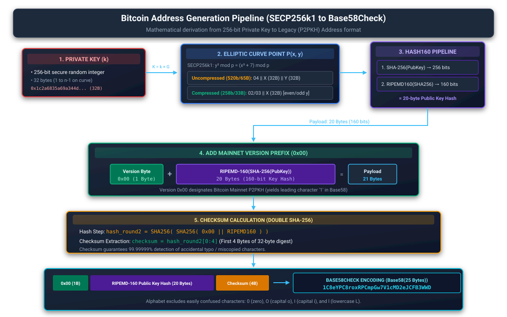

---

## 3. Implementing Keys and Addresses in Python

This section provides the exact, executable Python implementation matching the class demonstrations and Google Colab curriculum used in the course.

### 3.1 Step-by-Step Address Derivation Script (Class Colab Implementation)

The following complete script demonstrates the end-to-end derivation of a private key, public key, and legacy Bitcoin address using `secrets`, `ecdsa`, `hashlib`, `Crypto.Hash.RIPEMD160`, and `base58`.

```python
# Required Dependencies:
# pip install pycryptodome base58 ecdsa

import secrets
import hashlib
import base58
from ecdsa import SigningKey, SECP256k1
from Crypto.Hash import RIPEMD160

# Step 1: Generate 256-bit Cryptographically Secure Entropy (Private Key)
private_key_hex = secrets.token_hex(32)
private_key_bytes = bytes.fromhex(private_key_hex)

# Step 2: Elliptic Curve SECP256k1 Public Key Derivation (K = k * G)
sk = SigningKey.from_string(private_key_bytes, curve=SECP256k1)
vk = sk.verifying_key

# 2a. Uncompressed Public Key: Prefix 0x04 + 32-byte X + 32-byte Y (65 bytes)
public_key_uncompressed = b'\x04' + vk.to_string()

# 2b. Compressed Public Key: Prefix 0x02 (if Y is even) or 0x03 (if Y is odd) + 32-byte X (33 bytes)
x_coord = vk.to_string()[:32]
y_coord = vk.to_string()[32:]
prefix = b'\x02' if (int.from_bytes(y_coord, 'big') % 2 == 0) else b'\x03'
public_key_compressed = prefix + x_coord

# Step 3: HASH160 Pipeline (SHA-256 followed by RIPEMD-160)
# We apply this to the public key (demonstrated here on uncompressed as in lecture notes)
sha256_hash = hashlib.sha256(public_key_uncompressed).digest()

ripemd160 = RIPEMD160.new()
ripemd160.update(sha256_hash)
public_key_hash = ripemd160.digest()  # Exactly 20 bytes (160 bits)

# Step 4: Prepend Mainnet Version Byte (0x00 for P2PKH)
versioned_payload = b'\x00' + public_key_hash  # 21 bytes

# Step 5: Double SHA-256 Checksum Calculation
round1 = hashlib.sha256(versioned_payload).digest()
round2 = hashlib.sha256(round1).digest()
checksum = round2[:4]  # First 4 bytes (32 bits)

# Step 6: Binary Address Assembly (25 bytes)
binary_address = versioned_payload + checksum

# Step 7: Base58Check Encoding
bitcoin_address = base58.b58encode(binary_address).decode('utf-8')

# Output Results
print("================ BITCOIN ADDRESS GENERATION ================")
print(f"Private Key (Hex)    : {private_key_hex}")
print(f"Public Key (Hex)     : {public_key_uncompressed.hex()}")
print(f"Public Key Hash (20B): {public_key_hash.hex()}")
print(f"Checksum (Hex)       : {checksum.hex()}")
print(f"Bitcoin Address      : {bitcoin_address}")
print("============================================================")
```

#### Sample Verified Output
```text
================ BITCOIN ADDRESS GENERATION ================
Private Key (Hex)    : 1c2a6835a69a344d2266eac39eff6f0482d8fe46ab6193920de30b4efeaf8a2d
Public Key (Hex)     : 041cee3df397ca5807456b2502651f4d4c11e4c799d91105c006e701f54743c004be070925fe0d7680813cdf530d83a13a57f7794d801e05dcd295834f89d38c64
Public Key Hash (20B): 7a3c3e2bb92147db1d3e811192eb6c1f0169df31
Checksum (Hex)       : 5b4c107e
Bitcoin Address      : 1C8eYPC8roxRPCmpGw7V1cMD2eJCFB3WWD
============================================================
```

---

### 3.2 Entropy & BIP-39 Mnemonic Seed Generation

While raw 256-bit hexadecimal numbers are computer-friendly, human beings are error-prone when transcribing 64 hexadecimal characters. **BIP-39** defines a mechanism to convert entropy into a human-readable mnemonic seed phrase (typically 12 or 24 words).

#### Mathematical Conversion Algorithm:
1. Generate initial entropy $E$of length$L \in \{128, 160, 192, 224, 256\}$ bits.
2. Compute the SHA-256 hash of $E$. Take the first$L / 32$bits as a checksum$CS$.
   - For 128 bits of entropy: Checksum $= 128 / 32 = 4$bits. Total$= 132$ bits.
   - For 256 bits of entropy: Checksum $= 256 / 32 = 8$bits. Total$= 264$ bits.
3. Append $CS$to the end of$E$:
$$\text{Entropy With Checksum} = E \,||\, CS$$
4. Split the combined bitstream into groups of **11 bits** each:
   - For 128-bit entropy: $132 / 11 = \mathbf{12 \text{ words}}$.
   - For 256-bit entropy: $264 / 11 = \mathbf{24 \text{ words}}$.
5. Each 11-bit integer ($0 \le \text{value} \le 2047$) maps directly to an index in the standardized **BIP-39 English Wordlist** (containing exactly$2^{11} = 2048$ unique words, such as `abandon`, `ability`, `able`, ..., `zoo`).

| Segment | Component 1: Initial Entropy ($E$) | Component 2: Checksum ($CS$) | Total Combined |
| :--- | :--- | :--- | :--- |
| **Bit Length** | 128 bits (16 bytes CSPRNG) | 4 bits ($\text{SHA256}(E)[0..3]$) | **132 bits** |
| **11-Bit Splitting** | $11 \text{ bits} \times 11 \text{ segments}$ | 11th chunk finishes with 4-bit checksum | **12 segments** of 11 bits each |
| **Index Mapping** | $\text{Chunk}_1, \dots, \text{Chunk}_{11} \in [0, 2047]$|$\text{Chunk}_{12} \in [0, 2047]$ | Mapped to BIP-39 English Wordlist |
| **Word Output** | Word 1, Word 2, ..., Word 11 | Word 12 | **12-word mnemonic phrase** |

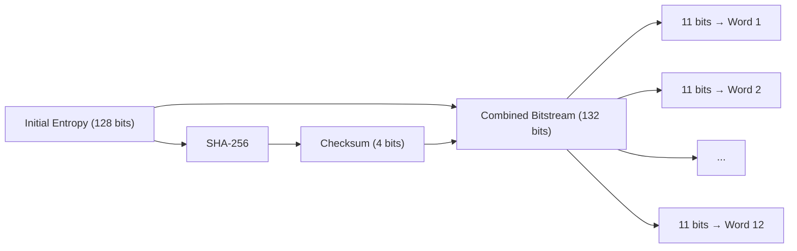

#### Deriving the 512-bit Binary Seed:
The mnemonic word string is passed into the key-stretching function **PBKDF2** (Password-Based Key Derivation Function 2) using HMAC-SHA512:
$$\text{Seed} = \text{PBKDF2}(\text{PRF}=\text{HMAC-SHA512}, \text{Password}=\text{mnemonic}, \text{Salt}=\text{"mnemonic"} \,||\, \text{passphrase}, \text{c}=2048, \text{dkLen}=64)$$
- **Iterations ($c$)**: 2,048 rounds of HMAC-SHA512.
- **Passphrase**: Optional user-supplied "13th word" or "25th word" providing plausible deniability and two-factor wallet security.
- **Output**: Exactly 512 bits (64 bytes) of binary seed.

---

### 3.3 BIP-32 Master Private Key & Extended Public Key (XPUB)

The 512-bit seed is converted into the root of a master hierarchical deterministic key tree using HMAC-SHA512:

$$I = \text{HMAC-SHA512}\Big(\text{Key}=\text{"Bitcoin seed"}, \text{Data}=\text{Seed}\Big)$$
- Split $I$ (512 bits) into two 256-bit halves:
  - **Left 256 bits ($I_L$)**: Master Private Key ($m$).
  - **Right 256 bits ($I_R$)**: Master Chain Code ($c$).

#### Extended Keys:
An extended key combines a cryptographic key with the 256-bit Chain Code:
- **Extended Private Key (`xprv`)**: Includes private key $k$+ chain code$c$. Can derive all child private keys, child public keys, and addresses.
- **Extended Public Key (`xpub`)**: Includes public key $K$+ chain code$c$. Can derive all child public keys and addresses **without having access to any private keys!**

#### Use Case of XPUB (Watch-Only Wallets & Merchant Servers):
In an e-commerce store, the web server needs to generate a fresh, unique Bitcoin address for every customer checkout. If the web server stored private keys, a server compromise would lead to the theft of all customer payments. With BIP-32, the merchant installs only the **`xpub`** on the web server. The web server deterministically generates infinite unique receiving addresses, while the private keys remain secured offline on an air-gapped hardware wallet.

---

### 3.4 Multi-Signature Script Generation (2-of-3 MultiSig)

Multi-signature (MultiSig) addresses require $M$signatures out of$N$possible private keys ($M$-of-$N$) to authorize spending.

#### Python MultiSig Script Assembly:
```python
import hashlib
import base58
from Crypto.Hash import RIPEMD160

# Suppose 3 parties generate compressed public keys:
pub1 = bytes.fromhex("021cee3df397ca5807456b2502651f4d4c11e4c799d91105c006e701f54743c004")
pub2 = bytes.fromhex("03a34b99f22c790c4e36b2b3c2c35a36db06226e41c692fc82b8b56df1addae0da")
pub3 = bytes.fromhex("022718281828459045235360287471352662497757247093699959574966967627")

# Construct Redeem Script: OP_2 <pub1> <pub2> <pub3> OP_3 OP_CHECKMULTISIG
# OP_2 = 0x52, OP_3 = 0x53, OP_CHECKMULTISIG = 0xae
redeem_script = (
    bytes([0x52]) +                 # OP_2 (M=2 required signatures)
    bytes([len(pub1)]) + pub1 +     # Push PubKey 1
    bytes([len(pub2)]) + pub2 +     # Push PubKey 2
    bytes([len(pub3)]) + pub3 +     # Push PubKey 3
    bytes([0x53]) +                 # OP_3 (N=3 total public keys)
    bytes([0xae])                   # OP_CHECKMULTISIG opcode
)

# Convert Redeem Script to P2SH Address:
# 1. SHA-256 on redeem script
sha_redeem = hashlib.sha256(redeem_script).digest()

# 2. RIPEMD-160 on SHA-256 result (Script Hash)
r160 = RIPEMD160.new()
r160.update(sha_redeem)
script_hash = r160.digest()  # 20 bytes

# 3. Add Mainnet P2SH Version Byte (0x05)
p2sh_versioned = b'\x05' + script_hash

# 4. Double SHA-256 Checksum
chk = hashlib.sha256(hashlib.sha256(p2sh_versioned).digest()).digest()[:4]

# 5. Base58Check Encode -> Generates address starting with '3'
multisig_address = base58.b58encode(p2sh_versioned + chk).decode('utf-8')
print("2-of-3 MultiSig P2SH Address:", multisig_address)
```

---

## 4. Wallets Architecture, Classification & Custody Models

### 4.1 Fundamental Role of a Blockchain Wallet

> **Crucial Concept**: A cryptocurrency wallet **does NOT contain any coins or tokens**. Bitcoins exist exclusively as unspent transaction outputs (UTXOs) recorded on the decentralized blockchain ledger. 

A wallet is a cryptographic keychain and client interface that:
1. Stores and manages private keys, public keys, and chain codes.
2. Tracks the UTXOs associated with the user's addresses.
3. Constructs, signs, and broadcasts transactions across the P2P network.

---

### 4.2 Non-Deterministic (JBOK) vs Deterministic Wallets

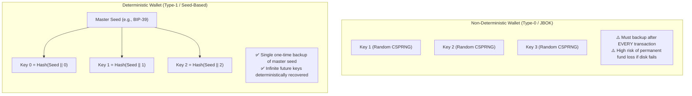

| Parameter | Non-Deterministic (Type-0 / JBOK) | Deterministic (Type-1 / Seed-Based) |
| :--- | :--- | :--- |
| **Key Generation** | Unrelated random numbers from CSPRNG (`wallet.dat`) | Sequential mathematical derivation from a single seed |
| **Backup Frequency** | Continuous; after every transaction or change address | **Once-and-done**; single seed backup recovers everything |
| **Address Derivation** | Independent generation; cannot pre-calculate | Formulaic: $k_i = \text{Hash}(\text{Seed} \,\|\, i)$ |
| **Loss Vulnerability** | High; unbacked change keys result in permanent coin loss | Low; complete recovery from 12 or 24 mnemonic words |

#### 1. Non-Deterministic Wallets (Type-0 / JBOK: "Just a Bunch of Keys")
- In early Bitcoin implementations, the wallet was simply a file containing 100 random private keys (`wallet.dat`).
- **Limitation**: Every time keys were exhausted or a new change address was generated, the user had to create a fresh backup of the wallet file. If the hard drive crashed before a backup was made, any newly generated change addresses and their funds were permanently lost.

#### 2. Deterministic Wallets (Type-1)
- All keys are derived sequentially from a single starting master number (a seed) using a mathematical one-way hash function:
$$k_i = \text{Hash}(\text{Seed} \,||\, i)$$
- A single backup of the seed protects all current and future keys.

---

### 4.3 Hierarchical Deterministic (HD) Wallets (BIP-32 & BIP-44)

BIP-32 enhanced deterministic wallets by organizing keys into a tree structure where parent keys derive child keys, child keys derive grandchild keys, and so forth, infinitely.

#### BIP-44 Multi-Account Derivation Path
BIP-44 defines a standardized 5-level path hierarchy:
$$\mathbf{m \,/\, \text{purpose}' \,/\, \text{coin\_type}' \,/\, \text{account}' \,/\, \text{change} \,/\, \text{address\_index}}$$

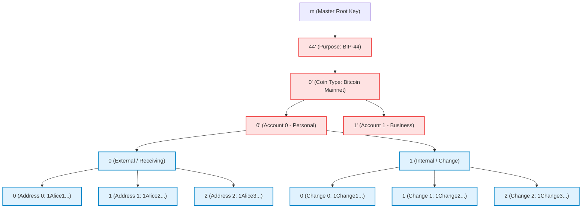

1. **`m`**: The master root private key derived from the BIP-39 seed.
2. **`purpose'`**: Set to `44'` for the BIP-44 standard. (Other standards: `49'` for P2WPKH-in-P2SH SegWit, `84'` for Native SegWit Bech32).
3. **`coin_type'`**: Standardized cryptocurrency index defined in SLIP-0044:
   - `0'`: Bitcoin Mainnet
   - `1'`: Bitcoin Testnet
   - `60'`: Ethereum
   - `2'`: Litecoin
4. **`account'`**: Separates funds into distinct logical accounts (e.g., `0'` for Personal, `1'` for Business, `2'` for Savings).
5. **`change`**: 
   - `0` (External): Addresses used for receiving payments from third parties.
   - `1` (Internal): Change addresses used to receive change back from outgoing transactions.
6. **`address_index`**: Sequential index (`0`, `1`, `2`, ..., $2^{31}-1$) for generating unique receiving addresses.

#### HD Wallet Architecture Diagram:

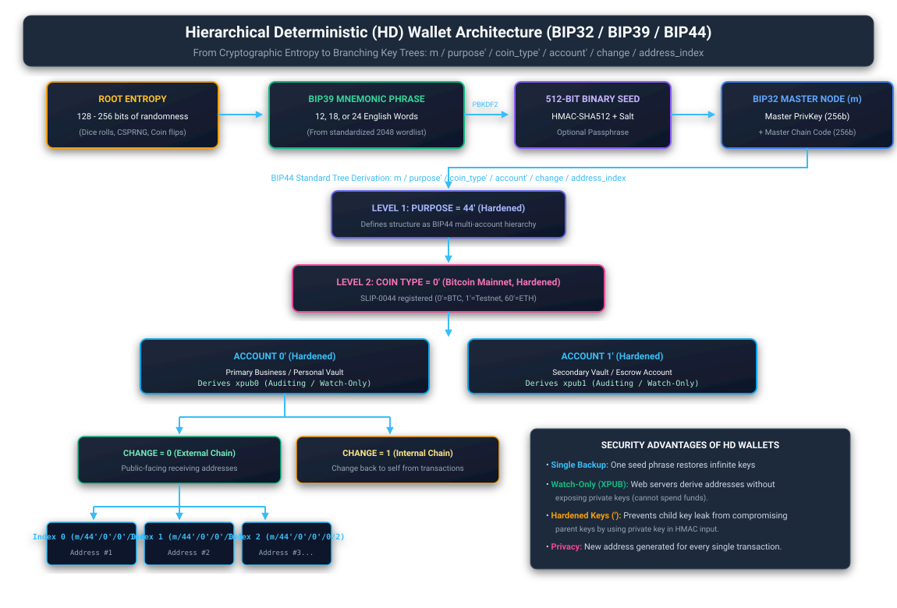

---

### 4.4 Hardened vs Normal Derivation

BIP-32 introduces two distinct child derivation mechanisms based on the child index $i$:

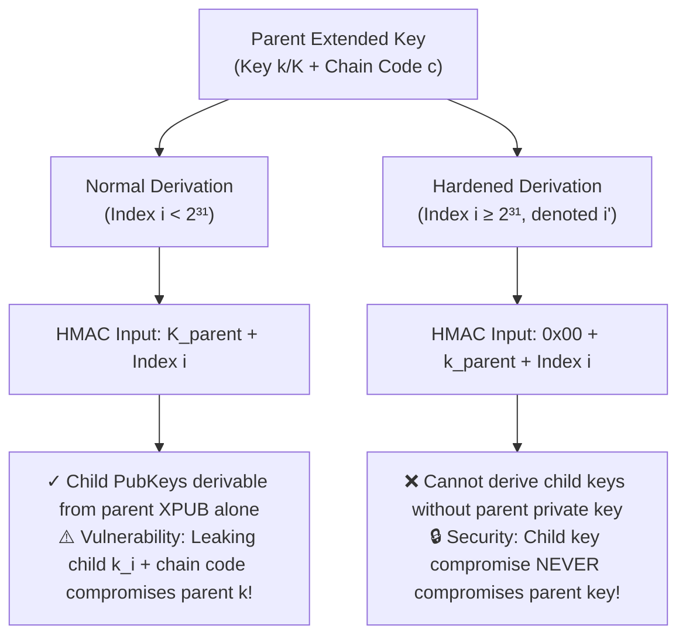

| Derivation Property | Normal Derivation ($0 \le i < 2^{31}$) | Hardened Derivation ($2^{31} \le i < 2^{32}$,$i'$) |
| :--- | :--- | :--- |
| **HMAC-SHA512 Input** | $c_{\text{parent}} \,\|\, K_{\text{parent}} \,\|\, i$|$c_{\text{parent}} \,\|\, \text{0x00} \,\|\, k_{\text{parent}} \,\|\, i$ |
| **Key Required at Parent** | Parent Public Key ($K$) suffices | Parent Private Key ($k$) strictly mandatory |
| **Derivation from XPUB?** | **Allowed**: Child public keys derived without private key | **Blocked**: Child public keys cannot be derived from XPUB |
| **Security Risk** | Leaking 1 child private key $k_i$+ parent chain code$c$exposes parent$k$ | Completely immune: Child private key leak cannot leak parent key |
| **BIP-44 Usage** | Address & Change levels (`change`, `address_index`) | Account isolation (`purpose'`, `coin_type'`, `account'`) |

#### 1. Normal Derivation ($0 \le i < 2^{31}$)
- The HMAC-SHA512 input is:
$$I = \text{HMAC-SHA512}\Big(c_{\text{parent}}, \, K_{\text{parent}} \,||\, i\Big)$$
- Because it only requires the parent **public key** $K_{\text{parent}}$, an extended public key (`xpub`) can derive child public keys without knowing the parent private key!
- **Security Vulnerability**: If an attacker gets access to the parent chain code $c_{\text{parent}}$AND steals any single unhardened child private key$k_i$, the attacker can mathematically compute the parent private key$k_{\text{parent}}$, compromising the entire wallet tree!

#### 2. Hardened Derivation ($2^{31} \le i < 2^{32}$, represented with a prime symbol `'`)
- The HMAC-SHA512 input uses the parent **private key** directly:
$$I = \text{HMAC-SHA512}\Big(c_{\text{parent}}, \, \text{0x00} \,||\, k_{\text{parent}} \,||\, i\Big)$$
- A parent public key cannot be used to derive hardened child public keys.
- **Security Benefit**: Leaking a hardened child private key does not leak the parent private key. Therefore, BIP-44 mandates hardened derivation for `purpose'`, `coin_type'`, and `account'`.

---

### 4.5 Custody Models: Hot vs Cold, Hardware Wallets & Physical Storage

| Feature | Hot Wallet | Cold Wallet | Hardware Wallet | MultiSig Vault |
| :--- | :--- | :--- | :--- | :--- |
| **Internet Connection** | Continuously online | Completely offline | Offline (USB/NFC/QR) | Mixed (M-of-N distribution) |
| **Examples** | Mobile (Exodus, Trust), Web extensions (Metamask), Exchanges | Paper wallet, Metal backup | Ledger, Trezor, Coldcard | 2-of-3 Casa, Unchained Capital |
| **Attack Vector Exposure** | Keyloggers, malware, remote hacks | Physical theft, loss, damage | Physical tampering (mitigated by Secure Element) | Requires compromising multiple independent locations |
| **Signing Mechanism** | Local RAM on host OS | Air-gapped offline computer | Internal Secure Element chip | Threshold quorum of distinct devices |
| **Primary Use Case** | Daily spending, small balances | Long-term institutional hodling | High-value personal custody | Corporate treasury, DAO governance |

#### Physical Storage Best Practices:
1. **Paper Wallets**: Printing QR codes of keys. Highly vulnerable to water damage, ink degradation, and house fires.
2. **Metal Seed Plates (Titanium / Stainless Steel)**: Engraving the 12/24 BIP-39 words onto industrial stainless steel plates capable of withstanding temperatures exceeding 1400°C, physical crushing, and corrosive acids.

---

## 5. Bitcoin Transactions & The UTXO Model

### 5.1 Concept of UTXO (Unspent Transaction Output)

Bitcoin does not track bank account balances. On the Bitcoin network:
- There is no table of accounts with account numbers and balances.
- Bitcoins exist only as **Unspent Transaction Outputs (UTXOs)**.
- A user's "balance" is simply the mathematical sum of all valid, spendable UTXOs associated with private keys controlled by the user's wallet.

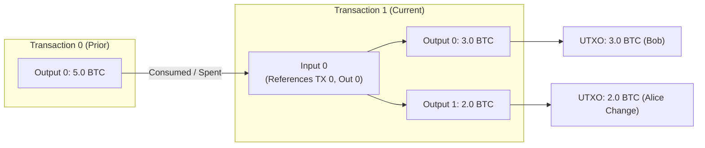

---

### 5.2 Account-Based Model vs UTXO Model Comparison

| Feature | Account-Based Model (e.g., Ethereum, Banks) | UTXO Model (Bitcoin) |
| :--- | :--- | :--- |
| **State Representation** | Global world state mapping addresses directly to balances | Global set of discrete, unspent coin fragments (`UTXO Set`) |
| **State Transitions** | Account balance is incremented or decremented | Existing UTXOs are destroyed; new UTXOs are created |
| **Concurrency / Parallelism** | Difficult; transactions from same account must execute sequentially to prevent nonce collisions | Highly concurrent; transactions consuming disjoint UTXOs can validate in parallel |
| **Double-Spend Detection** | Checks account sequence number (nonce) | Verifies whether the referenced outpoint is present in the active UTXO set |
| **Privacy Impact** | Address reuse is inherent, linking all activities | Encourages single-use addresses for every transaction output |
| **Storage in Memory** | Accounts table with storage trees | `Chainstate` LevelDB database stored in RAM (~5–10 GB) |

---

### 5.3 The Rule of Entirety & Implicit Miner Fees

#### The "Rule of Entirety" (Physical Cash Note Analogy)
> **Crucial Rule**: A UTXO cannot be partially spent! It is strictly atomic.

If you have a 100-rupee note in your wallet and want to buy a 30-rupee book, you cannot tear off 30% of the paper note. You must hand the entire 100-rupee note to the cashier, who returns a new 70-rupee note as change.
Similarly, in Bitcoin:
- If Bob owns a 3.0 BTC UTXO and wants to send 1.0 BTC to David, Bob's transaction must consume the entire 3.0 BTC UTXO.
- The transaction creates two new outputs:
  1. Output 0: 1.0 BTC locked to David's address.
  2. Output 1: 1.999 BTC locked to a change address belonging to Bob.

#### Implicit Miner Transaction Fees
Notice in the example above:
$$\sum \text{Inputs} = 3.000 \text{ BTC}$$
$$\sum \text{Outputs} = 1.000 + 1.999 = 2.999 \text{ BTC}$$
Where did the missing 0.001 BTC go?
> **Exam Fact**: Bitcoin transactions do **not** have an explicit "Fee" field in their raw byte serialization!

The transaction fee is **implicit**, defined by the difference between total input value and total output value:
$$\text{Miner Fee} = \sum_{i} \text{Value}(\text{Input}_i) - \sum_{j} \text{Value}(\text{Output}_j)$$
The miner who successfully mines the block containing this transaction is authorized by the consensus rules to claim all implicit fees in their **Coinbase transaction**.

> **Warning / Trap**: If a developer constructs a raw transaction with 5.0 BTC input, assigns 1.0 BTC to the recipient, and forgets to specify a change output, the remaining 4.0 BTC is treated by the network as an intentional miner fee and claimed by the miner!

---

### 5.4 Comprehensive Transaction Walkthrough: Alice, Bob, and David

Let us trace the exact lifecycle presented across Dr. Sandhya's transaction lecture slides:

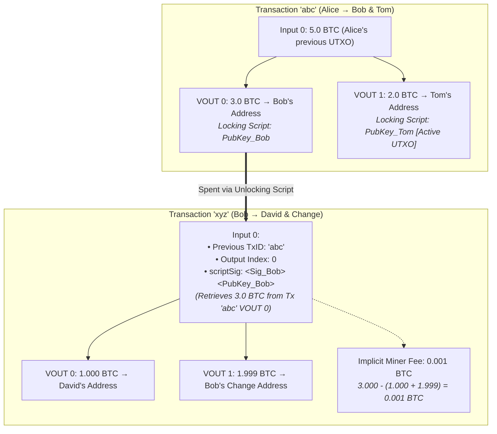

| Transaction | Section | Component / Field | Value | Locking / Unlocking Detail | State After Tx 'xyz' |
| :--- | :--- | :--- | :--- | :--- | :--- |
| **Tx `abc`** | Inputs | Input 0 | 5.0 BTC | Alice's Signature + Public Key | Consumed / Spent |
| | Outputs | VOUT 0 | 3.0 BTC | Locked to Bob (`PubKey_Bob`) | **Spent by Tx 'xyz'** |
| | Outputs | VOUT 1 | 2.0 BTC | Locked to Tom (`PubKey_Tom`) | **Active UTXO** (Unspent) |
| **Tx `xyz`** | Inputs | Input 0 | (3.0 BTC) | Points to `abc[0]`, scriptSig: `<Sig_Bob> <PubKey_Bob>` | Consumed |
| | Outputs | VOUT 0 | 1.000 BTC | Locked to David's Address | **Active UTXO** (Unspent) |
| | Outputs | VOUT 1 | 1.999 BTC | Locked to Bob's Change Address | **Active UTXO** (Unspent) |
| | *Fee* | Implicit Fee | 0.001 BTC | Difference: $\sum \text{Inputs} - \sum \text{Outputs}$ | Claimed by Miner |

#### Status of Outputs:
1. **Tx 'abc' VOUT 0 (3.0 BTC)**: Was active/unspent; upon confirmation of Tx 'xyz', it becomes **spent / inactive**. Any future attempt to reference Tx 'abc' VOUT 0 is rejected as an illegal **Double-Spend**.
2. **Tx 'abc' VOUT 1 (2.0 BTC)**: Remains active / unspent (Tom has not spent it).
3. **Tx 'xyz' VOUT 0 (1.0 BTC)**: Active UTXO owned by David.
4. **Tx 'xyz' VOUT 1 (1.999 BTC)**: Active UTXO owned by Bob.

#### UTXO Lifecycle Diagram:

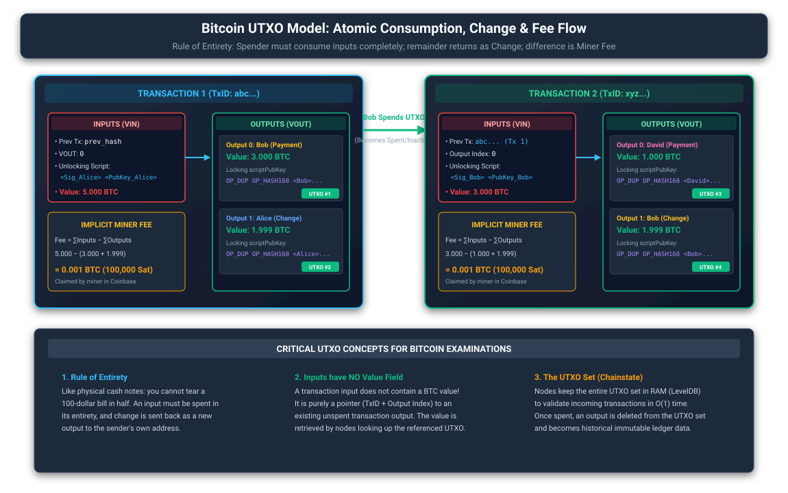

---

### 5.5 Raw Byte Anatomy of a Bitcoin Transaction

Every Bitcoin transaction is serialized into raw hexadecimal bytes for network broadcasting. Below is the anatomical deconstruction of a standard 1-input, 2-output legacy P2PKH transaction:

```
0100000001a1b2c3...000000006b483045...ffffffff0200e1f505000000001976a914...88ac...00000000
```

#### Field-by-Field Byte Breakdown:

| Field | Size (Bytes) | Description & Byte Order | Example Hex in Slides |
| :--- | :--- | :--- | :--- |
| **Version** | 4 Bytes | Transaction protocol version (Little-Endian) | `01 00 00 00` (Version 1) |
| **Input Count** | 1–9 Bytes (VarInt) | Number of transaction inputs | `01` (1 input) |
| **Outpoint TxID** | 32 Bytes | Hash of referenced transaction (**Little-Endian / Byte-Reversed**) | `4a 5e 1e ... b2 c3` |
| **Outpoint VOUT** | 4 Bytes | Output index in referenced transaction (Little-Endian) | `00 00 00 00` (Index 0) |
| **ScriptSig Length** | 1–9 Bytes (VarInt) | Length of unlocking script in bytes | `6b` (107 bytes in decimal) |
| **ScriptSig** | 107 Bytes | Unlocking script (`<Sig>` + `<PubKey>`) | DER signature (`70–72B`) + `01` (SIGHASH_ALL) + PubKey (`33/65B`) |
| **Sequence** | 4 Bytes | Sequence number (used for locktime / RBF) | `ff ff ff ff` (Disable locktime) |
| **Output Count** | 1–9 Bytes (VarInt) | Number of transaction outputs | `02` (2 outputs) |
| **Output 0: Value** | 8 Bytes | Satoshi amount (Little-Endian: $10^8 \text{ sat} = 1 \text{ BTC}$) | `e0 43 16 00 00 00 00 00` ($1.45 \times 10^6 \text{ sat}$) |
| **Output 0: ScriptLen** | 1–9 Bytes (VarInt) | Length of locking script in bytes | `19` (25 bytes in decimal) |
| **Output 0: ScriptPubKey** | 25 Bytes | Locking script: `OP_DUP OP_HASH160 <20B Hash> OP_EQUALVERIFY OP_CHECKSIG` | `76 a9 14 [20-byte hash] 88 ac` |
| **Output 1: Value** | 8 Bytes | Satoshi amount for change output (Little-Endian) | Little-endian satoshi value |
| **Output 1: ScriptLen** | 1–9 Bytes (VarInt) | Length of change locking script | `19` (25 bytes) |
| **Output 1: ScriptPubKey** | 25 Bytes | Change locking script | `76 a9 14 [Bob's change hash] 88 ac` |
| **Locktime** | 4 Bytes | Block height or Unix epoch timestamp (0 = immediate) | `00 00 00 00` (Execute immediately) |

#### Little-Endian Byte Reversal Rule:
In Bitcoin serialization, integers and transaction hashes in inputs are stored in **Little-Endian format** (least significant byte first). 
- If TxID displayed on a block explorer is:
  `c3b2a1...`
- It is stored in the raw transaction input bytes as:
  `...a1b2c3`
When parsing raw transaction bytes, the TxID bytes **must be reversed** to match the cryptographic hash.

#### Variable Length Integer (VarInt) Encoding:
To conserve space, Bitcoin encodes integers of variable magnitude using VarInt:
- Value $< \text{0xFD}$: Serialized as 1 single byte.
- Value $\le \text{0xFFFF}$: Serialized as `0xFD` followed by 2 bytes (little-endian).
- Value $\le \text{0xFFFFFFFF}$: Serialized as `0xFE` followed by 4 bytes (little-endian).
- Value $> \text{0xFFFFFFFF}$: Serialized as `0xFF` followed by 8 bytes (little-endian).

---

## 6. Bitcoin Scripting Engine & Standard Transaction Types

### 6.1 Bitcoin Script Execution Architecture (Stack Machine)

Bitcoin uses a stack-based, Forth-like programming language known as **Script**. 

#### Distinct Characteristics:
1. **Stack-Based Architecture**: Operations push data onto or pop data off a Last-In, First-Out (LIFO) stack.
2. **Turing Incomplete**: Bitcoin Script has intentionally **no loops, jumps, or recursion** (`no GOTO, no WHILE, no FOR`). This prevents infinite execution loops and protects nodes from Denial-of-Service (DoS) attacks.
3. **Execution Model**: To spend a UTXO, the node combines the **Unlocking Script** (`scriptSig`) provided in the spending input with the **Locking Script** (`scriptPubKey`) stored in the referenced UTXO:
$$\text{Combined Execution} = \text{scriptSig} \,||\, \text{scriptPubKey}$$
If execution completes without errors and the top value remaining on the stack is non-zero (TRUE), the spending condition is satisfied, and the transaction is valid.

---

### 6.2 Step-by-Step P2PKH Validation Trace

Pay-to-Public-Key-Hash (P2PKH) is the fundamental legacy transaction locking script.
- **scriptSig (Unlocking Script)**: `<Sig> <PubKey>`
- **scriptPubKey (Locking Script)**: `OP_DUP OP_HASH160 <PubKeyHash> OP_EQUALVERIFY OP_CHECKSIG`
- **Combined Script**:
  ` <Sig> <PubKey> OP_DUP OP_HASH160 <PubKeyHash> OP_EQUALVERIFY OP_CHECKSIG `

#### Step-by-Step Stack Evaluation:

| Step | Operation / Opcode | Action Taken by Bitcoin Script Engine | Resulting Stack State (Top &rarr; Bottom) | Status / Condition |
| :---: | :--- | :--- | :--- | :--- |
| **1** | `<Sig>` | Push unlocking digital signature onto stack | `[ <Sig> ]` | Success |
| **2** | `<PubKey>` | Push spender's public key onto stack | `[ <PubKey>, <Sig> ]` | Success |
| **3** | `OP_DUP` | Duplicate top element (`<PubKey>`) | `[ <PubKey>, <PubKey>, <Sig> ]` | Duplication complete |
| **4** | `OP_HASH160` | Hash top element: $\text{RIPEMD160}(\text{SHA256}(\text{PubKey}))$ | `[ <ComputedPubKeyHash>, <PubKey>, <Sig> ]` | Hash computed |
| **5** | `<ExpectedPubKeyHash>` | Push recipient's locking hash from `scriptPubKey` | `[ <ExpectedPubKeyHash>, <ComputedPubKeyHash>, <PubKey>, <Sig> ]` | Locking target loaded |
| **6** | `OP_EQUALVERIFY` | Pop top 2 items; verify $\text{Computed} == \text{Expected}$ | `[ <PubKey>, <Sig> ]` | If equal: continue; if not: abort transaction |
| **7** | `OP_CHECKSIG` | Pop `<PubKey>` & `<Sig>`; verify ECDSA signature over tx hash | `[ 1 ]` (TRUE) | **Transaction output successfully unlocked!** |

---

### 6.3 Standard Transaction Types: P2PK, P2PKH, P2SH, MultiSig, OP_RETURN, Coinbase

| Type | Locking Script (`scriptPubKey`) | Unlocking Script (`scriptSig`) | Address Prefix | Purpose / Notes |
| :--- | :--- | :--- | :--- | :--- |
| **P2PK** (Pay-to-Public-Key) | `<PubKey> OP_CHECKSIG` | `<Sig>` | None (Raw pubkey) | Early Satoshi format; used in original Coinbase outputs. |
| **P2PKH** (Pay-to-Public-Key-Hash) | `OP_DUP OP_HASH160 <PubKeyHash> OP_EQUALVERIFY OP_CHECKSIG` | `<Sig> <PubKey>` | Starts with **`1`** | Standard legacy transaction; protects pubkey behind hash until spent. |
| **P2SH** (Pay-to-Script-Hash, BIP-16) | `OP_HASH160 <ScriptHash> OP_EQUAL` | `[signatures...] <RedeemScript>` | Starts with **`3`** | Shifts burden of complex script storage from sender to receiver. Used for MultiSig. |
| **Bare MultiSig** | `OP_M <Pub1> <Pub2> ... <PubN> OP_N OP_CHECKMULTISIG` | `OP_0 <Sig1> <Sig2> ...` | None (Direct script) | Max 3 public keys in bare format; obsolete, superseded by P2SH. |
| **OP_RETURN** (Data Storage) | `OP_RETURN <data (up to 80 bytes)>` | Unspendable | None | **Provably unspendable**. Pruned from UTXO set in RAM, eliminating bloat. Used for timestamps/notarization. |
| **Coinbase** | Normal P2PKH or P2SH script | Arbitrary data (`Coinbase Script`, block height BIP-34) | None / Miner's addr | Generates new bitcoins (subsidy + all block fees). Has **no previous UTXO input**! |

#### Anatomy of a Coinbase Transaction:
- **Input Outpoint**: Prev TxID is 32 zero bytes (`0000000000000000000000000000000000000000000000000000000000000000`), VOUT is `0xFFFFFFFF`.
- **Coinbase Data**: The scriptSig does not contain a signature; instead, it contains arbitrary miner data (up to 100 bytes) including the block height (mandated by BIP-34) and the miner's extranonce pool tag (e.g., `/Foundry USA/`).
- **Output**: Sum of block subsidy (currently 3.125 BTC post-April 2024 halving) + all transaction fees from the block.

---

## 7. Bitcoin Peer-to-Peer Network Architecture & Protocols

The Bitcoin network operates as an unstructured peer-to-peer (P2P) overlay network running over standard TCP/IP (default TCP port 8333). All nodes communicate as equals (peers), with no centralized servers, domain controllers, or coordinators.

### 7.1 P2P Overlay Topology & Types of Bitcoin Nodes

A node is a computer running the Bitcoin client software. Nodes are categorized by the functional roles they fulfill:

| Node Type | Network Routing | Full Blockchain Ledger | Mining Engine (PoW) | Wallet Services | Primary Role |
| :--- | :---: | :---: | :---: | :---: | :--- |
| **Reference Client (Bitcoin Core)** | **YES** | **YES** | **YES** (Solo) | **YES** | Complete standard node fulfilling all 4 roles |
| **Full Node (Pruned or Archive)** | **YES** | **YES** | **NO** | Optional | Independent consensus validation & gossip relay |
| **Solo Miner** | **YES** | **YES** | **YES** | **NO** | Solves PoW difficulty target over standard P2P |
| **SPV Node (Lightweight Client)** | **YES** | **NO** (Headers only) | **NO** | **YES** | Fast client verification via Merkle proofs |

#### Detailed Node Roles:
1. **Full Node**: Maintains a full copy of the blockchain ledger and the complete active UTXO set (`chainstate`). Validates every transaction and block against consensus rules independently. Discards invalid blocks even if produced by 99% of miners.
2. **SPV (Simplified Payment Verification) / Lightweight Node**: Does not download transactions or full blocks. Only downloads the 80-byte block headers. Verifies whether a transaction is included in a block using **Merkle Inclusion Proofs** (Merkle Paths) verified against the Merkle root in the block header. Must connect to at least one full node to query data.
3. **Mining Node**: Runs specialized hardware (ASICs) executing SHA-256 double-hashing to solve the Proof-of-Work difficulty puzzle. In the modern Bitcoin network, almost all solo miners participate via mining pools.

---

### 7.2 Mining Pools & The Stratum Protocol

In the early days of Bitcoin, individual nodes mined solo over the standard P2P protocol. Due to astronomical difficulty increases, individual miners now join **Mining Pools**.

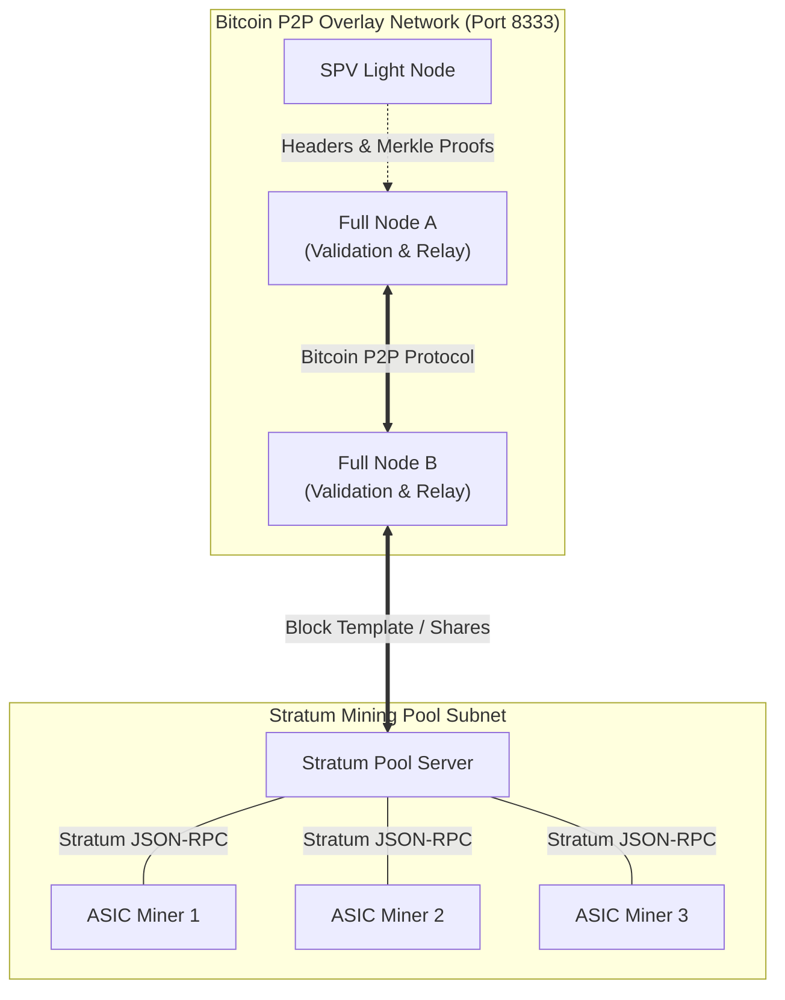

- **Stratum Protocol**: A low-overhead, JSON-RPC communication protocol used between mining hardware (ASICs) and pool servers.
- **Extended Bitcoin Network**: The holistic ecosystem comprising the primary Bitcoin P2P mesh, lightweight SPV clients, Stratum pool networks, and the Layer-2 Lightning Network.

---

### 7.3 Node Discovery for a Bootstrap Node

When a brand-new node ("Bootstrap Node") launches for the very first time, its blockchain is empty (containing only the hardcoded Genesis block at height 0), and its peer table is completely empty. How does it find other nodes in the network?

#### The 3-Step Lifecycle:
1. **Node Discovery**: Locating active peers on the global Internet.
2. **Node Connection**: Establishing TCP sessions and executing the `version`/`verack` protocol handshake.
3. **Block Download**: Synchronizing the blockchain ledger via the Gossip protocol.

#### How a Bootstrap Node Finds Peers:
1. **DNS Seeds**: The client software includes hardcoded domain names of static DNS seed servers maintained by prominent Bitcoin Core developers (e.g., `seed.bitcoin.sipa.be`, `dnsseed.bluematt.me`, `seed.bitcoinstats.com`).
   - The bootstrap node issues a standard DNS query (`A` or `AAAA` lookup).
   - The DNS seed server replies with a dynamic list of IP addresses of stable, active full nodes.
2. **Fallback Hardcoded Seed Nodes**: If local firewalls or ISP DNS hijacking blocks DNS queries, the software falls back to a hardcoded static list of reliable node IP addresses embedded in the C++ source code (`chainparams.cpp`).
3. **Manual Node Configuration**: Users can manually specify peer IPs via the command line or config file using `-addnode=<ip>` or `-connect=<ip>`.
4. **Local Peer Database (`peers.dat`)**: Once connected, the node saves all discovered peer IP addresses to a persistent local database file (`peers.dat`). Upon rebooting, the node connects directly to known peers from `peers.dat` without querying DNS seeds.

---

### 7.4 Connection Handshake Protocol (version / verack)

Once the bootstrap node (Node A) discovers an active peer (Node B), it initiates a TCP handshake on port 8333. Once the TCP socket is open, the nodes must perform the **Bitcoin Application-Level Handshake**:

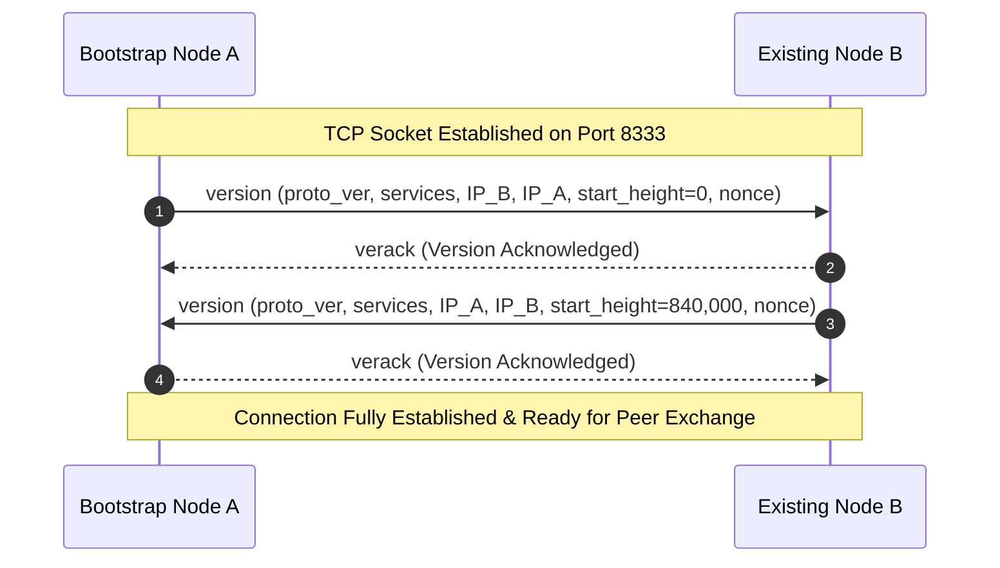

#### Parameters Transmitted in the `version` Message:
- **`version`**: The P2P protocol version supported by the node (e.g., `70016`).
- **`services`**: Bitmask of network capabilities supported (e.g., `NODE_NETWORK` indicates a full node capable of serving blocks; `NODE_WITNESS` indicates SegWit support).
- **`timestamp`**: Current epoch time (used to calculate network median time).
- **`addr_recv`**: IP address of the receiving node as seen by the sender.
- **`addr_from`**: IP address of the sending node.
- **`nonce`**: Random 64-bit integer generated per connection to detect and abort connections to oneself!
- **`subver` (User Agent)**: Software client name and version string (e.g., `"/Satoshi:26.0.0/"`).
- **`start_height`**: The current block height of the sending node's blockchain:
  - Node A (Bootstrap) sends: `start_height = 0`.
  - Node B (Synced Full Node) sends: `start_height = 840,000`.

#### The `verack` Message:
The `verack` (Version Acknowledgment) message contains only a 24-byte Bitcoin message header with no payload. It signals that both nodes have negotiated protocol parameters and the connection is officially open.

#### Node Discovery & Handshake Diagram:

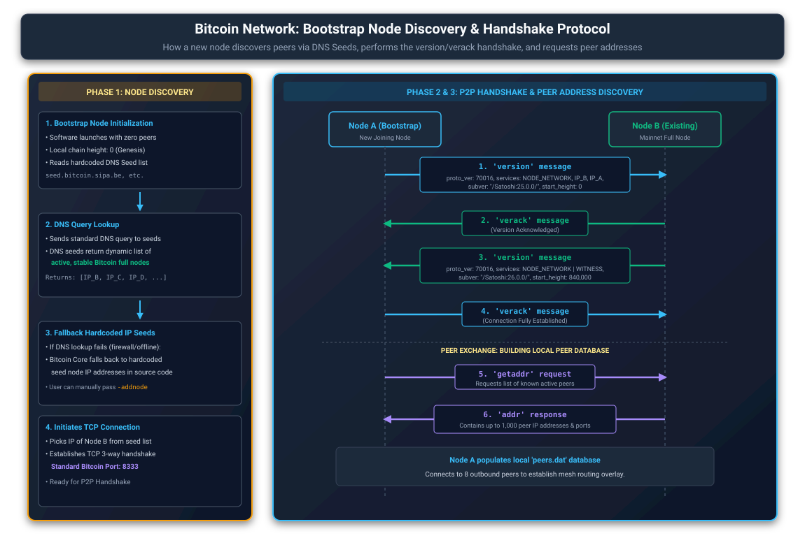

---

### 7.5 Peer Address Exchange (getaddr / addr)

To ensure decentralization and prevent network partitioning, nodes continuously discover and share IP addresses of other peers:
1. Node A transmits a **`getaddr`** message requesting known active peer addresses.
2. Node B responds with an **`addr`** message containing a serialized list of up to **1,000 peer records** (IP address, port number, timestamp, and supported services).
3. Node A records these in its local `peers.dat` file and establishes outbound connections to at least 8 independent peers to build a robust mesh network topology.

---

### 7.6 Block Download & Propagation (Gossip Protocol: inv, getdata, block)

Once Node A sees that Node B's `start_height` is greater than its own local height, Node A begins **Initial Block Download (IBD)**.

#### The Gossip Inventory Flow:

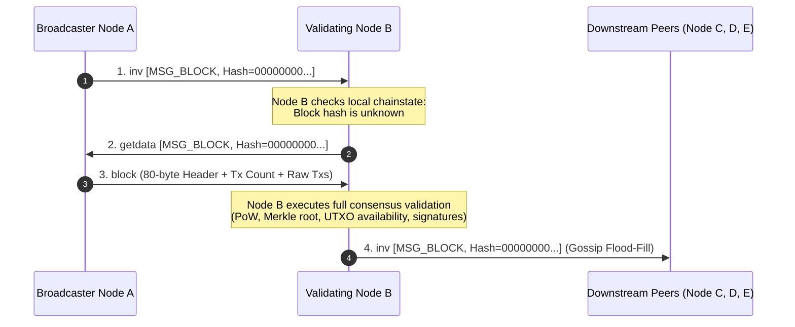

1. **`inv` (Inventory Announcement)**:
   - When a node receives or mines a new block (or transaction), it does **not** blast the multi-megabyte block payload to all peers blindly (which would cause massive network bandwidth congestion).
   - Instead, it sends an `inv` message containing an array of 32-byte hashes identifying items in its inventory.
   - For block synchronization, Node B sends an `inv` containing the hashes of the next 500 blocks.
2. **`getdata` (Data Request)**:
   - The receiving node queries its local database. If the hash is not present, it issues a `getdata` message requesting the specific payload.
3. **`block` (Full Payload Transmission)**:
   - The sender transmits the complete serialized `block` message (80-byte block header, transaction count, and all raw transactions).
4. **Local Consensus Validation**:
   - The receiving node independently validates:
     - Proof-of-Work: $\text{Hash}(\text{Header}) < \text{Target}$.
     - Merkle Root matches the hash of all included transactions.
     - Block size does not exceed limits.
     - Every input references a valid, unspent UTXO in `chainstate`.
     - Every digital signature (`scriptSig`) validates against its `scriptPubKey`.
     - No double-spending exists within the block.
5. **Gossip Propagation**:
   - Once validated, the node updates its UTXO set, appends the block to its local chain, and broadcasts an `inv` message to all its other neighbor peers. This exponential flood-fill mechanism is called the **Gossip Protocol**.

#### Block Propagation Diagram:

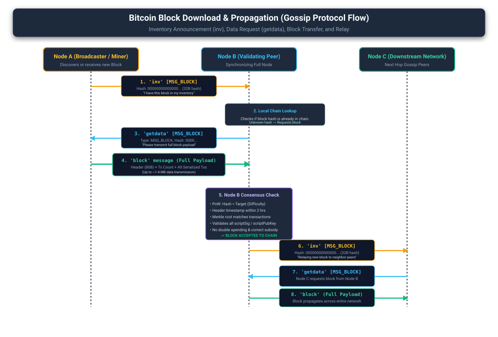

---

## 8. Comprehensive University Exam Preparation & Numerical Problems

### 8.1 Worked Numerical Problems

#### Numerical 1: Calculating Transaction Fees & Change
**Problem**:
Alice holds two UTXOs:
- UTXO 1: $1.85 \text{ BTC}$- UTXO 2:$0.65 \text{ BTC}$Alice constructs a transaction to send$2.10 \text{ BTC}$to Bob. The prevailing network fee rate is$20 \text{ satoshis/vByte}$, and Alice's transaction size is calculated to be$374 \text{ vBytes}$.
Calculate:
1. Total Input Amount in Satoshis.
2. Total Miner Fee in Satoshis and BTC.
3. The exact Change Amount returned to Alice in Satoshis and BTC.

**Solution**:
1. **Total Inputs**:
   $$\text{Total BTC} = 1.85 + 0.65 = 2.50 \text{ BTC}$$
   $$\text{Total Satoshis} = 2.50 \times 10^8 = 250,000,000 \text{ satoshis}$$

2. **Miner Fee**:
   $$\text{Fee (satoshis)} = \text{Transaction Size (vBytes)} \times \text{Fee Rate (sat/vByte)}$$
   $$\text{Fee} = 374 \times 20 = \mathbf{7,480 \text{ satoshis}}$$
   $$\text{Fee (BTC)} = \frac{7480}{10^8} = \mathbf{0.00007480 \text{ BTC}}$$

3. **Change to Alice**:
   $$\text{Bob's Payment} = 2.10 \text{ BTC} = 210,000,000 \text{ satoshis}$$
   $$\text{Change} = \text{Total Inputs} - \text{Bob's Payment} - \text{Miner Fee}$$
   $$\text{Change (satoshis)} = 250,000,000 - 210,000,000 - 7,480 = \mathbf{39,992,520 \text{ satoshis}}$$
   $$\text{Change (BTC)} = \frac{39,992,520}{10^8} = \mathbf{0.39992520 \text{ BTC}}$$

---

#### Numerical 2: Elliptic Curve Coordinate Compression Prefix
**Problem**:
Given a public key point on secp256k1 where:
- $X = \text{0x79BE667EF9DCBBAC55A06295CE870B07029BFCDB2DCE28D959F2815B16F81798}$-$Y = \text{0x483ADA7726A3C4655DA4FBFC0E1108A8FD17B448A68554199C47D08FFB10D4B8}$
Determine:
1. The uncompressed public key representation and its byte length.
2. The compressed public key representation and its byte length.

**Solution**:
1. **Uncompressed Representation**:
   - Prefix is always `0x04`.
   - Concatenation: `04` + $X$(32 bytes) +$Y$ (32 bytes).
   - Length: $1 + 32 + 32 = \mathbf{65 \text{ bytes}}$ (520 bits).
   $$\text{Uncompressed} = \text{0479BE667E...16F81798483ADA77...FB10D4B8}$$

2. **Compressed Representation**:
   - Examine the least significant bit (parity) of the $Y$-coordinate.
   - The final hex byte of $Y$ is `B8`.
   - In binary, `0xB8` $= 10111000_2$. The least significant bit is$0$($\mathbf{even}$).
   - Because $Y$ is even, the prefix is **`0x02`** (if it were odd, it would be `0x03`).
   - Length: $1 + 32 = \mathbf{33 \text{ bytes}}$ (264 bits).
   $$\text{Compressed} = \text{0279BE667EF9DCBBAC55A06295CE870B07029BFCDB2DCE28D959F2815B16F81798}$$

---

### 8.2 High-Yield Short Answer Questions (2–5 Marks)

#### Q1: What is the primary difference between a compressed and uncompressed private key in Bitcoin?
**Answer**:
Mathematically, they are identical 256-bit scalar numbers. The term "compressed private key" is an implementation convention: when exported in Wallet Import Format (WIF), a `0x01` byte suffix is appended to the private key before Base58Check encoding. This tells modern wallets to derive a compressed public key (`33 bytes`, prefix `02`/`03`) rather than a legacy uncompressed public key (`65 bytes`, prefix `04`). Compressed WIF keys start with `'K'` or `'L'` and are 52 characters long; uncompressed WIF keys start with `'5'` and are 51 characters long.

#### Q2: Why does Bitcoin use both SHA-256 and RIPEMD-160 to derive a Bitcoin address?
**Answer**:
1. **Defense-in-Depth**: If a structural cryptographic vulnerability is discovered in SHA-256, security is maintained by RIPEMD-160, and vice versa.
2. **Compact Address Length**: RIPEMD-160 reduces the public key hash to 160 bits (20 bytes), which is easier to print, display, and encode into QR codes than 256-bit hashes.
3. **Quantum Pre-Spending Protection**: The public key is hidden behind a one-way hash function until spent, preventing quantum Shor's algorithm attacks from discovering the private key before spending.

#### Q3: Explain why a transaction input contains no Bitcoin value field.
**Answer**:
A Bitcoin transaction input is strictly a pointer (`Outpoint`) consisting of a previous Transaction Hash (`TxID`, 32 bytes) and an Output Index (`VOUT`, 4 bytes), accompanied by an unlocking script (`scriptSig`). The input has no value field because the coin value is stored immutably in the referenced output. Validating nodes look up the referenced UTXO in their local `chainstate` database to determine the input value.

#### Q4: What is the "Rule of Entirety" in Bitcoin transactions?
**Answer**:
The Rule of Entirety states that a UTXO is atomic and indivisible; it must be spent completely. A user cannot spend a fraction of a UTXO. To spend part of an existing UTXO, the entire UTXO must be consumed as an input, and a new "change output" must be created to send the unspent remainder back to an address owned by the spender.

#### Q5: What is an OP_RETURN script and what is its primary benefit to full nodes?
**Answer**:
`OP_RETURN` is an opcode used to create a **provably unspendable** transaction output that carries arbitrary metadata (up to 80 bytes). Because it is mathematically proven to be unspendable, full nodes immediately prune `OP_RETURN` outputs from their active `chainstate` (UTXO set in RAM), preventing blockchain data storage bloat from exhausting node memory.

#### Q6: What parameters are exchanged during the Bitcoin node `version` handshake?
**Answer**:
The `version` message transmits: P2P protocol version, supported node services bitmask (`NODE_NETWORK`), current epoch timestamp, receiver IP address, sender IP address, a 64-bit random nonce (to prevent connecting to oneself), subversion string / user agent (`/Satoshi:26.0.0/`), and the node's current blockchain block height (`start_height`).

---

### 8.3 Comprehensive Long Answer / Essay Questions (10–15 Marks)

#### Question 1 (15 Marks):
**Discuss in exhaustive detail the mathematical and cryptographic process of generating a legacy Bitcoin address from initial entropy. Include the curve equations, coordinate compression, hash operations, checksum calculation, and Base58Check encoding.**

**Evaluation Rubric & Model Answer Structure**:
1. **Entropy and Private Key Generation (3 Marks)**:
   - Define entropy requirements (256-bit CSPRNG, coin flipping).
   - Range $1 \le k < n$, where$n$is the secp256k1 order. Explain security against brute-force ($2^{128}$ operations).
2. **Elliptic Curve Mechanics (4 Marks)**:
   - State Weierstrass equation: $y^2 \equiv x^3 + 7 \pmod p$. State$p = 2^{256} - 2^{32} - 977$.
   - Scalar point multiplication: $K = k \times G$.
   - Explain ECDLP one-way hardness.
   - Contrast uncompressed ($04 || X || Y$, 65 bytes) vs compressed ($02/03 || X$, 33 bytes) using$y^2$ modular roots and even/odd parity.
3. **HASH160 & Version Prefix (3 Marks)**:
   - Explain SHA-256 followed by RIPEMD-160: $\text{HASH160}(K) = \text{RIPEMD160}(\text{SHA256}(K))$.
   - Justify the two algorithms (defense-in-depth, 20-byte size, quantum resistance).
   - Prepend Mainnet version byte `0x00` $\rightarrow 21$-byte payload.
4. **Checksum & Base58Check Encoding (5 Marks)**:
   - Double SHA-256 hash: $H_2 = \text{SHA256}(\text{SHA256}(21\text{B Payload}))$.
   - Extract first 4 bytes as Checksum. Assemble 25-byte binary structure.
   - Base58 alphabet explanation: Explain the removal of `0`, `O`, `I`, `l`, `+`, `/`.
   - Explain why Mainnet P2PKH addresses start with `'1'`. Include the pipeline diagram.

---

#### Question 2 (15 Marks):
**Explain the complete anatomy and execution lifecycle of a Bitcoin transaction. Trace the step-by-step stack evaluation of a P2PKH script, and deconstruct the raw byte format of a transaction.**

**Evaluation Rubric & Model Answer Structure**:
1. **UTXO Model & Rule of Entirety (4 Marks)**:
   - Define UTXO. Compare with account-based model (state transitions, parallelism, privacy).
   - Explain atomic spending and change output calculation.
   - Define implicit miner fees: $\text{Fee} = \sum \text{Inputs} - \sum \text{Outputs}$.
2. **Raw Byte Serialization Anatomy (4 Marks)**:
   - Provide a table detailing all fields: Version (4B), Input Count (VarInt), Outpoint TxID (32B little-endian), Outpoint VOUT (4B), ScriptSig Len (VarInt), ScriptSig (107B), Sequence (4B), Output Count (VarInt), Value (8B satoshis), ScriptPubKey Len (VarInt), ScriptPubKey (25B), Locktime (4B).
   - Explain Little-Endian byte reversal and VarInt encoding.
3. **Stack Evaluation of P2PKH (7 Marks)**:
   - State ScriptSig: `<Sig> <PubKey>`.
   - State ScriptPubKey: `OP_DUP OP_HASH160 <PubKeyHash> OP_EQUALVERIFY OP_CHECKSIG`.
   - Provide the 7-step stack diagrams showing stack states:
     - `[ <Sig> ]`
     - `[ <Sig>, <PubKey> ]`
     - `[ <Sig>, <PubKey>, <PubKey> ]`
     - `[ <Sig>, <PubKey>, <ComputedHash> ]`
     - `[ <Sig>, <PubKey>, <ComputedHash>, <ExpectedHash> ]`
     - `[ <Sig>, <PubKey> ]`
     - `[ 1 ]`
   - Conclude with verification condition (stack top evaluates to non-zero).

---

#### Question 3 (10 Marks):
**Describe how a brand-new bootstrap node joins the Bitcoin P2P network. Explain the peer discovery mechanisms, the version/verack handshake protocol, and the block propagation Gossip flow.**

**Evaluation Rubric & Model Answer Structure**:
1. **Bootstrap Discovery Mechanisms (3 Marks)**:
   - DNS Seeds: Dynamic lookup querying hardcoded seed servers.
   - Fallback hardcoded seed node IPs in source code.
   - Persistent `peers.dat` cache for subsequent restarts.
2. **Connection Handshake (`version` / `verack`) (4 Marks)**:
   - Diagram the 4-way message flow between Node A and Node B.
   - List key parameters: `version`, `services`, `start_height`, `nonce` (anti-self-connection).
   - Address exchange using `getaddr` and `addr` (up to 1,000 peers).
3. **Block Propagation via Gossip Protocol (3 Marks)**:
   - Explain the 3-message sequence: `inv` $\rightarrow `getdata` \rightarrow$ `block`.
   - Why not broadcast full blocks directly? (Bandwidth management).
   - Local validation checks before relaying `inv` downstream.

---

### 8.4 Summary Revision Flashcard & Common Pitfalls

| Concept / Parameter | Key Technical Specification & Exam Value |
| :--- | :--- |
| **Private Key** | 256-bit random integer; $1 \le k < n$ on secp256k1; 32 bytes |
| **Curve Equation** | $y^2 = x^3 + 7 \pmod p$;$p = 2^{256} - 2^{32} - 977$ |
| **Public Key (Uncompressed)** | `0x04` $\|$ $X$(32B)$\|$ $Y$ (32B) = 65 bytes (520 bits) |
| **Public Key (Compressed)** | `0x02` (even $Y$) or `0x03` (odd$Y$)$\|$ $X$ (32B) = 33 bytes (264 bits) |
| **WIF Compressed Suffix** | `0x01` appended before Base58Check; starts with `'K'` or `'L'` (52 chars) |
| **HASH160** | $\text{RIPEMD160}(\text{SHA256}(\text{PubKey})) = 20\text{ bytes}$ (160 bits) |
| **Checksum** | First 4 bytes of $\text{SHA256}(\text{SHA256}(\text{Version} \,\|\, \text{HASH160}))$ |
| **Base58 Alphabet** | 58 chars; excludes `'0'`, `'O'`, `'I'`, `'l'`, `'+'`, `'/'` |
| **Address Prefix** | `'1'` = Mainnet P2PKH; `'3'` = P2SH; `0x00` version byte |
| **BIP-32 / BIP-44 Path** | `m / purpose' / coin_type' / account' / change / address_index` |
| **Hardened vs Normal** | Hardened (index $\ge 2^{31}$, `'`) prevents parent private key leak from child |
| **UTXO Rule of Entirety** | UTXOs are atomic; must spend 100% of input; change returns to spender |
| **Implicit Miner Fee** | $\text{Fee} = \sum(\text{Inputs}) - \sum(\text{Outputs})$; no dedicated fee field in raw bytes |
| **Script Engine** | Stack-based, LIFO, Forth-like, Turing Incomplete (no loops) |
| **P2PKH Execution** | `OP_DUP` $\rightarrow$`OP_HASH160`$\rightarrow$`OP_EQUALVERIFY`$\rightarrow$`OP_CHECKSIG`$\rightarrow$ pushes `1` |
| **Node Discovery** | DNS Seeds $\rightarrow$Fallback Seeds$\rightarrow$`peers.dat`$\rightarrow$ TCP port 8333 |
| **Node Handshake** | `version` $\rightarrow$`verack`$\longleftrightarrow$`version`$\rightarrow$ `verack` |
| **Gossip Relay** | `inv` (32B hash) $\rightarrow `getdata` \rightarrow$ `block` (full payload) |

#### Common Exam Pitfalls to Avoid:
1. **Confusing Private Key Compression**: Never say "the private key is compressed into fewer bits". A private key is always 256 bits; the WIF key is called compressed because it contains an extra `0x01` byte indicating that the *public key* should be compressed.
2. **Forgetting Little-Endian Reversal**: On raw transaction analysis questions, remember that the previous `TxID` in transaction inputs is stored in **reversed byte order** (little-endian).
3. **Searching for a "Fee" Field**: If asked where the fee is stored in a serialized Bitcoin transaction, clearly state that there is **no fee field**—it is completely implicit.
4. **Base58 Exclusions**: Remember the exact 6 excluded characters: numbers `0`, uppercase `O`, uppercase `I`, lowercase `l`, and punctuation `+` and `/`.
5. **SPV Nodes and Merkle Trees**: SPV nodes do not hold the full blockchain; they verify transactions using Merkle inclusion paths against the 80-byte block headers.
