# BACSE350: Blockchain Architecture and Design — Module 3 Master Study Guide
## Module 3: Ethereum and Hyperledger
**Course Code:** BACSE350 | **Category:** Core Professional Engineering | **Target Audience:** Scope VIT-Chennai & Blockchain Engineers  
**Source Materials:** `Unit-3_PART-A.pdf` (Ethereum Architecture & Gas), `Unit-3_PART-B.pdf` / `Unit-3_PART-B.pptx` (Solidity & Remix IDE), `Unit-3_PART-C-HL.pdf` (Hyperledger Fabric Concepts), `Unit-3_PART-C-HL-setup-network_07.pdf` (Hyperledger Fabric Setup & Test Network).

---

## Executive Summary & Module Blueprint

Module 3 represents the critical pedagogical transition from early unspent transaction output (UTXO) distributed ledgers (Bitcoin) to **Turing-complete smart contract platforms** and **enterprise permissioned blockchain consortia**. This module explores two foundational enterprise and public blockchain ecosystems:

1. **Ethereum:** The world's preeminent decentralized application (DApp) platform, pioneering stateful smart contracts executed deterministically within a sandboxed stack machine—the **Ethereum Virtual Machine (EVM)**. We analyze client architectures (Geth, Nethermind, Besu), the Web3 JSON-RPC communication bridge, the dual-account model (EOA vs. Contract Accounts), deterministic address generation, cryptographic wallets (MetaMask), the microeconomics of the **Gas metering mechanism**, and contract authoring via the **Solidity** programming language within the **Remix IDE**.
2. **Hyperledger Fabric:** The premier enterprise-grade, permissioned, modular distributed ledger framework hosted by the Linux Foundation. Designed for business consortia where participant identities are known, transactions require strict confidentiality, and throughput cannot suffer from proof-of-work latency. We analyze the **Execute-Order-Validate** paradigm, multi-channel privacy partitioning, the dual ledger structure (Append-only Blockchain + World State DB via LevelDB/CouchDB), specialized peer topologies (Endorsing, Committing, Anchor, Leader), crash fault tolerant (CFT) **Raft ordering clusters**, identity federation through the **Membership Service Provider (MSP)** and **Fabric CA**, and chaincode development in **Golang** deployed on containerized Docker networks.

| Part 1: Ethereum Architecture | Part 2: Solidity Contracts | Part 3: Hyperledger Fabric |
| :--- | :--- | :--- |
| • EVM Stack Machine (256-bit)<br>• Clients: Geth, Parity, Besu<br>• Nodes: Full, Light, Archive<br>• Web3.js / JSON-RPC Transport<br>• Gas Mechanics: Halting Problem<br>• Accounts: EOA vs Contract Accts<br>• Address Math: ECDSA to Keccak-256<br>• EIP-1559 Fee Dynamics & OOG | • Solc Compilation: Bytecode + ABI<br>• State/Memory/Calldata Storage<br>• Visibility & Mutability Rules<br>• Modifiers, Events, Custom Errors<br>• SafeMath & 0.8+ Checked Arithmetic<br>• Low-level Calls & Reentrancy Guard<br>• Remix IDE VM vs Injected Provider<br>• Complete Auction/Escrow Contract | • Enterprise Permissioned vs Public<br>• Channels: Private Bilateral Ledgers<br>• Peers: Endorsers, Committers, Anchor<br>• Ordering Service: Raft Consensus<br>• StateDB: LevelDB vs CouchDB JSON<br>• Fabric CA, X.509 PKI & MSP Directory<br>• 6-Stage Transaction Flow (RWSet)<br>• Native Go Chaincode & Docker Setup |

---

## 1. Ethereum System Architecture & Core Concepts

### 1.1 Formal Concepts & Core Definitions

* **Ethereum:** A decentralized, open-source, Turing-complete blockchain network featuring smart contract functionality, functioning as a globally synchronized, deterministic state machine powered by native cryptocurrency Ether ($\text{ETH}$).
* **Ethereum Virtual Machine (EVM):** A sandboxed, quasi-Turing complete, 256-bit word size, stack-based execution environment embedded within every full node that executes compiled bytecode uniformly across the decentralized network.
* **Smart Contract:** An immutable program deployed to a 20-byte address on the Ethereum blockchain consisting of executable EVM runtime bytecode and persistent key-value storage slots, executed deterministically upon receiving transaction payloads or internal message calls.
* **Externally Owned Account (EOA):** An Ethereum account controlled by an asymmetric cryptographic private key pair with no associated code, capable of initiating transactions, signing state changes, and maintaining an Ether balance and transaction nonce.
* **Contract Account (CA):** An autonomous account governed exclusively by its compiled EVM code, possessing an internal state storage trie, capable of holding Ether, and triggered exclusively by transactions initiated by EOAs or message calls from other contracts.
* **Gas:** A decoupled computational unit of measurement representing the deterministic operational cost of executing individual EVM opcodes and persisting state, serving to meter resource consumption, prevent infinite loops (Halting Problem), and compensate block validators.
* **Gwei:** A standard denominational unit of Ether equal to $10^9 \text{ Wei}$or$10^{-9} \text{ ETH}$, universally utilized to denominate gas prices.
* **Web3.js / Ethers.js:** Comprehensive JavaScript client libraries that abstract low-level JSON-RPC protocol specifications, enabling web frontends and backend servers to query blockchain state, sign transactions, and interact with deployed smart contracts.
* **MetaMask:** A non-custodial browser-extension and mobile cryptocurrency wallet that manages user keypairs via Hierarchical Deterministic (HD) derivation (BIP-39/BIP-44), facilitates secure transaction signing, and injects an Ethereum Web3 provider (`window.ethereum`) into web applications.
* **Application Binary Interface (ABI):** A deterministic, machine-readable JSON interface specification that dictates how binary EVM payloads must be encoded and decoded to invoke functions and parse return values or emitted event logs.

---

### 1.2 Architectural Schematic: Ethereum Execution Stack

The following system architecture diagram illustrates the end-to-end topology of an Ethereum execution node, spanning client communication layers, virtual machine components, account structures, and persistent world state databases:

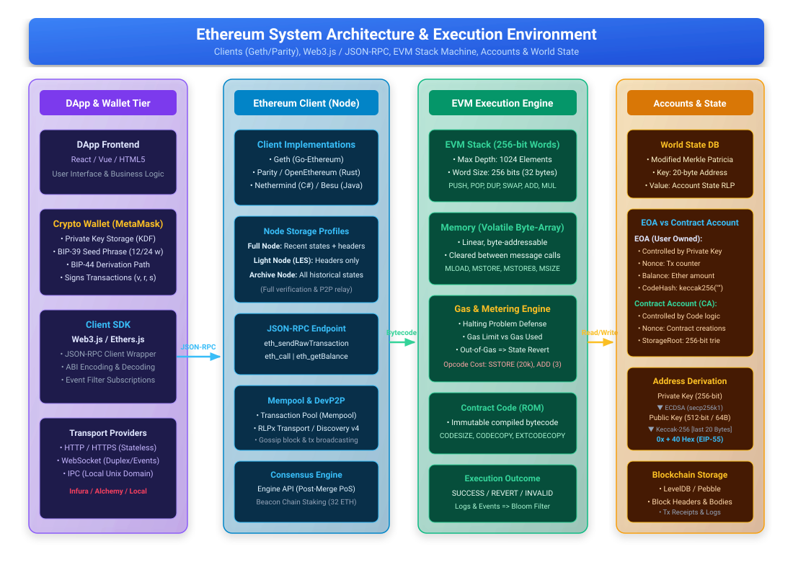

---

### 1.3 Ethereum Nodes and Client Diversity

Ethereum does not mandate a monolithic software client. The protocol is formally defined by the **Ethereum Yellow Paper** (Gavin Wood), allowing multiple independent software engineering teams to construct client implementations in diverse programming languages. This multi-client paradigm guarantees network resilience: a software bug or consensus failure in one client cannot bring down the decentralized network.

#### Client Classifications:
1. **Execution Clients (formerly Eth1):** Responsible for transaction pooling (mempool), EVM execution, state transitions, JSON-RPC endpoints, and maintaining the World State.
   - **Geth (Go-Ethereum):** The reference and historically dominant implementation written in Go. Maintained by the Ethereum Foundation.
   - **Nethermind:** A high-performance execution client built on C# and .NET Core, optimized for enterprise integrations and fast synchronization.
   - **Hyperledger Besu:** An enterprise-focused execution client written in Java, supporting both public networks and private consortium networks with pluggable consensus (IBFT 2.0, QBFT).
   - **Erigon:** An execution client written in Go optimized for extreme disk efficiency and lightning-fast archival synchronization via custom flat database key structures.
   - **Parity / OpenEthereum (Rust):** Historically prominent high-performance Rust client; deprecated and succeeded by OpenEthereum, subsequently retired in favor of newer clients.
2. **Consensus Clients (formerly Eth2):** Responsible for executing the Proof of Stake (PoS) consensus protocol on the **Beacon Chain**, managing validator duties (proposing blocks, attesting via BLS signatures), and driving finality via Casper FFG and LMD-GHOST. Examples include **Prysm** (Go), **Lighthouse** (Rust), **Teku** (Java), **Nimbus** (Nim), and **Lodestar** (TypeScript).
3. **Engine API:** Execution and Consensus clients communicate locally via an authenticated JSON-RPC interface known as the Engine API, coupled via JWT secret tokens.

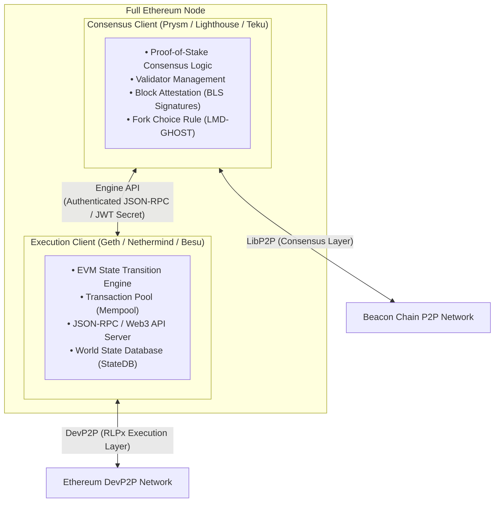

---

### 1.4 Node Storage & Synchronization Profiles

Depending on available storage, RAM, and operational requirements, an Ethereum node operates under one of three distinct profiles:

| Profile Dimension | Full Node | Light Node (LES) | Archive Node |
|:---|:---|:---|:---|
| **Storage Requirement** | Medium (~1 TB SSD) | Minimal (~500 MB – 1 GB) | Massive (> 14 TB high-speed NVMe) |
| **Historical Data Kept** | Block headers, bodies, receipts; recent state snapshots (~128 blocks) | Only sequential block headers; queries peers for Merkle proofs | Every historical state snapshot since Genesis block ($Block\ 0$) |
| **State Pruning** | Prunes intermediate historical World States to conserve storage | No World State stored locally | Zero pruning; preserves full historical Merkle Patricia tries |
| **Validation Capability** | Validates all incoming transactions, state transitions, and signatures | Validates headers; relies on full nodes to serve cryptographic proofs | Fully validates every historical block and state change |
| **Query Capability** | Can query current state directly; cannot query historical state from 2 years ago | Queries peers via Light Ethereum Subprotocol (LES) | Can query account balance or contract state at arbitrary historical block height |
| **Primary Use Case** | Regular staking, mining/validating, local DApp development | Mobile wallets, embedded IoT devices, browser integrations | Block explorers (Etherscan), analytical platforms, forensic auditing |

---

### 1.5 Client-to-Node Communication: Web3.js, Ethers.js & JSON-RPC

Decentralized frontends cannot execute EVM bytecode directly inside a browser. Instead, they interact with an Ethereum node exposing an RPC server conforming to the **Ethereum JSON-RPC specification**.

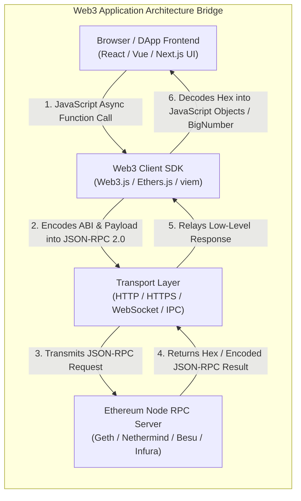

#### Supported Transport Providers:
1. **HTTP / HTTPS Provider:** Stateless request-response protocol. Suitable for basic reads (`eth_getBalance`, `eth_call`) and one-off transaction broadcasts (`eth_sendRawTransaction`). Cannot support bidirectional persistent event subscriptions.
2. **WebSocket (WSS) Provider:** Stateful, persistent, bidirectional TCP connection. Mandatory for real-time DApp architectures requiring contract event listening (`contract.events.Transfer(...)`) and new block header notifications (`eth_subscribe`).
3. **IPC (Inter-Process Communication) Provider:** Direct filesystem socket connection (e.g., `geth.ipc` on Unix or named pipes on Windows). Operates exclusively when the application resides on the same physical host as the node. Provides the highest throughput and lowest latency with zero network overhead.

#### Standard JSON-RPC Methods:
- `eth_blockNumber`: Returns the integer of the most recently mined block.
- `eth_getBalance`: Returns the balance of the account of given address in Wei.
- `eth_getTransactionCount`: Returns the number of transactions sent from an address (account nonce).
- `eth_sendRawTransaction`: Creates new message call transaction or a contract creation for signed transaction data.
- `eth_call`: Executes a new message call immediately in the local EVM without creating a transaction on the block chain (zero gas, read-only simulation).
- `eth_estimateGas`: Generates an estimate of how much gas is necessary to allow the transaction to complete without reverting.

---

### 1.6 Ethereum Virtual Machine (EVM) Architecture

The EVM is a **word-addressable, stack-based registerless virtual machine**. Unlike modern x86/ARM microprocessors that operate on 32-bit or 64-bit registers, the EVM natively computes over **256-bit words** (32 bytes). This architectural decision was intentionally chosen to natively accommodate standard cryptographic hashing algorithms (SHA-256, Keccak-256) and elliptic curve modular arithmetic without requiring multi-word precision libraries.

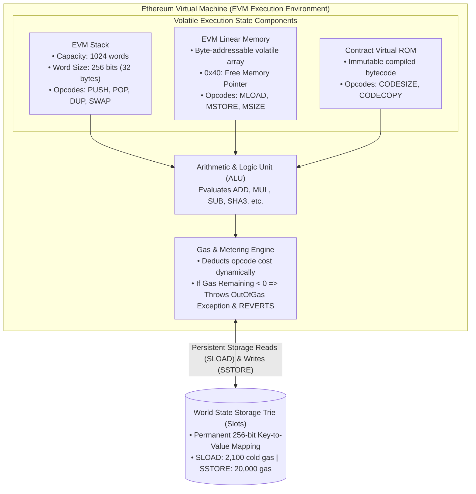

#### Core Components of the EVM:
1. **The Stack:**
   - Standard LIFO (Last-In-First-Out) stack structure.
   - Fixed capacity of **1024 elements**. Exceeding this boundary triggers a fatal `StackOverflow` error; popping from an empty stack causes a `StackUnderflow` error.
   - Each element is exactly **256 bits (32 bytes)** wide.
   - EVM opcodes can access the top 16 stack elements (`DUP1` through `DUP16`, `SWAP1` through `SWAP16`). Accessing deeper elements requires popping preceding items.
2. **Volatile Memory:**
   - Linear, byte-addressable volatile memory space allocated dynamically during transaction execution.
   - Cleared completely between message calls and discarded when contract execution terminates.
   - Reading or writing beyond the currently allocated memory boundary expands memory in 32-byte chunks.
   - **Memory Expansion Gas Cost:** Memory cost scales quadratically to prevent nodes from being DoS-attacked with vast memory allocations:
     $$\text{Cost}(\text{bytes}) = 3 \times a + \lfloor \frac{a^2}{512} \rfloor \quad \text{where } a = \lceil \frac{\text{bytes}}{32} \rceil$$
3. **Contract Code (Virtual ROM):**
   - The compiled bytecode deployed to the blockchain.
   - Stored in the account's `codeHash` reference; completely immutable once deployed.
   - Read by the EVM program counter (PC) using opcodes such as `CODESIZE`, `CODECOPY`, and `EXTCODECOPY`.
4. **Permanent Contract Storage:**
   - A persistent, key-value mapping linking $2^{256}$ 32-byte keys to 32-byte values.
   - Formally encoded as a **Merkle Patricia Trie** whose cryptographic root hash (`storageRoot`) is committed into the global state.
   - The most computationally expensive resource in Ethereum: writing a fresh non-zero slot costs **20,000 gas** (`SSTORE`), while reading a cold slot costs **2,100 gas** (`SLOAD`).

---

### 1.7 EVM Opcodes and Deterministic Gas Costs

Every instruction in compiled bytecode corresponds to a 1-byte opcode ($0x00$to$0xFF$). The execution engine deducts the gas cost associated with each opcode prior to evaluating its instruction. If the remaining gas drops below the opcode's cost, execution aborts immediately with an `OutOfGas` exception.

| Opcode (Hex) | Mnemonic | Base Gas Cost | Technical Description & Mechanics |
| :--- | :--- | :--- | :--- |
| `0x00` | **STOP** | 0 | Halts execution successfully. |
| `0x01` | **ADD** | 3 | Pops $a, b$; pushes$(a + b) \pmod{2^{256}}$ onto stack. |
| `0x02` | **MUL** | 5 | Pops $a, b$; pushes$(a \times b) \pmod{2^{256}}$ onto stack. |
| `0x03` | **SUB** | 3 | Pops $a, b$; pushes$(a - b) \pmod{2^{256}}$ onto stack. |
| `0x04` | **DIV** | 5 | Integer division; pushes 0 if divisor is 0. |
| `0x20` | **SHA3 (KECCAK256)** | 30 + 6 / word | Hashes contiguous memory slice using Keccak-256. |
| `0x31` | **BALANCE** | 100 (warm) / 2600 (cold) | Fetches account Ether balance. |
| `0x32` | **ORIGIN** | 2 | Returns EOA address that originated the transaction. |
| `0x33` | **CALLER** | 2 | Returns `msg.sender` (immediate caller address). |
| `0x34` | **CALLVALUE** | 2 | Returns Wei value transmitted with message call. |
| `0x51` | **MLOAD** | 3 + memory expansion | Reads 32-byte word from memory offset onto stack. |
| `0x52` | **MSTORE** | 3 + memory expansion | Writes 32-byte word from stack into volatile memory. |
| `0x54` | **SLOAD** | 100 (warm) / 2100 (cold) | Reads 32-byte slot from persistent storage onto stack. |
| `0x55` | **SSTORE** | 20,000 (init) / 2,900 | Persists 32-byte word to storage; refunds on zeroing out. |
| `0x56` | **JUMP** | 8 | Unconditional program counter jump to destination offset. |
| `0x57` | **JUMPI** | 10 | Conditional jump; jumps only if condition $\neq 0$. |
| `0x5B` | **JUMPDEST** | 1 | Valid destination marker; jump to non-`JUMPDEST` fails. |
| `0xA0`–`0xA4` | **LOG0**–**LOG4** | 375 + 375/topic + 8/byte | Emits event log with 0 to 4 indexed topics into receipt. |
| `0xF0` | **CREATE** | 32,000 + memory exp | Creates new contract account at deterministic address. |
| `0xF1` | **CALL** | 100 (warm) / 2600 (cold) | Initiates external message call to target contract. |
| `0xFD` | **REVERT** | 0 + memory exp | Halts execution, reverts all state changes, refunds gas. |
| `0xFE` | **INVALID** | Consumes ALL Gas | Designated invalid instruction; halts with panic error. |
| `0xFF` | **SELFDESTRUCT** | 5,000 (deprecated) | Destroys contract and transfers remaining balance. |

---

### 1.8 Gas Mechanics, EIP-1559 Economics, and Out-of-Gas Execution

#### Why Gas is Essential:
Alan Turing proved that it is mathematically impossible to write an algorithm that can determine whether an arbitrary computer program will finish running or run forever—the **Halting Problem**. In an open, decentralized network like Ethereum where every validator node must execute every submitted transaction to verify its state transition, a malicious or careless programmer could deploy a smart contract containing an infinite loop:
```solidity
while (true)
{
    /* Do nothing */
}
```
Without gas, every node in the world would hang indefinitely attempting to execute this single transaction, bringing global consensus to a dead stop. Gas completely neutralizes this attack: each transaction defines a finite **Gas Limit**. Every opcode deducts its exact deterministic gas cost from the gas counter. When the counter hits zero, execution halts immediately.

#### Core Gas Metrics:
1. **Gas Limit:** The absolute maximum number of gas units the sender authorizes for consumption during transaction execution. Standard ETH transfers have a fixed gas limit of **21,000 gas**. Complex contract invocations typically allocate between \$100,000$and \$3,000,000$ gas.
2. **Gas Used:** The actual cumulative gas consumed by the opcodes executed up to transaction completion. Any unused gas is refunded directly to the sender:
   $$\text{Gas Refunded} = \text{Gas Limit} - \text{Gas Used}$$
3. **Gas Price:** The amount of Ether the sender is willing to pay per unit of gas, denominated in Gwei ($10^{-9} \text{ ETH}$).

#### Post-London Hard Fork Fee Model (EIP-1559):
EIP-1559 overhauled the legacy "first-price auction" fee mechanism by introducing an algorithmically determined base fee combined with an optional priority fee (tip):
$$\text{Effective Gas Price} = \text{Base Fee} + \min(\text{Max Priority Fee}, \text{Max Fee} - \text{Base Fee})$$
$$\text{Total Transaction Fee} = \text{Gas Used} \times \text{Effective Gas Price}$$

- **Base Fee:** Automatically calculated by the protocol based on block fullness compared to the target block size (15 million gas target, 30 million gas cap). If a block is > 50% full, the base fee increases by up to 12.5% for the next block; if < 50% full, it decreases. **The Base Fee is burned permanently**, removing ETH from circulation.
- **Priority Fee (Tip):** An optional incentive paid directly to the validator to prioritize inclusion in the current block during high-congestion periods.

#### The Out-of-Gas (OOG) Exception:
When a transaction exhausts its allocated Gas Limit before execution finishes normally:
1. An `OutOfGas` exception is raised by the EVM.
2. The current execution frame and all child sub-calls halt immediately.
3. **All state modifications are completely rolled back** (storage variables revert to their pre-transaction values; balances are restored).
4. **Crucial Exam Rule:** **The consumed gas is NOT refunded.** The entire `Gas Limit \times Gas Price` fee is forfeited and awarded to the block proposer to compensate for the computational cycles consumed by the network while executing the aborted transaction.

---

### 1.9 Ethereum Accounts: Externally Owned Accounts (EOA) vs. Contract Accounts (CA)

The global state of Ethereum is a cryptographic mapping between 20-byte account addresses and account states. Every account state consists of an RLP-serialized 4-tuple:
$$\sigma[a] = (\text{nonce}, \text{balance}, \text{storageRoot}, \text{codeHash})$$

| Feature / Architectural Dimension | Externally Owned Account (EOA) | Contract Account (CA) |
| :--- | :--- | :--- |
| **Control Authority** | Private Cryptographic Key Pair (User) | Compiled EVM Bytecode Execution |
| **Account Creation Cost** | Free (Local elliptic curve math) | High Gas Cost (Contract deployment transaction) |
| **Can Initiate Transactions?** | **YES** (Direct transaction originator) | **NO** (Reactive message calls only) |
| **Code Hash (`codeHash`)** | `keccak256("")` (Hash of empty string) | `keccak256(RuntimeBytecode)` |
| **Storage Root (`storageRoot`)** | Empty Trie Hash (`0x56e81f...`) | Root hash of contract's Merkle Patricia storage trie |
| **Nonce Semantics** | Cumulative count of sent, confirmed transactions | Cumulative count of child contracts deployed via `CREATE` |

#### Detailed Element Semantics:
1. **Nonce:**
   - For an **EOA**: A sequential scalar counter representing the total number of transactions successfully confirmed from this address. Crucial for **Replay Protection**: prevents an attacker from eavesdropping on a valid signed transaction and replaying it on the network. A transaction with $\text{nonce} = 5$cannot execute until transaction$\text{nonce} = 4$ is confirmed.
   - For a **Contract Account**: A sequential scalar counter representing the total number of child contracts created by this contract via the `CREATE` opcode.
2. **Balance:** The quantity of Wei owned by this address. $1 \text{ ETH} = 10^{18} \text{ Wei}$.
3. **StorageRoot:** The 256-bit hash of the root node of a Merkle Patricia Trie that encodes the storage contents of the contract. For EOAs, `storageRoot` equals the empty trie root hash `0x56e81f171bcc55a6ff8345e692c0f86e5b48e01b996cadc001622fb5e363b421`.
4. **CodeHash:** The Keccak-256 hash of the EVM runtime bytecode associated with this account. For EOAs, this is the hash of an empty string `0xc5d2460186f7233c927e7db2dcc703c0e500b653ca82273b7bfad8045d85a470`.

---

### 1.10 Cryptographic Address Derivation Pipeline

Unlike Bitcoin which utilizes SHA-256 followed by RIPEMD-160 and Base58Check encoding, Ethereum addresses are generated via elliptic curve multiplication followed by **Keccak-256** hashing:

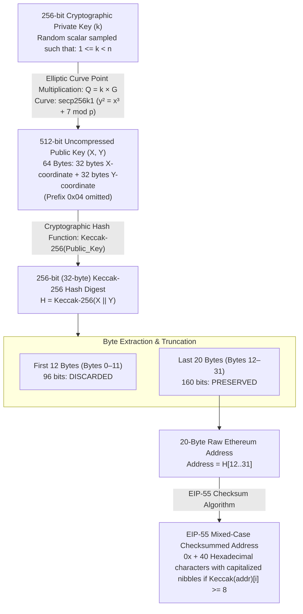

#### Mathematical Steps:
1. **Private Key Generation:** Sample a cryptographically secure 256-bit random integer $k$such that$1 \le k < n$.
2. **Public Key Derivation:** Calculate the elliptic curve point $K = (x, y) = k \times G$over curve$\text{secp256k1}$. Concatenate the$x$and$y$ coordinates to form a 64-byte uncompressed public key (excluding the standard `0x04` octet prefix).
3. **Keccak-256 Digest:** Pass the 64-byte public key through the Keccak-256 hashing algorithm:
   $$H = \text{Keccak-256}(x \parallel y)$$
4. **Byte Truncation:** Extract the **least significant 20 bytes** (last 160 bits) of the 32-byte hash digest $H$, dropping the first 12 bytes:
   $$\text{Address} = H[12..31]$$
5. **EIP-55 Checksum Encoding:** Ethereum addresses lack native checksum characters. EIP-55 prevents typographical capital error bugs by capitalizing hexadecimal characters $a-f$if the corresponding nibble in the Keccak-256 hash of the lowercase address is$\ge 8$.

---

### 1.11 Deterministic Smart Contract Address Creation

When a contract is created via a transaction or the `CREATE` opcode, its deployment address is computed deterministically from the sender's address and the sender's transaction nonce:

$$\text{Contract Address} = \text{Keccak-256}(\text{RLP}([\text{senderAddress}, \text{nonce}]))[12..31]$$

Where:
- $\text{senderAddress}$: The 20-byte address of the deploying EOA or parent contract.
- $\text{nonce}$: The integer transaction count of the deploying EOA (or contract creation count).
- $\text{RLP}$: Recursive Length Prefix encoding scheme used across Ethereum serialization.

*(Note: The newer `CREATE2` opcode introduced in EIP-1014 derives addresses independently of the nonce: $\text{keccak256}(0xFF \parallel \text{sender} \parallel \text{salt} \parallel \text{keccak256}(\text{initCode}))[12..31]$, enabling counterfactual state channels and deterministic factory deployments).*

---

### 1.12 Crypto Wallets: Key Management, MetaMask & Testnets

A cryptocurrency wallet does **not** store cryptocurrency inside the software. Ether and contract tokens reside exclusively on the decentralized blockchain state. A wallet is fundamentally a **key management suite and transaction signing engine**.

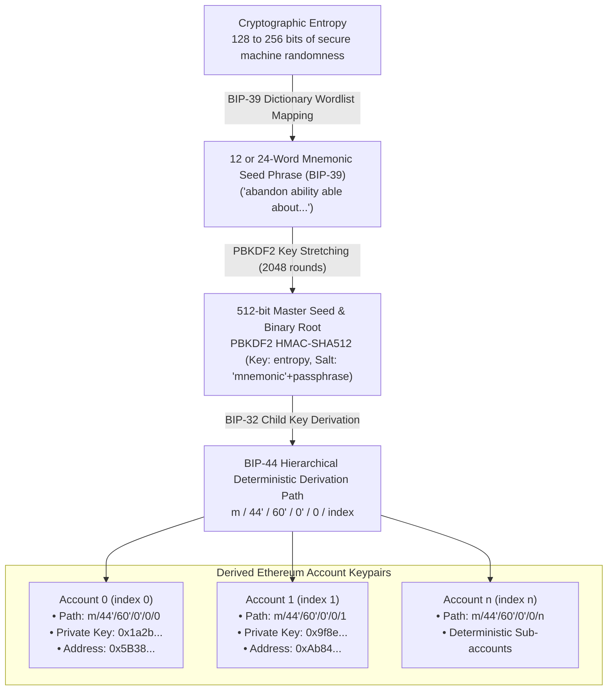

#### Key Management Operations:
- **Seed Phrase (BIP-39):** A human-readable sequence of 12 or 24 words derived from raw machine entropy. Serves as the master backup for all child private keys.
- **Hierarchical Deterministic (HD) Derivation (BIP-44):** Standard derivation tree path for Ethereum:
  $$m / 44' / 60' / 0' / 0 / x$$
  - `44'`: BIP-44 multi-account hierarchy specification.
  - `60'`: Coin type registered for Ethereum ($0'$ for Bitcoin).
  - `0'`: Account index.
  - `0`: External chain (receiving addresses).
  - `x`: Sequential address index ($0, 1, 2...$).
- **Infura Gateway Integration:** Rather than forcing browser extensions to download 1 TB of blockchain data, MetaMask communicates by default with **Infura** (an enterprise infrastructure provider hosting high-availability clusters of Geth/Besu nodes). Transactions signed locally in MetaMask are dispatched to Infura via HTTPS/WSS JSON-RPC for network broadcast.
- **Ethereum Testnets & Faucets:**
  - **Sepolia Testnet:** The primary recommended PoS testnet for smart contract testing, utilizing a permissioned validator set with fast, predictable block production.
  - **Holesky Testnet:** High-capacity testnet replacing Goerli, primarily targeting staking infrastructure and validator testing.
  - **Faucets:** Web portals that distribute free testnet ETH (e.g., SepoliaETH) to developers to pay for deployment gas fees without spending real capital.

---

## 2. Smart Contract Design & Solidity Programming

### 2.1 Formal Concepts & Core Definitions

* **Solidity:** A statically typed, contract-oriented, high-level programming language engineered specifically for targeting the Ethereum Virtual Machine (EVM), featuring inheritance, libraries, and user-defined complex structures.
* **Solc:** The standard optimizing compiler that ingests high-level Solidity source files (`.sol`) and emits EVM bytecode, compiler metadata, and Application Binary Interface (ABI) definitions.
* **Remix IDE:** An open-source, web-based integrated development environment that provides comprehensive code editing, compiler version toggling, in-memory virtual machine execution (Remix VM), gas estimation, and step-by-step transaction debugging.
* **State Variables:** Variables declared at the contract level whose values are permanently recorded in the contract's persistent storage trie on the blockchain.
* **Local Variables:** Ephemeral variables declared inside function bodies whose values exist exclusively within the stack frame during execution and are erased upon return.
* **View Function:** A function that reads state variables or global properties from the blockchain but is strictly prohibited by the compiler from mutating any state (`STATICCALL` opcode).
* **Pure Function:** A function that neither reads from nor writes to the blockchain state, operating strictly on its input arguments or local computations.
* **Payable Function:** A function marked with the `payable` modifier, permitting it to receive native Ether (`msg.value`) along with the execution call. Non-payable functions automatically revert if Ether is sent.
* **Fallback Function:** A nameless external function executed when a contract is invoked with a function selector that does not match any declared interface or when data payload is provided without matching signatures.
* **Receive Function:** A specialized external payable function (`receive() external payable`) executed when the contract receives plain Ether transfers accompanied by completely empty call data.

---

### 2.2 Compilation Pipeline Schematic

The following architectural diagram illustrates the compilation and deployment lifecycle of a Solidity smart contract:

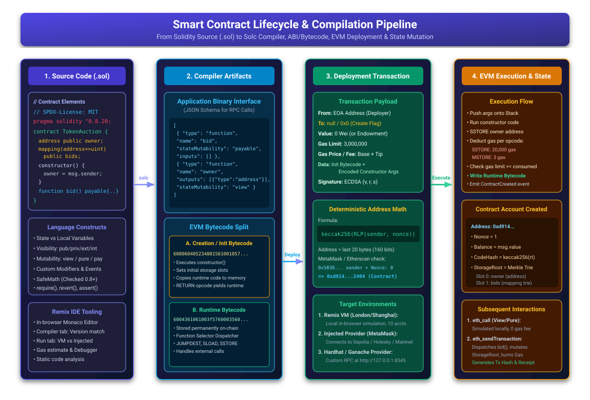

---

### 2.3 Compilation Artifacts: ABI vs. Bytecode

When `solc` compiles a contract, it generates two fundamental artifacts:

#### 1. Application Binary Interface (ABI):
A JSON array specifying the contract's public interfaces. It enables off-chain libraries (Web3.js/Ethers.js) to encode method calls and decode return values.
```json
[
  {
    "type": "function",
    "name": "setPrice",
    "inputs": [{"name": "_price", "type": "int256"}],
    "outputs": [],
    "stateMutability": "nonpayable"
  },
  {
    "type": "function",
    "name": "price",
    "inputs": [],
    "outputs": [{"name": "", "type": "int256"}],
    "stateMutability": "view"
  }
]
```

#### 2. EVM Bytecode:
The raw hexadecimal machine code executed by the EVM. Bytecode is partitioned into two distinct segments:
- **Creation / Init Bytecode:** The payload sent in the deployment transaction (`to = null`). It runs the contract `constructor()`, writes initial values to storage slots, copies the runtime bytecode into memory, and returns the runtime bytecode via the `RETURN` opcode. It is never stored on-chain.
- **Runtime Bytecode:** The code permanently committed to the contract address in the World State. It begins with the **Function Selector Dispatcher**:
```asm
PUSH1 0x04
CALLDATASIZE
LT
PUSH2 0x003f
JUMPI
PUSH1 0x00
CALLDATALOAD
PUSH1 0xe0
SHR
DUP1
PUSH4 0x8c0653de     // Keccak-256("setPrice(int256)")[0..3]
EQ
PUSH2 0x0045
JUMPI
```

---

### 2.4 Data Locations: Storage vs. Memory vs. Calldata

Every reference type variable in Solidity (arrays, structs, strings, bytes) must explicitly specify its data location:

| Dimension | `storage` | `memory` | `calldata` |
|:---|:---|:---|:---|
| **Persistence** | Permanent (recorded on blockchain) | Ephemeral (cleared after execution) | Ephemeral (cleared after execution) |
| **Location** | Merkle Patricia Storage Trie | Volatile linear byte-array | Read-only input buffer sent with tx |
| **Gas Cost** | Extremely expensive (\$20,000$/ \$2,100$ gas) | Inexpensive (linear + quadratic growth) | Cheapest (no memory expansion cost) |
| **Mutability** | Mutable | Mutable | **Immutable (Read-Only)** |
| **Default Context** | Contract-level state variables | Local variables in function body | External function reference arguments |

---

### 2.5 Variable & Function Visibility Specifiers

Solidity enforces strict access control through four visibility levels:

| Visibility Specifier | In Same Contract? | In Child (Derived) Contract? | By External EOA / Contract? |
| :--- | :--- | :--- | :--- |
| `public` | **YES** | **YES** | **YES** |
| `external` | **NO** (requires `this.f()`) | **NO** (requires `this.f()`) | **YES** |
| `internal` | **YES** | **YES** | **NO** |
| `private` | **YES** | **NO** | **NO** |

* **Public State Variables:** The compiler automatically generates an implicit external **getter function** of the same name. For mappings, the getter requires keys as arguments.
* **External Functions:** Gas-efficient for receiving large array/struct parameters because arguments remain in `calldata` without copying into `memory`.

---

### 2.6 Error Handling: `require()` vs. `revert()` vs. `assert()`

Robust contract engineering requires atomic failure handling. An exception halts execution, rolls back all state mutations, but treats gas differently based on the construct:

| Construct | Gas Handling | Emits Opcode | Canonical Use Case |
| :--- | :--- | :--- | :--- |
| `require(cond, str)` | Refunds unused gas | `REVERT` (`0xFD`) | Input validation, caller permissions, access control |
| `revert CustomErr()` | Refunds unused gas | `REVERT` (`0xFD`) | Complex conditional branches, gas-efficient error reporting |
| `assert(condition)` | Consumes ALL gas* | `INVALID` (`0xFE`) | Internal invariants, overflow/underflow sanity checks |
*Note: In Solidity 0.8.0+, `assert` emits `Panic(uint256)` and reverts unused gas, but conceptually represents an unrecoverable internal logic failure.*

---

### 2.7 Arithmetic Overflows & The SafeMath Paradigm

In Solidity versions prior to `0.8.0`, integers were subject to silent arithmetic wrap-around. For an 8-bit unsigned integer (`uint8`), the maximum value is $255$:

$$255 + 1 \equiv 0 \pmod{256}$$
This exact vulnerability allowed attackers to trigger the infamous **BatchOverflow Bug (CVE-2018-10299)** in multiple ERC-20 tokens, minting astronomical token balances out of thin air.

#### The Evolution of SafeMath:
1. **Solidity < 0.8.0:** Developers were mandated to import OpenZeppelin's `SafeMath` library (`using SafeMath for uint256;`), replacing arithmetic operators with checked functions (`add()`, `sub()`, `mul()`).
2. **Solidity $\ge$ 0.8.0:** The compiler automatically inserts arithmetic overflow and underflow checks into the generated bytecode. If an arithmetic operation wraps around, it throws an automatic `Panic(0x11)` and reverts.
3. **The `unchecked` Block:** When developers intentionally rely on wrapping arithmetic or seek to optimize gas in provably bounded loop counters, they can bypass checks using `unchecked`:
   ```solidity
   for (uint256 i = 0; i < len; )
   {
       // Loop body
       unchecked
       {
           ++i; // Saves ~30 gas per iteration
       }
   }
   ```

---

### 2.8 Native Ether Transfer Mechanics

Solidity provides three mechanisms to transfer native Ether from a contract to an address:

| Transfer Method | Gas Stipend | Reverts On Error? | Security Rating & Recommendations |
| :--- | :--- | :--- | :--- |
| `target.transfer(amount)` | Fixed 2,300 gas | **YES** (Throws error) | **DEPRECATED.** Fails if receiver runs fallback logic exceeding stipend. |
| `target.send(amount)` | Fixed 2,300 gas | **NO** (Returns `false`) | **DEPRECATED.** Returns boolean flag; often ignored, leading to silent failures. |
| `(bool ok, ) = target.call{value: amount}("")` | Forwards all remaining gas | **NO** (Returns `false`) | **RECOMMENDED.** Flexible gas forwarding; must be paired with CEI pattern or `ReentrancyGuard`. |

#### Why `transfer()` is Deprecated:
`transfer()` and `send()` forward a hardcoded gas stipend of **2,300 gas**, designed in 2015 to prevent reentrancy attacks by ensuring the receiving contract only had enough gas to emit an event. However, the **Istanbul Hard Fork (EIP-1884)** increased the gas cost of the `SLOAD` opcode from $200$ to $800$ gas. Consequently, receiver contracts attempting to read storage variables during fallback reverted, breaking legitimate smart contracts. Modern best practice mandates `.call{value: amount}("")` combined with the **Checks-Effects-Interactions (CEI)** pattern or OpenZeppelin's `ReentrancyGuard`.

---

### 2.9 Comprehensive Production Solidity Smart Contract

The following complete, annotated Solidity contract implements a multi-party **Decentralized Escrow and Auction System**, demonstrating all syllabus requirements: state variables, constructors, constants, immutables, structs, enums, mappings, dynamic/fixed arrays, modifiers, events, custom errors, payable functions, checked arithmetic, and low-level Ether calls:

```solidity
// SPDX-License-Identifier: MIT
pragma solidity ^0.8.20;

/**
 * @title DecentralizedEscrowAuction
 * @notice Implements an exam-standard, secure multi-party auction and escrow.
 * @dev Covers state storage, modifiers, CEI pattern, custom errors, and payable transfers.
 */
contract DecentralizedEscrowAuction
{
    // ------------------------------------------------------------------------
    // 1. TYPE DECLARATIONS: ENUMS & STRUCTS
    // ------------------------------------------------------------------------
    enum AuctionState
    {
        Created,
        Active,
        Suspended,
        Finalized
    }

    struct BidderProfile
    {
        uint256 totalBidAmount; // Cumulative Ether deposited
        uint256 bidTimestamp;   // Block timestamp of latest bid
        bool hasWithdrawn;      // Prevents double-withdrawal
    }

    struct ItemMetadata
    {
        string title;
        string physicalLocation;
        uint256 reservePrice;
    }

    // ------------------------------------------------------------------------
    // 2. STATE VARIABLES & IMMUTABLES
    // ------------------------------------------------------------------------
    address public immutable owner;               // Set once at deployment
    uint256 public immutable auctionEndTime;      // Epoch timestamp deadline
    uint256 public constant MINIMUM_BID_INCREMENT = 0.01 ether; // Constant (Bytecode)

    AuctionState public currentState;
    ItemMetadata public auctionItem;

    address public highestBidder;
    uint256 public highestBid;

    // Mapping: Address => Bidder Profile
    mapping(address => BidderProfile) public bidders;

    // Dynamic Array of all participating addresses
    address[] public participantRegistry;

    // Fixed-size array: Tracks highest 3 bids historically
    uint256[3] public topBidsRecord;

    // ------------------------------------------------------------------------
    // 3. EVENTS (EVM LOGGING)
    // ------------------------------------------------------------------------
    event BidSubmitted(address indexed bidder, uint256 totalAmount, uint256 timestamp);
    event AuctionFinalized(address indexed winner, uint256 winningBid);
    event FundsWithdrawn(address indexed recipient, uint256 amount);
    event StateTransition(AuctionState previousState, AuctionState newState);

    // ------------------------------------------------------------------------
    // 4. CUSTOM GAS-EFFICIENT ERRORS
    // ------------------------------------------------------------------------
    error UnauthorizedCaller(address caller);
    error AuctionNotActive();
    error AuctionAlreadyEnded();
    error AuctionStillActive();
    error BidTooLow(uint256 submitted, uint256 required);
    error NoRefundAvailable();
    error TransferFailed();

    // ------------------------------------------------------------------------
    // 5. CUSTOM MODIFIERS
    // ------------------------------------------------------------------------
    modifier onlyOwner()
    {
        if (msg.sender != owner)
        {
            revert UnauthorizedCaller(msg.sender);
        }
        _;
    }

    modifier inState(AuctionState expectedState)
    {
        if (currentState != expectedState)
        {
            revert AuctionNotActive();
        }
        _;
    }

    // ------------------------------------------------------------------------
    // 6. CONSTRUCTOR
    // ------------------------------------------------------------------------
    constructor(
        string memory _title,
        string memory _location,
        uint256 _reservePrice,
        uint256 _durationSeconds
    )
    {
        owner = msg.sender;
        auctionEndTime = block.timestamp + _durationSeconds;
        currentState = AuctionState.Active;

        auctionItem = ItemMetadata({
            title: _title,
            physicalLocation: _location,
            reservePrice: _reservePrice
        });
    }

    // ------------------------------------------------------------------------
    // 7. PAYABLE BIDDING FUNCTION (CHECKS-EFFECTS-INTERACTIONS)
    // ------------------------------------------------------------------------
    function submitBid() external payable inState(AuctionState.Active)
    {
        if (block.timestamp >= auctionEndTime)
        {
            revert AuctionAlreadyEnded();
        }

        uint256 currentTotal = bidders[msg.sender].totalBidAmount + msg.value;
        uint256 requiredBid = highestBid == 0 ? auctionItem.reservePrice : highestBid + MINIMUM_BID_INCREMENT;

        if (currentTotal < requiredBid)
        {
            revert BidTooLow(currentTotal, requiredBid);
        }

        // Record participant if first bid
        if (bidders[msg.sender].totalBidAmount == 0)
        {
            participantRegistry.push(msg.sender);
        }

        // State updates (Effects)
        bidders[msg.sender].totalBidAmount = currentTotal;
        bidders[msg.sender].bidTimestamp = block.timestamp;
        bidders[msg.sender].hasWithdrawn = false;

        highestBidder = msg.sender;
        highestBid = currentTotal;

        _updateTopBids(currentTotal);

        emit BidSubmitted(msg.sender, currentTotal, block.timestamp);
    }

    // ------------------------------------------------------------------------
    // 8. WITHDRAWAL PATTERN (AVOIDS REENTRANCY & DOS)
    // ------------------------------------------------------------------------
    function withdrawRefund() external returns (bool)
    {
        if (msg.sender == highestBidder && currentState == AuctionState.Active)
        {
            revert UnauthorizedCaller(msg.sender);
        }

        BidderProfile storage profile = bidders[msg.sender];
        uint256 refundAmount = profile.totalBidAmount;

        // If sender is winner after finalization, funds cannot be refunded
        if (msg.sender == highestBidder && currentState == AuctionState.Finalized)
        {
            revert NoRefundAvailable();
        }

        if (refundAmount == 0 || profile.hasWithdrawn)
        {
            revert NoRefundAvailable();
        }

        // Effect
        profile.totalBidAmount = 0;
        profile.hasWithdrawn = true;

        // Interaction (Low-level call pattern)
        (bool success, ) = payable(msg.sender).call{value: refundAmount}("");
        if (!success)
        {
            revert TransferFailed();
        }

        emit FundsWithdrawn(msg.sender, refundAmount);
        return true;
    }

    // ------------------------------------------------------------------------
    // 9. AUCTION FINALIZATION
    // ------------------------------------------------------------------------
    function finalizeAuction() external onlyOwner inState(AuctionState.Active)
    {
        if (block.timestamp < auctionEndTime)
        {
            revert AuctionStillActive();
        }

        currentState = AuctionState.Finalized;
        emit StateTransition(AuctionState.Active, AuctionState.Finalized);
        emit AuctionFinalized(highestBidder, highestBid);

        // Transfer winning funds to owner
        if (highestBid > 0)
        {
            (bool success, ) = payable(owner).call{value: highestBid}("");
            if (!success)
            {
                revert TransferFailed();
            }
        }
    }

    // ------------------------------------------------------------------------
    // 10. INTERNAL HELPER & VIEW GETTERS
    // ------------------------------------------------------------------------
    function _updateTopBids(uint256 _newBid) internal
    {
        if (_newBid > topBidsRecord[0])
        {
            topBidsRecord[2] = topBidsRecord[1];
            topBidsRecord[1] = topBidsRecord[0];
            topBidsRecord[0] = _newBid;
        }
        else if (_newBid > topBidsRecord[1])
        {
            topBidsRecord[2] = topBidsRecord[1];
            topBidsRecord[1] = _newBid;
        }
        else if (_newBid > topBidsRecord[2])
        {
            topBidsRecord[2] = _newBid;
        }
    }

    function getContractBalance() external view returns (uint256)
    {
        return address(this).balance;
    }

    function getParticipantCount() external view returns (uint256)
    {
        return participantRegistry.length;
    }

    // Explicit receive function to prevent accidental Ether lockups
    receive() external payable
    {
        revert("Direct deposits rejected. Call submitBid()");
    }
}
```

---

## 3. Hyperledger Fabric Enterprise Architecture

### 3.1 Formal Concepts & Core Definitions

* **Hyperledger Fabric:** A modular, open-source, permissioned distributed ledger technology (DLT) framework hosted by the Linux Foundation, engineered specifically for enterprise business consortia requiring high throughput, low latency, fine-grained access control, and privacy partitioning.
* **Permissioned Network:** A blockchain network where participant identities are strictly vetted, authenticated, and governed by cryptographically verified credentials issued by a trusted Certificate Authority (CA), contrasting with public, anonymous networks.
* **Channel:** A completely private, cryptographically isolated "subnet" of communication between two or more specific consortium organizations, maintaining a distinct, dedicated ledger inaccessible to non-member peers.
* **World State (StateDB):** A high-performance database holding the latest, current values of all ledger assets as mutable key-value pairs, allowing chaincode to query current state instantaneously without sequentially parsing historical blocks.
* **Blockchain Log:** An immutable, append-only disk ledger recording sequential, cryptographically hashed blocks containing all state transition histories, Read-Write sets, and cryptographic validation bitmasks.
* **Endorsing Peer:** A specialized peer node that simulates proposed transactions in an isolated Docker chaincode container, verifies client signatures, evaluates business logic, signs the generated Read-Write set, and returns an endorsement to the client.
* **Committing Peer:** A peer node that receives sequenced blocks from the ordering service, cryptographically validates endorsement policy compliance and concurrency conflicts (MVCC), commits valid transactions to the blockchain log, and updates the local StateDB.
* **Anchor Peer:** A designated peer per organization registered in the channel configuration that serves as the cross-organization discovery bridge over the **Gossip Data Dissemination Protocol**.
* **Ordering Service (Orderer):** A centralized or distributed consensus cluster (typically **EtcdRaft**) responsible for establishing a deterministic, chronological sequence of endorsed transactions across the network, packaging them into cryptographically sealed blocks without evaluating smart contract business logic.
* **Chaincode:** The decentralized business logic (smart contract) in Hyperledger Fabric, written in standard general-purpose programming languages (**Golang**, Java, TypeScript/JavaScript) and executed inside sandboxed Docker containers isolated from the peer process.

---

### 3.2 Hyperledger Project Ecosystem

Hosted by the Linux Foundation, the Hyperledger umbrella encompasses multiple distinct enterprise distributed ledger frameworks and tooling libraries:

| Project Name | Primary Focus | Architectural Highlights & Distinctions |
| :--- | :--- | :--- |
| **Hyperledger Fabric** | Enterprise Distributed Ledger | Modular architecture, private channels, pluggable consensus, Go/TS/Java chaincode |
| **Hyperledger Sawtooth** | Supply Chain & Scale | Asynchronous parallel execution, Proof of Elapsed Time (PoET) consensus |
| **Hyperledger Iroha** | Mobile & IoT Applications | Lightweight, fast C++ execution engine, built-in domain-specific commands |
| **Hyperledger Indy** | Self-Sovereign Identity (SSI) | Decentralized digital identities (DIDs), zero-knowledge verifiable credentials |
| **Hyperledger Besu** | Enterprise EVM Client | Java-based Ethereum client; bridges public Ethereum & private permissioned consortia |
| **Hyperledger Burrow** | EVM Chaincode Framework | Permissionable smart contract machine executing compiled Solidity bytecode |

---

### 3.3 Multi-Channel Architecture & Data Privacy

In public blockchains (Ethereum/Bitcoin), every confirmed transaction is broadcast and stored across every single node on the network. For enterprise competitors operating within the same industry (e.g., supply chain logistics or aerospace manufacturing), total transparency is unacceptable: a manufacturer cannot expose negotiated pricing discounts with Supplier A to Supplier B.

Hyperledger Fabric solves this via **Channels**:

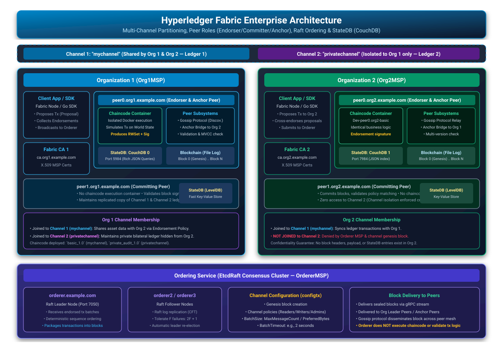

#### Channel Characteristics:
1. **Cryptographic Isolation:** A channel is defined by its own Genesis Block (`configtxgen`). Only organizations possessing certificates authorized in the channel's Membership Service Provider (Channel MSP) can connect peers or query data.
2. **Dedicated Ledgers:** Each channel maintains its own independent physical ledger:
   $$\text{Ledger}_{\text{Channel 1}} \neq \text{Ledger}_{\text{Channel 2}}$$
   Peers belonging to Organization 1 joined to both `Channel 1` and `Channel 2` maintain two physically distinct databases on disk (`var/hyperledger/production/ledgersData`).
3. **Zero Visibility for Non-Members:** Organization 2 (joined exclusively to `Channel 1`) has zero cryptographic or network visibility into transactions occurring on `Channel 2`. Even the block headers are hidden.

---

### 3.4 The Dual-Component Ledger Architecture

Unlike Bitcoin or Ethereum where the state must be recalculated from genesis or verified through complex Merkle trees, Fabric partitions its ledger into two decoupled engines:

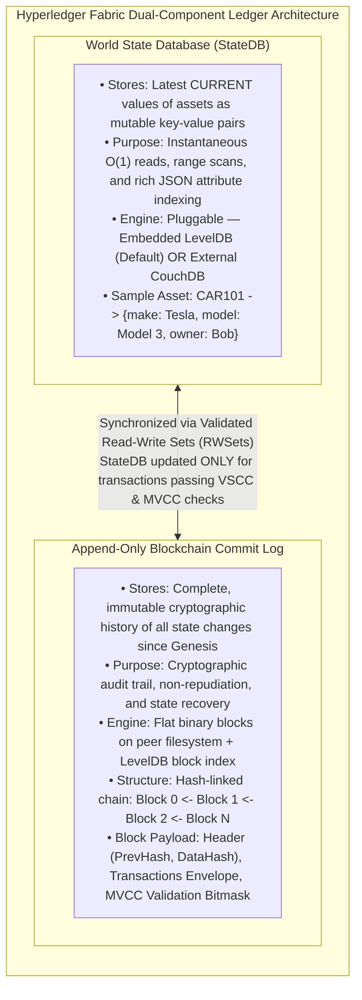

#### StateDB Engines: LevelDB vs. CouchDB:
- **LevelDB:** Default embedded key-value store compiled directly inside the peer process. Fast, lightweight, but supports only binary key-value lookups (e.g., `GetState("CAR101")`) and key-range scans (`GetStateByRange("CAR000", "CAR999")`).
- **CouchDB:** External standalone document database executing as a paired Docker container (`couchdb0:5984`). It serializes assets as JSON documents, supporting **rich queries** (ad-hoc queries filtering by arbitrary JSON attributes, regex, and nested fields):
  ```json
  {
    "selector": {
      "docType": "asset",
      "owner": "Alice",
      "value": { "$gte": 5000 }
    }
  }
  ```
  *Exam Rule:* CouchDB allows declarative JSON index creation (`META-INF/statedb/couchdb/indexes/indexOwner.json`) to prevent full-database scans during chaincode query execution.

---

### 3.5 Peer Typology and Operational Roles

A single Fabric peer binary (`peer`) can fulfill multiple operational roles depending on its channel membership, configuration, and hardware deployment:

| Peer Role | Executes Chaincode? | Maintains Ledger? | Core Operational Function |
| :--- | :--- | :--- | :--- |
| **Endorsing Peer** | **YES** (in Docker container) | **YES** | Simulates proposals, signs Read-Write Sets (RWSets). |
| **Committing Peer** | **NO** | **YES** | Validates VSCC & MVCC; commits blocks to disk. |
| **Anchor Peer** | Role modifier | Role modifier | Discovered via Gossip; bridges cross-org traffic. |
| **Leader Peer** | Role modifier | Role modifier | Pulls blocks from Orderer; distributes to org peers. |

1. **Every Endorsing Peer is inherently a Committing Peer**, but not all Committing Peers are Endorsing Peers. Organizations frequently deploy lightweight committing peers to serve local application read-queries without paying the compute overhead of launching isolated chaincode execution containers.
2. **Anchor Peers:** Registered in the channel configuration (`anchor_peers` definition in `configtx.yaml`). Gossip communication across organizations uses Anchor Peers as connection endpoints.
3. **Leader Election:** An organization can configure a static leader (`CORE_PEER_GOSSIP_USELEADERELECTION=false`) or enable dynamic leader election where peers automatically elect an active leader via Gossip heartbeat messages to stream blocks from the Ordering Service.

---

### 3.6 Ordering Service: Architecture & Consensus

In Hyperledger Fabric, **consensus is decoupled from transaction execution**. The Ordering Service does not know what business logic a transaction contains, does not simulate chaincode, and does not check whether accounts have sufficient balances. Its sole responsibility is to establish an undisputed, strict chronological sequence of transactions.

#### Consensus Implementations:
1. **Solo:** Single orderer node process. Strictly for local academic exploration; zero fault tolerance. Deprecated.
2. **Kafka:** Apache Kafka cluster providing Crash Fault Tolerance (CFT) via a ZooKeeper ensemble. Deprecated in Fabric v2.x due to operational complexity and lack of native TLS alignment.
3. **EtcdRaft (The Production Standard):** A Crash Fault Tolerant (CFT) ordering service based on the **Raft consensus algorithm**. Raft follows a Leader-Follower architecture:
   - A single leader node is elected among the ordering nodes.
   - The leader receives transactions, replicates log entries sequentially across all follower nodes, and waits for a quorum majority ($\lfloor \frac{N}{2} \rfloor + 1$) before committing.
   - Tolerates the permanent crash of $F$ nodes in a cluster of $2F + 1$ nodes (e.g., a 5-node cluster survives 2 dead nodes).
4. **SmartBFT:** Byzantine Fault Tolerant ordering service introduced in modern releases, tolerating up to $F$ malicious or subverted orderers in a $3F + 1$ cluster.

#### Block Cutting Parameters:
The Ordering Service cuts a new block whenever either of two conditions in `configtx.yaml` is satisfied:
- **BatchSize:**
  - `MaxMessageCount`: Maximum number of transactions in a block (e.g., 100).
  - `AbsoluteMaxBytes`: Maximum physical serialized block size (e.g., 99 MB).
  - `PreferredMaxBytes`: Target byte size (e.g., 2 MB).
- **BatchTimeout:** Maximum duration the orderer waits after receiving a transaction before cutting a block (e.g., `2s`), ensuring low-volume networks do not hang indefinitely waiting for `MaxMessageCount`.

---

### 3.7 Endorsement Policies

An **Endorsement Policy** is a boolean condition specified during chaincode approval and commitment that dictates exactly which organizations must execute and cryptographically sign a transaction proposal for it to be accepted as valid by committing peers.

#### Policy Syntax:
Defined using the standard principal syntax:
- `AND('Org1MSP.peer', 'Org2MSP.peer')`: Both Organization 1 and Organization 2 must endorse the transaction.
- `OR('Org1MSP.peer', 'Org2MSP.peer')`: Either organization's endorsement suffices.
- `OutOf(2, 'Org1MSP.peer', 'Org2MSP.peer', 'Org3MSP.peer')`: Any 2 out of the 3 participating organizations must sign.

*Crucial Exam Note:* Endorsement policies are evaluated twice:
1. **Off-Chain by the Client SDK:** The client inspects the endorsements gathered to ensure policy satisfaction before broadcasting to the Ordering Service.
2. **On-Chain by Committing Peers:** During the **Validation System Chaincode (VSCC)** phase, committing peers independently parse the endorsement signatures against the policy embedded in the channel configuration block.

---

## 4. Membership Service Provider (MSP) & Identity Infrastructure

### 4.1 Formal Concepts & Core Definitions

* **Membership Service Provider (MSP):** A pluggable abstraction interface that translates raw Public Key Infrastructure (PKI) cryptographic identities (X.509 certificates) into recognizable organizational affiliations, roles, and access control permissions within Hyperledger Fabric.
* **Fabric CA:** The built-in Certificate Authority implementation in Hyperledger Fabric, providing identity registration, enrollment, certificate issuance, renewal, and revocation.
* **X.509 Certificate:** A standard digital certificate format defined by the International Telecommunication Union (ITU-T) that cryptographically binds an identity (Distinguished Name) to a public key, signed by an issuing CA.
* **Enrollment Certificate (ECert):** The long-term identity certificate issued to a network actor (peer, orderer, client, admin) after successful authentication against the CA.
* **Organizational Unit (OU):** An attribute embedded within an X.509 certificate subject line (e.g., `OU=peer`, `OU=admin`) utilized by Fabric's NodeOU classification engine to distinguish roles automatically.
* **Certificate Revocation List (CRL):** A cryptographically signed list published by the CA identifying certificates that have been revoked prior to their scheduled expiration date.

---

### 4.2 Architectural Schematic: Fabric PKI and MSP Directory Layout

The following diagram illustrates how cryptographic materials issued by the Fabric CA are mapped through the MSP filesystem directory into local and channel governance scopes:

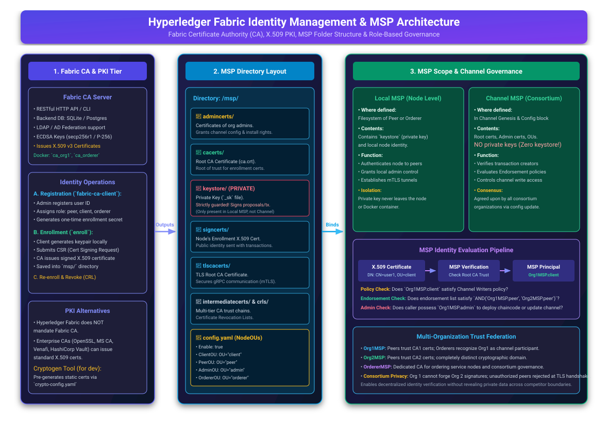

---

### 4.3 Inside the `msp/` Directory Layout

Whether inspecting a local peer node or a channel configuration block, cryptographic materials are structured within a standardized directory format:

| Directory / File | Scope | Contents & Security Mechanics |
| :--- | :--- | :--- |
| `admincerts/` | Local & Channel | X.509 certificates of designated organization administrators |
| `cacerts/` | Local & Channel | Root CA certificate (`ca.crt`); establishes the organizational root of trust |
| `intermediatecerts/` | Local & Channel | Optional intermediate CA certificates for multi-tier trust chaining |
| `keystore/` | **LOCAL ONLY (SECRET)** | Node's private signing key (`_sk`). **STRICTLY CONFIDENTIAL; NEVER on channel** |
| `signcerts/` | Local & Channel | Node's public X.509 enrollment certificate (`cert.pem`) |
| `tlscacerts/` | Local & Channel | Root TLS CA certificate for establishing mutual TLS (mTLS) gRPC sessions |
| `tlsintermediatecerts/` | Local & Channel | Optional intermediate TLS CA certificates |
| `crls/` | Local & Channel | Certificate Revocation Lists identifying revoked or compromised certificates |
| `config.yaml` | Local & Channel | NodeOU configuration mapping organizational units to Admin, Peer, Client |

*Exam Trap:* **Channel MSPs NEVER contain a `keystore/` directory.** Private keys belong strictly to individual nodes and users. Publishing a private key to a channel configuration block compromises the entire organization's cryptographic security!

---

### 4.4 Local MSP vs. Channel MSP

Hyperledger Fabric distinguishes between two hierarchical levels of MSP:

| Dimension | Local MSP (Node-Level) | Channel MSP (Consortium-Level) |
|:---|:---|:---|
| **Storage Location** | Local filesystem of peer or orderer (`/etc/hyperledger/fabric/msp`) | Embedded inside Channel Genesis & Configuration Blocks |
| **Contains Private Key?** | **YES** (Inside `keystore/` folder) | **NO** (Zero private keys permitted) |
| **Operational Scope** | Determines local admin rights on that physical node process | Determines channel read/write access and endorsement checks |
| **Configuration File** | Defined in `core.yaml` (peer) or `orderer.yaml` (orderer) | Defined in `configtx.yaml` under `Organizations:` section |
| **Authentication Function**| Authenticates node during gRPC TLS handshakes and CLI commands | Validates transaction proposals, signatures, and VSCC policies |

---

### 4.5 Identity Lifecycle: Registration vs. Enrollment

1. **Registration:** An administrative action executed via `fabric-ca-client register`. The administrator registers a user identity with the CA, specifying a username, role (`peer`, `client`, `admin`), organizational unit, and receives a one-time enrollment secret (password).
2. **Enrollment:** Executed by the entity itself via `fabric-ca-client enroll`. The entity generates an elliptic curve keypair locally (using curve `secp256r1` / NIST P-256), constructs a Certificate Signing Request (CSR), transmits it to the CA with its secret, and receives its signed X.509 certificate. The private key never leaves the entity's local filesystem.

---

## 5. Hyperledger Fabric Transaction Lifecycle (Execute-Order-Validate)

### 5.1 The Execute-Order-Validate Paradigm

Traditional blockchains (Ethereum, Bitcoin) utilize an **Order-Execute Architecture**:
1. Transactions are ordered and packaged into blocks by miners/validators.
2. Every node in the network executes every transaction sequentially to compute state transitions.
*Fatal Flaws of Order-Execute:* Requires deterministic smart contract languages (severely restricting language features), forces sequential execution (bottlenecking throughput), and exposes unencrypted business logic to all nodes.

Hyperledger Fabric introduces the pioneering **Execute-Order-Validate Architecture**:
1. **Execute (Simulation):** Transactions are simulated in parallel by designated endorsing peers *before* consensus ordering.
2. **Order:** Lightweight ordering nodes sequence pre-executed transactions without re-running code.
3. **Validate:** Committing peers validate endorsement compliance and concurrency version conflicts (MVCC) before committing to disk.

---

### 5.2 Transaction Flow Sequence Diagram

The following sequence diagram tracks a transaction proposal through the complete 6-stage lifecycle across all network tiers:

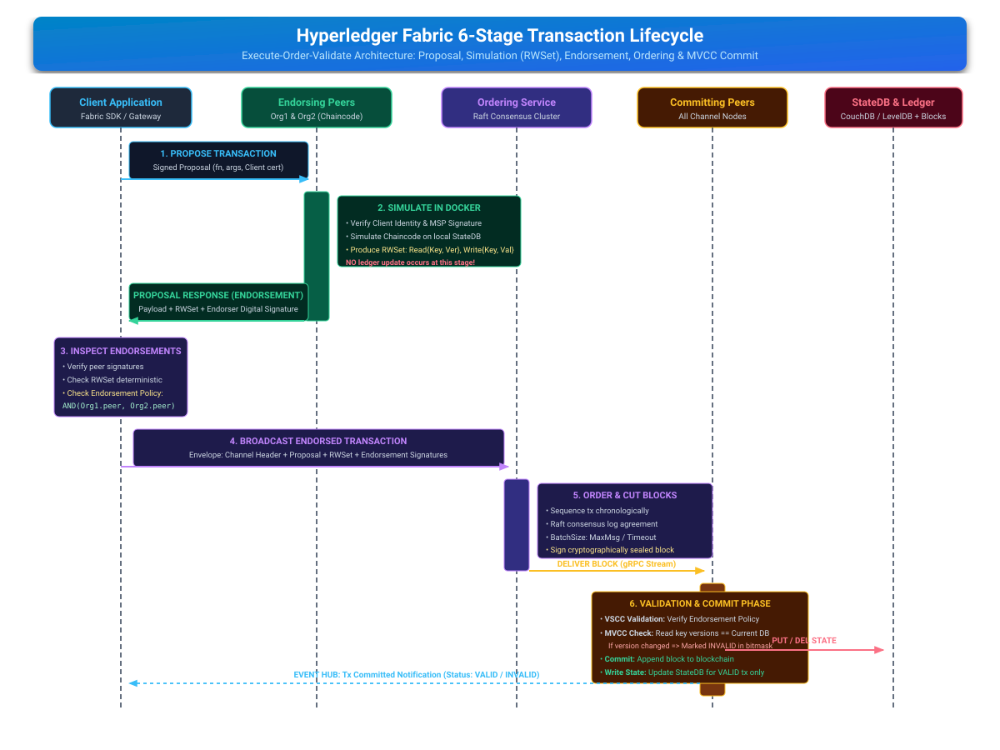

---

### 5.3 Detailed Step-by-Step Breakdown of the 6-Stage Lifecycle

#### Stage 1: Proposal Generation & Dispatch
1. Client application uses the Fabric SDK (Node/Go/Java) to construct a Transaction Proposal.
2. The proposal contains:
   - Channel ID (e.g., `"mychannel"`)
   - Chaincode ID (e.g., `"basic"`)
   - Target Function and Arguments (e.g., `"TransferAsset"`, `["CAR101", "Bob"]`)
   - Client Identity (X.509 Certificate) and Cryptographic Nonce
3. Client signs the proposal using its local private key.
4. SDK inspects the chaincode Endorsement Policy and dispatches the signed proposal across gRPC connections to the required Endorsing Peers (e.g., `Peer0.Org1` and `Peer0.Org2`).

#### Stage 2: Simulation & Endorsement (Chaincode Docker Execution)
1. Endorsing Peers receive the proposal and perform pre-execution verification:
   - Verify client signature against the Channel MSP.
   - Verify client possesses Writer permissions on the channel.
   - Ensure the proposal has not been previously executed (replay prevention).
2. Endorsing Peer launches / communicates with the isolated Docker container running the chaincode.
3. Chaincode executes the invoked function against the peer's local StateDB (World State).
4. > [!IMPORTANT]
   > **CRITICAL EXAM RULE:** The peer does **NOT** write modifications to the local database during simulation!
5. The peer captures all state reads and proposed writes into a **Read-Write Set (RWSet)**:
   - **Read Set:** List of keys accessed along with their exact current version numbers:
     $$\text{ReadSet} = \{ \text{Key}: \text{"CAR101"}, \text{Version}: [\text{Block 12}, \text{Tx 3}] \}$$
   - **Write Set:** List of keys and their proposed new values:
     $$\text{WriteSet} = \{ \text{Key}: \text{"CAR101"}, \text{Value}: \text{"Owner: Bob"} \}$$
6. Endorsing peer packages the RWSet, return value, and chaincode metadata into a Proposal Response.
7. Endorsing peer signs the Proposal Response with its own local private key (Endorsement).
8. The signed endorsement is transmitted back to the Client SDK via gRPC.

#### Stage 3: Client Endorsement Assembly & Inspection
1. Client SDK receives proposal responses from all targeted endorsing peers.
2. Client verifies peer signatures using the organization's CA root certificates.
3. Client compares the RWSets returned by different endorsing peers:
   - If chaincode execution is non-deterministic (e.g., relying on system time or random numbers), different peers will produce differing RWSets, causing the client to abort.
4. Client checks if the collected endorsements satisfy the chaincode Endorsement Policy (e.g., `AND('Org1MSP.peer', 'Org2MSP.peer')`).
5. If policy is satisfied, the client packages the proposal, RWSets, and endorsement signatures into an **Endorsed Transaction Envelope**.

#### Stage 4: Broadcast to Ordering Service
1. Client submits the serialized transaction envelope to the Ordering Service via gRPC stream.
2. The payload contains:
   - Transaction Header (TxID, Channel ID, Client Cert)
   - Chaincode Proposal & Arguments
   - Execution Results (RWSet)
   - Cryptographic Endorsements (Signatures of Org1 and Org2 peers)
3. Ordering service receives transactions concurrently from multiple client applications across channels.

#### Stage 5: Ordering & Block Cutting (Raft Consensus)
1. The Raft consensus leader sequences incoming transactions in strict chronological order.
2. Transactions are batched into blocks according to `configtx.yaml` parameters (`BatchSize` / `BatchTimeout`).
3. Raft replicates the log across follower orderer nodes. Once a quorum commits, the block is cut.
4. Orderer signs the block header (`DataHash`, `PrevHash`, `BlockNumber`).
5. The sealed block is broadcast over gRPC streams to Leader Peers / Anchor Peers of each organization.
6. Leader peers distribute the block internally across committing peers via the Gossip protocol.

#### Stage 6: Validation & Commit (VSCC, MVCC & StateDB Write)
Every committing peer evaluates the block independently through a three-pass validation pipeline:

- **Pass A: Validation System Chaincode (VSCC) Check**
  - Peer parses each transaction's endorsements against the channel's Endorsement Policy.
  - If endorsements are missing or forged, transaction is marked `INVALID`.
- **Pass B: Multi-Version Concurrency Control (MVCC) Read-Write Conflict Detection**
  - Peer iterates through the Read Set of the transaction.
  - Compares each read key's version in the transaction against the key's CURRENT version in local StateDB:
    - If $\text{Tx.ReadSet.Version} == \text{StateDB.CurrentVersion} \implies \mathbf{PASS\ (Valid)}$
    - If $\text{Tx.ReadSet.Version} \neq \text{StateDB.CurrentVersion} \implies \mathbf{FAIL\ (MVCC\ Conflict\ -\ INVALID)}$
  - A conflict occurs if another transaction earlier in the same block (or previous block) modified the same key after this transaction simulated its read!
- **Pass C: Commit & Event Dispatch**
  - Peer appends the sealed block to the Blockchain Log on disk, including a Bitmask identifying which transactions are `VALID` and which are `INVALID`.
  - **FOR VALID TRANSACTIONS ONLY:** Peer applies the Write Set to the StateDB (updates LevelDB/CouchDB).
  - **FOR INVALID TRANSACTIONS:** Discarded from StateDB; state is untouched, but transaction remains recorded on the blockchain log for immutable auditing!
  - Peer emits event notifications to client listeners notifying completion status.

---

## 6. Application Development & Network Deployment Engineering

### 6.1 Transition from Hyperledger Composer to Native Fabric Chaincode

In early blockchain curricula, **Hyperledger Composer** was frequently introduced as a rapid prototyping tool. Composer abstracted blockchain development through Domain Specific Modeling files (`.cto`), Access Control Lists (`permissions.acl`), and JavaScript transaction processors packed into Business Network Archives (`.bna`).

> [!WARNING]
> **Deprecation Notice:** The Linux Foundation formally deprecated Hyperledger Composer in 2019. Modern production enterprise engineering uses **Native Fabric Chaincode** implemented in **Golang**, Java, or TypeScript, communicating via the `fabric-contract-api` and managed via the **Fabric v2.x Chaincode Lifecycle**.

| Architectural Aspect | Hyperledger Composer (Deprecated) | Native Fabric Chaincode (Modern Production) |
| :--- | :--- | :--- |
| **Modeling & Syntax** | Abstract domain modeling files (`.cto`) | Direct Go / TypeScript / Java structs & methods |
| **Runtime Architecture** | Node.js shim wrapper inside chaincode container | Native compiled binary running inside dedicated Docker container |
| **Concurrency Control** | Prone to unexpected MVCC read-conflict aborts | Full programmatic control over Read-Write Set keys |
| **Deployment Pipeline** | Legacy `composer network install/start` | Standard Fabric v2.x 4-Step Lifecycle (Package, Install, Approve, Commit) |
| **Industry Status** | Deprecated & unmaintained since 2019 | Active, production-hardened Linux Foundation LTS standard |

---

### 6.2 Production Native Golang Chaincode Implementation

The following complete Golang chaincode implements a commercial vehicle asset management contract utilizing the official `fabric-contract-api-go`, demonstrating initialization, state writes (`PutState`), reads (`GetState`), updates, key-range queries (`GetStateByRange`), and JSON serialization:

```go
package main

import (
	"encoding/json"
	"fmt"
	"log"

	"github.com/hyperledger/fabric-contract-api-go/contractapi"
)

// SmartContract defines the Contract API structure
type SmartContract struct
{
	contractapi.Contract
}

// VehicleAsset defines the key-value schema stored in StateDB
type VehicleAsset struct
{
	DocType        string `json:"docType"`        // Used for CouchDB rich query filtering
	ID             string `json:"id"`             // Primary key (e.g., "VIN1002")
	Make           string `json:"make"`           // Manufacturer
	Model          string `json:"model"`          // Vehicle Model
	Owner          string `json:"owner"`          // Current owner identity
	AppraisedValue int    `json:"appraisedValue"` // Valuation in USD
}

// InitLedger populates the World State with initial test assets
func (s *SmartContract) InitLedger(ctx contractapi.TransactionContextInterface) error
{
	assets := []VehicleAsset{
		{DocType: "asset", ID: "VIN1001", Make: "Tesla", Model: "Model 3", Owner: "Alice", AppraisedValue: 45000},
		{DocType: "asset", ID: "VIN1002", Make: "BMW", Model: "i4", Owner: "Bob", AppraisedValue: 52000},
		{DocType: "asset", ID: "VIN1003", Make: "Ford", Model: "Mustang Mach-E", Owner: "Charlie", AppraisedValue: 48000},
	}

	for _, asset := range assets
	{
		assetJSON, err := json.Marshal(asset)
		if err != nil
		{
			return fmt.Errorf("failed to serialize asset: %v", err)
		}
		// Write to StateDB
		err = ctx.GetStub().PutState(asset.ID, assetJSON)
		if err != nil
		{
			return fmt.Errorf("failed to put asset to world state: %v", err)
		}
	}
	return nil
}

// CreateAsset creates a new vehicle asset if it does not already exist
func (s *SmartContract) CreateAsset(ctx contractapi.TransactionContextInterface, id string, makeStr string, modelStr string, owner string, value int) error
{
	exists, err := s.AssetExists(ctx, id)
	if err != nil
	{
		return err
	}
	if exists
	{
		return fmt.Errorf("asset %s already exists in world state", id)
	}

	asset := VehicleAsset{
		DocType:        "asset",
		ID:             id,
		Make:           makeStr,
		Model:          modelStr,
		Owner:          owner,
		AppraisedValue: value,
	}

	assetJSON, err := json.Marshal(asset)
	if err != nil
	{
		return err
	}

	return ctx.GetStub().PutState(id, assetJSON)
}

// ReadAsset returns the asset stored in World State with given id
func (s *SmartContract) ReadAsset(ctx contractapi.TransactionContextInterface, id string) (*VehicleAsset, error)
{
	assetJSON, err := ctx.GetStub().GetState(id)
	if err != nil
	{
		return nil, fmt.Errorf("failed to read from world state: %v", err)
	}
	if assetJSON == nil
	{
		return nil, fmt.Errorf("asset %s does not exist", id)
	}

	var asset VehicleAsset
	err = json.Unmarshal(assetJSON, &asset)
	if err != nil
	{
		return nil, err
	}
	return &asset, nil
}

// TransferAsset updates the owner field of an asset in World State
func (s *SmartContract) TransferAsset(ctx contractapi.TransactionContextInterface, id string, newOwner string) error
{
	asset, err := s.ReadAsset(ctx, id)
	if err != nil
	{
		return err
	}

	// Update field
	asset.Owner = newOwner
	assetJSON, err := json.Marshal(asset)
	if err != nil
	{
		return err
	}

	// Persist update (Generates WriteSet with updated value)
	return ctx.GetStub().PutState(id, assetJSON)
}

// AssetExists returns true if asset exists in World State
func (s *SmartContract) AssetExists(ctx contractapi.TransactionContextInterface, id string) (bool, error)
{
	assetJSON, err := ctx.GetStub().GetState(id)
	if err != nil
	{
		return false, fmt.Errorf("failed to read world state: %v", err)
	}
	return assetJSON != nil, nil
}

// GetAllAssets iterates over all keys in StateDB using range query
func (s *SmartContract) GetAllAssets(ctx contractapi.TransactionContextInterface) ([]*VehicleAsset, error)
{
	resultsIterator, err := ctx.GetStub().GetStateByRange("", "")
	if err != nil
	{
		return nil, err
	}
	defer resultsIterator.Close()

	var assets []*VehicleAsset
	for resultsIterator.HasNext()
	{
		queryResponse, err := resultsIterator.Next()
		if err != nil
		{
			return nil, err
		}

		var asset VehicleAsset
		err = json.Unmarshal(queryResponse.Value, &asset)
		if err != nil
		{
			return nil, err
		}
		assets = append(assets, &asset)
	}
	return assets, nil
}

func main()
{
	assetChaincode, err := contractapi.NewChaincode(&SmartContract{})
	if err != nil
	{
		log.Panicf("Error creating vehicle asset chaincode: %v", err)
	}

	if err := assetChaincode.Start(); err != nil
	{
		log.Panicf("Error starting vehicle asset chaincode: %v", err)
	}
}
```

---

### 6.3 Fabric v2.x 4-Step Chaincode Lifecycle

In Fabric v1.x, a single network admin could instantiate chaincode directly on a channel. Fabric v2.x replaced this with a decentralized **4-Step Governance Lifecycle**:

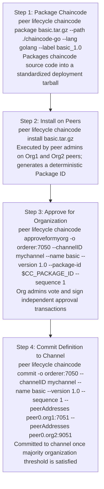

---

### 6.4 Fabric Test-Network Deployment & Docker Container Topology

The course materials (`Unit-3_PART-C-HL-setup-network_07.pdf`) document the complete step-by-step setup of the standard Fabric network.

#### System Prerequisites:
- **Operating System:** Ubuntu Linux (18.04 / 20.04 LTS recommended).
- **RAM:** Minimum 4 GB to 8 GB dedicated memory.
- **Node.js:** Versions 8.9.x or 10.x (for legacy client tools), Node 14+ for modern SDKs.
- **Golang:** Go version 1.14+; configure `$GOPATH`, `$GOROOT`, and append `$GOPATH/bin` to `~/.profile`.
- **Docker Engine & Docker Compose:** Docker version 19.03+ and Compose version 1.25+.
- **Fabric Samples & Binaries:** Downloaded via:
  ```bash
  curl -sSL https://bit.ly/2ysbOFE | bash -s -- 2.2.0 1.4.9
  ```

#### Core Network Configuration Files:
1. `crypto-config.yaml`: Defines organizational topology (domain names, hostnames, peer count) consumed by `cryptogen` to generate static X.509 certs.
2. `configtx.yaml`: Defines consortium policies, channel definitions, ordering cluster parameters (Raft consensus endpoints, batch size, batch timeout), and organizations. Consumed by `configtxgen` to produce:
   - Orderer Genesis Block: `orderer.genesis.block`
   - Channel Creation Artifact: `channel.tx`
   - Anchor Peer Update Transactions: `Org1MSPanchors.tx`, `Org2MSPanchors.tx`
3. `docker-compose.yaml`: Specifies container configurations, volumes, port forwarding, and environment variables.

#### Container Composition Progression:
Depending on network configuration flags, the Docker container landscape scales across three tiers:

| Network Deployment Profile | Container Count | Active Docker Container Instances & Ports | Key Capabilities & Architecture |
| :--- | :--- | :--- | :--- |
| **1. Default Baseline Network** | **3 Containers** | • `orderer.example.com` (Port 7050) — Raft Ordering node<br>• `peer0.org1.example.com` (Port 7051) — Org 1 Peer<br>• `peer0.org2.example.com` (Port 9051) — Org 2 Peer | Minimal test environment utilizing in-process embedded LevelDB instances for StateDB |
| **2. Network with CouchDB** | **5 Containers** | • Above 3 baseline containers +<br>• `couchdb0` (Port 5984) — Dedicated World State DB for `peer0.org1`<br>• `couchdb1` (Port 7984) — Dedicated World State DB for `peer0.org2` | Enables rich JSON attribute queries and declarative indexing across assets |
| **3. Full Production Stack with Fabric CAs** | **8 Containers** | • Above 5 containers (1 Orderer, 2 Peers, 2 CouchDBs) +<br>• `ca_orderer` (Port 9054) — Root CA for Ordering Service<br>• `ca_org1` (Port 7054) — Root CA for Organization 1<br>• `ca_org2` (Port 8054) — Root CA for Organization 2 | Complete decentralized PKI identity infrastructure mirroring enterprise consortia |

#### Step-by-Step CLI Runbook:
```bash
# 1. Navigate to fabric-samples test-network directory
cd fabric-samples/test-network

# 2. Launch full 8-container stack with CouchDB and Certificate Authorities
./network.sh up createChannel -c testchannel -s couchdb -ca

# 3. Verify running containers
docker ps --format "table {{.Names}}\t{{.Status}}\t{{.Ports}}"

# 4. Deploy Golang Chaincode
./network.sh deployCC -ccn basic -ccp ../asset-transfer-basic/chaincode-go -ccl go

# 5. Initialize ledger by invoking InitLedger
peer chaincode invoke -o localhost:7050 --ordererTLSHostnameOverride orderer.example.com \
  --tls --cafile $ORDERER_CA -C testchannel -n basic \
  --peerAddresses localhost:7051 --tlsRootCertFiles $PEER0_ORG1_CA \
  --peerAddresses localhost:9051 --tlsRootCertFiles $PEER0_ORG2_CA \
  -c '{"function":"InitLedger","Args":[]}'

# 6. Query World State for all assets
peer chaincode query -C testchannel -n basic -c '{"Args":["GetAllAssets"]}'

# 7. Graceful teardown of network and pruning of Docker volumes
./network.sh down
```

---

## 7. Comprehensive Comparative Matrices & Architectural Taxonomies

### 7.1 Public Permissionless vs. Enterprise Permissioned Blockchains

The following multi-dimensional comparative matrix contrasts the three major blockchain architectures studied across the BACSE350 syllabus:

| Architectural Dimension | Bitcoin | Ethereum (Post-Merge) | Hyperledger Fabric |
|:---|:---|:---|:---|
| **Network Governance** | Public, permissionless, decentralized | Public, permissionless, decentralized | Consortium permissioned, governed by MSP |
| **Identity & Privacy** | Anonymous / Pseudonymous (P2PKH) | Pseudonymous (20-byte hex address) | Known, cryptographically authenticated (X.509) |
| **Native Cryptocurrency** | Bitcoin ($\text{BTC}$) | Ether ($\text{ETH}$) | **None** (No native cryptocurrency required) |
| **Cost Model** | Transaction mining fees (Satoshis/vByte)| Dynamic Gas metering ($Gas \times Price$)| Zero execution fee (Consortium infrastructure) |
| **Consensus Algorithm** | Proof of Work (PoW / Hashcash SHA-256)| Proof of Stake (PoS / Casper + LMD-GHOST)| Crash Fault Tolerant (EtcdRaft) / SmartBFT |
| **Smart Contract Logic**| Bitcoin Script (Stack-based, non-Turing)| Solidity / Vyper (EVM, Turing-complete) | Golang / TypeScript / Java (Docker sandboxed) |
| **Execution Paradigm** | Order-Execute (Sequential) | Order-Execute (Sequential) | **Execute-Order-Validate (Parallel)** |
| **Throughput (TPS)** | ~7 Transactions per second | ~15 – 30 TPS (L1) / Thousands on L2 | **2,000 – 20,000+ TPS** |
| **Finality** | Probabilistic (6 blocks ~60 mins) | Deterministic (~2 epochs / 12.8 mins)| **Immediate & Deterministic (1 block)** |
| **Data Confidentiality**| Completely public ledger | Completely public ledger | **Bilateral channels & Private data collections**|
| **State Storage Model** | Unspent Transaction Output (UTXO) | Account Model (World State Trie) | Key-Value / JSON World State (Level/CouchDB) |

---

### 7.2 StateDB Engine Comparison: LevelDB vs. CouchDB

| Feature Dimension | LevelDB | CouchDB |
|:---|:---|:---|
| **Architecture** | In-process, embedded key-value engine | External standalone database server (Docker) |
| **Data Format** | Raw binary byte arrays / strings | JSON documents or binary blobs |
| **Query Mechanism** | Primary key lookup (`GetState`) & Range (`GetStateByRange`)| Primary key, Range, and **Rich Declarative JSON Queries** |
| **Index Support** | Lexicographical key ordering only | User-defined declarative JSON indexes (`$eq`, `$regex`)|
| **Operational Overhead** | Extremely low; zero extra network latency | Moderate; consumes additional RAM and container port |
| **Web Administration** | None | Built-in web administration interface (Fauxton UI) |
| **Exam Recommendation** | High-throughput simple key-value assets | Complex assets requiring filtering by multiple attributes|

---

### 7.3 Solidity Function Type Mutability Matrix

| State Mutability Modifier | Reads Blockchain State? | Writes / Modifies State? | Accepts Native Ether? | Underlying EVM Mechanism |
| :--- | :--- | :--- | :--- | :--- |
| **(Default / Non-payable)** | **YES** | **YES** | **NO** (Reverts if `msg.value > 0`) | `CALL`, `SSTORE`, `LOG` opcodes permitted |
| **`view`** | **YES** | **NO** | **NO** | Enforced via `STATICCALL` opcode; reading with `SLOAD` allowed |
| **`pure`** | **NO** | **NO** | **NO** | Local stack/memory computations only; zero state or environment reads |
| **`payable`** | **YES** | **YES** | **YES** | Omits `CALLVALUE` check; receives Ether into contract balance |

---

## 8. High-Yield Exam Questions & Numerical Problems with Worked Solutions

### Problem 1: Ethereum Gas Accounting, Execution Tracing & Out-of-Gas Revert Analysis

**Scenario:**  
An Externally Owned Account (EOA `0xA1bC...`) initiates a transaction calling a contract function `updateRecord(uint256 x)`. The sender configures the transaction with:
- `Gas Limit` = $50,000\text{ gas}$
- `Base Fee` = $30\text{ Gwei}$
- `Max Priority Fee (Tip)` = $2\text{ Gwei}$
- `Max Fee Per Gas` = $40\text{ Gwei}$

During execution in the EVM, the function evaluates the following opcodes sequentially:
1. Standard transaction baseline cost
2. Memory expansion and function selector decoding: $1,200\text{ gas}$
3. Writing a brand-new non-zero state variable (`SSTORE` from 0 to non-zero): $20,000\text{ gas}$
4. Calling an internal helper performing $400$ iterations of an arithmetic loop where each iteration costs $75\text{ gas}$.

**Questions:**
1. What is the effective gas price paid per unit of gas?
2. Does the transaction succeed or fail? Show step-by-step mathematical gas summation.
3. What is the total fee in Ether deducted from the sender's account?
4. What happens to the contract state variables if execution halts with an Out-of-Gas exception?

**Complete Worked Solution:**

#### Part 1: Effective Gas Price Calculation
Using the EIP-1559 pricing formula:
$$\text{Effective Gas Price} = \text{Base Fee} + \min(\text{Max Priority Fee}, \text{Max Fee} - \text{Base Fee})$$
$$\text{Effective Gas Price} = 30\text{ Gwei} + \min(2\text{ Gwei}, 40 - 30\text{ Gwei}) = 30 + 2 = 32\text{ Gwei}$$

#### Part 2: Gas Consumption Tracing
Let us compute the total gas required by the opcodes:
- Base transaction cost: $21,000\text{ gas}$
- Selector decoding and memory: $1,200\text{ gas}$
- Storage initialization (`SSTORE`): $20,000\text{ gas}$
- Arithmetic loop: $400 \times 75 = 30,000\text{ gas}$

$$\text{Total Gas Required} = 21,000 + 1,200 + 20,000 + 30,000 = 52,200\text{ gas}$$

**Comparison:**
$$\text{Gas Limit Allocated} = 50,000\text{ gas}$$
$$\text{Gas Required} = 52,200\text{ gas}$$
$$52,200 > 50,000 \implies \mathbf{FAIL\ (OutOfGas\ Exception)}$$
Execution halts at iteration 370 of the loop when the gas counter reaches 0.

#### Part 3: Total Transaction Fee Deducted
Because the transaction failed due to an Out-of-Gas exception, **the entire Gas Limit is consumed and forfeited**:
$$\text{Gas Consumed} = 50,000\text{ gas}$$
$$\text{Fee (Gwei)} = 50,000 \times 32\text{ Gwei} = 1,600,000\text{ Gwei}$$
Convert to Ether:
$$\text{Fee (ETH)} = 1,600,000 \times 10^{-9}\text{ ETH} = 0.0016\text{ ETH}$$
$$\text{Fee Burned} = 50,000 \times 30\text{ Gwei} = 0.0015\text{ ETH}$$
$$\text{Validator Tip} = 50,000 \times 2\text{ Gwei} = 0.0001\text{ ETH}$$

#### Part 4: State Variable Consequences
Because of atomicity in the EVM, **all state changes are rolled back**. The storage slot modified during the `SSTORE` opcode reverts to its original value prior to the transaction. The transaction hash is recorded on the blockchain with status `0 (Failure)`.

---

### Problem 2: Mathematical Derivation of Ethereum Contract Address & EIP-55 Checksum

**Scenario:**  
An EOA with address `0x6ac7ea33f8831ea9dcc53393aaa88b25a785dbf0` deploys its very first smart contract ($\text{nonce} = 0$).

**Question:**  
Derive the deterministic contract address using the RLP encoding formula and explain the mathematical steps.

**Complete Worked Solution:**

#### Step 1: The Address Derivation Formula
$$\text{Contract Address} = \text{Keccak-256}(\text{RLP}([\text{senderAddress}, \text{nonce}]))[12..31]$$

#### Step 2: RLP Encoding
- The sender address is a 20-byte binary sequence: `0x6ac7ea33f8831ea9dcc53393aaa88b25a785dbf0`.
- In RLP, a 20-byte string is prefixed with `0x80 + 20 = 0x94`.
  $$\text{RLP}(\text{sender}) = \text{0x946ac7ea33f8831ea9dcc53393aaa88b25a785dbf0}$$
- The nonce is integer `0`. Under Ethereum RLP rules, integer 0 is encoded as the empty byte string `0x80`.
- The list containing these two items is serialized with a list prefix. The total payload length is $1 + 20 + 1 = 22\text{ bytes}$($0x16$).
- The list prefix is `0xc0 + 22 = 0xd6`.
- The complete RLP serialized payload is:
  $$\text{Payload} = \text{0xd6946ac7ea33f8831ea9dcc53393aaa88b25a785dbf080}$$

#### Step 3: Keccak-256 Hashing
Compute the Keccak-256 hash of the 23-byte payload:
$$\text{Keccak-256}(\text{Payload}) = \text{0xcd234a471d3a111c2a4a0281313693f739cac2740fc0741718c016f316514b60}$$

#### Step 4: Extract Last 20 Bytes
Discard the first 12 bytes (`cd234a471d3a111c2a4a0281`). Retain the remaining 20 bytes (40 hex characters):
$$\mathbf{Contract\ Address} = \mathbf{0x313693f739cac2740fc0741718c016f316514b60}$$

---

### Problem 3: Fabric Endorsement Policy Evaluation & MVCC Read-Write Set Concurrency Conflict

**Scenario:**  
In a Hyperledger Fabric supply chain network with two organizations (`Org1MSP` and `Org2MSP`), the chaincode `AssetTransfer` has an Endorsement Policy:
$$\text{Policy} = \text{AND}('Org1MSP.peer', 'Org2MSP.peer')$$

Two client applications simultaneously attempt to purchase the exact same asset `ASSET_42`:
- **Current State in StateDB:** Key: `ASSET_42`, Value: `{"owner": "Alice", "price": 100}`, **Version:** `Block 10, Tx 2`.
- **Transaction 1 ($Tx_1$):** Client 1 proposes transferring `ASSET_42` to "Bob". Both `Org1` and `Org2` endorse.
- **Transaction 2 ($Tx_2$):** Client 2 proposes transferring `ASSET_42` to "Charlie". Both `Org1` and `Org2` endorse.
- Both transactions are submitted to the Ordering Service at roughly the same time and are batched into the exact same **Block 11**, with $Tx_1$ordered at Index 0 and$Tx_2$ ordered at Index 1.

**Questions:**
1. Detail the Read-Write Set generated during simulation for both transactions.
2. Trace the validation steps on Committing Peers when processing Block 11.
3. What is the final state of `ASSET_42` in StateDB?
4. What happens to $Tx_2$ on the blockchain ledger?

**Complete Worked Solution:**

#### Part 1: Read-Write Sets Generated During Simulation
Because both transactions simulated against the World State before Block 11 was cut:
- **$Tx_1$ RWSet:**
  - $\text{ReadSet} = \{ \text{Key}: "ASSET\_42", \text{Version}: [10, 2] \}$-$\text{WriteSet} = \{ \text{Key}: "ASSET\_42", \text{Value}: "\{owner: Bob, price: 100\}" \}$- **$Tx_2$ RWSet:**
  - $\text{ReadSet} = \{ \text{Key}: "ASSET\_42", \text{Version}: [10, 2] \}$-$\text{WriteSet} = \{ \text{Key}: "ASSET\_42", \text{Value}: "\{owner: Charlie, price: 100\}" \}$

#### Part 2: Committing Peer Block Validation Trace
The committing peer processes transactions within Block 11 sequentially:

**Processing $Tx_1$ (Index 0):**
1. **VSCC Check:** Verifies endorsements from both `Org1MSP` and `Org2MSP`. Valid.
2. **MVCC Concurrency Check:**
   - $Tx_1$read key `ASSET_42` at version$[10, 2]$.
   - Current StateDB version for `ASSET_42` is $[10, 2]$.
   - $\text{Read Version} == \text{Current DB Version} \implies \mathbf{PASS}$.
3. **Commit Action:** $Tx_1$ is marked **VALID** in Block 11 bitmask.
4. **StateDB Update:** Key `ASSET_42` updated to `{"owner": "Bob"}`; its version advances to $[11, 0]$.

**Processing $Tx_2$ (Index 1):**
1. **VSCC Check:** Verifies endorsements from both `Org1MSP` and `Org2MSP`. Valid.
2. **MVCC Concurrency Check:**
   - $Tx_2$read key `ASSET_42` at version$[10, 2]$.
   - Current StateDB version for `ASSET_42` is now $[11, 0]$(due to$Tx_1$ commit!).
   - $[10, 2] \neq [11, 0] \implies \mathbf{FAIL\ (MVCC\_READ\_CONFLICT)}$.
3. **Commit Action:** $Tx_2$ is marked **INVALID** in Block 11 bitmask.
4. **StateDB Update:** **None.** WriteSet for $Tx_2$ is completely discarded.

#### Part 3: Final State in StateDB
The owner of `ASSET_42` in StateDB is **Bob**, with version $[11, 0]$. Charlie's purchase attempt was invalidated.

#### Part 4: Disposition of $Tx_2$
$Tx_2$ is **NOT deleted**. It is permanently written into Block 11 of the immutable blockchain log on disk with its validation code set to `TRANSACTION_INVALID_MVCC_CONFLICT`. Client 2's event listener receives an MVCC failure notification, allowing the client application to re-read the updated asset and submit a fresh transaction proposal if desired.

---

### Problem 4: The DAO Reentrancy Exploit & Checks-Effects-Interactions Mitigation

**Scenario:**  
Explain how an attacker drained $3.6\text{ million ETH}$ in the infamous 2016 DAO Hack due to contract reentrancy, and contrast the vulnerable code pattern with the secure implementation.

**Conceptual Explanation & Code Comparison:**

In Solidity, when a contract sends Ether to an external contract using `.call{value: amount}("")`, execution control transfers to the recipient contract's `receive()` or `fallback()` function. If the calling contract has not updated its internal state *before* sending Ether, the recipient contract can recursively call back into the withdraw function before the first call finishes, draining the contract balance.

```solidity
// ============================================================================
// 1. VULNERABLE CONTRACT (INCORRECT PATTERN: INTERACTION BEFORE EFFECT)
// ============================================================================
contract VulnerableVault
{
    mapping(address => uint256) public balances;

    function deposit() external payable
    {
        balances[msg.sender] += msg.value;
    }

    function withdraw() external
    {
        uint256 bal = balances[msg.sender];
        require(bal > 0, "Zero balance");

        // STEP 1: INTERACTION FIRST (FATAL FLAW!)
        // Control transfers to attacker's fallback function before balance is zeroed
        (bool sent, ) = msg.sender.call{value: bal}("");
        require(sent, "Failed to send Ether");

        // STEP 2: EFFECT SECOND (NEVER REACHED DURING RECURSIVE REENTRANCY!)
        balances[msg.sender] = 0;
    }
}

// ============================================================================
// 2. ATTACKER EXPLOIT CONTRACT
// ============================================================================
contract Attacker
{
    VulnerableVault public target;

    constructor(address _target)
    {
        target = VulnerableVault(_target);
    }

    // Trigger attack
    function attack() external payable
    {
        target.deposit{value: 1 ether}();
        target.withdraw();
    }

    // Fallback executes recursively whenever Ether is received
    receive() external payable
    {
        if (address(target).balance >= 1 ether)
        {
            target.withdraw(); // REENTRANCY OCCURS HERE
        }
    }
}

// ============================================================================
// 3. SECURE CONTRACT (CHECKS-EFFECTS-INTERACTIONS PATTERN + REENTRANCY GUARD)
// ============================================================================
contract SecureVault
{
    mapping(address => uint256) public balances;
    uint256 private _status; // Reentrancy lock (1 = unlocked, 2 = locked)

    modifier nonReentrant()
    {
        require(_status != 2, "ReentrancyGuard: reentrant call");
        _status = 2; // Lock
        _;
        _status = 1; // Unlock
    }

    constructor()
    {
        _status = 1;
    }

    function deposit() external payable
    {
        balances[msg.sender] += msg.value;
    }

    function withdraw() external nonReentrant
    {
        // 1. CHECKS
        uint256 bal = balances[msg.sender];
        require(bal > 0, "Zero balance");

        // 2. EFFECTS (Zero out balance BEFORE interacting with external address)
        balances[msg.sender] = 0;

        // 3. INTERACTIONS
        (bool sent, ) = msg.sender.call{value: bal}("");
        require(sent, "Failed to send Ether");
    }
}
```

---

## 9. Formula Sheet, Key Acronyms & Exam Traps Quick Reference

### 9.1 Mathematical Formula Sheet

1. **Effective Gas Price (EIP-1559):**
   $$\text{EffectiveGasPrice} = \text{BaseFee} + \min(\text{MaxPriorityFeePerGas}, \text{MaxFeePerGas} - \text{BaseFee})$$

2. **Total Transaction Fee:**
   $$\text{TotalFee} = \text{GasUsed} \times \text{EffectiveGasPrice}$$

3. **Unused Gas Refund:**
   $$\text{Refund} = (\text{GasLimit} - \text{GasUsed}) \times \text{EffectiveGasPrice} \quad \text{[Only applies on SUCCESS or REVERT]}$$

4. **Ethereum Address Derivation:**
   $$\text{Address} = \text{Keccak-256}(\text{Uncompressed\_Public\_Key}_{64\text{ Bytes}})[12..31]$$

5. **Contract Address Derivation (`CREATE`):**
   $$\text{Address} = \text{Keccak-256}(\text{RLP}([\text{SenderAddress}, \text{Nonce}]))[12..31]$$

6. **Counterfactual Contract Address Derivation (`CREATE2`):**
   $$\text{Address} = \text{Keccak-256}(0\text{xFF} \parallel \text{SenderAddress} \parallel \text{Salt}_{32\text{ Bytes}} \parallel \text{Keccak-256}(\text{InitCode}))[12..31]$$

7. **Memory Expansion Gas Cost:**
   $$\text{Cost}(\text{words}) = 3 \times \text{words} + \lfloor \frac{\text{words}^2}{512} \rfloor \quad \text{where } \text{words} = \lceil \frac{\text{bytes}}{32} \rceil$$

8. **Raft Ordering Quorum Fault Tolerance:**
   $$N = 2F + 1 \implies \text{Tolerates } F \text{ crashed orderer nodes}$$
   $$\text{Quorum Required} = \lfloor \frac{N}{2} \rfloor + 1$$

---

### 9.2 Key Acronyms Glossary

| Acronym | Full Form & Meaning | Canonical System Context |
| :--- | :--- | :--- |
| **ABI** | Application Binary Interface | Deterministic JSON encoding specification for EVM contract calls |
| **CA** | Certificate Authority / Contract Account | PKI entity in Fabric / Autonomous EVM code account in Ethereum |
| **CFT** | Crash Fault Tolerant | Consensus model tolerating node crashes without Byzantine malice (e.g., Raft) |
| **DApp** | Decentralized Application | Web frontend interacting with blockchain smart contracts |
| **EIP** | Ethereum Improvement Proposal | Standards process for core Ethereum protocol specifications (e.g., EIP-1559, EIP-55) |
| **EOA** | Externally Owned Account | Ethereum account controlled by a private cryptographic key pair |
| **EVM** | Ethereum Virtual Machine | 256-bit sandboxed stack execution runtime embedded in full nodes |
| **Geth** | Go-Ethereum | Reference Go execution client implementation maintained by Ethereum Foundation |
| **HD** | Hierarchical Deterministic | BIP-32/BIP-44 tree-based key derivation from a single seed phrase |
| **LES** | Light Ethereum Subprotocol | Protocol enabling light clients to verify block headers and Merkle proofs |
| **MSP** | Membership Service Provider | Hyperledger Fabric identity and access control abstraction layer |
| **MVCC** | Multi-Version Concurrency Control | Optimistic concurrency check comparing Read-Write Set versions in Fabric |
| **OOG** | Out of Gas | EVM exception raised when gas counter hits zero during execution |
| **RLP** | Recursive Length Prefix | Standard deterministic binary encoding and serialization scheme in Ethereum |
| **RWSet** | Read-Write Set | Captured simulation state reads and proposed writes produced by Fabric endorsers |
| **StateDB** | World State Database | Current state key-value store (LevelDB or CouchDB) in Hyperledger Fabric |
| **VSCC** | Validation System Chaincode | Fabric built-in validation engine enforcing channel endorsement policies |

---

### 9.3 High-Frequency Exam Traps & Pitfalls

1. **Gas Refund Trap:** When a contract runs out of gas (`OutOfGas`), does the sender get back unused gas?  
   *Answer:* **NO.** The entire `GasLimit * GasPrice` is forfeited to the block validator. Unused gas is only refunded if execution completes normally or halts via a controlled `revert()`.
2. **Fabric Simulation vs. Commit Trap:** When an Endorsing Peer simulates chaincode during Stage 2, is the World State updated?  
   *Answer:* **NO.** State is NEVER modified during endorsement simulation. State is modified exclusively by Committing Peers during Stage 6 for transactions that pass MVCC checks.
3. **Invalid Fabric Transactions Trap:** If a transaction fails the MVCC read-write conflict check in Stage 6, is it deleted from the blockchain?  
   *Answer:* **NO.** The transaction is permanently recorded in the block on the immutable blockchain log, but its status bitmask is marked `INVALID`, and its write-set is NOT applied to StateDB.
4. **Orderer Business Logic Trap:** Does the Ordering Service in Fabric check whether the sender has sufficient funds or evaluate chaincode?  
   *Answer:* **NO.** The Ordering Service is completely agnostic to business logic. It sequences transactions chronologically and packages blocks.
5. **Private Key in Channel MSP Trap:** Does a Channel MSP configuration block contain private keys?  
   *Answer:* **NO.** Channel MSPs contain only public certificates (Root CA, Admin certs, OUs). Storing private keys in a channel configuration is a severe security violation.
6. **EVM Word Size Trap:** What is the native word size of the EVM stack?  
   *Answer:* **256 bits (32 bytes)**, intentionally matched to Keccak-256 and elliptic curve cryptographic scalar fields.
7. **Ethereum Account Nonce Trap:** Does an EOA nonce represent the number of received transactions?  
   *Answer:* **NO.** An EOA nonce strictly represents the number of **sent, confirmed transactions** initiated by that account.

---
