# BACSE350: Blockchain Architecture & Design
## Module 4: Security and Privacy Practices — Master Concept & Exam Preparation Guide

---

### Executive Overview & Module Syllabus Mapping
This master document provides an exhaustive, university-level, exam-ready synthesis of **Module 4: Security and Privacy Practices** for BACSE350. It integrates all foundational lecture notes, architectural security frameworks, technical risk analyses, network threat vectors, privacy attack heuristics, hardware wallet physical security mechanisms, multisignature governance structures, and historical case studies (including the 2016 DAO exploit and the 2017 Bitcoin block size war).

#### Syllabus Coverage Matrix
1. **Security Architecture Principles**: Defense-in-depth, principle of least privilege, zero trust architecture, classical CIA triad, Parkerian Hexad, fail-safe defaults, complete mediation, economy of mechanism, open design (Kerckhoffs's principle), psychological acceptability, and decentralization of trust.
2. **Technical and Inherent Risks of Blockchain Technology**: Dual risk classification framework, smart contract vulnerabilities (Reentrancy, integer overflow/underflow, access control, logic flaws, unpatchable code), The DAO hack in-depth case study (with ATM analogy, code walkthrough, fallback function recursion, and remediation), scalability trilemma, and the oracle problem.
3. **Attacks on Privacy & De-Anonymization**: Pseudonymity vs. anonymity, transaction graph analysis, address clustering heuristics (common-input ownership and change address detection), network-level sniffing (gossip listeners, IP broadcast mapping), dusting attacks, taint analysis, timing and amount correlation, and Privacy-Enhancing Technologies (PETs: ZKP, Ring Signatures, Stealth Addresses, Confidential Transactions, CoinJoin).
4. **Blockchain-Specific vs. Non-Blockchain Attacks**: 51% double spending and reorganization mechanics, Eclipse attack topology, Sybil attack dynamics, Timejacking attacks, selfish mining, DDoS, BGP routing attacks, phishing, malware/keyloggers, and exchange hybrid compromise vectors.
5. **Limits and Bottlenecks of Blockchain**: Throughput (TPS) bottlenecks, confirmation latency, storage bloat and state explosion, transaction irreversibility, and regulatory conflicts (GDPR Article 17 "Right to Erasure" vs. immutability).
6. **User Security Best Practices & Operational Security**: Seed phrase custody (BIP-39 standard, offline generation), passphrase (25th word) protection, phishing defense, hardware 2FA keys, air-gapped signing, and Web3 smart contract token approval revocation.
7. **Physical Bitcoin Storage & Hardware Wallets**: Paper wallets, stainless steel seed plates (fire/water/crush resistance), Secure Element (SE) chips (EAL5+/EAL6+) vs. general-purpose MCUs, Ledger vs. Trezor design philosophies, hot vs. cold wallet operational trade-offs.
8. **Balancing Risk and Diversifying Custodial Exposure**: The 75-20-5 custodial asset allocation model, multi-institution counterparty diversification, and Shamir's Secret Sharing (SLIP-0039 / SSS 3-of-5 split backups).
9. **Multisignature Schemes and Decentralized Governance**: $M$-of-$N$ threshold signing, cryptographic implementations (P2SH, MuSig2, Safe), escrow mechanisms, on-chain vs. off-chain governance, two-layer governance-multisig defense, and hard forks vs. soft forks (BTC/BCH, ETH/ETC).
10. **University Exam Preparation Guide**: High-yield rapid review summaries, concept comparison matrices, and 20 comprehensive university-level practice questions with detailed solutions.

---

## 1. Security Architecture Principles in Blockchain Systems

Security architecture is the structured discipline of designing, implementing, and maintaining defense systems that prevent, detect, and recover from adversarial attacks. While blockchain inherits classical principles from distributed systems, operating systems security, and applied cryptography, it fundamentally redesigns the trust model by eliminating central authorities and introducing game-theoretic consensus.

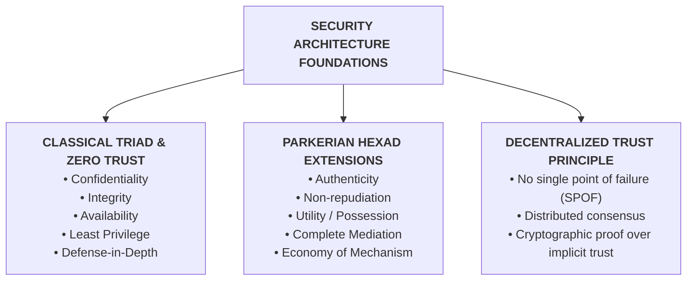

### 1.1 The Classical CIA Triad in Decentralized Systems
The CIA Triad forms the bedrock of information security. In blockchain, the implementation mechanisms diverge significantly from centralized relational database servers.

| CIA Property | Classical Centralized Definition | Blockchain Decentralized Implementation | Vulnerabilities & Breaches | Exam Mapping Tip |
| :--- | :--- | :--- | :--- | :--- |
| **Confidentiality** | Protecting data against unauthorized disclosure (access control lists, TLS encryption, DB permissions). | **Inherently weak by default.** Blockchains are open, transparent ledgers. Pseudonymous public keys provide only superficial confidentiality. Advanced confidentiality requires zero-knowledge proofs (Zcash zk-SNARKs), ring signatures (Monero), or confidential transactions. | Address clustering, transaction graph analysis, dusting attacks, de-anonymization via KYC exchanges. | **Map to:** Encryption, Stealth Addresses, ZKPs, Pedersen Commitments. |
| **Integrity** | Guaranteeing data cannot be altered, forged, or deleted undetected. | **Strong architectural guarantee.** Each block header encapsulates the cryptographic hash of the previous block ($H_{prev}$) and the Merkle root hash of all enclosed transactions. Modifying a historical block invalidates the entire subsequent hash chain. | 51% hashrate majority reorganization, smart contract state manipulation, integer wrap-around. | **Map to:** Cryptographic Hashing (SHA-256, Keccak-256), Merkle Trees, Digital Signatures. |
| **Availability** | Ensuring services and data remain continuously accessible to authorized users. | **Massive inherent resilience.** Replicated state machines across tens of thousands of globally distributed peer-to-peer (P2P) nodes eliminate Single Points of Failure (SPOF). The network operates 24/7/365 without central hosting. | P2P Eclipse attacks, BGP route hijacking, massive DDoS against RPC gateway nodes (Infura, Alchemy), mempool congestion. | **Map to:** P2P Gossip Replication, Node Redundancy, Decentralized Consensus. |

> [!IMPORTANT]
> **University Exam Rule:** When an exam prompt asks *"Which CIA property does component X protect?"*, apply this exact mapping:
> - **Cryptographic Hashing / Merkle Trees / Block Links** $\longrightarrow$ **Integrity**
> - **Zero-Knowledge Proofs / Encryption / Ring Signatures** $\longrightarrow$ **Confidentiality**
> - **P2P Node Gossip / Mining Pools / Validator Redundancy** $\longrightarrow$ **Availability**

---

### 1.2 Extended Security Properties: The Parkerian Hexad
Donn B. Parker expanded the classical CIA triad into the Parkerian Hexad by introducing three essential dimensions that are particularly vital in cryptocurrency custody and transaction validity:

1. **Authenticity**:
   - *Definition:* The cryptographic assurance that a message, block, or transaction genuinely originated from the specific identity claiming to send it.
   - *Blockchain Implementation:* Enforced exclusively through digital signature schemes based on Elliptic Curve Cryptography (ECDSA on `secp256k1` in Bitcoin/Ethereum, or Ed25519 in Solana). A valid signature proves the signer possesses the private key corresponding to the sender address without exposing the key itself.
2. **Non-Repudiation**:
   - *Definition:* The undeniable mathematical certainty that prevents a sender from falsely claiming they did not initiate or authorize a specific transaction.
   - *Blockchain Implementation:* Once a transaction is signed with a valid private key and confirmed inside an immutable block by network consensus, the sender cannot deny having broadcast it. The digital signature is permanently preserved on-chain for anyone to verify.
3. **Utility / Possession**:
   - *Definition:* The property of data remaining usable, accessible, and under the rightful party's physical and operational control.
   - *Blockchain Implementation:* Directly maps to **private key custody**. If a user loses their 12-word recovery seed phrase or forgets their PIN, the cryptocurrency tokens still exist on the public ledger, but the *utility* and *possession* are permanently lost to the rightful owner. Conversely, if an attacker exfiltrates a private key via malware, possession is compromised without altering the underlying blockchain ledger code.

---

### 1.3 Core Security Architecture Principles
Classical software security principles (Saltzer and Schroeder, 1975) apply directly to smart contract engineering and node infrastructure:

* **Principle of Least Privilege (PoLP)**:
  - Every user account, daemon process, validator node, and smart contract function must hold only the absolute minimum permissions necessary to perform its intended task.
  - *Blockchain Manifestation:* Restricting administrative functions using Solidity access-control modifiers (`onlyOwner`, OpenZeppelin `AccessControl` with role-based permissions `DEFAULT_ADMIN_ROLE`, `MINTER_ROLE`). Limiting ERC-20 token approval allowances to exact payment amounts rather than granting infinite approvals (`type(uint256).max`).
* **Defense-in-Depth**:
  - Never rely on a single defensive layer. Security must be layered so that if one defensive control fails (e.g., an endpoint computer is infected with a keylogger), subsequent independent controls (e.g., physical Secure Element PIN confirmation on a hardware wallet) prevent catastrophe.
  - *Blockchain Manifestation:* Combining smart contract automated testing, formal verification, external security audits, bug bounties, multisignature timelocks, and decentralized circuit breakers (pausable tokens).
* **Zero Trust Architecture (ZTA)**:
  - *"Never trust, always verify."* Assume the network perimeter is entirely hostile. Every node, peer, user, and incoming RPC call must be authenticated and validated independently on every interaction.
  - *Blockchain Manifestation:* In Bitcoin and Ethereum, **full nodes do not trust their peers**. When a peer sends a newly minted block, the receiving node does not take the peer's word that the block is valid; it independently executes every transaction, validates every signature, verifies the proof-of-work/proof-of-stake hash target, and recomputes the Merkle roots.
* **Separation of Duties**:
  - Critical, high-stakes actions must require multiple independent actors, preventing a single compromised individual or rogue administrator from causing irreversible damage.
  - *Blockchain Manifestation:* **Multisignature (Multisig) wallets** (e.g., Safe requiring 3-of-5 executive signatures) and decentralized threshold governance protocols.
* **Fail-Safe Defaults**:
  - The default system response to an unverified, ambiguous, or error state must be to deny access and revert all changes.
  - *Blockchain Manifestation:* Smart contract execution in the Ethereum Virtual Machine (EVM) uses transactional state changes. If any condition in a function fails (`require(condition, "error")`), the transaction throws an exception, **reverting all state mutations and balance changes back to their original state**, consuming only the gas expended up to the failure point.
* **Complete Mediation**:
  - Every access request must be checked on every invocation, without caching prior authorization states that could become stale or bypassed during reentrant execution.
  - *Blockchain Manifestation:* Re-verifying account balances and state conditions immediately before performing any state change or asset transfer, directly preventing reentrancy vulnerabilities.
* **Economy of Mechanism (Simplicity)**:
  - System architecture and contract logic must remain as simple and concise as possible. Because smart contract bytecode deployed to an immutable blockchain cannot be easily patched, unnecessary algorithmic complexity directly expands the permanent attack surface.
* **Open Design (Kerckhoffs's Principle)**:
  - Security must depend solely on the secrecy of cryptographic keys, never on the secrecy of algorithms, protocol designs, or source code.
  - *Blockchain Manifestation:* Blockchains are inherently open source. Bitcoin Core, Ethereum clients (Geth, Nethermind, Erigon), and verified Solidity contract code are publicly audited by thousands of researchers worldwide.
* **Psychological Acceptability**:
  - Security controls must be sufficiently intuitive and manageable that users do not deliberately bypass them. If seed phrase backup procedures are too complex, users will resort to taking photos on smartphones or saving them in unencrypted cloud notes, completely undermining security.

---

### 1.4 Decentralization as a Unique Security Principle
Classical corporate cybersecurity models rely on **perimeter defense**: corporate firewalls, enterprise VPNs, active directory domain controllers, and trusted cloud bastions. Centralized architectures suffer from a catastrophic structural vulnerability: the **Single Point of Failure (SPOF)**. If the central database administrator account or root AWS key is compromised, the entire organization collapses.

Blockchain replaces perimeter security with **decentralized game-theoretic trust**:
1. **Trust Elimination**: Instead of trusting a centralized custodian (e.g., a commercial bank or cloud provider), users trust open mathematical protocols, verifiable cryptography, and economic incentives.
2. **Mutual Distrust**: Network participants (miners, validators, nodes, users) are assumed to be selfish, potentially malicious, and mutually distrusting.
3. **Economic Incentive Alignment**: In Proof-of-Work and Proof-of-Stake, honest validation is rewarded with newly minted block subsidies and transaction fees, while cheating (attempting double spending or invalid blocks) results in wasted electricity or slashed staked capital.
4. **Architectural Trade-Off**: Decentralization eliminates SPOFs, but transfers the entire burden of key management onto the individual user and introduces complex consensus attack vectors (such as 51% majority dominance).

---

## 2. Technical and Inherent Risks of Blockchain Technology

A common misconception is that blockchain is inherently secure against all risks. In reality, blockchain risks must be bifurcated into two fundamentally distinct categories: **Technical Risks** and **Inherent Risks**.

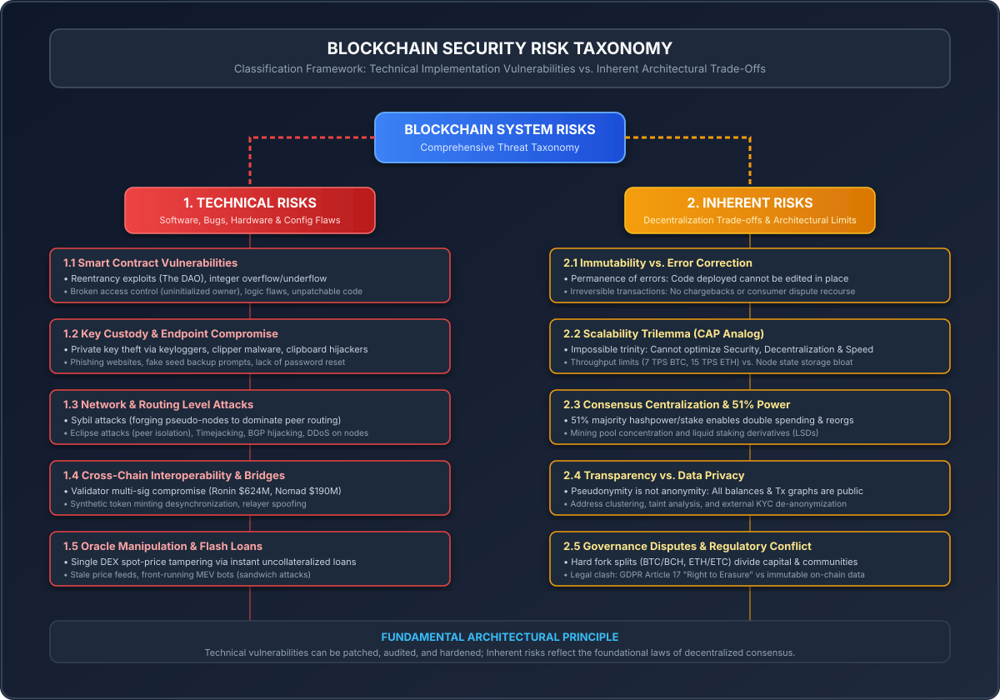

### 2.1 The Dual Risk Taxonomy: Comparative Analysis

| Feature Dimension | Technical Risks (Implementation Flaws) | Inherent Risks (Architectural Trade-Offs) |
| :--- | :--- | :--- |
| **Origin & Cause** | Bugs, programming errors, flawed logic, misconfigurations, and software/hardware vulnerabilities in clients, wallets, or smart contracts. | Foundational design trade-offs resulting from decentralization, immutability, transparency, and consensus mathematics. |
| **Remediability** | Can be resolved, patched, audited, or hardened through better coding standards, formal verification, and security testing. | **Cannot be "patched" away.** They represent inherent structural properties and trade-offs of the technology itself. |
| **Primary Examples** | Reentrancy bugs, integer overflows, uninitialized access control, oracle price manipulation, cross-chain bridge bugs. | Scalability trilemma, probabilistic finality, irreversibility of mistaken transfers, GDPR Article 17 "Right to Erasure" conflict. |
| **Impact on Users** | Catastrophic exploit of specific dApps or loss of stolen funds to exploiters. | Systemic operational constraints (high gas fees, slow block times, permanent public transaction history). |

---

### 2.2 Technical Risks: Detailed Breakdown

#### A. Smart Contract Vulnerabilities
Smart contracts are immutable, publicly executable computer programs deployed to a decentralized virtual machine (such as the EVM). Unlike traditional enterprise software where bugs can be quietly fixed via emergency hotfixes on cloud servers, deployed smart contract bytecode is permanently immutable.

1. **Reentrancy Attacks**:
   - Occurs when a vulnerable contract makes an external call to an untrusted contract (or transfers native Ether) *before* updating its internal state balance.
   - The recipient contract intercepts the control flow via its `fallback()` or `receive()` function and recursively calls back into the original withdrawal function before the initial execution resolves, repeatedly draining funds.
   - *Exam Highlight:* Detailed in-depth in Section 2.3 (The DAO case study).
2. **Integer Overflow and Underflow**:
   - In programming languages where integer sizes are fixed (e.g., `uint8` ranges from 0 to 255; `uint256` ranges from 0 to $2^{256}-1$):
     - **Overflow:** $255 + 1 \equiv 0$ (in `uint8`).
     - **Underflow:** $0 - 1 \equiv 255$(in `uint8`) or$2^{256}-1$ (in `uint256`).
   - If a smart contract calculates account balances without bounds checking, an attacker with a balance of 0 tokens who transfers 1 token would trigger an underflow, causing their balance to wrap around to the maximum possible integer value ($2^{256}-1$), instantly minting billions of unauthorized tokens (as seen in the famous 2018 BeautyChain `BEC` and `SMT` token exploits).
   - *Mitigation:* Historical mitigation required OpenZeppelin's `SafeMath` library. In modern Solidity (v0.8.0 and above), the compiler automatically injects arithmetic overflow and underflow checks, reverting transactions automatically upon arithmetic wrap.
3. **Broken Access Control & Uninitialized Contracts**:
   - Occurs when critical administrative functions (e.g., `mintTokens()`, `upgradeImplementation()`, `drainTreasury()`) fail to enforce access control modifiers, or allow public initialization.
   - *Case Study: Parity Multi-Sig Hack (2017):* In the second Parity wallet incident, the underlying library contract was left uninitialized. An attacker called `initWallet()` on the library itself, became the sole owner of the library contract, and subsequently called `kill()`, self-destructing the library. This instantly and permanently froze **513,774 Ether** (worth hundreds of millions of dollars) across 587 multi-sig wallets, with funds permanently unrecoverable to this day.
4. **Logic and Business Errors**:
   - Software where code executes exactly as written without any compiler errors, but the underlying economic or business logic is fatally flawed.
   - *Example:* A lending protocol designed to calculate discounts or collateral liquidation thresholds using flawed mathematical formulas, allowing exploiters to borrow entire liquidity pools against worthless collateral.
5. **Unpatchable Deployment**:
   - Once a contract is deployed to an immutable blockchain, its bytecode cannot be modified. If a critical bug is discovered post-deployment, developers cannot simply patch the code.
   - *Workaround:* Using **Proxy Patterns** (ERC-1967 Transparent Proxy or UUPS - Universal Upgradeable Proxy Standard), where an immutable proxy contract holds state and delegates execution (`delegatecall`) to an upgradeable logic implementation contract. However, upgradeable proxies introduce significant **centralization risks**, as whoever holds the admin upgrade key can unilaterally change the rules or steal user funds.

#### B. Key Custody and Endpoint Compromise
Blockchain accounts do not have a customer support center or "Forgot Password?" reset link. If a private key is exposed to a malicious keylogger, trojan, or clipboard clipper malware (which monitors Windows clipboard memory and replaces copied cryptocurrency addresses with an attacker's address), the attacker can sign irreversible transactions.

#### C. Cross-Chain Bridge Exploits
Different blockchains (e.g., Ethereum, Solana, Binance Smart Chain) operate on disparate consensus rules and cannot communicate natively. Cross-chain bridges lock assets on Chain A and mint synthetic wrapped tokens on Chain B.
- *Why Bridges are Giant Honeypots:* Bridges pool hundreds of millions of dollars into single smart contract vaults or small validator multi-sig sets.
- *Historical Exploits:*
  - **Ronin Bridge Hack (Axie Infinity, March 2022 - \$624 Million):** Attackers compromised 5 out of 9 validator private keys (4 Sky Mavis nodes and 1 Axie DAO validator), forging withdrawal authorizations.
  - **Wormhole Bridge Exploit (February 2022 - \$326 Million):** Attackers exploited a smart contract signature-verification bypass in Wormhole's Solana bridge contract, minting 120,000 wrapped Ether without depositing collateral.

#### D. The Oracle Problem
Smart contracts executed inside the deterministic EVM sandbox cannot make off-chain HTTP requests or query external APIs (doing so would break consensus, as different nodes would receive different API responses at different times). Blockchains must rely on **Oracles** (e.g., Chainlink, Pyth Network) to feed external real-world data (such as ETH/USD exchange rates, weather data, or election outcomes).
- *Oracle Exploitation:*
  - If a DeFi lending platform relies on a single decentralized exchange (DEX) liquidity pool (e.g., Uniswap v2 spot price) as its price oracle, an attacker can take out a massive **Flash Loan** (borrowing \$100 M+ uncollateralized within a single block), manipulate the DEX spot price artificially, borrow massive protocol funds against inflated collateral, and repay the flash loan—all within milliseconds.

---

### 2.3 The DAO Hack (2016) In-Depth Case Study

The June 2016 exploit of **The DAO** (Decentralized Autonomous Organization) remains the most consequential smart contract vulnerability in blockchain history, resulting in the theft of 3.6 million Ether (approximately 15% of all circulating Ether at the time) and leading to the historic hard fork that split Ethereum into Ethereum (ETH) and Ethereum Classic (ETC).

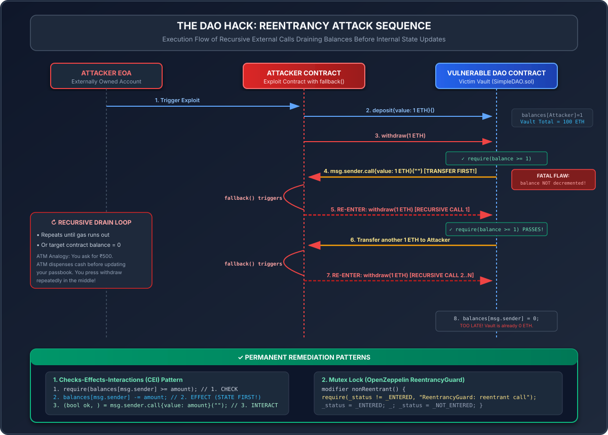

#### The ATM Analogy: Explaining Reentrancy Simply
Imagine an automated teller machine (ATM) programmed with a flawed sequence of operations:
1. You insert your debit card and request a withdrawal of ₹1,000.
2. The ATM verifies that your account has ₹1,000. *(Check passed)*
3. The ATM dispenses ₹1,000 in cash through the slot. *(Interaction)*
4. **Before the ATM updates your bank passbook balance to zero**, you press the "Withdraw ₹1,000" button again.
5. Because your passbook has not yet been debited, the ATM checks your balance again, sees you still have ₹1,000, dispenses another ₹1,000, and you repeat this process until the ATM cash vault is completely empty.
6. Only after the cash vault is empty does the ATM finally update your passbook balance to zero.

#### The Flawed Solidity Code Flow
The vulnerable withdrawal function in The DAO contract executed operations in the fatal order: **Check $ightarrow$Interact$ightarrow$ Effect**.

```solidity
// VULNERABLE CONTRACT PATTERN (The DAO Anti-Pattern)
contract VulnerableDAO
{
    mapping(address => uint256) public balances;

    function withdraw() public
    {
        uint256 amountToWithdraw = balances[msg.sender];
        
        // 1. CHECK
        require(amountToWithdraw > 0, "Zero balance");

        // 2. INTERACTION (FATAL FLAW: Sends funds BEFORE updating internal state!)
        // In Solidity, calling msg.sender with value forwards execution to the caller's fallback()
        (bool success, ) = msg.sender.call{value: amountToWithdraw}("");
        require(success, "Transfer failed");

        // 3. EFFECT (TOO LATE! Never reached during reentrancy loop)
        balances[msg.sender] = 0;
    }
}
```

#### The Attacker's Malicious Exploit Contract
The attacker deployed an exploit contract equipped with a specialized `fallback()` function:

```solidity
// MALICIOUS ATTACKER CONTRACT
contract ReentrancyExploiter
{
    VulnerableDAO public targetDAO;
    uint256 public constant INITIAL_DEPOSIT = 1 ether;

    constructor(address _targetDAO)
    {
        targetDAO = VulnerableDAO(_targetDAO);
    }

    // Fallback/receive function triggered whenever this contract receives Ether
    receive() external payable
    {
        // Re-enter the target contract if the target vault still holds funds
        if (address(targetDAO).balance >= INITIAL_DEPOSIT)
        {
            targetDAO.withdraw(); // RECURSIVE REENTRANT CALL!
        }
    }

    function attack() external payable
    {
        require(msg.value == INITIAL_DEPOSIT, "Need 1 ETH to start");
        // Step 1: Deposit 1 ETH so the target records balances[exploiter] = 1 ETH
        targetDAO.deposit{value: INITIAL_DEPOSIT}();
        // Step 2: Trigger the first withdrawal
        targetDAO.withdraw();
    }
}
```

#### Step-by-Step Exploit Mechanics:
1. **Deposit**: Attacker deposits 1 ETH into `VulnerableDAO`. State: `balances[Attacker] = 1 ETH`. Vault balance: 100 ETH.
2. **First Call**: Attacker calls `attack()`, which invokes `targetDAO.withdraw()`.
3. **Target Check**: `targetDAO` checks `balances[msg.sender] >= 1 ETH` $ightarrow$ Evaluates to **TRUE**.
4. **Premature Ether Dispatch**: `targetDAO` executes `msg.sender.call{value: 1 ETH}("")`.
5. **Execution Interception**: Sending Ether to `ReentrancyExploiter` automatically triggers its `receive()` fallback function.
6. **Reentrant Invocations**: Inside `receive()`, the attacker's contract calls `targetDAO.withdraw()` *again*.
7. **Bypassing the Balance Check**: Control enters `withdraw()` a second time. Because the line `balances[msg.sender] = 0` was never reached in the first invocation, `balances[msg.sender]` is **still 1 ETH**.
8. **Looping Drain**: The target contract dispatches another 1 ETH, triggering the fallback again. This recursive loop cycles until the gas limit is exhausted or the target contract's balance is completely drained.
9. **Unwinding**: Once recursion terminates, the call stack unwinds and repeatedly executes `balances[msg.sender] = 0`, but the vault is already empty.

#### Remediation: The Two Golden Defense Standards
To permanently eliminate reentrancy vulnerabilities, smart contract engineers employ two vital design patterns:

##### 1. Checks-Effects-Interactions (CEI) Pattern
Always mutate contract state (effects) **before** interacting with any external contracts or dispatching Ether:

```solidity
// SECURE PATTERN: Checks-Effects-Interactions (CEI)
function secureWithdraw() public
{
    // 1. CHECKS
    uint256 amountToWithdraw = balances[msg.sender];
    require(amountToWithdraw > 0, "Insufficient balance");

    // 2. EFFECTS (State is updated FIRST before any external transfer!)
    balances[msg.sender] = 0;

    // 3. INTERACTIONS (External call occurs only after internal state is safe)
    (bool success, ) = msg.sender.call{value: amountToWithdraw}("");
    require(success, "Transfer failed");
}
```
*Why CEI works:* If an attacker attempts to re-enter `secureWithdraw()`, the check `require(balances[msg.sender] > 0)` immediately fails and reverts because `balances[msg.sender]` was already set to 0 in Step 2.

##### 2. Mutex Lock via OpenZeppelin's ReentrancyGuard
Apply a boolean reentrancy guard modifier (`nonReentrant`) that sets a lock during execution:

```solidity
// SECURE PATTERN: Mutex Reentrancy Guard
abstract contract ReentrancyGuard
{
    uint256 private constant _NOT_ENTERED = 1;
    uint256 private constant _ENTERED = 2;
    uint256 private _status;

    constructor()
    {
        _status = _NOT_ENTERED;
    }

    modifier nonReentrant()
    {
        require(_status != _ENTERED, "ReentrancyGuard: reentrant call");
        _status = _ENTERED; // Lock acquired
        _;
        _status = _NOT_ENTERED; // Lock released
    }
}
```

---

### 2.4 Inherent Risks: Architectural Trade-Offs

#### A. The Scalability Trilemma
Coined by Vitalik Buterin, the **Scalability Trilemma** posits that a decentralized blockchain system can realistically optimize for only **two of three** fundamental properties simultaneously:

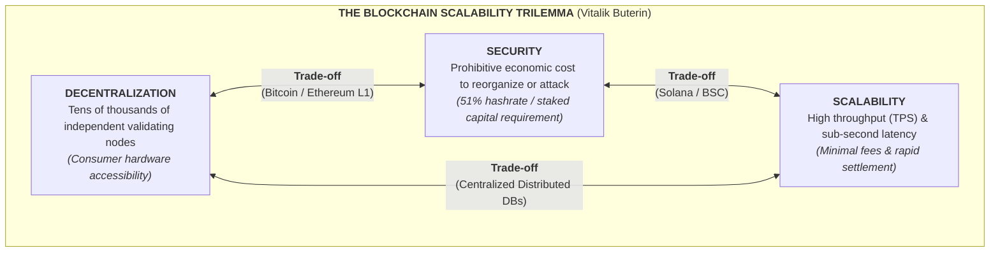

> [!NOTE]
> **The Core Trilemma Law:** A Layer-1 blockchain protocol can realistically optimize for only **two of the three** foundational properties simultaneously. Layer-2 solutions (rollups, state channels) resolve this by off-loading execution throughput while anchoring security and decentralization to Layer 1.

1. **Decentralization**: The network relies on thousands of independent, geographically dispersed, consumer-grade nodes validating blocks without centralized hardware requirements.
2. **Security**: The computational or financial cost of attacking, manipulating, or reorganizing the network is prohibitively high.
3. **Scalability (Throughput)**: The capacity to process thousands of transactions per second (TPS) with minimal confirmation latency and nominal transaction fees.

*The Trade-off Dynamics:*
- **Maximizing Decentralization & Security (Bitcoin, Ethereum L1):** High decentralization and unmatched cryptographic security, but throughput is bottlenecked (Bitcoin ~7 TPS, Ethereum ~15-30 TPS).
- **Maximizing Scalability & Security (Solana, Binance Smart Chain):** Extremely high throughput (thousands of TPS), but validator hardware requirements are so high (terabytes of RAM, enterprise datacenters) that fewer independent nodes can run them, severely degrading decentralization.

#### B. Consensus Centralization & Finality Risks
- **Majority Dominance Risk:** Any consensus mechanism is vulnerable if a single cartel controls $>50\%$ of validating resources (hashpower in PoW, staked tokens in PoS). Real-world centralization of mining pools (e.g., Foundry USA + Antpool controlling over 50% of Bitcoin hashrate) and liquid staking derivatives (e.g., Lido controlling a substantial percentage of staked ETH) continuously threaten this assumption.
- **Probabilistic vs. Absolute Finality:** In Nakamoto consensus (Bitcoin), finality is strictly **probabilistic**. A transaction is never 100% mathematically impossible to reverse; rather, the probability of a reorganization becomes exponentially smaller as more blocks are appended on top of it. Traditional financial settlement rails (e.g., Fedwire, RTGS) expect absolute finality.

#### C. Regulatory & Legal Inherent Conflicts: The GDPR Dilemma
One of the most profound legal challenges facing public blockchain technology is the direct conflict between **cryptographic immutability** and data privacy regulations, specifically the European Union's **General Data Protection Regulation (GDPR) Article 17 ("Right to Erasure" / "Right to be Forgotten")**:

| Dimension | Blockchain Cryptographic Immutability | GDPR Article 17 ("Right to Erasure") |
| :--- | :--- | :--- |
| **Core Mandate** | Once confirmed, ledger transactions and state data can never be altered or purged. | Data subjects hold legal right to demand complete deletion of all personally identifiable information (PII). |
| **Persistence Model** | Historical ledger is strictly append-only, validated by backward cryptographic hash chains. | Historical database records containing personal identifiers must be fully erased upon request. |
| **Architecture Topology** | State is replicated across 10,000+ globally distributed autonomous peer nodes. | Centralized or identifiable Data Controllers and Data Processors hold strict regulatory accountability. |
| **Architectural Resolution** | **Strict Separation:** Never record raw PII on-chain (even encrypted). Store actual data off-chain in compliant mutable stores. | Record only one-way cryptographic hash commitments ($H(\text{PII})$), ZK proofs, or DIDs on the immutable ledger. |
- **The Jurisdictional Dilemma:** Under GDPR, who is the "Data Controller"? In a public decentralized network with no central corporate headquarters, every validator node operator could theoretically be prosecuted for maintaining immutable personal data broadcast to the ledger.
- **Architectural Solution:** Never store Personally Identifiable Information (PII) on-chain. Store PII off-chain in encrypted databases, and record only cryptographic hash commitments or zero-knowledge proofs on the public blockchain.

---

## 3. Attacks on Privacy & De-Anonymization

A critical misconception among beginner cryptocurrency users is that blockchain transactions are completely anonymous. In truth, public blockchains (such as Bitcoin and Ethereum) are **pseudonymous**. Every single transaction, balance, sender address, recipient address, and timestamp is permanently recorded on a publicly accessible ledger viewable by anyone with a block explorer.

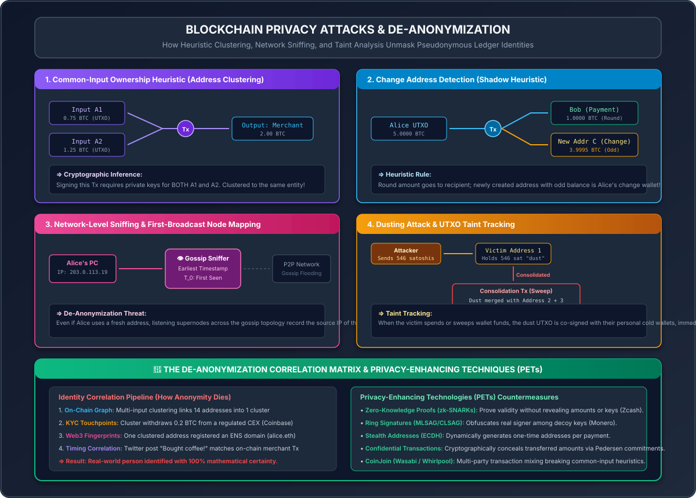

### 3.1 The Pseudonymity vs. Anonymity Spectrum
- **Anonymity:** *"The identity of the actor is completely unknown and un-linkable to any identifier."*
- **Pseudonymity:** *"The actor operates under a persistent alphanumeric identifier or mask (public key hash). While the real-world name is not explicitly attached, all actions under that identifier are linkable."*
- **Privacy Attack:** *"A methodology by which an adversary correlates clues, graph topology, network metadata, and external records to permanently link a pseudonymous address to a real-world human identity."*

---

### 3.2 Address Clustering Heuristics
Blockchain surveillance firms (e.g., Chainalysis, Elliptic, TRM Labs) deploy automated heuristic engines to group thousands of disparate pseudonymous addresses into a single entity cluster.

#### 1. Common-Input Ownership Heuristic (Multi-Input Clustering)
In UTXO-based blockchains like Bitcoin, if a transaction spends multiple unspent transaction outputs (UTXOs) originating from different addresses (e.g., Input Address $A_1$holding 0.5 BTC and Input Address$A_2$holding 1.5 BTC) into a single payment, **it is mathematically deduced that the entity initiating the transaction possesses the private keys for both$A_1$and$A_2$**.
- *Heuristic Deduction:* $A_1$and$A_2$ belong to the same wallet/owner. By recursively chaining this heuristic across historical transaction graphs, surveillance engines merge millions of individual addresses into unified entity clusters.

#### 2. Change Address Detection (Shadow Address Heuristic)
When a user spends a UTXO, the full amount must be consumed. The surplus remainder is returned as "change" to a newly generated address controlled by the sender's wallet:
- *Heuristic Clues:*
  - **Round Number Heuristic:** If a transaction sends 1.0000 BTC to Address $B$and 3.487192 BTC to Address$C$, Address$B$is inferred to be the commercial payment, while Address$C$ is flagged as the sender's change address.
  - **Address Type Matching:** If the input is a Native SegWit (`bc1q...`) address, and one output is Legacy (`1...`) while the other is Native SegWit (`bc1q...`), the matching output format is statistically likely to be the change wallet.
  - **Fresh Address Heuristic:** An output address that has never previously appeared on the blockchain ledger is almost always the change output.

---

### 3.3 Network-Level Sniffing & First Broadcast Mapping
Even if an advanced user meticulously avoids address reuse, transactions can be compromised at the network transport layer:
1. When a user broadcasts a transaction from their desktop wallet, the transaction does not appear everywhere simultaneously; it propagates via a **P2P gossip protocol** (flooding).
2. Adversaries deploy thousands of "listening supernodes" across the global P2P topology.
3. By recording the **precise microsecond timestamp ($T_0$)** and IP address of the peer that first transmitted the transaction across an open TCP socket, the observer can triangulate the geographical origin and Internet Service Provider (ISP) of the transaction broadcaster, linking the pseudonymous cryptocurrency wallet directly to a physical residence.

---

### 3.4 Active Privacy Attacks

* **Dusting Attacks**:
  - An attacker sends an infinitesimal amount of cryptocurrency (e.g., 546 satoshis, known as "dust") to hundreds of target addresses.
  - Unsuspecting users do not notice the tiny deposit. Later, when the user performs a large transaction or consolidates their wallet, their wallet software automatically sweeps the dust UTXO along with their large personal cold storage UTXOs.
  - The moment the dust is combined in a multi-input transaction, the common-input heuristic instantly unmasks the connection between the user's previously isolated wallets!
* **Timing and Amount Analysis**:
  - *Timing Correlation:* Matching the block timestamp of an on-chain transfer with external real-world events (e.g., a surveillance camera timestamp at a retail merchant or a time-stamped online tweet).
  - *Amount Matching:* If an invoice specifies an exact payment of ₹1,438.72 (or 0.0178392 BTC), searching the public blockchain for that exact fractional amount immediately pinpoints the transaction.
* **Smart Contract State Leakage**:
  - All smart contract storage variables (even those marked with the Solidity keyword `private`) and emitted events are completely public and readable by anyone querying an Ethereum node via `eth_getStorageAt`. Sensitive commercial data, employee payroll records, or private trade agreements deployed to a public contract are instantly exposed.

---

### 3.5 The De-Anonymization Synthesis Pipeline
The diagram below illustrates how disparate public clues converge to strip away pseudonymity entirely:

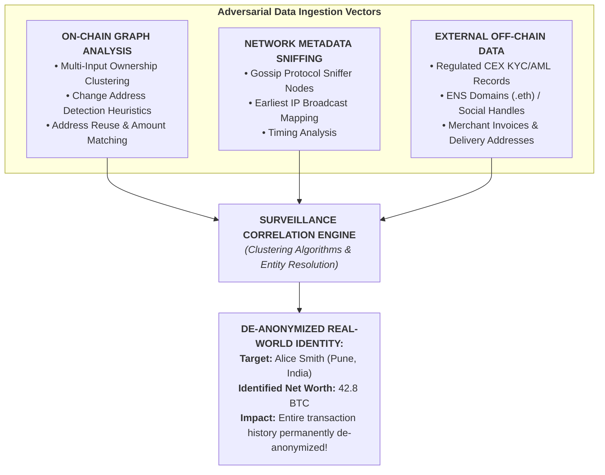

---

### 3.6 Privacy-Enhancing Technologies (PETs)
To counteract surveillance heuristics, cryptographers have developed advanced Privacy-Enhancing Technologies:

| Privacy Technology | Underlying Cryptographic Mechanism | Blockchain Implementation | What It Hides |
| :--- | :--- | :--- | :--- |
| **Zero-Knowledge Proofs (zk-SNARKs / zk-STARKs)** | Prover mathematically demonstrates a statement is true without revealing any secret data beyond the statement's validity. | **Zcash (Shielded Pools), Tornado Cash, Aztec** | Sender address, recipient address, and transaction amount are all completely concealed. |
| **Ring Signatures (MLSAG / CLSAG)** | A transaction is signed by a cryptographic group ("ring") of public keys including the real sender and multiple decoy keys chosen from the blockchain. | **Monero (XMR)** | Obfuscates the true sender among decoys; verifier knows *one* member of the ring signed, but cannot determine which one. |
| **Stealth Addresses (Dual-Key ECDH)** | Sender uses recipient's public view key and spend key with Diffie-Hellman key exchange to generate a unique, one-time destination address for every payment. | **Monero, Ethereum ERC-5564** | Prevents linking multiple incoming payments to the same public recipient address. |
| **Confidential Transactions** | Amounts are blinded using **Pedersen Commitments** ($C = rG + vH$) and verified using range proofs (Bulletproofs) to prove inputs equal outputs without revealing balances. | **Liquid Network, Monero** | Transaction amounts are completely hidden while mathematically proving no coins were created out of thin air. |
| **CoinJoin Protocol** | Multi-party collaborative transaction mixing where $N$ users combine their inputs into a single transaction with identical output values. | **Wasabi Wallet, Samourai Whirlpool** | Mathematically breaks the common-input ownership heuristic by making it impossible to determine which input corresponds to which output. |

---

## 4. Blockchain-Specific vs. Non-Blockchain Attacks

In cybersecurity, threats against blockchain ecosystems fall into two distinct domains: **Blockchain-Specific Attacks** (which exploit the unique mathematics, consensus rules, and protocol architecture of decentralized ledgers) and **Non-Blockchain Attacks** (classical cybersecurity threats targeting endpoints, networks, human psychology, and cloud infrastructure).

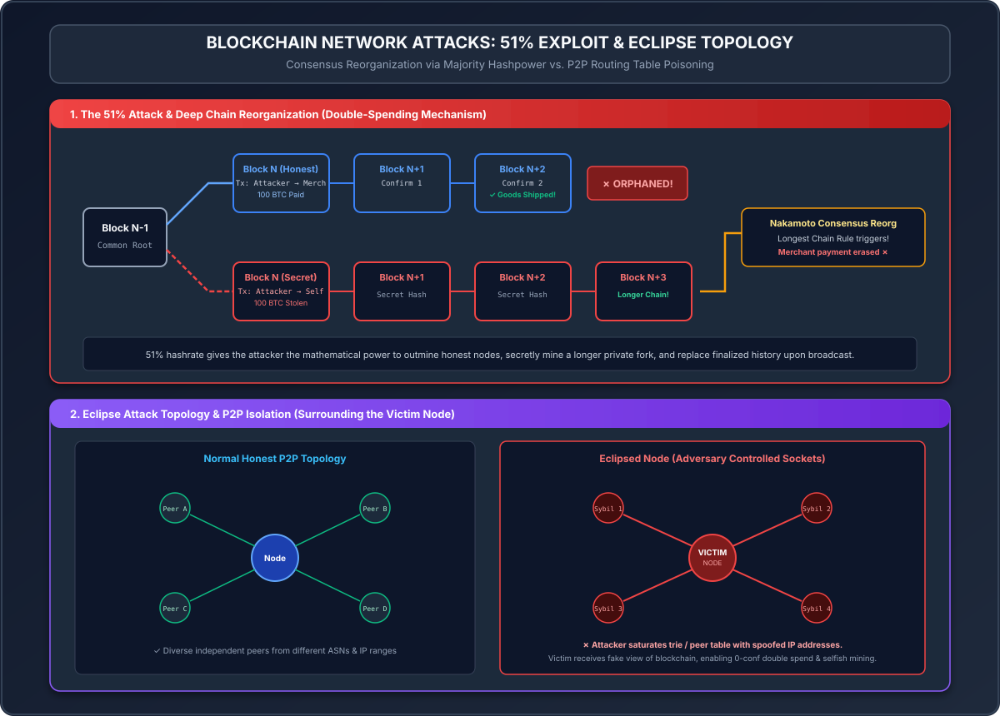

### 4.1 Comparative Analysis Matrix

| Comparison Vector | Blockchain-Specific Attacks | Non-Blockchain (Classical) Attacks |
| :--- | :--- | :--- |
| **Attack Target** | Consensus mechanism, peer-to-peer gossip protocol, blockchain state machine, smart contract bytecode. | Operating systems, web browsers, centralized DNS servers, API servers, human users. |
| **Exploited Mechanism** | Nakamoto consensus rules, proof-of-work hashrate, mempool ordering, EVM execution mechanics. | Social engineering, malware, software buffer overflows, network packet flooding. |
| **Primary Examples** | 51% Attack, Eclipse Attack, Sybil Attack, Timejacking, Selfish Mining, Flash Loan Reentrancy. | Phishing, Clipboard Clippers, DDoS on RPC nodes, Man-in-the-Middle (MITM), BGP Hijacking. |
| **Defensive Responsibility** | Protocol cryptographers, core blockchain developers, smart contract security auditors. | Individual end-users, system administrators, web hosting providers, exchange DevOps teams. |

---

### 4.2 Blockchain-Specific Attacks

#### 1. The 51% Attack & Double Spending
A 51% attack occurs when an adversary captures more than half of the total network consensus power (hashrate in PoW or staked tokens in PoS).
- **The Double Spending Workflow:**
  1. **Public Transaction:** Attacker sends 1,000 BTC to an automobile dealership or cryptocurrency exchange on the public honest blockchain.
  2. **Secret Mining:** Concurrently, the attacker secretly mines a private branch of the blockchain starting from the block *prior* to their payment. In their secret branch, they do not include the payment to the merchant; instead, they include a transaction sending those exact same 1,000 BTC to their own personal wallet.
  3. **Merchant Delivery:** The honest network mines blocks $N, N+1, N+2$. The merchant sees 2 confirmations, considers the payment settled, and delivers the luxury goods.
  4. **Broadcasting the Secret Fork:** Because the attacker commands $>51\%$hashrate, their secret chain grows faster than the honest network's chain ($N+3, N+4$). The attacker suddenly broadcasts their longer private chain to the P2P network.
  5. **Deep Chain Reorganization:** Under the **Longest Chain Rule (Nakamoto Consensus)**, every honest node globally automatically switches to the attacker's chain because it contains more cumulative proof-of-work.
  6. **The Double Spend Realized:** The honest blocks are **orphaned**. The merchant's payment vanishes into thin air. The attacker retains the luxury merchandise *and* their 1,000 BTC!
- *Exam Clarification:* **What a 51% attack CAN and CANNOT do:**
  - *CAN:* Reorganize recent blocks, double spend their own coins, censor specific transactions.
  - *CANNOT:* Forge digital signatures, steal coins from arbitrary addresses without private keys, or alter historical transactions that occurred long before their attack began.

#### 2. Eclipse Attack
In an Eclipse attack, the adversary isolates a specific victim node from the rest of the legitimate peer-to-peer network:
- **Topology & Execution:** An attacker uses multiple IP addresses or automated botnets to flood the victim's peer table (`addr` gossip messages) with attacker-controlled IP addresses.
- **The Eclipse State:** When the victim node restarts or drops existing sockets, it reconnects *exclusively* to peers operated by the attacker.
- **Exploitation:** The attacker feeds the victim a completely fabricated, distorted view of the blockchain. This allows:
  - Performing zero-confirmation double spending against a merchant node.
  - Co-opting the victim's mining hashrate for selfish mining.
  - Concealing newly broadcast blocks from validator nodes.

#### 3. Sybil Attack
- *Mechanism:* An attacker spins up thousands of cheap, virtual nodes or pseudonymous identities to dominate a P2P network.
- *Defense:* Blockchains prevent Sybil attacks by anchoring voting power to **scarce physical or financial resources**:
  - In **Proof-of-Work**, creating 10,000 virtual nodes provides zero advantage; voting weight depends strictly on real-world computational energy (hashrate).
  - In **Proof-of-Stake**, voting power depends strictly on locked financial capital (tokens).

#### 4. Timejacking Attack
- *Mechanism:* Bitcoin nodes maintain an internal network time offset calculated as the median timestamp of their connected peers.
- *Execution:* An attacker surrounds a target node with Sybil peers that report fabricated timestamps (e.g., claiming the current time is 70 minutes in the future).
- *Consequence:* The victim node's internal network time calculation drifts. When the victim mines a block, its timestamp violates consensus validity rules and is rejected by the honest network, or the node is tricked into miscalculating difficulty retargeting intervals, effectively freezing the node.

#### 5. Selfish Mining (Block Withholding)
Discovered by Ittay Eyal and Emin Gün Sirer (2013), selfish mining demonstrates that miners controlling as little as **25% to 33%** of total network hashrate can earn higher rewards than their fair share by strategically withholding newly discovered blocks from the network, invalidating honest miners' work and forcing them to waste electricity on orphaned blocks.

---

### 4.3 Non-Blockchain Attacks Targeting the Ecosystem
Even if the blockchain's underlying cryptography (elliptic curves, SHA-256) is mathematically unbreakable, the surrounding digital infrastructure remains highly vulnerable:

* **Phishing & Social Engineering**:
  - Attackers build pixel-perfect clones of popular Web3 interfaces (e.g., Uniswap, OpenSea) hosted on deceptive look-alike domains (e.g., using Cyrillic homoglyph characters like `unıswap.com`). Unsuspecting users connect their wallets and sign malicious approval payloads.
* **Malware & Clipboard Clippers**:
  - Cryptocurrency addresses are long, unmemorizable hex strings (e.g., `0x71C...3a9`), so users rely on copy-pasting. **Clipper Trojans** run silently in background memory, monitoring the operating system clipboard. When they detect an address pattern, they instantaneously overwrite the clipboard buffer with the attacker's address. If the user fails to inspect every character before confirming, funds are sent to the attacker.
* **BGP Routing Hijacking & DNS Attacks**:
  - In 2022, attackers compromised the Border Gateway Protocol (BGP) routing tables of major telecommunications transit providers, hijacking traffic destined for the hosting servers of the Curve Finance front-end. The attackers served a malicious DNS resolution that pointed users to a phishing contract, stealing millions of dollars without compromising a single line of Solidity smart contract code on the blockchain.

---

## 5. Limits and Bottlenecks of Blockchain Technology

While blockchain provides transformative properties of decentralization, censorship resistance, and immutability, it introduces severe architectural bottlenecks when compared to classical centralized databases.

| Architectural Dimension | Centralized Systems (e.g., Visa, AWS Aurora) | Decentralized Blockchain (Layer 1: Bitcoin / Ethereum) |
| :--- | :--- | :--- |
| **Throughput (TPS)** | **24,000+ TPS** (horizontally scalable with sharding) | **7 – 30 TPS** (strictly bounded by block size & consensus propagation) |
| **Settlement Latency** | **Sub-second (100 – 500 ms)** with instant finality | **Minutes to hours** (10m – 60m for multi-block probabilistic finality) |
| **State Storage & History** | Scalable relational / NoSQL DBs; historical pruning | Complete state replication: every full node stores full chain history |
| **Error Recourse & Reversals** | Chargebacks, administrative overrides, dispute arbitration | Strict cryptographic irreversibility (requires contentious hard fork) |
| **Regulatory Compliance** | GDPR native (data easily modified, scrubbed, or purged) | Structural tension with GDPR Article 17 "Right to Erasure" |
| **Trust Model** | Trust institutional intermediaries and central servers | Trustless cryptographic proofs and decentralized economic consensus |

### 5.1 Throughput & Transactions Per Second (TPS) Bottlenecks
Traditional enterprise databases (e.g., Visa, Mastercard, Google Spanner) process tens of thousands of transactions per second. In contrast, foundational Layer-1 blockchains operate at fractions of that throughput:
- **Bitcoin:** $\sim 7$ TPS (with a 1 MB block size limit and a 10-minute target block interval).
- **Ethereum L1:** $\sim 15 - 30$ TPS (governed by a 30-million gas limit per 12-second slot).
- **Visa Payment Network:** Capable of processing over 24,000+ TPS during peak holiday demand.

*Why Can't Blockchains Simply Increase Block Sizes to 1 GB?*
If Bitcoin increased block size to 1 GB every 10 minutes:
1. Only massive corporate datacenters with gigabit internet connections could download, verify, and store the ledger.
2. Individual consumer nodes would be kicked off the network, completely destroying decentralization.
3. Network propagation latency across the globe would spike, causing massive block orphan rates and making 51% attacks trivial to execute.

---

### 5.2 Confirmation Latency & Probabilistic Finality
In traditional banking, swiping a credit card provides instant authorization. On a blockchain, broadcasting a transaction merely enters it into the **mempool** (memory pool of unconfirmed transactions).
- **Block Inclusion Latency:** A user must wait for a miner/validator to include the transaction inside a block (average 10 minutes in Bitcoin, 12 seconds in Ethereum).
- **Finality Wait Time:** Because forks can naturally occur, merchants cannot trust a single confirmation for large value transfers. In Bitcoin, **6 confirmations** (approximately 60 minutes) are traditionally required to achieve probabilistic economic finality where the probability of a reorganizing fork is virtually zero.

---

### 5.3 Storage Bloat & State Explosion
Every full node in a blockchain must maintain a complete historical copy of the ledger to independently validate transactions from the Genesis Block forward:
- **Bitcoin Full Node:** Currently requires $>600$ GB of disk storage.
- **Ethereum Full Archive Node:** Requires $>1.5$TB to$>12$ TB of fast NVMe SSD storage.
- *Systemic Risk:* As blockchain history grows indefinitely, the hardware cost of running a full node increases exponentially. This leads to **State Bloat**, forcing regular users to abandon local full nodes and rely entirely on centralized third-party RPC providers (like Infura or Alchemy), quietly re-introducing centralized single points of failure.

---

### 5.4 Irreversibility and Lack of Recourse
The defining virtue of blockchain—immutability—is also one of its greatest liabilities:
- In traditional banking, if a user accidentally types the wrong account number, or falls victim to credit card fraud, the bank's fraud department can reverse the wire transfer or initiate a chargeback.
- On a public blockchain, **transactions are mathematically irreversible**. If a user makes a "fat-finger" typo sending 10 ETH to an unowned burn address, or accidentally falls victim to a scammer, **no human being on Earth holds the administrative authority to reverse the transfer**. The funds are lost forever.

---

## 6. User Security Best Practices & Operational Security

Because public blockchains eliminate centralized institutional intermediaries, **the user is solely responsible for the custody of their assets**. A single operational mistake results in permanent financial loss.

### 6.1 Private Key & Seed Phrase Management

#### The BIP-39 Standard
Modern HD (Hierarchical Deterministic) wallets implement the **BIP-39 standard**, which converts 128 to 256 bits of high-entropy cryptographic randomness into an ordered sequence of **12 or 24 human-readable English words** chosen from a standardized dictionary of exactly 2,048 words.

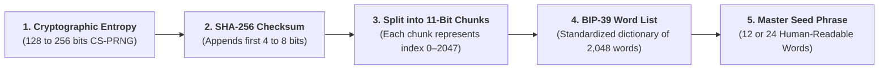

#### The Golden Rules of Seed Phrase Backup:
1. **Strictly Analog (Zero Digital Footprint):**
   - NEVER type a seed phrase on a computer keyboard.
   - NEVER take a photo or screenshot of a seed phrase on a smartphone.
   - NEVER store a seed phrase in cloud storage (Google Drive, iCloud, Dropbox, OneDrive), password managers, or unencrypted text files.
   - Any digital representation can be scraped by background mobile apps, compromised sync accounts, or malware.
2. **Physical Medium Durability:**
   - Write the seed phrase down on paper using archival ink, or ideally, engrave it into an industrial **stainless steel seed plate**.
3. **Sequence Preservation:**
   - The exact numerical order of the words is mandatory. If the words are scrambled, mathematical derivation fails.
4. **Passphrase Protection (The "25th Word" / BIP-39 Extension):**
   - Users can append a user-chosen secret passphrase to their 24-word seed phrase.
   - *Plausible Deniability (\$5 Wrench Attack Defense):* Entering the 24 words with *no passphrase* (or a dummy passphrase) opens a decoy wallet containing a small amount of cryptocurrency, satisfying a physical mugger while keeping the master vault hidden behind the true passphrase.

---

### 6.2 Authentication & Operational Defenses

* **Hardware Security Keys (FIDO2 / YubiKey) vs. SMS 2FA**:
  - SMS-based Two-Factor Authentication is fundamentally broken due to widespread **SIM Swapping attacks** (where an attacker bribes or socially engineers telecom carrier staff to port the victim's phone number to an attacker-controlled SIM card).
  - All exchange accounts and email gateways must be protected with hardware physical security keys (YubiKey) implementing WebAuthn / FIDO2, which are cryptographically immune to SIM swapping and phishing proxy bypasses.
* **Phishing Defense Protocols**:
  - Bookmark essential Web3 decentralized applications (dApps) in your browser. Never search for dApps on Google, as malicious sponsored ads routinely rank above legitimate URLs.
  - Inspect SSL certificates and verify domain spelling character-by-character.

---

### 6.3 Smart Contract & Web3 Interaction Hygiene

#### The ERC-20 Infinite Approval Trap
When interacting with a decentralized exchange (e.g., Uniswap) to trade tokens, the dApp prompts the user's wallet to execute an `approve(spender, amount)` transaction.
- To save gas fees and avoid prompting the user on every future trade, many dApps request an **Infinite Approval** (`amount = 2^256 - 1` or `0xffffff...`).
- *The Hidden Danger:* If that dApp smart contract is subsequently hacked or contains an unrevealed backdoor 2 years later, the exploiter can call `transferFrom()` to drain **100% of that token from the user's wallet**, even if the user has not interacted with the dApp for years!
- *Best Practice:* Use allowance revocation tools (e.g., `revoke.cash`) regularly to revoke or minimize approvals down to zero once trading is finished.

#### Calldata Decoding on Hardware Wallets:
Never click "Confirm" blindly. Before confirming a transaction on a hardware wallet, physically verify:
1. The destination contract hex address.
2. The exact token amount.
3. The network chain ID.
4. The gas fee.

---

## 7. Physical Bitcoin Storage & Hardware Wallets

Cryptocurrency tokens do not physically reside inside a flash drive, smartphone, or laptop; **all tokens remain permanently recorded on the public blockchain ledger**. What a physical wallet stores is the **cryptographic private key (or BIP-39 master seed)** that grants the mathematical authorization to sign transactions and transfer those tokens.

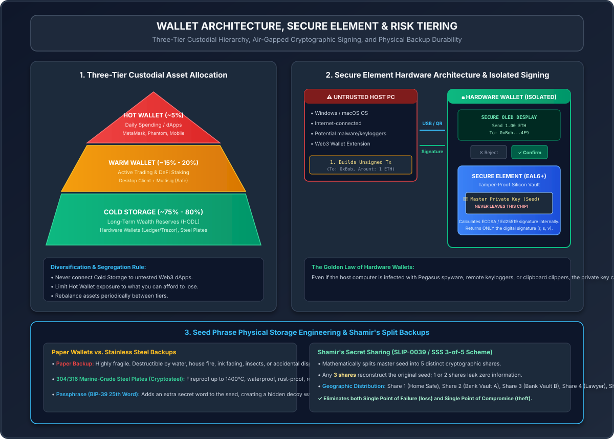

### 7.1 Physical Cold Storage Media

#### Paper Wallets: Mechanisms and Obsolescence
A paper wallet consists of a physical sheet of paper with a freshly generated public address and its corresponding private key printed as QR codes:
- *Historical Popularity:* Completely offline generation eliminated internet-based malware during key creation.
- *Severe Modern Vulnerabilities:*
  - **Physical Fragility:** Highly susceptible to house fire, water damage, ink fading over time, tearing, or accidental disposal.
  - **Printer Cache Leaks:** Printing via modern WiFi printers saves unencrypted bitmap copies of the private key into local printer flash memory.
  - **Change Address Loss:** Sweeping a paper wallet with a software client without understanding UTXO change mechanics has historically led users to accidentally burn their change balances.

#### Stainless Steel Plates & Metal Storage (Cryptosteel, Keystone Tablet)
To eliminate the extreme fragility of paper, cold storage engineers utilize industrial metal backups:
- **Material Properties:** Fabricated from marine-grade **304 or 316 stainless steel** or solid titanium.
- **Extreme Resilience:**
  - Fireproof up to $1,400^\circ	ext{C} - 1,500^\circ	ext{C}$(far exceeding typical residential house fires$\sim 600^\circ	ext{C} - 800^\circ	ext{C}$).
  - Completely waterproof, rust-proof, resistant to saltwater corrosion, and indestructible under building structural collapse.
- **Physical Assembly:** Users manually slide laser-engraved metal letter tiles into a heavy steel chassis and lock it with tamper-evident screws.

---

### 7.2 Hardware Wallets: Architecture and the Secure Element

A hardware wallet is a dedicated, specialized embedded hardware device engineered with a single overarching security objective: **to isolate the private key in hardware so that it NEVER touches the memory (RAM) of an internet-connected host computer**.

#### The Hardware Execution Boundary: Host vs. Secure Device
1. **The Host Computer (Untrusted Environment):**
   - Running Windows, macOS, or Linux connected to the public internet.
   - May be infected with keyloggers, Trojan horses, clipboard clippers, or malicious browser extensions.
   - The host wallet interface (e.g., MetaMask, Ledger Live, Electrum) creates an **unsigned transaction payload** and sends it across the USB/Bluetooth cable or QR code to the hardware wallet.
2. **The Hardware Wallet (Trusted Execution Environment):**
   - **Microcontroller (MCU):** Coordinates communication, USB endpoints, and display rendering.
   - **Secure Element (SE) Chip (Common Criteria EAL5+ / EAL6+ Certified):**
     - A hardened, tamper-resistant cryptographic coprocessor identical to those used in biometric passports and banking chip cards.
     - Houses the encrypted BIP-39 master seed.
     - Mathematically shielded against sophisticated physical laboratory attacks:
       - **Side-Channel Analysis (SCA):** Measuring microscopic fluctuations in electrical power consumption (Differential Power Analysis - DPA) during elliptic curve multiplication.
       - **Fault Injection:** Pulsing micro-lasers or voltage glitches to bypass instruction execution branches.
       - **Physical Decapping & Microprobing:** If an attacker dissolves the plastic casing with nitric acid and attaches microprobes to the silicon bus, the chip automatically wipes its cryptographic memory (tamper-zeroization).
   - **Tamper-Proof Display & Physical Buttons:**
     - The hardware device independently decodes the transaction payload and displays the recipient address and amount on its own screen.
     - *Crucial Rule:* The transaction cannot be signed unless a human being physically presses the tactile hardware buttons on the device.
3. **The Cryptographic Handshake:**
   - The Secure Element executes the ECDSA/Schnorr signature calculation internally.
   - The hardware wallet transmits **ONLY the final digital signature $(r, s, v)$** back to the host computer.
   - **The private key never leaves the Secure Element silicon boundary under any circumstances.**

#### Ledger vs. Trezor: Differing Design Philosophies

| Feature Comparison | Ledger (e.g., Nano S Plus, Nano X, Stax) | Trezor (e.g., Model One, Model T, Safe 3) |
| :--- | :--- | :--- |
| **Silicon Architecture** | Utilizes a certified closed-source **Secure Element (STMicroelectronics SE)** running a proprietary operating system (BOLOS). | Historically utilized open-source general-purpose MCUs; modern models (Safe 3) incorporate an opt-in Secure Element. |
| **Open Source Philosophy** | Firmware client and apps are open source, but the underlying Secure Element firmware is closed-source due to chip manufacturer NDAs. | **100% Fully Open Source**: All hardware schematics, PCB layouts, and firmware source code are publicly verifiable. |
| **Physical Attack Defense** | Exceptional resistance against laboratory physical extraction attacks due to EAL6+ certified hardware security chip. | Older MCUs were vulnerable to physical fault injection (voltage glitching) if stolen by a sophisticated laboratory; modern versions have hardened this. |

---

### 7.3 Air-Gapped Transaction Signing Workflows
The absolute gold standard in high-value custody is **Air-Gapped Cold Storage**. An air-gapped device possesses zero physical or wireless connectivity: no USB data connection, no Bluetooth, no WiFi, and no NFC.

```mermaid
sequenceDiagram
    autonumber
    actor User as User
    participant PC as Untrusted Computer<br/>(Online / Network Connected)
    participant HW as Air-Gapped Hardware Signer<br/>(Offline / Zero Radios / Secure Element)
    participant Net as Public Blockchain Node

    Note over PC: Step 1: Builds unsigned transaction in BIP-174 PSBT format
    PC->>HW: Step 2: Optical Air-Gap (Displays PSBT as QR code on monitor; scanned via hardware camera)
    Note over HW: Step 3: Device remains 100% offline (no WiFi, Bluetooth, or USB)
    Note over HW: Step 4: Decodes PSBT payload in isolated execution environment
    HW-->>User: Step 5: Displays recipient address and exact amount on tamper-proof screen
    User->>HW: Step 6: Physically verifies details on screen & presses hardware confirmation button
    Note over HW: Step 7: Secure Element generates valid cryptographic signature
    HW->>PC: Step 8: Optical Return (Displays signed TX as animated QR code; scanned via PC webcam)
    Note over PC: Step 9: Reassembles raw signed transaction payload
    PC->>Net: Step 10: Broadcasts verified transaction to public blockchain network
```

---

## 8. Balancing Risk and Diversifying Custodial Exposure

No single security setup is optimal for all scenarios. Maximizing security introduces operational friction; maximizing convenience introduces catastrophic theft exposure. Professional cryptocurrency treasury management requires **Risk Balancing and Asset Diversification**.

### 8.1 The 75-20-5 Custodial Asset Allocation Model
Institutional security experts recommend segregating cryptocurrency holdings across a three-tiered hierarchy based on velocity and exposure:

1. **Cold Storage Tier ($\sim 75\% - 80\%$ of Net Worth):**
   - *Purpose:* Generational wealth preservation, long-term reserves ("HODL").
   - *Infrastructure:* Multi-sig air-gapped hardware wallets, stainless steel seed plates in safe deposit boxes, Shamir split backups.
   - *Rule:* Zero interaction with smart contracts or dApps. Transactions occur rarely (months/years).
2. **Warm Storage Tier ($\sim 15\% - 20\%$ of Net Worth):**
   - *Purpose:* Active DeFi yield generation, staking validation, quarterly rebalancing.
   - *Infrastructure:* Hardware wallet integrated with desktop software (Electrum, Ledger Live) or multi-sig organizational vault (Safe).
   - *Rule:* Moderate friction, verified smart contracts only.
3. **Hot Wallet Tier ($\sim 5\%$ of Net Worth):**
   - *Purpose:* Daily micro-transactions, NFT minting, testing new protocols.
   - *Infrastructure:* Mobile wallet (Rainbow, Trust Wallet) or browser extension (MetaMask, Phantom).
   - *Rule:* Maximum convenience; treat this capital as cash in a physical pocket wallet—assume it could be lost at any moment.

---

### 8.2 Counterparty & Custodial Diversification
The catastrophic collapses of major centralized entities (**Mt. Gox in 2014, QuadrigaCX in 2019, FTX in 2022**) proved the timeless cryptocurrency maxim:
> **"Not your keys, not your coins."**

- **The Danger of Exchange Concentration:** Storing 100% of an organization's or individual's assets on a single centralized exchange creates an extreme Single Point of Failure (SPOF) exposed to exchange insolvency, executive embezzlement, regulatory asset freezes, or internal exchange hack.
- **Institutional Multi-Custodian Framework:** Large enterprises balance exposure across:
  - Independent Qualified Custodians (e.g., Coinbase Custody, BitGo, Anchorage Digital).
  - Regulated MPC (Multi-Party Computation) co-custody vaults (Fireblocks).
  - On-chain self-sovereign multisignature treasuries.

---

### 8.3 Shamir's Secret Sharing (SLIP-0039 / SSS Split Backups)
A traditional 24-word seed phrase creates a dangerous dilemma:
- If stored in *one* location, that location is a single point of failure (fire, theft).
- If copies are placed in *multiple* locations, an attacker breaking into any single location steals the entire fortune.

**Shamir's Secret Sharing (SSS)** resolves this using Lagrange polynomial interpolation:
- The master seed $S$is mathematically split into$N$ unique cryptographic shares.
- A pre-defined threshold $M$(where$M \le N$) of shares is required to reconstruct the original seed.
- **Any group of $M-1$ or fewer shares reveals absolutely zero mathematical information about the seed.**

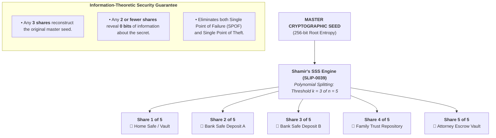
- In this **3-of-5 scheme**:
  - If a burglar steals Share 1 from the home vault, they cannot steal any funds.
  - If a flood destroys Bank Safe A, the remaining 4 shares can easily reconstruct the wallet.
  - Both single points of loss and single points of compromise are completely eliminated!

---

## 9. Multisignature Schemes and Decentralized Governance

Multisignature (Multisig) technology distributes operational authorization across multiple independent cryptographic keyholders, eliminating single points of failure in organizational management and decentralized autonomous organizations (DAOs).

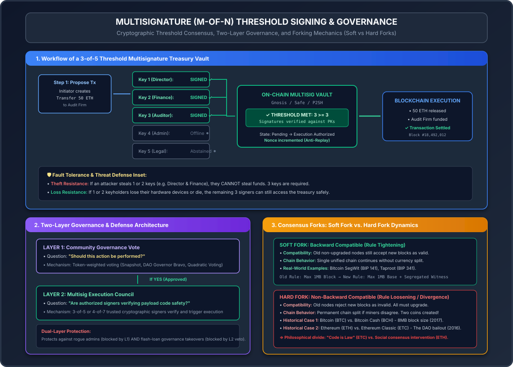

### 9.1 Multisignature (Multisig) Mechanics

#### $M$-of-$N$ Threshold Signing
In a standard single-signature wallet:
$$	ext{Private Key} \longrightarrow 	ext{Transaction Approved}$$
In an $M$-of-$N$ multisig wallet:
- There are $N$ authorized signers.
- Any $M$distinct valid signatures (where$M \le N$) are required to release funds or execute an on-chain smart contract call.

#### Real-World Scenario: 2-of-3 Corporate Multisig
An enterprise treasury designates three executive officers:
- Keyholder A: Managing Director
- Keyholder B: Chief Financial Officer (CFO)
- Keyholder C: Lead Security Auditor
- **Outcome Analysis:**
  - Director signs + CFO signs $\longrightarrow$**2 signatures$\ge 2$threshold$\longrightarrow$ Transaction Approved & Executed.**
  - If an attacker compromises the CFO's laptop and steals Keyholder B's private key, the attacker **CANNOT steal the company funds** because 1 signature is rejected by the smart contract!
  - If Keyholder A goes on leave or loses their device, Keyholder B and Keyholder C can still execute payroll without delay.

#### Technical Implementations:
1. **Bitcoin P2SH (Pay-to-Script-Hash, BIP-16):**
   - The spending conditions are defined in a Redeem Script requiring `OP_CHECKMULTISIG`. The user deposits funds into an address starting with `3...` representing the hash of the script.
2. **Schnorr Signatures & Taproot (MuSig2, BIP-340/341):**
   - Modern Bitcoin multisig aggregates $N$ public keys and signatures into a single combined key and signature off-chain. To outside blockchain observers, a complex 5-of-5 multisig transaction looks mathematically identical to an ordinary single-signature transfer, dramatically improving privacy and reducing transaction fees.
3. **Smart Contract Multisig (Safe / Gnosis Safe on Ethereum):**
   - Implemented as an immutable smart contract managing wallet logic. Tracks internal execution nonces, maintains a dynamic array of owner addresses, and executes arbitrary contract transactions via `delegatecall` once the signature threshold is satisfied.

#### The Escrow Scheme (2-of-3 E-Commerce Escrow)
- Three participants: **Buyer**, **Seller**, and **Arbitrator**.
- *Normal Happy Path:* Buyer deposits funds into 2-of-3 vault. Seller ships goods. Buyer receives goods. Buyer and Seller both sign $\longrightarrow$ 2 signatures release funds to Seller. The Arbitrator is never contacted.
- *Dispute Path:* Buyer claims goods never arrived; Seller claims they shipped. The Arbitrator inspects shipping tracking receipts. If Arbitrator rules in Buyer's favor, Arbitrator and Buyer sign $\longrightarrow$funds refunded. If Arbitrator rules for Seller, Arbitrator and Seller sign$\longrightarrow$ funds paid to Seller.

---

### 9.2 Decentralized Governance Models

Decentralization requires protocols to adapt, patch vulnerabilities, and allocate treasury funds without relying on a corporate board of directors.

#### On-Chain vs. Off-Chain Governance

| Governance Property | Off-Chain Governance (e.g., Bitcoin, Ethereum L1) | On-Chain Governance (e.g., Polkadot, Tezos, Uniswap DAO) |
| :--- | :--- | :--- |
| **Decision Mechanism** | Informal social consensus: Developer mailing lists, GitHub Improvement Proposals (BIPs/EIPs), miner signaling, node software choice. | Formal algorithmic voting: Token-weighted voting recorded directly on the blockchain via governance smart contracts. |
| **Execution** | Voluntary: Node operators manually download and run updated client software releases. | Automatic: If a proposal passes the threshold, the smart contract automatically executes code changes or distributes treasury funds. |
| **Strengths** | Extremely conservative, resistant to plutocratic takeover, highly resilient against hasty modifications. | Rapid decision-making, direct stakeholder representation, programmatic execution. |
| **Weaknesses** | Slow, politically contentious, can lead to permanent chain forks during philosophical stalemates. | **Plutocracy:** Whales with massive capital dictate rules. Highly vulnerable to Flash Loan governance voting manipulation. |

---

### 9.3 Two-Layer Security: Governance + Multisig Integration
To protect multi-million-dollar DAO treasuries from catastrophic hostile takeovers, industry-leading protocols deploy a **Two-Layer Defensive Architecture**:

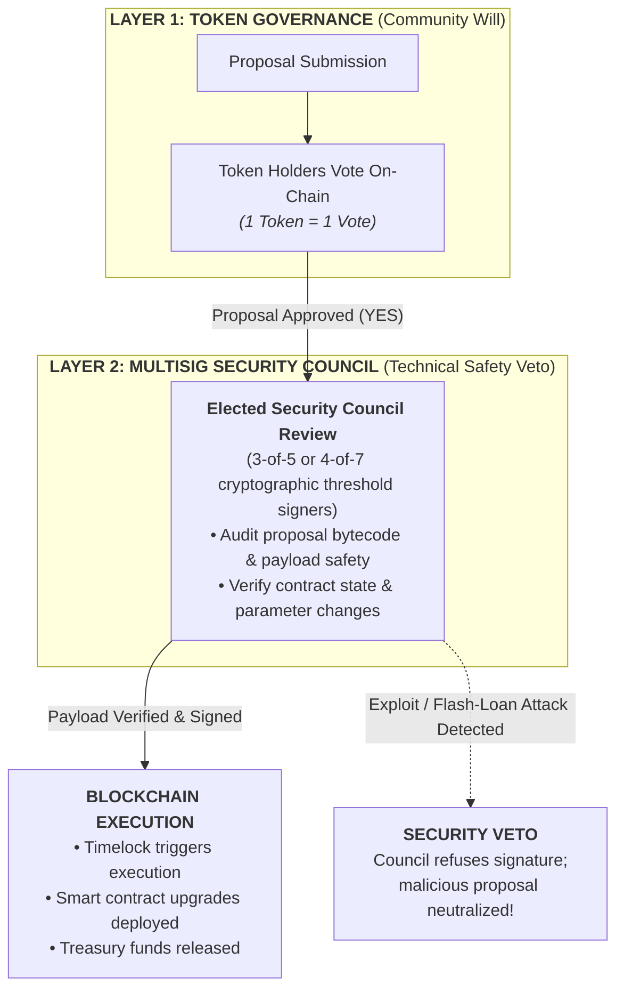
- **Layer 1 (The Will of the People):** *"Should we do this?"* Token holders vote on broad initiatives and grant allocations.
- **Layer 2 (The Security Veto):** *"Is the code safe and free of exploits?"* An elected security council of reputable developers holds multisig execution keys. If a malicious proposal passes Layer 1 via a flash-loan exploit, the Layer 2 multisig council refuses to sign, vetoing the exploit and safeguarding treasury funds.

---

### 9.4 Hard Forks vs. Soft Forks

When protocol consensus rules are upgraded, the mechanism of deployment determines whether the network remains unified or fractures into two competing blockchains.

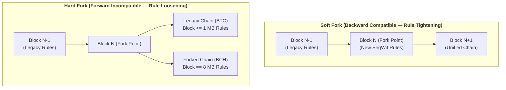

| Dimension | Soft Fork (Backward Compatible) | Hard Fork (Non-Backward Compatible) |
| :--- | :--- | :--- |
| **Rule Dynamics** | **Rule Tightening:** Constrains valid transaction or block parameters. | **Rule Loosening / Redefinition:** Expands rules to allow previously illegal blocks. |
| **Old Node Compatibility** | **Compatible:** Un-upgraded nodes accept new blocks as valid under broader rules. | **Incompatible:** Un-upgraded nodes reject new blocks; must upgrade software. |
| **Chain Continuity** | **Single unified chain continues forward**; no permanent divergence. | **Permanent chain split** if non-unanimous miner/community consensus. |
| **Coin / Asset State** | Single token preserved; no duplicate ledger or coin split. | Splits ledger into two separate tokens (e.g., BTC & BCH, ETH & ETC). |
| **Historical Precedent** | Bitcoin SegWit (BIP 141, 2017), Taproot (BIP 341, 2021). | Bitcoin Cash fork (2017, 8 MB blocks), Ethereum DAO fork (2016). |

#### Detailed Fork Mechanics:

1. **Soft Fork (Backward Compatible - Rule Tightening):**
   - A soft fork **tightens** or restricts existing validation rules.
   - Non-upgraded nodes running legacy software still view newly mined blocks as valid under their old, broader rule set.
   - *Requirement:* A majority of mining hashrate must enforce the new rules. Non-upgraded nodes continue operating smoothly without realizing rules have changed.
   - *Historical Examples:*
     - **Bitcoin Segregated Witness (SegWit - BIP 141, 2017):** Moved cryptographic signature data (witness) out of the base 1 MB block into a separate discount structure. Old nodes saw transactions as valid "anyone-can-spend" scripts.
     - **Bitcoin Taproot (BIP 341/342, 2021):** Introduced Schnorr signatures and MAST without splitting the chain.
2. **Hard Fork (Non-Backward Compatible - Rule Loosening / Divergence):**
   - A hard fork **loosens** validation rules or introduces fundamentally incompatible protocol changes.
   - Non-upgraded nodes running old software strictly reject the new blocks as invalid.
   - If the community is not 100% unanimous, **the blockchain permanently diverges into two independent chains, duplicating all historical balances into two separate cryptocurrencies**.
   - *Historical Case Study 1: The Bitcoin Block Size War (2017) $\longrightarrow$ Bitcoin (BTC) vs. Bitcoin Cash (BCH):*
     - Faction A wanted to preserve decentralization and consumer full nodes by keeping 1 MB blocks and adopting Layer-2 solutions (Lightning Network).
     - Faction B wanted on-chain scaling by increasing block sizes to 8 MB.
     - Result: In August 2017, the chain split permanently into **Bitcoin (BTC)** and **Bitcoin Cash (BCH)**.
   - *Historical Case Study 2: The DAO Hack Bailout (2016) $\longrightarrow$ Ethereum (ETH) vs. Ethereum Classic (ETC):*
     - Following the 2016 DAO exploit, the core development team proposed a hard fork to override ledger immutability and transfer the stolen 3.6M Ether to a recovery contract.
     - Pragmatists supported the hard fork to save the ecosystem (becoming **Ethereum - ETH**).
     - Ideological purists insisted on *"Code is Law"* and refused to alter history, preserving the un-forked chain (becoming **Ethereum Classic - ETC**).

---

## 10. University Exam Preparation Guide & Review Questions

This section provides a concentrated, high-yield revision resource engineered specifically to prepare engineering students for university examinations on blockchain security and privacy.

### 10.1 High-Yield Rapid Review Summaries
- **Reentrancy**: Occurs when external calls precede internal state mutations. Remediated via **Checks-Effects-Interactions (CEI)** and **ReentrancyGuard** mutex locks.
- **51% Attack**: Allows an attacker with majority hashpower to secretly mine a longer private chain, reorganize recent blocks upon broadcast, and **double spend their own coins**. It CANNOT forge signatures or steal others' coins.
- **Eclipse Attack**: Isolates a victim node by saturating its peer routing table with attacker-controlled IP addresses.
- **Common-Input Heuristic**: Multi-input transactions deduce that all input addresses belong to the same entity.
- **Dusting Attack**: Sending tiny amounts (dust) to deanonymize addresses during wallet sweep/consolidation.
- **Hot vs. Cold Wallet**: Hot is connected to the internet (MetaMask); Cold is offline (Ledger/Trezor). Assets are never physically stored in the device; only private keys are stored.
- **Secure Element (SE)**: EAL5+/EAL6+ tamper-resistant silicon coprocessor that performs cryptographic signing internally so private keys never touch host computer RAM.
- **Multisig ($M$-of-$N$)**: Eliminates single points of failure by requiring$M$of$N$ authorized signatures to release funds.
- **Soft Fork vs. Hard Fork**: Soft fork is backward compatible (rule tightening, single chain); Hard fork is forward incompatible (rule loosening, risk of permanent currency split).
- **GDPR Conflict**: GDPR Article 17 "Right to Erasure" directly clashes with blockchain cryptographic immutability.

---

### 10.2 Concept Comparison Tables

#### A. Hot Wallets vs. Cold Wallets

| Feature Dimension | Hot Wallet | Cold Storage Wallet |
| :--- | :--- | :--- |
| **Internet Connectivity** | Constantly connected or running on online device. | Completely severed from internet (offline/air-gapped). |
| **Primary Platforms** | Browser extensions (MetaMask), mobile apps. | Hardware devices (Ledger, Trezor), steel plates. |
| **Target Use-Case** | Daily dApp interactions, active trading (~5% funds). | Long-term wealth reserves, HODL vault (~80% funds). |
| **Vulnerability Surface** | Browser malware, keyloggers, phishing, clippers. | Physical theft, loss of seed backup, \$5 wrench attacks. |
| **Signing Location** | In host OS memory (RAM). | Strictly inside isolated Secure Element hardware chip. |

#### B. Soft Fork vs. Hard Fork

| Feature Dimension | Soft Fork | Hard Fork |
| :--- | :--- | :--- |
| **Backward Compatibility** | Fully backward compatible. | Incompatible with legacy nodes. |
| **Consensus Rule Change** | Restricts/tightens validation rules. | Relaxes/loosens validation rules. |
| **Node Upgrade Policy** | Old nodes still accept new blocks. | Old nodes reject new blocks; must upgrade. |
| **Chain Split Consequence** | Single unified chain continues. | Chain permanently splits if consensus is contested. |
| **Token Impact** | Zero token duplication. | Two competing cryptocurrencies created (BTC/BCH). |

#### C. Sybil Attack vs. Eclipse Attack

| Feature Dimension | Sybil Attack | Eclipse Attack |
| :--- | :--- | :--- |
| **Target Scope** | The entire global peer-to-peer network. | A single, targeted victim node. |
| **Adversary Goal** | Dominate voting weight or gossip propagation globally. | Isolate and blindfold the victim from honest reality. |
| **Primary Mechanism** | Creating thousands of pseudo-identities. | Poisoning the victim's peer routing table (`addr`). |
| **Defense Mechanism** | Proof-of-Work hashrate / Proof-of-Stake capital. | Diverse peer selection, IP ban scores, anchoring. |

---

### 10.3 20 Comprehensive University Practice Questions with Solutions

#### Question 1 (Security Architecture Principles)
**Prompt:** A bank implements an internal consortium blockchain for inter-bank clearance. The development team argues that because the blockchain is private, they do not need to implement the Principle of Least Privilege on smart contract administrative functions. Critique this assertion using security architecture principles.
*Answer:*
The assertion is critically flawed. Under the **Zero Trust Architecture (ZTA)** and **Defense-in-Depth** principles, systems must never rely on perimeter security alone. In a consortium blockchain, participating institutions are mutually distrusting competitors. If internal administrative functions (e.g., token minting, contract upgrades) lack strict access control (`onlyOwner` / role-based permissions), an insider threat, a compromised employee account at a single participating bank, or a lateral network breach would allow an attacker to seize control of the entire inter-bank clearing system. Least privilege must always be strictly enforced regardless of network visibility.

#### Question 2 (CIA Triad Mapping)
**Prompt:** Explain which specific properties of the classical CIA triad are protected by: (a) Merkle Trees, (b) Zero-Knowledge Proofs, and (c) P2P Gossip Protocol.
*Answer:*
- **(a) Merkle Trees $\longrightarrow$ Integrity:** Merkle trees allow cryptographic verification that individual transactions exist within a block without tampering. Changing a single bit in a transaction completely changes the Merkle root hash in the block header.
- **(b) Zero-Knowledge Proofs $\longrightarrow$ Confidentiality:** ZKPs allow a prover to demonstrate the validity of a transaction to the network without revealing sender, recipient, or amount details.
- **(c) P2P Gossip Protocol $\longrightarrow$ Availability:** Replicating transaction and block data across thousands of independent nodes ensures continuous 24/7 network uptime without a centralized single point of failure.

#### Question 3 (Technical vs. Inherent Risks)
**Prompt:** Differentiate between Technical Risks and Inherent Risks in blockchain systems. Provide two examples of each.
*Answer:*
- **Technical Risks** are vulnerabilities arising from implementation flaws, software bugs, flawed business logic, or system misconfigurations. They can be eliminated through code audits, bug bounties, and security testing. *Examples:* Reentrancy vulnerabilities in smart contracts, integer overflows.
- **Inherent Risks** are fundamental trade-offs that stem from the core architectural properties of decentralized consensus (decentralization, immutability, transparency). They cannot be patched away by software updates. *Examples:* The Scalability Trilemma (throughput vs. decentralization), the legal conflict between immutability and GDPR Article 17 "Right to Erasure".

#### Question 4 (The DAO Hack Mechanics)
**Prompt:** Explain the root cause of The DAO hack (2016). Write a short pseudo-code snippet showing the flawed execution flow and explain why the attacker's balance was not deducted during the attack.
*Answer:*
The root cause was a **Reentrancy vulnerability** caused by violating the Checks-Effects-Interactions pattern. The vulnerable contract transferred Ether to the caller *before* updating the caller's internal ledger balance:
```solidity
// Vulnerable sequence
require(balances[msg.sender] >= amount); // 1. Check
msg.sender.call{value: amount}("");      // 2. Interact (Transfers Ether)
balances[msg.sender] -= amount;         // 3. Effect (Update balance)
```
When Ether was sent in step 2, execution transferred to the attacker contract's `fallback()` function. The attacker contract immediately invoked `withdraw()` again. Because step 3 was never reached in the first invocation, `balances[msg.sender]` remained intact, allowing the attacker to pass the balance check repeatedly until the contract was drained.

#### Question 5 (Reentrancy Countermeasures)
**Prompt:** Explain the Checks-Effects-Interactions (CEI) design pattern and explain how OpenZeppelin's `ReentrancyGuard` modifier works mathematically/operationally.
*Answer:*
- **Checks-Effects-Interactions (CEI):** Mandates that all validation checks occur first (`require`), all internal state mutations (effects) occur second (`balances[msg.sender] -= amount`), and external calls or Ether transfers (interactions) occur strictly last. If an external call attempts reentrancy, the balance is already 0, and the initial check reverts the transaction.
- **ReentrancyGuard:** Implements a software mutex lock using a storage status variable (`_status`). Upon function entry, `require(_status != _ENTERED)` checks that the lock is free, then sets `_status = _ENTERED`. When execution returns from the function, it resets `_status = _NOT_ENTERED`. If a reentrant call attempts to re-enter the function while execution is ongoing, `_status` is still `_ENTERED`, causing an immediate revert.

#### Question 6 (Scalability Trilemma)
**Prompt:** Define the Scalability Trilemma. Can a Layer-1 blockchain achieve maximum decentralization, maximum security, and 100,000 TPS simultaneously? Justify your answer.
*Answer:*
The Scalability Trilemma states that a decentralized blockchain can simultaneously maximize only two of three properties: **Decentralization**, **Security**, and **Scalability**. A Layer-1 blockchain cannot achieve all three at maximum levels simultaneously. Processing 100,000 TPS on Layer-1 requires massive block sizes and sub-second block intervals. The bandwidth, computation, and storage needed to validate such high throughput can only be sustained by enterprise-grade datacenter servers. This eliminates consumer nodes from participating in validation, fatally compromising decentralization. Scaling requires off-loading execution to Layer-2 networks (Rollups, State Channels).

#### Question 7 (The Oracle Problem)
**Prompt:** Why is an Oracle necessary for smart contracts, and how does relying on an Oracle introduce a single point of failure?
*Answer:*
Smart contracts run inside a deterministic virtual machine sandbox and cannot make external HTTP/API requests, because asynchronous network responses would prevent nodes from reaching consensus on state transitions. An oracle is required to push off-chain real-world data (such as commodity prices or exchange rates) onto the blockchain. However, if a smart contract relies on a single centralized oracle or a low-liquidity DEX spot price, the oracle reintroduces a centralized point of failure. If the oracle feed is hacked, experiences latency, or is manipulated via a flash loan, the smart contract executes incorrect state changes with irreversible financial losses.

#### Question 8 (Address Clustering Heuristics)
**Prompt:** Explain how the Common-Input Ownership Heuristic allows blockchain surveillance firms to cluster disparate Bitcoin addresses.
*Answer:*
In the UTXO transaction model, if a transaction requires 2.0 BTC, but the user owns UTXOs of 0.8 BTC at Address $A_1$and 1.2 BTC at Address$A_2$, the transaction consumes both UTXOs as inputs. Because a valid transaction requires valid digital signatures for every input, the entity executing the transaction must hold the private keys for both$A_1$and$A_2$. Surveillance firms infer that$A_1$and$A_2$ are co-owned by the same entity. By chaining this heuristic across historical transaction graphs, thousands of addresses are merged into unified identity clusters.

#### Question 9 (Dusting Attacks)
**Prompt:** Describe the workflow of a Dusting Attack and explain how an attacker uses it to deanonymize a target user.
*Answer:*
1. The attacker broadcasts microscopic amounts of cryptocurrency (e.g., 546 satoshis "dust") to the target's public address.
2. The user's wallet receives the unrequested dust UTXO.
3. Later, when the user spends funds or consolidates their wallet, the wallet software automatically combines the dust UTXO with the user's larger, previously un-linked cold storage UTXOs into a single multi-input transaction.
4. The observer detects the multi-input consolidation and applies the common-input heuristic, linking the victim's private cold wallets directly to the dusted address and unmasking their complete portfolio.

#### Question 10 (Privacy-Enhancing Technologies)
**Prompt:** Contrast Ring Signatures in Monero with Zero-Knowledge Proofs in Zcash in terms of how they protect transaction privacy.
*Answer:*
- **Monero (Ring Signatures):** Obfuscates the sender by grouping the actual sender's public key with $N$ decoy public keys selected from the public blockchain. A cryptographic ring signature proves that *one* of the members signed, but an observer cannot determine which one. Ring signatures provide **anonymity sets** (decoy obfuscation).
- **Zcash (zk-SNARKs):** Does not rely on decoys. The sender constructs a zero-knowledge succinct non-interactive argument of knowledge that mathematically proves the transaction satisfies all ledger validity rules (funds exist, were not double spent) without revealing the sender address, recipient address, or amount. Zcash provides **absolute cryptographic zero-knowledge proof**.

#### Question 11 (51% Attack Capabilities)
**Prompt:** If a mining pool captures 55% of the Bitcoin network hashrate for 24 hours, can they steal Bitcoins directly from Satoshi Nakamoto's wallet? Justify your answer with cryptographic principles.
*Answer:*
**No, they cannot.** A 51% attack grants control over block creation and transaction ordering, not cryptographic authorization. Spending coins from any address requires a valid digital signature generated by the private key corresponding to that address. Even with 100% hashrate, an attacker cannot forge ECDSA signatures. If the attacker includes an unsigned transaction in a block, every honest full node on the network will reject the block as invalid under protocol rules, regardless of how much proof-of-work the block possesses. The attacker can only reorganize recent blocks to double-spend their own coins or censor transactions.

#### Question 12 (Eclipse Attacks)
**Prompt:** How does an Eclipse Attack differ from a Sybil Attack, and how does an Eclipse Attack enable double-spending?
*Answer:*
- A **Sybil attack** is the creation of many pseudonymous virtual identities to gain disproportionate influence across the *global* network.
- An **Eclipse attack** specifically targets a *single victim node*, saturating its peer connections so that every incoming and outgoing TCP connection connects exclusively to attacker-controlled nodes.
- **Enabling Double-Spending:** The attacker sends a transaction paying the eclipsed merchant. The attacker feeds the eclipsed merchant confirmed blocks containing the transaction, but withholds those blocks from the rest of the world. The merchant delivers the goods. Meanwhile, the attacker spends those same coins on the honest public network. Because the merchant was isolated, they accepted a phantom payment that does not exist on the legitimate chain.

#### Question 13 (Timejacking Attack)
**Prompt:** Explain the mechanism of a Timejacking attack on Bitcoin nodes.
*Answer:*
Bitcoin nodes calculate an internal `NetworkTimeOffset` by taking the median timestamp of their connected peers. In a Timejacking attack, an attacker surrounds a victim node with Sybil peers that broadcast false timestamps (e.g., 70 minutes ahead of real time). This skews the victim's internal network time calculation. If the node's time is driven more than 2 hours ahead of real time, newly mined blocks from honest miners will be rejected by the victim as having invalid timestamps, isolating the node from the legitimate chain and wasting its computational hashrate.

#### Question 14 (Selfish Mining)
**Prompt:** Explain how Selfish Mining allows a minority miner to earn higher relative rewards than their fair share of hashrate.
*Answer:*
In selfish mining (Eyal and Sirer), when a selfish miner finds a new block, they do not broadcast it; they keep it secret and begin mining the next block privately. When honest miners find a block, the selfish miner quickly releases their secret block. If the selfish miner has a lead, their secret chain outraces the honest block, causing the honest miners' blocks to be orphaned. By forcing honest miners to waste energy on orphaned blocks, the selfish miner increases their relative proportion of valid blockchain rewards above their actual hashrate percentage.

#### Question 15 (BIP-39 Passphrase)
**Prompt:** Explain the security utility of the BIP-39 "25th Word" (passphrase) against a "\$5 Wrench Attack" (physical extortion).
*Answer:*
In BIP-39, the optional passphrase acts as an additional salt used during PBKDF2 key derivation. Every distinct passphrase mathematically derives a completely different master private key and set of addresses. If an attacker physically kidnaps a user and demands their seed phrase, the user can provide the 24 words with *no passphrase* (or a dummy passphrase). This opens a **decoy wallet** with a small, plausible balance. The attacker believes they have stolen the user's funds, while the true fortune remains protected behind the secret 25th word, providing **plausible deniability**.

#### Question 16 (Hardware Wallet Architecture)
**Prompt:** Why is an air-gapped hardware wallet with a Secure Element chip considered superior to running a desktop wallet on an air-gapped Windows laptop?
*Answer:*
1. **Attack Surface:** An air-gapped Windows laptop runs a full operating system with millions of lines of code, legacy drivers, and complex software dependencies vulnerable to USB drive malware (e.g., Stuxnet-style `.lnk` exploits).
2. **Hardware Hardening:** A hardware wallet features an ultra-minimal codebase and incorporates a certified **Secure Element (EAL5+/EAL6+)** chip engineered specifically to resist physical side-channel attacks (power analysis, laser fault injection, microprobing). A laptop's standard CPU and RAM possess zero hardware shielding against physical memory extraction if stolen.

#### Question 17 (Shamir's Secret Sharing)
**Prompt:** A corporate treasury deploys a 3-of-5 Shamir's Secret Sharing scheme (SLIP-0039). If an employee steals 2 shares, how much information about the master seed have they gained? Justify mathematically.
*Answer:*
They have gained **zero mathematical information (0 bits)**. Shamir's Secret Sharing is based on polynomial interpolation over finite fields. To reconstruct a secret encoded in a polynomial of degree $k-1 = 2$, exactly$k = 3$ points are mathematically required. Given only 2 points, an infinite number of polynomials of degree 2 pass through those two points, making every possible secret in the finite field equally probable. The scheme provides **information-theoretic security**.

#### Question 18 (Multisignature Escrow)
**Prompt:** Illustrate a 2-of-3 escrow workflow for an e-commerce transaction between a Buyer, a Seller, and an Arbitrator. Explain the sequence of events during a dispute.
*Answer:*
1. **Setup:** The Buyer funds a 2-of-3 multisig wallet requiring 2 signatures from Buyer, Seller, or Arbitrator.
2. **Dispute:** The Buyer claims the item was never received, while the Seller claims it was shipped.
3. **Arbitration:** The Arbitrator reviews the postal courier tracking evidence.
4. **Resolution:**
   - If the Arbitrator confirms delivery, the Arbitrator and the Seller both sign the transaction. With 2 signatures collected ($\ge 2$ threshold), funds are transferred to the Seller.
   - If the Arbitrator confirms non-delivery, the Arbitrator and the Buyer both sign, refunding the funds back to the Buyer.
   - The Arbitrator cannot steal funds unilaterally because 1 signature is rejected by the smart contract.

#### Question 19 (Hard Fork vs. Soft Fork Mechanics)
**Prompt:** Compare hard forks and soft forks with respect to node compatibility and explain why the 2017 Bitcoin block size controversy resulted in a hard fork.
*Answer:*
- **Soft Fork:** Tightens validation rules; old nodes accept new blocks as valid; backward compatible; maintains a single unified blockchain.
- **Hard Fork:** Loosens or alters validation rules; old nodes reject new blocks as invalid; forward incompatible; permanently fractures the chain if disagreement exists.
- **2017 Controversy:** The Bitcoin Cash faction wanted to increase the block size limit from 1 MB to 8 MB. Increasing the block size is a **rule loosening** (blocks $>1$ MB were previously invalid). Because legacy Bitcoin Core nodes would strictly reject 8 MB blocks as invalid, the change could not be implemented via a soft fork. Since the community disagreed, the network underwent a contentious hard fork, permanently creating **Bitcoin Cash (BCH)** alongside **Bitcoin (BTC)**.

#### Question 20 (GDPR vs. Blockchain Immutability)
**Prompt:** Explain the direct legal and architectural conflict between GDPR Article 17 ("Right to Erasure") and public blockchain immutability. How must blockchain architects design applications to avoid non-compliance?
*Answer:*
- **The Conflict:** GDPR Article 17 grants European citizens the legal right to demand the permanent deletion of their personal data (PII). Conversely, public blockchains are cryptographically immutable state machines where historical transaction data is permanently replicated across thousands of distributed nodes and cannot be deleted or edited without destroying the hash chain.
- **Architectural Solution:** Never store Personally Identifiable Information (names, emails, addresses, medical records) on the blockchain ledger, even in encrypted form (as encryption could be broken by future quantum computers). Architects must store PII off-chain in traditional, compliant databases, and store only **one-way cryptographic hash commitments, zero-knowledge proofs, or decentralized identifiers (DIDs)** on the public blockchain. Deleting the off-chain data renders the on-chain hash a useless, unlinkable cryptographic string, satisfying privacy regulations.

---
