# BACSE350: Blockchain Architecture & Design
## Module 5: Blockchain Storage Models and Use Cases — Master Concept & Exam Preparation Guide

---

### Executive Overview & Module Syllabus Mapping
This master document provides an exhaustive, university-level, exam-ready synthesis of **Module 5: Blockchain Storage Models and Use Cases** for BACSE350. Based on the complete curriculum authored by Dr. Sandhya P (SCOPE, VIT Chennai) and augmented with enterprise architectural standards (Enterprise Ethereum Alliance, W3C DID, IPFS specifications, and BigchainDB protocols), this guide serves as the definitive reference for understanding how decentralized ledgers manage state, how off-chain storage systems complement blockchain throughput, and how multi-party trust frameworks are implemented in production enterprise systems.

<!-- Module 5 Syllabus Overview -->
> [!NOTE]
> ### 📋 BACSE350 Module 5 Syllabus at a Glance
>
> 1. **Layered Architecture of Blockchain**
>    - **Standard 6-Layer Functional Stack**: Data, Network, Consensus, Incentive, Contract, Application
>    - **Consensus 2/3rd Voting Rule**: Byzantine Fault Tolerance ($n \ge 3f + 1$), Consortium quorum
>    - **Enterprise Architecture Stack (EEA)**: Tooling, Privacy/Scaling, Core Ledger, Enterprise P2P
> 2. **Design Methodology for Blockchain Applications**
>    - **10-Step Decision Framework**: From Use-Case Scoping to Front-End & Deployment
>    - **Step 6 Deep Dive**: 10 Core Blockchain Instance Parameters (Permissions, Assets, Atomic Swaps, etc.)
>    - **Step 7 Deep Dive**: 7 Blockchain API Function Classes (Keygen, Issuance, Auth, CRUD, Contracts)
> 3. **On-Chain vs. Off-Chain Storage Trade-Offs**
>    - **Cost Modeling**: Ethereum `SSTORE` gas vs. Cloud/IPFS storage (\$/MB economics)
>    - **Technical Bottlenecks**: State bloat, node sync degradation, TPS vs. Storage capacity
>    - **Legal Imperatives**: GDPR "Right to be Forgotten" (Article 17) vs. Immutable on-chain state
> 4. **InterPlanetary File System (IPFS) Deep Dive**
>    - **Content Addressing**: Location URLs vs. Content Identifiers (CIDv0 Base58 vs. CIDv1 Multiformats)
>    - **Data Representation**: UnixFS chunking (256 KB blocks) & Merkle Directed Acyclic Graph (DAG)
>    - **Routing & Exchange**: Kademlia Distributed Hash Table (DHT) & Bitswap Tit-for-Tat protocol
>    - **Pinning Mechanisms**: Local pinning, IPFS Cluster, commercial pinning services & GC behavior
> 5. **BigchainDB: Scalable Decentralized Database**
>    - **Architectural Fusion**: Blockchain immutability on top of scalable NoSQL (MongoDB + Tendermint)
>    - **The CRAB Data Model**: Create, Retrieve, Append, Burn (Why traditional UPDATE/DELETE are forbidden)
>    - **Comparative Paradigm**: Voting-based consensus vs. Token economics; Healthcare record tracking
> 6. **Hybrid Storage Models & Architectural Blueprint**
>    - **Cryptographic Anchoring**: Off-chain payload storage + On-chain hash pointers
>    - **The 4-Stage Data Lifecycle**: Asset Creation $\to$The Split$\to$Secure Anchoring$\to$ Verifiable Access
>    - **Production Solidity Implementation**: Hybrid document registry with cryptographic verification
> 7. **Real-World Case Studies & Architectural Analysis**
>    - **Finance & Payments**: Loans & Mortgages (5-day closing vs. 42-day baseline), Cross-Border Remittance (R3 Corda Shared Golden Source), Stock Trading (T+0 instant settlement), Online Identity (DID/KYC)
>    - **Land Records & Real Estate**: Immutable property registries, automated mortgage lien clearing
>    - **Digital Advertising**: Multi-billion dollar ad fraud mitigation, Token-Curated Registries (adChain TCR)
>    - **Media & Publishing**: Anti-piracy surveillance contracts, NFT content crowdfunding (Vishal Malhotra 'Ilm'), and micro-metered streaming music royalty splits
>    - **Supply Chain Monitoring**: Pharmaceutical drug serialization, cold chain IoT monitoring, counterfeit elimination
>    - **Healthcare Systems**: Patient EHR consent management, clinical trial data integrity (preventing p-hacking), and automated insurance claims billing adjudication
> 8. **University Exam Preparation Guide & Review Questions**
>    - **High-Yield Rapid Review Summaries**
>    - **Comprehensive Concept Comparison Tables**
>    - **20 Multi-Part University Practice Questions with In-Depth Solutions**

---
## 1. Layered Architecture of Blockchain

A blockchain network is not a monolithic program; it is an orchestrated stack of decentralized protocols, cryptographic primitives, distributed consensus algorithms, and application interfaces. To analyze, engineer, and secure blockchain systems, computer scientists evaluate them through two primary structural models:
1. **The Standard 6-Layer Protocol Architecture** (Functional bottom-up view).
2. **The Enterprise Application Architecture** (Enterprise Ethereum Alliance - EEA Multi-Tier reference model).

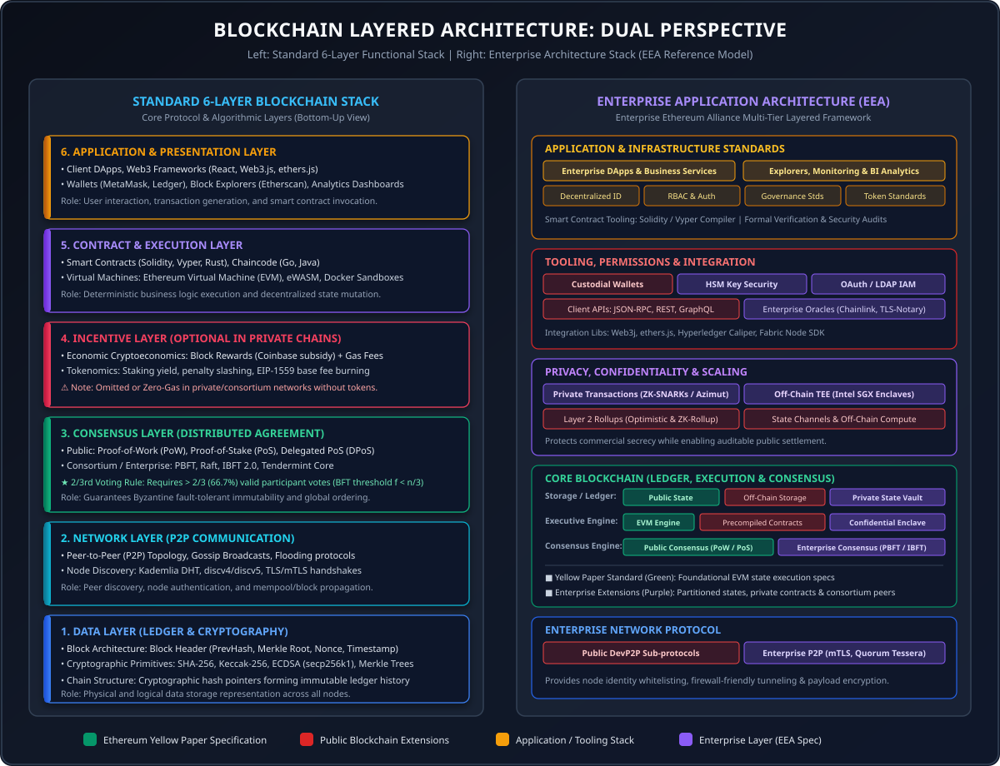

---

### 1.1 The Standard 6-Layer Functional Architecture

The standard blockchain protocol stack organizes operations into six distinct horizontal layers, where each layer depends on the invariants guaranteed by the layers beneath it:

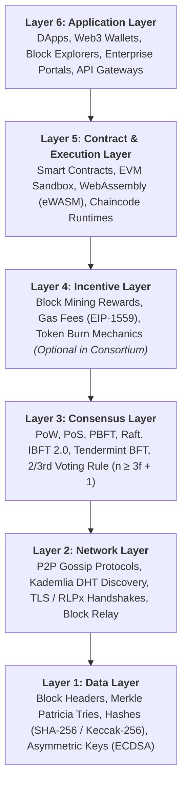

#### Layer 1: Data Layer (Ledger State & Cryptographic Primitives)
The Data Layer establishes the foundational physical and mathematical representations of data stored across the distributed ledger:
* **Block Anatomy**: Each block comprises a **Block Header** and a **Block Body**. The header encapsulates the metadata:
  * `previousBlockHash`: The 32-byte cryptographic hash of the immediate parent block, establishing strict temporal ordering and chaining.
  * `merkleRoot`: The 32-byte root hash of the Merkle tree summarizing all transactions committed in the block.
  * `timestamp`: Unix epoch time indicating block generation.
  * `difficultyTarget` / `nBits`: The mathematical threshold defining mining difficulty (in PoW networks).
  * `nonce`: An arbitrary 32-bit (or 64-bit) counter incremented by miners to solve the proof-of-work puzzle.
* **Cryptographic Primitives**:
  * **Cryptographic Hash Functions**: Deterministic, pre-image resistant, collision-resistant functions (e.g., SHA-256 in Bitcoin, Keccak-256 in Ethereum).
  * **Asymmetric Key Cryptography**: Digital signature algorithms (e.g., ECDSA over the secp256k1 elliptic curve, Ed25519) providing non-repudiation, authentication, and transaction integrity.
  * **Merkle Trees & Patricia Tries**: Hierarchical cryptographic trees allowing $O(\log n)$ membership verification proofs (Merkle SPV proofs) and efficient state diff tracking without processing entire transaction histories.
* **Chain Structure**: Formed by linking blocks sequentially through their parent hashes. Modifying a transaction in block $k$alters its Merkle root, which alters block$k$'s hash, breaking the hash pointer in block$k+1$, cascading invalidity through all descendant blocks.

#### Layer 2: Network Layer (P2P Communications & Synchronization)
The Network Layer manages the decentralized transmission of data across geographically distributed, untrusted physical nodes without relying on centralized routing infrastructure:
* **Peer-to-Peer (P2P) Topology**: Nodes connect over overlay networks where each participant acts simultaneously as a client and a server (servent).
* **Node Discovery**:
  * **Kademlia Distributed Hash Table (DHT)**: Implemented in protocols like Ethereum's `discv4` and `discv5`, allowing nodes to locate peers using XOR distance metrics ($d(x, y) = x \oplus y$).
  * **DNS Seeding & Bootstrap Nodes**: Hardcoded fallback nodes used during initial peer discovery.
* **Handshake & Mutual Authentication**:
  * Nodes perform cryptographic handshakes (e.g., RLPx protocol in Ethereum) involving ECDH (Elliptic Curve Diffie-Hellman) key exchanges to negotiate ephemeral encryption keys for transport-layer security.
  * Protocol version compatibility checks and genesis block hash verification prevent accidental peering across incompatible network forks.
* **Gossip Protocols & Block Relay**:
  * Transactions and newly discovered blocks are flooded across the network using epidemic broadcast (gossip) protocols.
  * Relay mechanisms (such as the FIBRE network or compact blocks BIP-152) optimize propagation latency to minimize orphan block rates.

#### Layer 3: Consensus Layer (Distributed Agreement & Byzantine Fault Tolerance)
The Consensus Layer is the computational and algorithmic core of the blockchain. It guarantees that all honest distributed nodes agree on a single, canonical, immutable sequence of state transitions, even in the presence of faulty, disconnected, or actively malicious nodes:
* **Consensus Mechanisms Taxonomy**:
  * **Permissionless / Nakamoto Consensus**: Proof-of-Work (PoW), Proof-of-Stake (PoS), Delegated Proof-of-Stake (DPoS). High decentralization, probabilistic finality, higher latency.
  * **Permissioned / Deterministic Consensus**: Practical Byzantine Fault Tolerance (PBFT), Raft, Istanbul BFT (IBFT 2.0), Tendermint Core. High throughput, low latency, immediate deterministic finality.
* **The 2/3rd Voting Rule in Byzantine Fault Tolerance (BFT)**:
  * In distributed systems subject to Byzantine failures (arbitrary and malicious behavior), achieving consensus requires a strict mathematical supermajority.
  * According to the Byzantine Generals Problem (Lamport, Shostak, Pease, 1982), a system of $n$nodes can tolerate at most$f$ Byzantine (faulty or malicious) nodes if and only if:
    $$n \ge 3f + 1 \quad \implies \quad f < \frac{n}{3}$$
  * To commit a state transition or certify a block, a proposed block must accumulate cryptographic votes (digital signatures) from more than two-thirds of the authorized voting participants:
    $$\text{Required Quorum} \ge 2f + 1 > \frac{2}{3}n$$
  * **Mathematical Proof of Quorum Intersection**:
    Suppose the total network has $n = 3f + 1$nodes. Consider two disjoint quorums$Q_1$and$Q_2$, each of size$2f + 1$. The intersection between$Q_1$and$Q_2$ must contain:
    $$|Q_1 \cap Q_2| = |Q_1| + |Q_2| - |Q_1 \cup Q_2| = (2f + 1) + (2f + 1) - (3f + 1) = f + 1$$
    Since the maximum number of malicious nodes is $f$, the intersection of any two valid voting quorums contains at least$(f + 1) - f = 1$honest node. Therefore, two conflicting blocks can never both achieve a$2/3$ supermajority vote. This guarantees **Safety** (no double spending or conflicting forks).
* **Consortium Network Definitions**:
  * In a consortium blockchain, consensus is not achieved through competitive hash power or capital lockups. Instead, it is governed by an identified, legally bound committee of institutional validator nodes.
  * Voting occurs over multi-phase rounds (e.g., Pre-Prepare, Prepare, Commit). Once $2/3$ of validator signatures are compiled into a commit certificate, the block is finalized immediately with zero probability of reorganization.

#### Layer 4: Incentive Layer (Cryptoeconomics & Fee Distribution)
The Incentive Layer incorporates economic game theory into the protocol to encourage honest node participation and deter denial-of-service (DoS) attacks:
* **Block Rewards (Coinbase Subsidy)**: Newly minted native cryptocurrency tokens awarded to the node that successfully mines or validates a block.
* **Transaction (Gas) Fees**: Variable fees paid by transaction senders to compensate validators for computational, bandwidth, and storage resources consumed.
* **Deflationary & Burning Mechanisms**: Protocols such as Ethereum's EIP-1559 burn a base fee portion of every transaction, tying network security to economic scarcity.
* **Enterprise / Consortium Distinction**:
  * **Crucial Architectural Note**: The Incentive Layer is strictly **OPTIONAL** in blockchain architectures.
  * In private, enterprise, or consortium networks (e.g., Hyperledger Fabric, Corda, Quorum), participating entities operate nodes under contractual obligations and mutual business interests.
  * Consequently, enterprise blockchains frequently eliminate cryptocurrencies, block rewards, and gas fees entirely (or operate with "zero-gas" models), avoiding regulatory classification as money-services businesses and removing fee volatility.

#### Layer 5: Contract & Execution Layer (Smart Contracts & Virtual Machines)
This layer enables programmable state mutations, allowing decentralized ledgers to execute complex multi-party business logic:
* **Deterministic Execution Engines**: Virtual machines must guarantee that executing transaction $T$against state$S$produces identical state$S'$ on every node across the globe, irrespective of CPU architecture, operating system, or local time.
  * **Ethereum Virtual Machine (EVM)**: A stack-based, 256-bit word size deterministic runtime.
  * **eWASM / WebAssembly**: High-performance, multi-language execution sandbox used in modern high-throughput networks.
  * **Docker / Chaincode**: Containerized runtime environments used in Hyperledger Fabric supporting Go, Java, and TypeScript.
* **Smart Contract Languages**: High-level contract languages including Solidity (object-oriented, EVM), Vyper (Python-like security-focused), Rust (memory-safe, Solana/Substrate), and Move (resource-oriented linear types).
* **Formal Verification**: Mathematical techniques used to rigorously prove that contract bytecode adheres to functional specifications and cannot enter unauthorized states (e.g., preventing reentrancy or integer overflows).

#### Layer 6: Application & Presentation Layer (End-User Interfaces)
The top layer provides the abstraction boundaries and human-machine interfaces necessary for users and external enterprise software to interact with the decentralized network:
* **Decentralized Applications (DApps)**: Web3 applications executing frontend logic in client browsers while dispatching state-changing transactions to blockchain nodes.
* **Web3 Libraries & Frameworks**: Client communication abstractions including `web3.js`, `ethers.js`, `viem`, and `Web3j`.
* **Cryptographic Wallets**: Software (MetaMask, Rainbow) and hardware (Ledger, Trezor) key custody solutions that manage key generation, address derivation, and transaction signing.
* **Block Explorers & BI Tools**: Indexing engines (The Graph, Etherscan, Blockscout) that parse raw block data into searchable relational schemas for analytics, accounting, and compliance.

---

### 1.2 Enterprise Blockchain Architecture View (EEA Reference Stack)

In production enterprise environments, the classical 6-layer protocol is refactored into the **Enterprise Ethereum Alliance (EEA) Architectural Stack**, which explicitly segregates open public standards from proprietary, consortium-grade enterprise extensions:

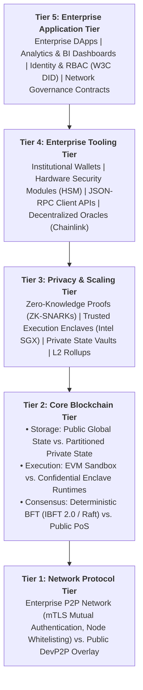

#### Detailed Breakdown of EEA Tiers:
1. **Application Tier**:
   * Encapsulates enterprise business workflows, decentralized finance (DeFi) primitives, supply-chain tracking interfaces, and regulatory auditing consoles.
   * Standardizes infrastructure contracts: Role-Based Access Control (**RBAC**), Decentralized Identity (**DID** / W3C specifications), Network Governance rules, and Token Standards (ERC-20, ERC-721, ERC-1155).
2. **Tooling Tier**:
   * Bridges traditional corporate IT systems with the blockchain ledger.
   * Integrates **Hardware Security Modules (HSMs)** adhering to FIPS 140-2 Level 3 standards to sign corporate transactions without private keys ever touching memory.
   * Exposes JSON-RPC, REST, and GraphQL client gateways, coupled with decentralized **Oracles** (e.g., Chainlink, TLSNotary) to ingest off-chain financial, meteorological, and logistics data.
3. **Privacy & Scaling Tier**:
   * **Private Transactions**: Utilizes zero-knowledge proofs (ZK-SNARKs, ZK-STARKs) or dual-state architectures (e.g., Quorum Tessera private transaction managers) so that competitors sharing the same ledger cannot observe transaction amounts, counterparty identities, or contract terms.
   * **Trusted Execution Environments (TEE)**: Leverages hardware enclaves (such as Intel SGX or AMD SEV) to compute confidential contract logic off-chain with verifiable remote attestation.
   * **Layer-2 Scaling**: Deploys Optimistic Rollups, ZK-Rollups, and state channels to achieve thousands of transactions per second (TPS) while anchoring fraud/validity proofs back to Layer 1.
4. **Core Blockchain Tier**:
   * Differentiates between the **Yellow Paper Standard** (foundational EVM, public global state trie, and public consensus) and **Enterprise Extensions** (partitioned private state databases, precompiled cryptographic contracts for enterprise curves like `secp256r1`, and deterministic BFT voting engines).
5. **Network Protocol Tier**:
   * Replaces unauthenticated, open P2P flooding (DevP2P) with firewall-friendly, mutual TLS (mTLS) enterprise peering. Only authorized cryptographic node certificates signed by the consortium Certificate Authority (CA) can peer and exchange traffic.

---
## 2. Design Methodology for Blockchain Applications

Building a blockchain-enabled solution requires a rigorous engineering methodology. Because smart contracts and on-chain state are immutable once deployed, architectural mistakes, misconfigured parameters, or flawed economic incentives cannot simply be patched with traditional database hotfixes. Organizations must execute a disciplined 10-step lifecycle framework.

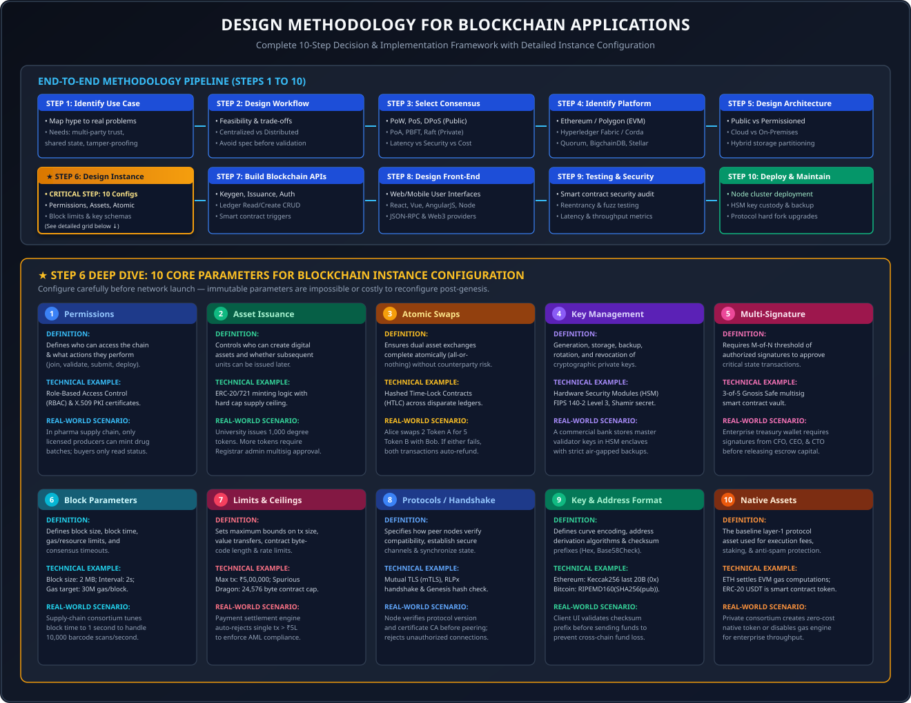

---

### 2.1 The 10-Step Decision Framework

```mermaid
flowchart LR
    S1["<b>Step 1</b><br/>Identify Use Case<br/><i>(Qualification Test)</i>"] --> S2["<b>Step 2</b><br/>Design Workflow<br/><i>(On/Off-Chain Split)</i>"] --> S3["<b>Step 3</b><br/>Select Consensus<br/><i>(PoW / PoS / BFT)</i>"]
    S3 --> S4["<b>Step 4</b><br/>Identify Platform<br/><i>(Public / Consortium)</i>"]
    S4 --> S5["<b>Step 5</b><br/>Design Architecture<br/><i>(Layer Integration)</i>"]
    S5 --> S6["<b>Step 6</b><br/>Configure Instance<br/><i>(10 Parameters)</i>"]
    S6 --> S7["<b>Step 7</b><br/>Build APIs<br/><i>(7 Function Classes)</i>"]
    S7 --> S8["<b>Step 8</b><br/>Front-End / UI<br/><i>(Web3 Providers)</i>"]
    S8 --> S9["<b>Step 9</b><br/>Testing & Audit<br/><i>(Formal Verification)</i>"]
    S9 --> S10["<b>Step 10</b><br/>Deployment & Ops<br/><i>(Mainnet / Consortium)</i>"]
```

#### Step 1: Identify the Use Case (De-Hyping Blockchain)
* **The Reality Check**: Blockchain is not a panacea. It introduces computational redundancy, higher storage costs, and transaction latency compared to optimized relational or NoSQL databases.
* **The Qualification Test (Biran et al. Decision Heuristic)**: A project genuinely requires blockchain technology ONLY IF all of the following conditions hold true:
  1. *Shared State*: Multiple distinct entities must read from and write to a common database.
  2. *Multiple Untrusted Writers*: The writers do not trust each other or have conflicting commercial incentives.
  3. *Absence of a Trusted Intermediary*: A central clearinghouse or trusted escrow agent is either unavailable, prohibitively expensive, introduces unacceptable latency, or represents a dangerous single point of failure (SPOF).
  4. *Interdependent Transactions*: Transactions require cryptographic immutability and verifiable chronological ordering.
* **Widespread Viable Use Cases**: Cross-border payments, supply chain provenance tracking, automated mortgage lending, multi-party insurance adjudication, tamper-proof academic credentials, and decentralized identity (KYC).

#### Step 2: Design a Workflow for Blockchain Integration
* Map business processes to state transitions. Distinguish which operations must be executed deterministically on-chain from operations that should remain off-chain in legacy enterprise resource planning (ERP) or customer relationship management (CRM) systems.
* Establish clear boundaries for data privacy, regulatory compliance, and auditability. Avoid writing low-level code before the cross-organizational data pipeline is formally modeled.

#### Step 3: Identify the Consensus Mechanism
* Select an agreement protocol aligned with the operational requirements of the use case:
  * **Proof-of-Work (PoW)**: High censorship resistance, open permissionless entry, but high electricity consumption and low throughput (~7 TPS in Bitcoin).
  * **Proof-of-Stake (PoS)**: Energy-efficient public consensus, capital-backed security, medium throughput.
  * **Delegated Proof-of-Stake (DPoS)**: High throughput (~1,000–5,000 TPS) via a selected committee of witnesses, at the cost of higher validator concentration.
  * **Proof-of-Authority (PoA) / PBFT**: Highly suited for private enterprise consortia where identities of validating nodes are legally vetted; provides deterministic sub-second finality and zero electricity waste.
  * **Proof-of-Weight / Proof-of-Space**: Cryptographic consensus based on disk storage commitments or custom weighted reputation metrics.

#### Step 4: Identify the Platform
* Match functional requirements to existing enterprise and public blockchain platforms:
  * **Ethereum / Polygon / Arbitrum**: Best for open composability, EVM smart contracts, robust developer tooling, and global liquidity.
  * **Hyperledger Fabric**: Best for modular enterprise consortia requiring private sub-channels, zero-gas execution, and pluggable consensus (Raft/BFT).
  * **R3 Corda**: Explicitly designed for financial institutions; executes point-to-point confidential bilateral workflows without a global broadcast ledger.
  * **Quorum (Consensys Quorum)**: Enterprise fork of Ethereum featuring private transaction enclaves (Tessera) and Istanbul BFT consensus.
  * **BigchainDB**: Blends database scalability (MongoDB backend) with blockchain immutability and asset transfer mechanics.
  * **Stellar / Ripple (XRP Ledger)**: Highly optimized for low-cost, high-speed multi-currency cross-border settlement.
  * **MultiChain**: Rapid deployment platform for private enterprise data stream tracking and permissioned asset issuance.

#### Step 5: Design the Architecture
* Determine the deployment topology:
  * **Public Permissionless**: Anyone can read, write, and validate transactions (e.g., Ethereum Mainnet).
  * **Private Permissioned**: Operated within a single organization with restricted internal node access.
  * **Consortium Blockchain**: Governed by a federation of independent institutions (e.g., 10 commercial banks sharing a trade finance network).
  * **Hybrid Architecture**: Private consortium state anchored periodically to a public root blockchain for external auditability.
* Select hosting infrastructure: Cloud (AWS, Azure, GCP managed blockchain nodes), On-Premises bare metal (for sovereign banking compliance), or Multi-Cloud Hybrid deployments.

---

### 2.2 Step 6 Deep Dive: 10 Core Blockchain Instance Parameters (CRITICAL STEP)

The configuration of a blockchain instance defines the immutable operational rules of the network. Once initialized in the genesis block or network configuration profile, modifying these parameters typically requires an arduous hard fork or network-wide coordinator reset.

| # | Parameter | Core Functionality & Configuration Scope |
|:---:|---|---|
| **1** | **Permissions** | Network participation, transaction broadcast authorization, & consensus validator voting ACL |
| **2** | **Asset Issuance** | Fungible / non-fungible token minting rules, algorithmic supply caps, & multi-tier ownership rights |
| **3** | **Atomic Swaps** | Hashed Time-Locked Contracts (HTLC) for trustless cross-chain decentralized exchange |
| **4** | **Key Management** | Hardware Security Module (HSM) integration, threshold signatures, & deterministic (BIP-32/44) schemes |
| **5** | **Multi-Signatures** | $M$-of-$N$ cryptographic governance quorums for high-value treasury operations and administrative functions |
| **6** | **Block Parameters** | Maximum block gas limit, block time interval targets, gas ceilings, & consensus timeout rules |
| **7** | **Limits** | Maximum transaction payload size, call-stack recursion depth (1024), and contract bytecode size (24 KB limit) |
| **8** | **Network Protocols** | Mutual TLS (mTLS) handshake authentication, peer discovery wire protocol, & node whitelisting |
| **9** | **Key & Address Formats** | Cryptographic curve selection (secp256k1 vs. Ed25519), address hashing, & human-readable prefixes |
| **10** | **Native Assets** | Protocol-level base currency (gas token) vs. smart contract application tokens (ERC-20, ERC-721, ERC-1155) |

#### Parameter 1: Permissions
* **Definition**: Establishes the authorization matrix defining which public keys or identity certificates can join the network, broadcast transactions, validate candidate blocks, and deploy new smart contracts.
* **Technical Implementation**: Implemented via Role-Based Access Control (RBAC) smart contracts or X.509 PKI certificates managed by a Certificate Authority (such as Hyperledger Fabric CA).
* **Real-World Scenario**: In a pharmaceutical supply chain consortium, only certified manufacturers are granted permissions to invoke `mintBatch()`. Wholesalers and hospitals hold permissions to invoke `transferCustody()`, while retail patients hold read-only permissions to inspect product history.

#### Parameter 2: Asset Issuance / Reissuance
* **Definition**: Establishes the monetary and supply governance of digital assets: who holds the right to mint new tokens, whether additional units can be reissued subsequently, and whether a hard supply cap exists.
* **Technical Implementation**: Smart contract state variables enforcing algorithmic issuance curves, token burning functions (`burn()`), and administrative minting guards (`onlyOwner` / `hasRole(MINTER_ROLE)`).
* **Real-World Scenario**: A university issues 1,000 digital certificate tokens representing graduating students for the class of 2026. The contract parameter specifies that no new degree tokens for 2026 can be minted unless three authorized University Deans sign a joint reissuance transaction.

#### Parameter 3: Atomic Exchanges
* **Definition**: Guarantees that two parties trading disparate assets (either on the same chain or across distinct blockchains) execute the transaction atomically: both sides complete successfully, or both transactions revert simultaneously with zero counterparty risk.
* **Technical Implementation**: Hashed Time-Locked Contracts (HTLC) leveraging cryptographic hash pre-images and absolute/relative lock-times (`checkLockTimeVerify` / `keccak256(preimage)`).
* **Real-World Scenario**: Alice holds 2 Token A on Blockchain A, and Bob holds 5 Token B on Blockchain B. An atomic swap protocol guarantees that Alice receives Bob's 5 Token B if and only if Bob receives Alice's 2 Token A; if either party becomes unresponsive before the expiration timeout, both escrows auto-refund.

#### Parameter 4: Key Management
* **Definition**: The complete lifecycle management framework for cryptographic private keys: secure entropy generation, storage, access control, backup, scheduled rotation, and emergency revocation.
* **Technical Implementation**: Integration of Hardware Security Modules (HSMs) conforming to FIPS 140-2 Level 3, Shamir's Secret Sharing (SLIP-0039), and account abstraction (ERC-4337) social recovery vaults.
* **Real-World Scenario**: An investment bank validating high-value institutional transactions stores validator signing keys in tamper-responsive cloud HSM enclaves. Corporate transactions require automated authorization pipelines via multi-factor authentication before the HSM computes the digital signature.

#### Parameter 5: Multi-Signature Schemes
* **Definition**: Enforces an $M$-of-$N$threshold rule requiring$M$distinct authorized cryptographic signatures out of$N$ eligible signers before a transaction can be committed to the ledger.
* **Technical Implementation**: Multisig smart contract wallets (e.g., Safe / Gnosis Safe) or threshold Schnorr signature aggregation (MuSig2).
* **Real-World Scenario**: A corporate treasury managing \$100 M in digital reserves mandates a 3-of-5 multisig policy. To release capital or authorize an acquisition payment, at least 3 officers (e.g., CEO, CFO, General Counsel, VP Finance, Controller) must independently sign the transaction using their hardware wallets.

#### Parameter 6: Block Parameters
* **Definition**: Protocol-level operational constants governing ledger throughput, state size growth, and network propagation:
  * *Maximum Block Size*: Upper bound on block bytes (e.g., 1 MB–4 MB in Bitcoin, arbitrary bytes in enterprise chains).
  * *Target Block Interval*: Time elapsed between consecutive blocks (e.g., 10 minutes in Bitcoin, 12 seconds in Ethereum PoS, 1 second in private Raft clusters).
  * *Block Gas / Resource Limit*: Maximum cumulative computational effort allowable within a single block (e.g., 30 million gas in Ethereum).
* **Technical Implementation**: Genesis block parameters and dynamic adjustment algorithms (e.g., difficulty recalculation every 2016 blocks in Bitcoin).
* **Real-World Scenario**: An enterprise supply chain network tracking 50,000 high-frequency IoT sensor updates per minute configures a 1-second block interval with an expanded 50M gas limit to eliminate mempool transaction queuing delays.

#### Parameter 7: Limits
* **Definition**: Systemic safety bounds restricting transaction execution, account balances, smart contract bytecode size, and network resource utilization to prevent denial-of-service (DoS) exploits.
* **Technical Implementation**: EIP-170 maximum contract code size (24,576 bytes), maximum call stack depth (1,024 levels), and daily transfer volume ceilings enforced by smart contract rate limiters.
* **Real-World Scenario**: A decentralized banking application enforces an automated compliance limit: any transaction attempting to transfer greater than ₹5,00,000 in a single payload is automatically quarantined for secondary compliance review and AML reporting.

#### Parameter 8: Network Protocols / Handshaking
* **Definition**: The low-level transport and communication specifications that nodes adhere to when peering, verifying protocol compatibility, and exchanging mempool transactions and blocks.
* **Technical Implementation**: Mutual TLS (mTLS) with standard cipher suites (TLS 1.3, AES-GCM-256), RLPx wire protocols, protocol version negotiation (e.g., `eth/68`), and hardcoded genesis block hash cross-checking.
* **Real-World Scenario**: When a newly commissioned bank validator node connects to a financial consortium, it transmits its TLS certificate. The existing nodes verify that the certificate was issued by the consortium root CA, verify identical protocol versions, and verify matching genesis hashes before establishing an encrypted peering connection.

#### Parameter 9: Key and Address Formats
* **Definition**: The mathematical algorithms and encoding rules used to generate, derive, format, and validate public/private keys and public account addresses.
* **Technical Implementation**:
  * *Elliptic Curves*: secp256k1 (Bitcoin/Ethereum) vs. Ed25519 (Solana/Tendermint).
  * *Derivation*: Ethereum takes the Keccak-256 hash of the 64-byte uncompressed public key and truncates it to the last 20 bytes, prepending `0x`. Bitcoin hashes the public key via SHA-256 followed by RIPEMD-160, appending a network byte and checksum, encoded in Base58Check or Bech32 (SegWit).
  * *EIP-55 Checksum*: Mixed-case capitalization in Ethereum addresses to prevent typing errors.
* **Real-World Scenario**: A consumer wallet application evaluates user-entered destination strings against checksum rules before dispatching funds, rejecting attempts to transfer assets across mismatched address formats (e.g., preventing accidental loss from pasting a Bitcoin address into an Ethereum transaction).

#### Parameter 10: Native Assets
* **Definition**: The foundational layer-1 cryptocurrency or fuel token native to the blockchain protocol, utilized to pay validator computation fees and prevent infinite execution loops.
* **Technical Implementation**: Inherent protocol-level state balance (e.g., `msg.value` in EVM) contrasted against layer-2 contract-defined tokens (e.g., ERC-20, ERC-721).
* **Real-World Scenario**: On Ethereum, Ether (ETH) is the native asset required to pay gas fees for executing transactions, while Tether (USDT) is an ERC-20 smart contract token whose transfers require ETH to settle. In contrast, enterprise networks (like Hyperledger Fabric) frequently operate without a native asset, eliminating cryptocurrency speculation from enterprise operations.

---

### 2.3 Step 7 Deep Dive: 7 Blockchain API Function Classes

To enable client applications, enterprise ERP backends, and frontend interfaces to interact with the blockchain instance, developers build or expose seven standardized API function categories:

| Class # | API Function Category | Primary Scope & Enterprise Operation |
|:---:|---|---|
| **1** | **Generating Key Pairs** | Generates cryptographically secure private/public keys & hierarchical deterministic seed phrases (ECDSA secp256k1 / Ed25519) |
| **2** | **Digital Asset Issuance** | Mints tokens, establishes max supply caps, defines metadata schemes, and configures asset ownership parameters |
| **3** | **Data Authentication** | Computes cryptographic digests, digitally signs arbitrary payloads, and verifies sender signatures & non-repudiation |
| **4** | **Checking Blockchain Status** | Queries network chain ID, latest block height, dynamic base gas fees, peer count, node sync state, and mempool depth |
| **5** | **Create & Read Operations** | Dispatches state-modifying transactions to the network (`Create`) and performs gasless local state view queries (`Read`) |
| **6** | **Smart Contract Lifecycle** | Compiles bytecode, deploys contracts, invokes stateful contract methods, and manages event logs & filter topics |
| **7** | **Address Specifications** | Validates checksummed address formats (EIP-55), verifies elliptic curve derivations, and resolves naming records (ENS / DID) |

1. **Generating Key Pairs API**:
   * Generates cryptographically secure private keys using hardware-level pseudo-random number generators (CSPRNG).
   * Derives public keys via elliptic curve multiplication ($K = k \cdot G$) and outputs hierarchical deterministic (HD) wallet paths (BIP-32/BIP-44).
2. **Digital Asset Issuance API**:
   * Creates initial token supplies, initializes contract metadata (name, symbol, decimals), and executes authorized minting or burning transactions.
3. **Data Authentication API**:
   * Uses private keys to generate cryptographic digital signatures over arbitary data payloads (e.g., EIP-712 structured data signing).
   * Verifies signatures on incoming requests to confirm message integrity and non-repudiation.
4. **Checking Blockchain Parameters API**:
   * Exposes real-time network telemetry: current block number, sync status, network ID/chain ID, circulating supply, gas price estimations, and connected peer counts.
5. **Create and Read Operations API**:
   * *Create*: Dispatches signed raw transactions to the network mempool to update ledger state.
   * *Read*: Executes state inspection calls (e.g., `eth_call`, `eth_getBalance`, `eth_getStorageAt`) without spending gas or modifying blockchain state.
6. **Smart Contracts API**:
   * Handles contract compilation, ABI encoding, deployment transaction broadcasting, and invoking state-mutating functions or read-only view getters.
7. **Address Specifications API**:
   * Implements address format conversion, checksum validation (EIP-55), address validity regex verification, and ENS (Ethereum Name Service) reverse resolution.

---

### 2.4 Steps 8, 9, and 10: Front-End, Testing & Deployment

#### Step 8: Designing the Front End
* **Client Integration**: Modern decentralized applications utilize JSON-RPC over WebSocket or HTTPS to establish bidirectional event-driven communication with blockchain nodes.
* **Tech Stack**: Frontend frameworks (React, Vue, Angular, Next.js) paired with Web3 provider libraries (`ethers.js`, `viem`, `wagmi`).
* **Wallet Connection Abstraction**: Standardized connectors (WalletConnect, Web3Modal) allowing end users to authenticate with mobile wallets, hardware devices, or browser extensions.

#### Step 9: Implementation and Testing
* **Smart Contract Security Audits**: Static analysis (Slither, Mythril) to detect reentrancy, access control bypasses, integer flaws, and unchecked external calls.
* **Fuzzing & Formal Verification**: Property-based fuzz testing (Foundry, Echidna) and mathematical modeling to verify state machine invariants.
* **Performance Benchmarking**: Stress testing network throughput, block propagation delays, and transaction latency using tools like Hyperledger Caliper under peak transactional loads.

#### Step 10: Deployment and Maintenance
* **Node Infrastructure Deployment**: Provisioning validator nodes, backup RPC nodes, and failover clustering across multi-region data centers.
* **Key Custody & Disaster Recovery**: Air-gapping master validator keys in secure HSM modules; configuring multi-sig admin controls for contract upgrades.
* **Upgrades & Fork Governance**: Utilizing diamond patterns (ERC-2535) or transparent proxy contracts (ERC-1967) for upgradable logic, while preparing automated procedures for scheduled network hard forks.

---
## 3. On-Chain vs. Off-Chain Storage Trade-Offs

One of the most consequential architectural decisions when designing decentralized applications is determining whether data should reside **On-Chain** (directly within the replicated blockchain ledger state) or **Off-Chain** (in an external, auxiliary storage layer). This decision impacts financial cost, execution latency, throughput, data privacy, and legal compliance.

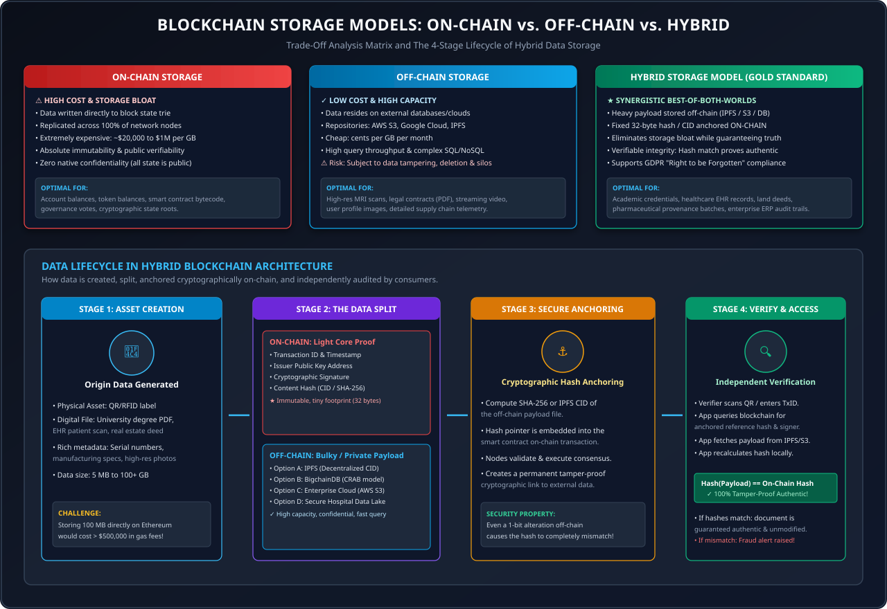

---

### 3.1 The Blockchain Storage Trilemma

Blockchain nodes must reach global consensus on every state transition. Every byte written directly to a blockchain ledger must be downloaded, verified, and stored permanently by tens of thousands of independent validating nodes worldwide. This imposes fundamental constraints known as the **Storage Trilemma**:
1. **Decentralization**: If running a full node requires terabytes of high-performance NVMe storage, ordinary users cannot run nodes, leading to validator centralization.
2. **Throughput**: Larger blocks filled with bulky data require longer network propagation times, drastically increasing block orphan rates and network forks.
3. **Immutability & Verifiability**: Storing complete data on-chain guarantees perpetual, tamper-proof auditability, but at extreme computational and economic expense.

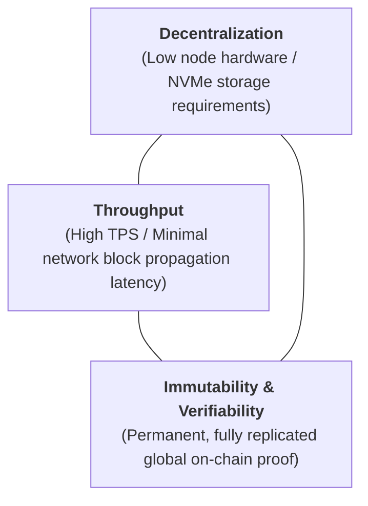
> [!TIP]
> **The Storage Trilemma Trade-Off**: Blockchain protocols cannot maximize all three dimensions simultaneously. Maximizing *Throughput* (e.g. larger blocks or shorter block times) and *Immutability* causes state bloat, demanding enterprise hardware that undermines *Decentralization*. The industry solution is the **Hybrid Storage Model**: offloading bulk state off-chain while maintaining mathematical verifiability on-chain.

---

### 3.2 Deep Dive: On-Chain Storage Mechanics & Economics

#### The Cost of On-Chain Storage (EVM SSTORE Analysis)
In the Ethereum Virtual Machine (EVM), writing to persistent contract storage is governed by the `SSTORE` opcode. The gas schedule is heavily penalized to deter state bloat:
* Writing a non-zero 32-byte word (256 bits) to an uninitialized storage slot costs **20,000 gas**.
* There are $1,024 \text{ bytes} / 32 \text{ bytes} = 32 \text{ storage slots}$ per kilobyte.
* Therefore, writing **1 KB** of raw data requires:
  $$\text{Gas per KB} = 32 \times 20,000 = 640,000 \text{ gas}$$
* Writing **1 MB** requires $640,000 \times 1,024 \approx 655,360,000 \text{ gas}$.
* At a modest gas price of **30 Gwei** and an Ether price of **\$3,000 USD**:
  $$\text{Cost per MB} = 655,360,000 \text{ gas} \times 30 \times 10^{-9} \text{ ETH} \times \$3,000 \approx \$59,000 \text{ USD}$$
* Storing a single **1 GB** file directly on-chain would cost **~\$59,000,000 USD**!
* **Conclusion**: Directly storing multi-megabyte files (such as medical imaging scans, high-resolution media, PDF legal agreements, or firmware blobs) on a public blockchain is economically impossible and technically catastrophic.

#### Technical Bottlenecks of On-Chain Storage:
1. **State Bloat & State Explosion**: Unlike historic block transactions (which can be pruned by non-archive nodes), active state (account balances, contract storage variables) must reside in fast memory (RAM/NVMe) to execute incoming transactions. Rapid state growth degrades node lookup speeds ($O(\log n)$ trie traversals).
2. **Node Synchronization Failure**: Initial Block Download (IBD) for newly joined nodes becomes unviable if nodes must sync hundreds of gigabytes of historical state data over P2P connections.
3. **Bandwidth & Propagation Lag**: Large block payloads take longer to propagate across the peer network, allowing well-connected mining cartels to centralize block production.

---

### 3.3 Deep Dive: Off-Chain Storage Models

To circumvent the prohibitive costs and throughput limits of on-chain storage, modern architectures offload the bulk of data payloads to specialized off-chain repositories:

#### Off-Chain Storage Repositories:
1. **Traditional Enterprise Cloud Storage**: Amazon Web Services (AWS S3), Google Cloud Storage, Microsoft Azure Blob. Offers near-infinite capacity, multi-gigabit throughput, high availability, and negligible costs (~\$0.02 per GB per month). However, it introduces centralized cloud provider lock-in and a single administrative failure point.
2. **Enterprise Relational & NoSQL Databases**: PostgreSQL, Oracle, MongoDB, Apache Cassandra. Provides powerful SQL querying, relational joins, sub-millisecond retrieval, and full ACID compliance, but lacks decentralized trust and cryptographic immutability.
3. **Decentralized Object Storage**: InterPlanetary File System (IPFS), Filecoin, Arweave, Storj. Combines peer-to-peer distribution, cryptographic content addressing, and erasure coding across untrusted host nodes.

#### Challenges of Pure Off-Chain Storage:
* **Tampering Risk**: An attacker or rogue database administrator with root privileges can silently modify off-chain records without leaving a cryptographic trace.
* **Link Rot & Deletion**: URLs and external references frequently break due to domain expiration, server decommissioning, or centralized censorship.
* **Access Control Vulnerability**: Managing decentralized permissions across siloed corporate servers requires complex, brittle API gateways.

---

### 3.4 Regulatory & Privacy Imperatives: The GDPR Dilemma

Storing data on-chain introduces a fundamental legal conflict with modern data protection regulations, specifically the European Union's **General Data Protection Regulation (GDPR)** and the **California Consumer Privacy Act (CCPA)**:

| GDPR Legal Mandate | Blockchain Architectural Reality | Technical & Architectural Resolution |
|---|---|---|
| **Article 17: "Right to be Forgotten"** | **Immutable Ledger**: Historical state cannot be erased or pruned once committed into mined blocks. | Store raw PII off-chain in GDPR-compliant databases; record only irreversible 32-byte hashes on-chain. When off-chain data is expunged, the on-chain hash is permanently orphaned and renders data mathematically unrecoverable. |
| **Article 16: "Right to Rectification"** | **Append-Only Architecture**: Transactions cannot be modified in-place; state history is strictly chronological and immutable. | Issue new correction transactions referencing updated document versions while preserving the historical audit trail in off-chain systems. |
| **Article 25: Data Minimization** | **Total State Replication**: All transaction data is redundantly broadcast to and stored across every participating node globally. | Zero raw PII payloads on the ledger; utilize cryptographic commitments, hashes, or Zero-Knowledge Proofs (ZK-SNARKs) to minimize on-chain footprint. |
| **Article 44: Cross-Border Transfers** | **Unbounded P2P Gossip**: Block relay floods transactions across international geographic boundaries without regulatory borders. | Deploy private consortium channels (e.g., Hyperledger Fabric Private Data Collections or Quorum Tessera private state) with strict node whitelisting. |

* **The Architectural Rule**: **Never store Personally Identifiable Information (PII) on-chain**.
* Name, address, phone numbers, biometric hashes, and clinical records must remain off-chain in encrypted data lakes. Only anonymized, non-reversible cryptographic hash pointers and zero-knowledge commitments may touch the public blockchain.

---

### 3.5 Comparative Storage Synthesis Matrix

| Evaluation Vector | On-Chain Storage | Off-Chain Storage | Hybrid Storage Model |
|---|---|---|---|
| **Primary Storage Media** | Block State Trie (Merkle Patricia Trie) | AWS S3, Cloud Object Storage, RDBMS, NoSQL | Off-Chain Payload (IPFS/Cloud) + On-Chain Hash Pointer |
| **Cost Economics** | Prohibitive (~$59,000 / MB on Ethereum L1) | Extremely Inexpensive (~$0.02 / GB / month) | Negligible on-chain (Fixed 32-byte hash anchor per asset) |
| **Maximum Capacity** | Kilobytes strictly (bounded by block gas limits) | Terabytes / Petabytes / Exabytes | Terabytes / Petabytes (scaled seamlessly off-chain) |
| **Query Throughput** | Low (15–30 TPS on Ethereum L1) | Extremely High (100,000+ QPS) | High (Off-chain queries executed at native database speed) |
| **Query Flexibility** | Primitive Key-Value lookups only | Complex SQL joins, multi-index JSON, full-text BI | Fast SQL/NoSQL off-chain + on-chain integrity verification |
| **Immutability** | Absolute & Permanent (Consensus-enforced) | Mutable & Deletable (Subject to DBA / cloud admin) | Mathematically Guaranteed (Tamper-evident hash match) |
| **Public Verifiability** | 100% Native Consensus verification | Zero native public verification | 100% Independent Cryptographic Audit |
| **Confidentiality / PII** | Zero (Publicly visible to all network participants) | High (Secured by enterprise ACLs, VPCs, and IAM) | High (Payload encrypted off-chain; zero plaintext on-chain) |
| **GDPR Compliance** | Non-compliant for PII (Violates Article 17) | Fully Compliant (Records can be permanently deleted) | Fully Compliant (Purging payload orphans the on-chain hash) |
| **Prime Use Cases** | Balances, voting state, smart contract logic code | Bulky media, raw telemetry, large operational datasets | Academic degrees, EHR records, Land titles, Supply chain |

---
## 4. Hybrid Storage Models & Architectural Blueprint

The **Hybrid Storage Model** is the industry-standard architectural pattern for enterprise decentralized applications. It reconciles the cost, storage, and privacy constraints of blockchains with the verifiability and tamper-evidence required by decentralized trust frameworks.

---

### 4.1 The Fundamental Principle of Cryptographic Anchoring

In a hybrid architecture:
1. The **bulky, unstructured, or private payload** (e.g., PDF university degrees, high-resolution DICOM medical scans, legal deeds, supply chain manifests) is stored entirely in an off-chain storage layer (such as an encrypted enterprise database, cloud object store, or IPFS).
2. A fixed-size, deterministic **cryptographic hash pointer** (a 32-byte SHA-256 digest or IPFS CID) is calculated from the file's bytes.
3. This 32-byte hash—along with transaction metadata (issuer public key address, timestamp, schema version, and cryptographic signature)—is written directly into a smart contract on the blockchain.

```mermaid
flowchart LR
    subgraph OffChain ["Off-Chain Storage Layer (Decentralized / Cloud)"]
        Payload["<b>Heavy Document Payload</b><br/>• Degree PDF / Medical Imaging (100 MB)<br/>• Raw Video / Large IoT Telemetry<br/>• Stored in IPFS Cluster / AWS S3 Vault"]
    end

    subgraph HashFunction ["Cryptographic Processing"]
        Hash["<b>Deterministic Hash Digest</b><br/>SHA-256 / IPFS CID<br/><i>H = Keccak256(Payload)</i>"]
    end

    subgraph OnChain ["On-Chain Blockchain Ledger (EVM Smart Contract)"]
        Anchor["<b>Document Registry State Record</b><br/>• <code>issuer</code>: 0x9f1a83b...<br/>• <code>docHash</code>: 0x7fa1c4e... (32 bytes)<br/>• <code>ipfsCID</code>: bafybeic...<br/>• <code>timestamp</code>: 1773738200<br/>• <code>isRevoked</code>: false"]
    end

    Payload -->|Compute SHA-256 / IPFS CID| Hash
    Hash -->|anchorDocument Transaction (20K gas)| Anchor
```

Because cryptographic hash functions possess the property of **pre-image resistance** and **collision resistance**, it is mathematically impossible to alter even a single bit of the 100 MB off-chain file without drastically changing the 32-byte hash digest. Thus, the blockchain provides an **immutable, mathematically unforgeable seal of authenticity** over external data without carrying the storage burden.

---

### 4.2 The 4-Stage Lifecycle of Hybrid Data Storage

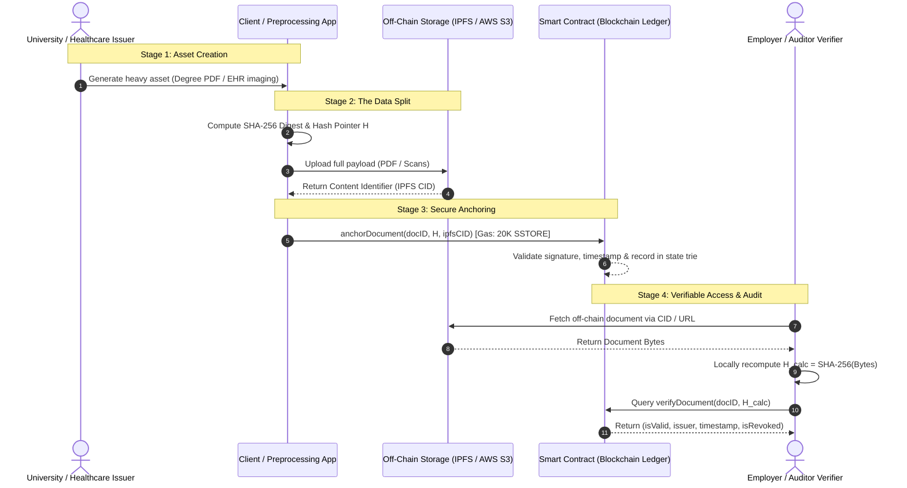


#### Stage 1: Asset Creation
* A real-world event or digital process produces an asset.
* Examples: A university registrar generates a graduation certificate PDF; an MRI scanner outputs a patient diagnostic imaging file; an IoT sensor records pharmaceutical batch formulation telemetry.
* The asset contains rich metadata: high-resolution vector artwork, timestamps, serial numbers, and signatures.

#### Stage 2: The Data Split
* The architecture separates the generated data into two streams:
  * **On-Chain Stream (Core Proof)**: Transaction ID, issuer address, issuance timestamp, recipient identifier, and the document's cryptographic hash.
  * **Off-Chain Stream (Bulky Payload)**: The actual document bytes, associated metadata files, and raw images.

#### Stage 3: Secure Anchoring
* The system computes $H = \text{SHA-256}(\text{Payload})$ or adds the file to IPFS to receive a Content Identifier (CID).
* The issuer signs a transaction embedding $H$ and invokes the smart contract's registration function.
* Distributed validators execute consensus and record the transaction in the ledger state trie.

#### Stage 4: Verification and Access
* When a third party (such as an employer, auditor, doctor, or customs officer) wishes to verify the authenticity of the asset:
  1. The verifier receives the off-chain document file (via email, QR code download, or IPFS retrieval).
  2. The verifier's client application independently recomputes the cryptographic hash:
     $$H_{\text{calculated}} = \text{SHA-256}(\text{Received File Bytes})$$
  3. The application queries the smart contract on the blockchain using the Document ID or Issuer Address to fetch the anchored hash:
     $$H_{\text{on-chain}} = \text{SmartContract.getHash}(\text{DocumentID})$$
  4. The application compares the two digests:
     $$\text{If } H_{\text{calculated}} == H_{\text{on-chain}} \implies \text{Document is 100% Genuine & Unmodified}$$
     $$\text{If } H_{\text{calculated}} \neq H_{\text{on-chain}} \implies \text{Tampering / Fraud Detected!}$$

---

### 4.3 Production-Grade Solidity Implementation: `HybridDocumentRegistry.sol`

Below is an enterprise-grade Solidity smart contract demonstrating how the hybrid storage architecture is implemented in production:

```solidity
// SPDX-License-Identifier: MIT
pragma solidity ^0.8.20;

/**
 * @title HybridDocumentRegistry
 * @dev Implements cryptographic hash anchoring for off-chain documents (IPFS / Enterprise Cloud)
 * Demonstrates Module 5 Hybrid Storage Architecture.
 */
contract HybridDocumentRegistry
{
    // Struct representing the on-chain metadata anchor
    struct DocumentRecord
    {
        bytes32 contentHash;      // SHA-256 or truncated IPFS Multihash
        string ipfsCID;           // IPFS Content Identifier (v0 or v1 string)
        address issuer;           // Cryptographic address of issuing entity
        uint256 issuanceTime;     // Unix timestamp of block commitment
        bool isRevoked;           // Revocation status flag
        string documentType;      // e.g., "DegreeCertificate", "MedicalScan", "LandDeed"
    }

    // Storage: Mapping from unique Document UUID to DocumentRecord
    mapping(bytes32 => DocumentRecord) private _registry;

    // Access Control: Authorized Issuers
    mapping(address => bool) public authorizedIssuers;
    address public contractOwner;

    // Events for off-chain indexing and monitoring
    event DocumentAnchored(
        bytes32 indexed documentId,
        bytes32 indexed contentHash,
        string ipfsCID,
        address indexed issuer,
        uint256 timestamp
    );

    event DocumentRevoked(
        bytes32 indexed documentId,
        address indexed issuer,
        uint256 timestamp,
        string reason
    );

    event IssuerAuthorized(address indexed issuer);
    event IssuerRevoked(address indexed issuer);

    modifier onlyOwner()
    {
        require(msg.sender == contractOwner, "Caller is not contract owner");
        _;
    }

    modifier onlyIssuer()
    {
        require(authorizedIssuers[msg.sender], "Caller is not an authorized issuer");
        _;
    }

    constructor()
    {
        contractOwner = msg.sender;
        authorizedIssuers[msg.sender] = true;
        emit IssuerAuthorized(msg.sender);
    }

    function authorizeIssuer(address newIssuer) external onlyOwner
    {
        require(newIssuer != address(0), "Invalid address");
        authorizedIssuers[newIssuer] = true;
        emit IssuerAuthorized(newIssuer);
    }

    function revokeIssuer(address issuer) external onlyOwner
    {
        authorizedIssuers[issuer] = false;
        emit IssuerRevoked(issuer);
    }

    /**
     * @notice Anchors an off-chain document's hash and IPFS CID onto the blockchain
     * @param documentId Unique identifier for the document (UUID or serial number hash)
     * @param contentHash SHA-256 cryptographic digest of the raw off-chain file
     * @param ipfsCID Content Identifier string from IPFS network
     * @param docType Categorical classification of the document
     */
    function anchorDocument(
        bytes32 documentId,
        bytes32 contentHash,
        string calldata ipfsCID,
        string calldata docType
    ) external onlyIssuer
    {
        require(_registry[documentId].issuanceTime == 0, "Document ID already registered");
        require(contentHash != bytes32(0), "Invalid content hash");

        _registry[documentId] = DocumentRecord({
            contentHash: contentHash,
            ipfsCID: ipfsCID,
            issuer: msg.sender,
            issuanceTime: block.timestamp,
            isRevoked: false,
            documentType: docType
        });

        emit DocumentAnchored(documentId, contentHash, ipfsCID, msg.sender, block.timestamp);
    }

    /**
     * @notice Revokes a previously registered document
     */
    function revokeDocument(bytes32 documentId, string calldata reason) external
    {
        DocumentRecord storage record = _registry[documentId];
        require(record.issuanceTime != 0, "Document does not exist");
        require(msg.sender == record.issuer || msg.sender == contractOwner, "Unauthorized to revoke");
        require(!record.isRevoked, "Document already revoked");

        record.isRevoked = true;
        emit DocumentRevoked(documentId, msg.sender, block.timestamp, reason);
    }

    /**
     * @notice Public verification helper to audit a document against local file bytes
     * @param documentId Document unique identifier
     * @param recalculatedHash SHA-256 computed locally by the verifier over downloaded file
     * @return isValid Boolean indicating whether the document is authentic and active
     * @return issuer Address of the authorized issuing authority
     * @return ipfsCID The IPFS locator to fetch original payload
     */
    function verifyDocument(
        bytes32 documentId,
        bytes32 recalculatedHash
    ) external view returns (bool isValid, address issuer, string memory ipfsCID)
    {
        DocumentRecord memory record = _registry[documentId];
        if (record.issuanceTime == 0 || record.isRevoked)
        {
            return (false, address(0), "");
        }
        
        bool hashMatch = (record.contentHash == recalculatedHash);
        return (hashMatch, record.issuer, record.ipfsCID);
    }
}
```

---
## 5. InterPlanetary File System (IPFS) Deep Dive

The **InterPlanetary File System (IPFS)** is a decentralized, peer-to-peer, content-addressed hypermedia protocol designed to make the web faster, safer, and more resilient against censorship and single-point-of-failure outages.

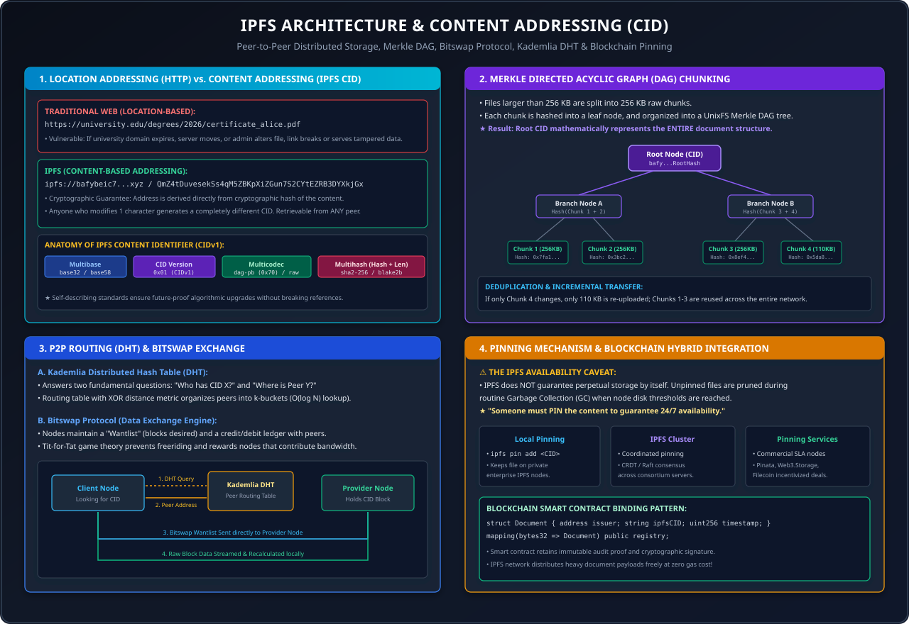

---

### 5.1 Foundational Architecture: Location vs. Content Addressing

The traditional World Wide Web relies on **Location Addressing** via the Hypertext Transfer Protocol (HTTP):
* **HTTP (Location-Based)**: `https://university.edu/records/2026/degree_alice.pdf`
  * Instructs the browser *where* to retrieve the file (which IP address, domain name, and server directory path).
  * *Vulnerabilities*: If the server crashes, if the domain expires, if the company goes bankrupt, or if an administrator deletes or renames the folder, the link returns `404 Not Found` (link rot). More dangerously, if an attacker hacks the server and replaces the PDF with a forged copy, the URL continues to resolve normally, serving malicious content without warning.
* **IPFS (Content-Based Addressing)**: `ipfs://bafybeic7...` or `QmZ4tDuvesekSs4qM5ZBKpXiZGun7S2CYtEZRB3DYXkjGx`
  * Instructs the network *what* content is being sought, rather than *where* it is located.
  * The identifier is derived directly and deterministically from the cryptographic hash of the file's binary contents.
  * *Mathematical Invariant*: If even one pixel in an image or one character in a document is altered, its cryptographic address completely changes. If multiple peers host the exact same file, they all serve it under the exact same identifier. Users can download pieces of the file concurrently from dozens of nearby nodes rather than congesting a single centralized web server.

---

### 5.2 Anatomy of Content Identifiers (CID)

A **Content Identifier (CID)** is a self-describing cryptographic label used to address content in IPFS. It has evolved through two primary specifications:

#### CIDv0 (Legacy Format):
* Always 46 characters in length.
* Always begins with the prefix `Qm...` (e.g., `QmZ4tDuvesekSs4qM5ZBKpXiZGun7S2CYtEZRB3DYXkjGx`).
* Strictly assumes SHA-256 as the hashing algorithm and encodes the raw multihash in Base58btc.
* Lacks forward-compatible self-describing fields.

#### CIDv1 (Modern Multiformats Standard):
CIDv1 is constructed by concatenating four self-describing binary prefixes using the **Multiformats** protocol:

| Segment | 1. Multibase Prefix | 2. CID Version | 3. Multicodec | 4. Multihash Digest |
|---|---|---|---|---|
| **Field Type** | String Prefix / Base Encoding | Unsigned Varint | Unsigned Varint | Structured Binary Digest |
| **Example Value** | `'b'` (Base32) or `'z'` (Base58btc) | `0x01` (CIDv1) | `0x70` (`dag-pb`) or `0x55` (`raw`) | `0x12` (SHA-256) + `0x20` (32 bytes) + `<32-byte-hash>` |
| **Specification Role** | Human-readable string encoding; Base32 makes CIDs case-insensitive & safe for DNS subdomains and URLs | Indicates CID specification version, enabling forward protocol upgrades | Identifies content serialization format (Protobuf UnixFS, DAG-CBOR, Raw binary) | Self-describes hashing algorithm code, byte length, and the cryptographic hash value |

1. **Multibase Prefix**: Specifies the base encoding used to represent binary data as a human-readable string (e.g., `b` indicates Base32, which is lowercase and case-insensitive, making it safe for DNS subdomains and URLs; `z` indicates Base58btc).
2. **CID Version**: An unsigned variable integer (varint) denoting the specification version (`0x01` for CIDv1).
3. **Multicodec**: Identifies the content type and serialization format of the targeted data (e.g., `0x70` for `dag-pb` Protobuf UnixFS; `0x71` for `dag-cbor`; `0x55` for raw binary).
4. **Multihash**: A structured hash digest comprising:
   * `<hash-function-code>`: Cryptographic algorithm identifier (`0x12` for SHA-256; `0xb220` for BLAKE2b-256).
   * `<digest-length>`: Number of bytes in the digest (`0x20` = 32 bytes).
   * `<digest-value>`: The raw cryptographic hash bytes.

* **Significance of Multiformats**: If SHA-256 is mathematically compromised in 2035, the IPFS network does not break. Developers can transition seamlessly to quantum-resistant hash algorithms (such as BLAKE3 or SHA-3) simply by changing the multihash function code prefix, without redesigning the protocol.

---

### 5.3 UnixFS & The Merkle Directed Acyclic Graph (DAG)

Large files cannot be transmitted across a peer-to-peer network as massive monolithic blobs. IPFS utilizes the **UnixFS** data abstraction to format and chunk data into a **Merkle Directed Acyclic Graph (DAG)**:
1. **Chunking**: A file is split into manageable chunks, with a default block size of **256 KB**.
2. **Leaf Nodes**: Each 256 KB chunk is cryptographically hashed to form a leaf node in the DAG.
3. **Internal Nodes & Tree Assembly**: Intermediate nodes group lists of child chunk hashes. The hashes of these intermediate nodes are grouped recursively until a single **Root Node** is produced.
4. **Root CID**: The Content Identifier of this Root Node represents the entire file.

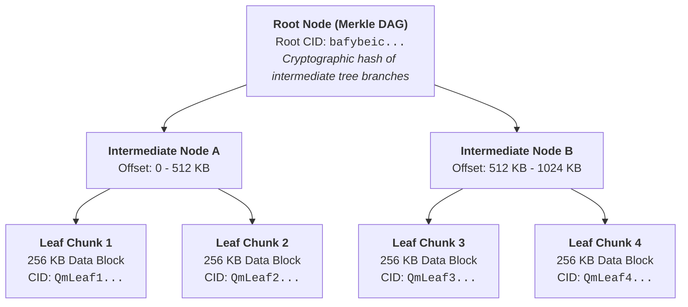


#### Architectural Superpowers of the Merkle DAG:
* **Deduplication**: If two completely different 1 GB video files share an identical 100 MB opening intro sequence, the underlying 256 KB chunk blocks for that intro share the exact same CIDs. Both files reference the exact same blocks in node storage, cutting disk usage across the network.
* **Incremental Synchronization**: If a user edits 5 lines of code in a 500 MB software repository, only the leaf chunk containing those lines changes. IPFS uploads only that single 256 KB block and updates the intermediate branch hashes; the remaining 499.75 MB of chunks are left untouched.
* **Tamper Evidence**: Any alteration to any leaf node ripples up the DAG, changing the Root CID.

---

### 5.4 Peer-to-Peer Routing: The Kademlia Distributed Hash Table (DHT)

Once a node possesses a CID, how does it discover which computers on the global internet currently host those blocks? IPFS employs a **Kademlia Distributed Hash Table (DHT)**:
* **Node IDs & XOR Distance**: Every node on the IPFS network is assigned a 256-bit Node ID (derived from its public key). The "distance" between any two node IDs $x$and$y$, or between a node ID and a CID, is calculated using the bitwise exclusive-OR (XOR) metric:
  $$d(x, y) = x \oplus y$$
* **$k$-Buckets & Routing Tables**: Each node maintains a routing table organized into logarithmic buckets ($k$-buckets). Nodes maintain dense contact lists for peers that are numerically "close" in XOR space, and sparse contact lists for distant peers.
* **Content Provider Records**: When a node hosts content, it periodically publishes a *Provider Record* to the $k$ closest nodes to that CID in the DHT, stating: *"Node Qm123 has content bafy456 at IP address 198.51.100.25:4001"*.
* **Lookup Efficiency**: Locating any arbitrary block requires traversing at most $O(\log N)$ hops across the network, scaling effortlessly to millions of participants.

---

### 5.5 Data Transfer: The Bitswap Protocol

Once the DHT locates peers hosting the desired content, the actual binary blocks are transferred using **Bitswap**:
* **Wantlists & Have Messages**: When a node requires blocks to assemble a file, it broadcasts a `Wantlist` to connected peers. Peers reply with `Have` or `Block` messages.
* **Ledgers & Tit-for-Tat Game Theory**:
  * Bitswap prevents "freeloading" (nodes that download data without contributing bandwidth).
  * Each node maintains a credit/debt ledger with every peer it communicates with.
  * If Node A sends 50 MB of data to Node B, Node B's credit increases. If Node B refuses to reciprocate and upload data to Node A, Node A throttles its outbound transmission rate to Node B using a deterministic Tit-for-Tat algorithm.
  * This economic game theory incentivizes nodes to contribute upstream bandwidth to the network.

---

### 5.6 Pinning Services & Data Persistence

A widespread misconception among novice developers is that uploading a file to IPFS guarantees it will remain available on the network forever. **This is false.**

#### The Garbage Collection (GC) Threat:
* IPFS nodes cache files they download to serve them to neighboring peers.
* However, when a node's local disk utilization reaches its configured storage ceiling (e.g., 90% disk capacity), the node runs an automated **Garbage Collection (GC)** process.
* During GC, any content stored in cache that has not been explicitly **Pinned** is permanently deleted from that node's disk.
* If all nodes that downloaded a file disconnect or garbage-collect it, that file becomes unreachable across the entire IPFS network.

#### Pinning Solutions:
1. **Local Pinning**:
   * Executing the command: `ipfs pin add <CID>` tells the local IPFS daemon that this content is critical and must never be pruned during garbage collection.
2. **IPFS Cluster**:
   * An open-source software suite that coordinates allocation, replication, and pinning across a consortium or fleet of private enterprise IPFS daemons using Raft or CRDT (Conflict-Free Replicated Data Types) consensus.
3. **Commercial Pinning Services (Pinning APIs)**:
   * Cloud infrastructure providers (Pinata, Infura, QuickNode, Web3.Storage) that guarantee 99.99% high-availability multi-region pinning under commercial Service Level Agreements (SLAs).
4. **Filecoin Integration**:
   * Uses cryptographic proofs (Proof of Replication - PoRep, and Proof of Spacetime - PoSt) to create decentralized economic storage contracts, financially penalizing storage providers if they drop pinned IPFS blocks.

---
## 6. BigchainDB: Scalable Decentralized Database

While IPFS excels at peer-to-peer file sharing and static object storage, it does not provide database functionalities: it lacks indexing, relational schemas, SQL/JSON querying, high transactional throughput, and stateful append-only ledgers. To bridge the divide between enterprise databases and blockchain ledgers, **BigchainDB** was engineered.

---

### 6.1 Architectural Motivation: Database vs. Blockchain

| Evaluation Dimension | Traditional Distributed Databases (MongoDB, Cassandra, Spanner) | Traditional Blockchains (Bitcoin, Ethereum) |
|---|---|---|
| **Transactional Throughput** | ✅ **Ultra-High**: Millions of transactions/sec with sharding | ❌ **Low**: 7–30 TPS on base L1 consensus layers |
| **Query Flexibility** | ✅ **Rich Querying**: Full SQL, multi-attribute JSON filtering, regex, geospatial indices | ❌ **Primitive Access**: Basic key-value state mappings (`mapping(bytes32 => Record)`) |
| **Storage Scalability** | ✅ **Petabyte Scale**: Horizontally partitionable commodity cluster nodes | ❌ **Severe Constraint**: High state bloat, massive replication costs (~\$59,000/MB) |
| **Governance & Control** | ❌ **Centralized Authority**: Controlled by a single DBA, root administrator, or cloud vendor | ✅ **Decentralized Consensus**: Multi-party Byzantine fault-tolerant governance |
| **Data Mutability** | ❌ **Mutable State**: Records can be silently modified, updated in-place, or purged | ✅ **Cryptographic Immutability**: Append-only historical state secured by hash pointers |
| **Signatures & Ownership**| ❌ **Lacks Native Signatures**: Access governed by ACL / session tokens; no native non-repudiation | ✅ **Cryptographic Non-Repudiation**: Every state mutation is authenticated by asymmetric key signatures |

* **BigchainDB's Core Thesis**: Why choose between them? BigchainDB starts with an enterprise-grade distributed database architecture (MongoDB) and infuses it with blockchain characteristics: decentralized control, cryptographic asset tracking, Byzantine fault-tolerant consensus, and immutable append-only state.

---

### 6.2 Dual-Layer Architecture of BigchainDB

BigchainDB decouples data storage from consensus agreement across two primary layers:

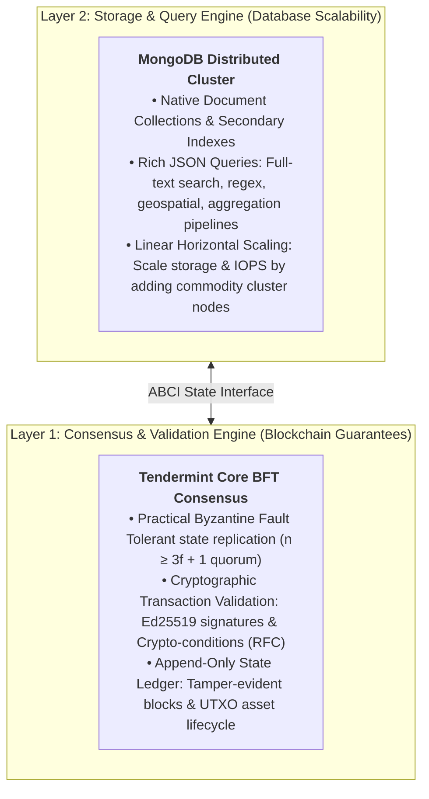

1. **Consensus & Validation Layer**:
   * Uses **Tendermint Core**, an enterprise-grade BFT consensus engine.
   * Validator nodes vote in lock-step rounds. Transactions are validated against cryptographic conditions, ensuring that only the rightful holder of an asset's private key can authorize a transfer.
2. **Storage & Database Layer**:
   * Employs **MongoDB** as the underlying storage engine on each node.
   * Data is stored natively as structured JSON documents. Developers can execute arbitrary complex queries across transaction metadata, asset payloads, and timestamps using familiar database query syntax.

---

### 6.3 The CRAB Data Model vs. Traditional CRUD

Traditional database management systems operate under the **CRUD** paradigm. BigchainDB deliberately alters this model to enforce immutability, establishing the **CRAB** model:

| Op (CRUD) | Traditional Database Model (CRUD) | Op (CRAB) | BigchainDB Blockchain Model (CRAB) | Architectural & Audit Rationale |
|:---:|---|:---:|---|---|
| **C** | **CREATE**: Inserts a new row or document into physical tables. | **C** | **CREATE**: Mints a new cryptographically bound digital asset onto the ledger. | Generates the root asset ID using deterministic transaction hashing. |
| **R** | **READ**: Queries the current stored values on disk via SQL / find. | **R** | **RETRIEVE**: Queries JSON asset state and metadata via MongoDB query engine. | Leverages MongoDB secondary indexes to execute fast, multi-attribute queries. |
| **U** | **UPDATE**: Overwrites data in-place, erasing historical disk sectors. | **A** | **APPEND**: Forbids in-place overwrite; appends a new signed state transition transaction. | Preserves an unbroken cryptographic UTXO provenance trail from genesis to current owner. |
| **D** | **DELETE**: Permanently expunges records, creating irreversible audit blind spots. | **B** | **BURN**: Forbids deletion; transfers asset to an unspendable null cryptographic public key. | Inactivates asset permanently while leaving complete historical lifecycle verifiable by auditors. |

#### Why Are UPDATE and DELETE Forbidden in BigchainDB?
* **UPDATE is replaced by APPEND**:
  * In a traditional database, an `UPDATE` command overwrites the existing values in disk sectors, obliterating historical state.
  * In BigchainDB, an asset's state can never be mutated in place. To change the state or transfer ownership of an asset, a new transaction must be **APPENDED** to the ledger.
  * Each transfer transaction points to the previous transaction output (unspent transaction output - UTXO model), forming an unbroken cryptographic provenance trail from creation to current holder.
* **DELETE is replaced by BURN**:
  * In traditional databases, `DELETE` permanently expunges rows or documents, creating blind spots in financial audits.
  * In BigchainDB, an asset can never be removed from the ledger. If an asset reaches the end of its useful lifecycle (e.g., an expired passport, a discharged hospital patient, or decommissioned machinery), it is **BURNED**.
  * **The Mechanics of Burning**: The asset is transferred in an APPEND transaction to an unspendable null cryptographic public key (or a public key whose private key is mathematically provable to be unrecoverable, such as the `0x00...00` address). Once transferred to the burn address, no entity can ever sign a transaction to re-spend or alter it, yet its entire historical audit log remains permanently verifiable on the ledger.

---

### 6.4 Key Technical Distinctions: BigchainDB vs. Blockchain vs. IPFS

| Feature / Characteristic | BigchainDB | Ethereum Blockchain | IPFS Protocol |
|---|---|---|---|
| **Primary Identity** | Scalable Decentralized Database | Decentralized State Machine / Computer | Peer-to-Peer File Distribution System |
| **Consensus Mechanism** | Deterministic Voting (Tendermint Core BFT) | Proof of Stake (LMD-GHOST / Casper FFG) | None (Kademlia DHT routing + Bitswap exchange) |
| **Turing-Complete Contracts** | No (Employs standardized Crypto-conditions) | Yes (EVM bytecode execution) | No (Static content addressed storage) |
| **Native Token Required** | No (Zero-gas / consortium configuration) | Yes (ETH for transaction gas & staking) | No (Free P2P protocol; Filecoin optional for persistence) |
| **Complex Querying (JSON)** | Yes (Native MongoDB indexing, regex, joins) | No (Primitive key-value mappings only) | No (Exact CID content addressing lookup only) |
| **Transactional Throughput** | High (~1,000 – 5,000 TPS) | Low (~15 – 30 TPS on base L1) | High (Peer-to-peer network bandwidth bound) |
| **Data Mutation Model** | CRAB (Create, Retrieve, Append, Burn) | Append-Only Block State Transitions | Immutable Merkle Directed Acyclic Graph (DAG) |

1. **No Mining / No Proof-of-Work**: BigchainDB validator nodes do not solve arbitrary computational puzzles. Blocks are proposed and voted upon directly through deterministic Tendermint rounds.
2. **Voting-Based Rather Than Capital-Based**: Validator power is governed by voting rights allocated across consortium participants rather than token balances or energy expenditure.
3. **No Native Smart Contracts**: BigchainDB does not execute arbitrary Turing-complete bytecodes. Instead, it utilizes standardized **Crypto-conditions** (RFC standard) to enforce transaction validity rules (threshold signatures, hash locks, and timeout conditions).

---

### 6.5 Healthcare Patient Data Management in BigchainDB

In Module 5, Dr. Sandhya P highlights a concrete architectural case study utilizing BigchainDB for electronic healthcare administration:
* **The Scenario**: Multiple stakeholders (hospitals, diagnostic laboratories, specialist physicians, pharmacies, and health insurance billing departments) require real-time access to patient records without centralized database silos.
* **The BigchainDB Solution**:
  1. *Patient Asset Creation*: When a patient enters the system, an asset representing their medical profile is registered via a `CREATE` transaction.
  2. *Granular Patient Consent*: The patient holds the private keys controlling their medical assets. A specialist doctor requesting access must receive a cryptographically signed authorization from the patient.
  3. *Multi-Party Consensus*: When a medical procedure occurs, the lab results, doctor's clinical notes, and billing codes are assembled into an `APPEND` transaction. Consensus between the hospital node, laboratory node, and insurer node must be reached before the record is committed.
  4. *Asset Burning on De-enrollment*: If a record becomes obsolete or the patient migrates to a different sovereign healthcare system, the associated local permission token is marked as `BURNED`, preventing subsequent lookups while maintaining the immutable historical claims trail.

---
## 7. Real-World Use Cases & Architectural Case Studies

Blockchain technology delivers transformative business value in ecosystems characterized by fragmented data silos, high coordination friction, asymmetric information, and costly intermediaries. This section provides an in-depth analysis of the real-world case studies covered across Module 5.

---

### 7.1 Finance and Payments

#### Case Study 1: Loans and Mortgages
* **The Traditional Problem**:
  * The legacy residential mortgage process involves a maze of disconnected intermediaries: retail lenders, credit rating bureaus, title search agencies, escrow officers, insurance underwriters, and independent property appraisers.
  * Inefficient manual handoffs, physical document mailings, and repetitive paper verifications create an industry-average closing window of **42 to 45 days**, accompanied by thousands of dollars in closing fees and high operational risk.
* **The Blockchain Solution**:
  * A peer-to-peer mortgage lending platform utilizing automated smart contracts, tokenized property title deeds, and programmatic fund escrow.
  * Eliminates redundant manual credit checks by integrating cryptographically attested digital identities.
* **The Alex & Maria Johnson Walkthrough (5-Day Mortgage Closing)**:
  1. *Loan Application Block*: Newly married Alex and Maria Johnson find their ideal home and submit an application through a decentralized lending portal. The application is serialized as an initial transaction block.
  2. *Consortium Broadcast*: The transaction block is broadcast to an enterprise consortium ledger uniting lenders, credit agencies, property valuation authorities, and local government land registries.
  3. *Automated Verification*: Through permissioned data sharing, their digital identity (KYC), bank account liquidity, and credit history are instantly verified against cryptographically signed credentials.
  4. *Expedited Valuation*: A certified property appraiser conducts a formal digital valuation, anchoring the valuation report hash directly to the loan block.
  5. *Smart Contract Offer*: An algorithmic loan offer contract is generated. Alex and Maria digitally sign the mortgage covenant using their private keys.
  6. *Capital Disbursement*: The loan funds (stablecoin or central bank digital currency - CBDC) are automatically released from lender escrow to the home seller's account.
  7. *Title Deed Transfer*: The property title is atomically transferred from the seller to the Johnsons on the municipal land registry ledger, with an embedded cryptographic mortgage lien favoring the lending bank.
  * **Result**: The Johnsons become registered homeowners in **5 days instead of the standard 42 days**, slashing administrative overhead by over 75%.

#### Case Study 2: Cross-Border Payments & Remittance
* **The Traditional Problem**:
  * Cross-border fiat transfers rely on the legacy SWIFT network and **correspondent banking chains** (NOSTRO and VOSTRO accounts).
  * If Bank A in India transfers capital to Bank B in Germany, the funds must route through multiple intermediary clearing banks.
  * Each bank maintains its own isolated database, leading to **fragmented and inconsistent data**, high FX spreads, manual reconciliation discrepancies, settlement delays of **3 to 5 business days**, and billions in idle liquidity buffers.
* **The Blockchain Solution (R3 Corda Shared Golden Source)**:
  * Replaces multiple out-of-sync local ledgers with a single, synchronized **"Golden Source"** of truth shared directly between transacting counterparties.
  * **Traditional Architecture Without Corda**: Bank A records GBP 100 / USD 120; Central Clearing Counterparty (CCP) records GBP 99; Corporation B records USD 120. Frequent mismatches demand manual phone calls, spreadsheet reconciliations, and costly dispute resolution.
  * **With R3 Corda Shared Golden Source**:
    * Bank in Country A, Corporation in Country B, and regulatory observers connect to a shared Corda state machine.
    * Real-time synchronization guarantees identical state (Trade ID: 12345, GBP 100 / USD 125) with zero discrepancies.
    * Atomic **Payment-versus-Payment (PvP)** settlement executes in under 5 seconds, eliminating counterparty settlement risk and freeing up billions in trapped corporate capital.

#### Case Study 3: Stock Trading & Securities Settlement
* **The Traditional Problem**:
  * Public and private securities trading suffers from the **T+2 (or T+3) settlement cycle**, where executing a trade and actually transferring cash and legal ownership takes 48 to 72 hours.
  * Central clearinghouses (such as the DTCC) must maintain immense collateral margin pools to buffer against the risk that a trader defaults during the two-day settlement lag.
* **The Blockchain Solution (Jason to Mark Stock Transfer Flow)**:
  1. *Tokenized Securities*: Private company equities are tokenized into compliant digital asset tokens.
  2. *Transaction Block*: Jason submits an order to sell shares to Mark; the order is signed with his private key and represented online as a transaction block.
  3. *Network Broadcast*: The block is relayed to authorized broker-dealer validator nodes.
  4. *Network Validation*: Nodes execute smart contract compliance checks: Does Jason actually own the shares? Has Mark passed KYC/AML? Is the transfer restricted by secondary lock-up rules?
  5. *Ledger Commitment*: Once validated, the block is appended to the ledger, establishing an indelible record of stock provenance.
  6. *Atomic Delivery-versus-Payment (DvP)*: In the exact same computational step, cash tokens move from Mark to Jason, and equity tokens move from Jason to Mark. Settlement is instantaneous (**T+0**), completely eliminating clearinghouse counterparty risk.

#### Case Study 4: Online Digital Identities & Self-Sovereign Identity (DID)
* **The Traditional Problem**:
  * Online identity management is broken: users juggle hundreds of vulnerable passwords, while corporate servers act as massive centralized honeypots for hackers (resulting in billions of leaked Social Security numbers and credentials).
  * Verifying identity across banks, government agencies, and transport providers requires submitting repetitive physical paperwork.
* **The Blockchain Solution**:
  * A permissioned blockchain identity platform adhering to the **W3C Decentralized Identifier (DID)** and **Verifiable Credentials (VC)** specifications.
  * *Workflow*:
    1. A citizen generates a cryptographic key pair on their mobile device or web interface.
    2. An issuing authority (e.g., Department of Motor Vehicles or National Passport Bureau) signs a Verifiable Credential over the citizen's attributes.
    3. The credential issuer anchors the DID document hash and public key to the blockchain via a smart contract.
    4. When accessing services at **Banks**, **Government Departments**, **Transport Hubs**, or **Hospitals**, the citizen presents a cryptographic Zero-Knowledge Proof (ZKP) from their mobile app.
    5. The third party verifies the mathematical validity of the issuer's signature on-chain in milliseconds without ever storing or exposing the citizen's private underlying documents.

---

### 7.2 Land Records and Real Estate Title Registries

* **The Problem**:
  * Land registries in developing and developed nations alike are plagued by fraudulent title deeds, duplicate property sales, manual paper record tampering, bribery, and lost documentation.
  * In many regions, over 60% of civil court cases revolve around disputed land ownership. Buyers must pay substantial title insurance fees to protect against phantom heirs or undisclosed liens.
* **The Blockchain Solution**:
  * Cadastral survey coordinates, property boundaries, and title deeds are tokenized as Non-Fungible Tokens (NFTs) on an immutable, permissioned state government blockchain.
  * Every historical transfer, inherited subdivision, and mortgage encumbrance is cryptographically chained.
  * Property transfers trigger smart contracts that atomically verify the seller's clear title, enforce local transfer tax remittances to municipal authorities, clear outstanding municipal property tax liens, and transfer title ownership to the buyer in a single transaction.

---

### 7.3 Media, Publishing & Digital Entertainment

#### Case Study 5: Digital Copyright Protection & Anti-Piracy Surveillance
* **The Problem**:
  * Digital video, music, and software are vulnerable to effortless digital duplication, screen ripping, and unauthorized torrent distribution, costing content creators billions in lost revenue annually.
* **The Blockchain Solution**:
  1. *Perceptual Hashing & Registration*: Newly mastered video content is processed using perceptual fingerprinting algorithms; the unique perceptual hash is registered in a smart contract on the blockchain along with copyright ownership metadata.
  2. *Automated Surveillance Contracts*: Web crawlers and decentralized oracle bots continuously scan public video streaming platforms, peer-to-peer networks, and social media feeds for video fingerprints.
  3. *Algorithmic Enforcement*: When an unauthorized duplicate is detected, the oracle triggers the surveillance smart contract, which automatically compiles cryptographic proof of infringement and dispatches legally binding DMCA takedown notices or automatically reroutes monetization royalties to the true copyright holder.
  4. *Micro-Consumption Licensing*: Consumers can purchase micro-tokens enabling on-demand pay-per-minute consumption of high-fidelity media, eliminating the economic friction driving piracy.

#### Case Study 6: Decentralized Content Crowdfunding
* **The Problem**:
  * Independent filmmakers, documentary creators, and musicians face massive barriers raising capital from risk-averse legacy Hollywood and corporate record labels.
  * Crowdfunding platforms (Kickstarter, GoFundMe) operate as centralized walled gardens, charging high fees (5-10%) and offering zero financial returns to backers due to complex regulatory boundaries.
* **The Blockchain Solution (NFT-Backed Film Crowdfunding)**:
  1. *Concept Creation*: An independent filmmaker develops a creative film script and production plan.
  2. *Smart Contract Escrow*: A crowdfunding smart contract is deployed, establishing milestone funding goals, minimum/maximum capital thresholds, and project deadlines.
  3. *Tokenized Investment*: Retail backers and fans deposit cryptocurrency or fiat stablecoins into the smart contract and receive proportional governance/revenue tokens.
  4. *Milestone Escrow Releases*: Capital is not handed over in a lump sum. Funds are unlocked in tranches only after independent production milestones (pre-production, principal photography, post-production) are signed off by backer vote.
  5. *Automated Revenue Distribution*: Once the film is released, commercial streaming revenues and licensing royalties flow into the smart contract, which programmatically distributes percentage returns directly to token holders' wallets.
  * **Real-World Highlight**: Actor Vishal Malhotra directed the film *'Ilm'*, funded entirely through NFTs (reported by *The Times of India*, May 19, 2022), demonstrating viable decentralized entertainment financing in the Indian film industry.

#### Case Study 7: Digital Advertising Fraud Mitigation
* **The Problem**:
  * Digital ad fraud is a **\$100 B+ annual catastrophe**. Ad networks suffer from bot farms generating fake clicks, domain spoofing (pretending an ad is displayed on a premium newspaper when it is running on a hidden bot site), and fraudulent impression stuffing.
  * Advertisers pay billions for phantom audiences, while genuine publishers receive pennies on the dollar due to opaque ad-tech intermediaries taking 40–60% fee cuts.
* **The Blockchain Solution (Token-Curated Registries - TCRs)**:
  * Implements an open, decentralized protocol such as the **adChain Registry** or **Basic Attention Token (BAT)** model:
    1. *Publisher Application*: A website publisher wishing to join the verified advertiser whitelist deposits a bond (e.g., 100 adChain tokens) and applies to the registry.
    2. *Challenge Period*: A public window opens where security vendors, ad-fraud researchers, or community members can challenge the application by matching the 100-token deposit and submitting evidence of bot traffic.
    3. *Token-Holder Voting*: If challenged, an accreditation committee of token holders votes:
       * Address `0x123` votes *Approve* (weight: 100 tokens).
       * Address `0xabc` votes *Reject* (weight: 200 tokens).
    4. *Whitelisting & Slashing*: If approved, the publisher enters the verified domain registry, and advertisers can safely bid on its inventory. If rejected as fraudulent, the applicant's 100-token bond is slashed and rewarded to the challenger and honest voters.
    5. *BAT Model*: In the Brave Browser ecosystem, user attention is measured securely on the local device; advertisers purchase BAT tokens, which are distributed directly to users for their attention and to publishers for their content, cutting out fraudulent intermediaries.

#### Case Study 8: Music Streaming & Automated Royalty Payments
* **The Problem**:
  * The traditional music industry is notoriously exploitative: artists often receive less than 12% of the royalties generated by their music, with payments delayed by **6 to 18 months** through complex labyrinths of publishers, collection societies, and distributor accounting audits.
* **The Blockchain Solution**:
  1. *Consortium Integration*: Publishers, digital streaming platforms (DSPs), collection agencies, and artist unions connect to a common blockchain platform.
  2. *Algorithmic Split Contracts*: The rights allocation for a musical track is coded into a smart contract: e.g., 15% to Recording Label / Publisher, 5% to Digital Distributor, 40% to Songwriter, 40% to Performing Artist.
  3. *Micro-Metered Streaming Transactions*: Every time a consumer streams a song on a mobile device, a micro-transaction is recorded on the ledger.
  4. *Instant Real-Time Payouts*: The smart contract automatically splits the streaming revenue (e.g., \$0.004 per stream) and credits the cryptographic accounts of the distributor, publisher, and artists in real time. Accounting transparency is absolute, and disputes are rendered obsolete.

---

### 7.4 Supply Chain & Logistics Monitoring

#### Case Study 9: Pharmaceutical Drug Traceability & Cold Chain Monitoring

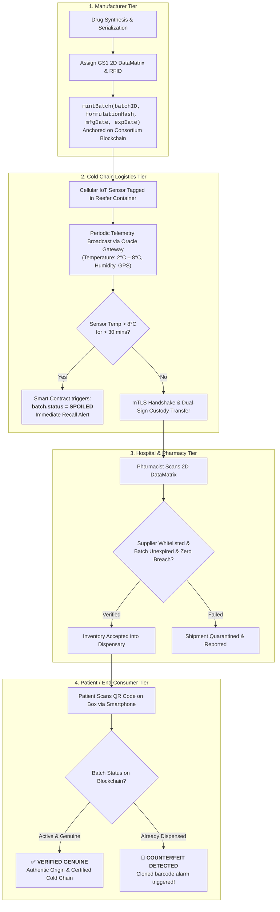

* **The Problem**:
  * Counterfeit pharmaceuticals represent a **\$200 B+ global illicit trade**, resulting in over 1,000,000 preventable deaths annually (WHO estimates).
  * High-value biological medicines (vaccines, insulin, chemotherapy agents) require strict temperature-controlled storage (**Cold Chain: 2°C to 8°C**). Temperature breaches during transit are frequently concealed by carriers to avoid financial penalties, resulting in spoiled, inert, or toxic drugs administered to unsuspecting patients.

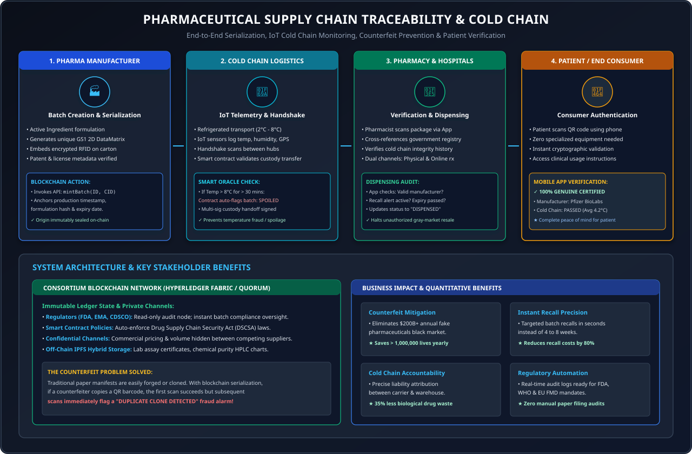

* **The End-to-End Blockchain Architecture**:
  1. *Manufacturer Tier*:
     * During pharmaceutical formulation, each individual drug packet is assigned a unique, randomized serialized identity encoded into a **GS1 2D DataMatrix** barcode and an encrypted RFID tag.
     * The manufacturer's automated packaging line calls a blockchain API:
       `mintBatch(batchID, formulationHash, manufacturingDate, expiryDate)`
     * The transaction immutably records product provenance on a consortium blockchain (e.g., Hyperledger Fabric / Quorum) co-hosted by health regulators (FDA, CDSCO, EMA).
  2. *Cold Chain Logistics Tier*:
     * Shipping containers are fitted with tamper-proof cellular IoT sensors logging temperature, relative humidity, shock/vibration, and GPS location coordinates.
     * IoT telemetry is periodically hashed and anchored to the batch on-chain via an Oracle gateway.
     * **Automated Cold Chain Smart Contract Policy**:
       `if (sensor.temperature > 8°C for duration > 30 mins) => batch.status = SPOILED`
     * When custody transfers between transport carriers and regional distribution warehouses, both parties scan the shipment, executing an mTLS handshake and a dual-signature transaction certifying custody handoff.
  3. *Hospital & Pharmacy Tier*:
     * When medicines arrive at a hospital dispensary or online pharmacy, the pharmacist scans the 2D DataMatrix code using a dedicated verification application.
     * The application verifies that the manufacturer is on the government-approved supplier whitelist, confirms the batch is active and unexpired, and validates that zero temperature breaches occurred across the logistics journey before accepting inventory.
  4. *Patient / End-Consumer Tier*:
     * The patient uses their smartphone camera to scan the QR barcode on the medicine box.
     * The mobile app queries the blockchain directly, presenting an instant cryptographic verdict:
       - **VERIFIED GENUINE**: Authentic manufacturer signature, complete journey timeline, and certified cold-chain history.
       - **CLONE / COUNTERFEIT DETECTED**: If a counterfeiter cloned a valid barcode and printed it across 10,000 fake packages, the blockchain detects that the batch has already been marked as `DISPENSED` elsewhere, triggering an immediate fraud alarm and halting consumption!

---

### 7.5 Healthcare & Life Sciences

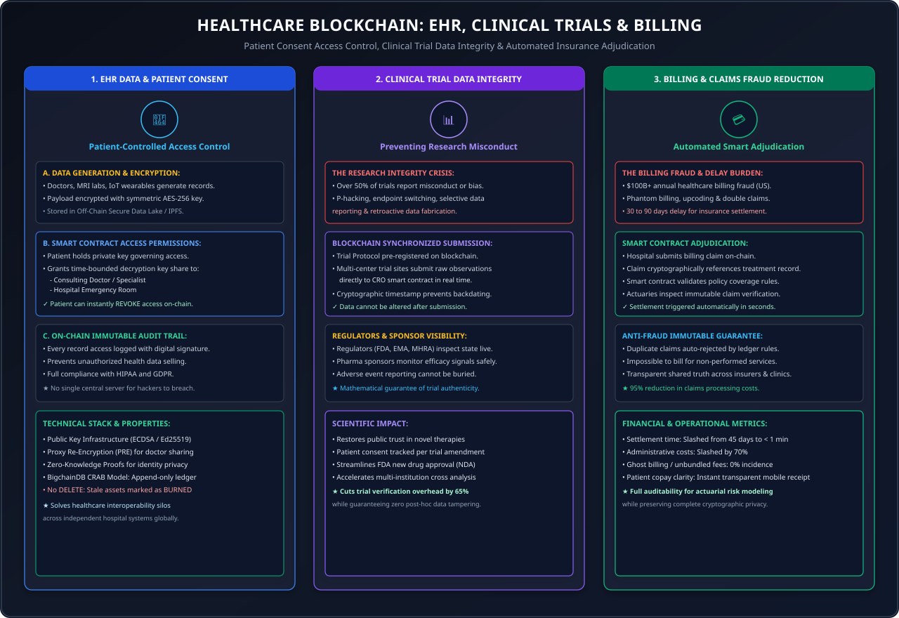

#### Case Study 10: Electronic Health Record (EHR) & Public Health Security

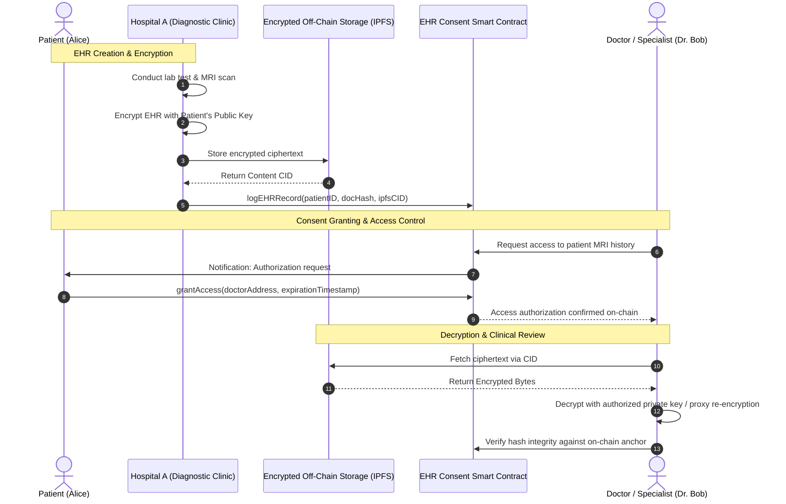

* **The Problem**:
  * Medical records are trapped in proprietary hospital EHR software silos. When a patient switches doctors or visits an emergency room in another city, doctors lack access to their past medical history, resulting in redundant tests, misdiagnoses, and fatal drug interactions.
  * Centralized healthcare databases are prime targets for ransomware attacks and data theft.
* **The Blockchain Solution**:
  * A hybrid healthcare architecture uniting off-chain encrypted medical data lakes with an on-chain smart contract access control registry:
    1. *Data Generation & Encryption*: Diagnostic labs, MRI scanners, wearable biometric sensors, and doctors generate medical records. The records are encrypted using symmetric AES-256 keys and deposited into secure hospital data lakes or IPFS.
    2. *Patient-Centric Access Control*: The patient holds the private master key. When visiting a specialist, the patient issues a time-bounded cryptographic re-encryption key via smart contract.
    3. *Revocable Permissions*: The patient can inspect their complete audit trail and revoke a provider's access instantly.
    4. *Defense-in-Depth*: Because there is no single central database, a hacker breaching one hospital cannot access records across the rest of the healthcare network.

#### Case Study 11: Clinical Trial Data Integrity
* **The Problem**:
  * Scientific research integrity is in crisis: investigations reveal that **over 50% of published clinical trials suffer from research misconduct**, including:
    * *P-hacking*: Running multiple statistical models until an arbitrary positive correlation emerges by chance.
    * *Endpoint Switching*: Silently changing the trial's stated primary objective when the drug fails to cure the original target symptom.
    * *Selective Data Withholding*: Suppressing adverse patient reactions and reporting only favorable trial cohorts.
* **The Blockchain Solution**:
  1. *Protocol Pre-Registration*: Before testing begins, the clinical trial protocol (exact sample sizes, primary endpoints, statistical criteria) is mathematically hashed and anchored to the blockchain.
  2. *Real-Time Data Streaming*: Contract Research Organizations (CROs) and multi-center testing hospitals submit raw patient measurements directly to the smart contract as observations occur.
  3. *Cryptographic Timestamps*: Cryptographic timestamps prevent backdating, retrofitting data, or modifying spreadsheets post-hoc.
  4. *Regulator Oversight*: Drug regulators (FDA, MHRA, EMA) and pharmaceutical sponsors run read-only observer nodes, inspecting trial progression in real time. Adverse events cannot be swept under the rug, restoring global public confidence in newly approved vaccines and therapeutics.

#### Case Study 12: Healthcare Billing Fraud & Automated Claims Adjudication
* **The Problem**:
  * Healthcare billing fraud accounts for over **\$100 billion in annual losses** in the United States alone.
  * Common fraudulent practices include **Phantom Billing** (billing for procedures, tests, or visits that never took place), **Upcoding** (billing for more expensive treatments than those actually provided), and **Duplicate Claims Submission**.
  * Manual claims adjudication requires armies of administrative staff, causing insurance settlement delays of **30 to 90 days**.
* **The Blockchain Solution**:
  1. *Automated Claims Generation*: When a hospital provides treatment, an automated smart contract generates an insurance claim transaction cryptographically linked to the authenticated medical procedure record.
  2. *Algorithmic Policy Validation*: The insurer's policy terms (deductibles, co-pays, approved formulary treatments) are encoded into smart contracts. The contract validates whether the patient's insurance policy covers the procedure in milliseconds.
  3. *Actuarial & Audit Verification*: Actuaries inspect immutable claim verification trails, enabling highly accurate mathematical risk modeling and fraud detection.
  4. *Instant Settlement*: Approved claims trigger instant fund transfers from insurer to hospital.
  5. *Zero Fraud Incidence*: Duplicate claims are rejected instantly by the ledger's uniqueness invariants, and phantom billing is impossible because claims require a cryptographically signed treatment attestation from the patient's device. Claims processing costs collapse by over **90%**, and payment cycles shrink from 45 days to **under 60 seconds**.

---
## 8. University Exam Preparation Guide & Review Questions

This section provides high-yield revision summaries, definitive concept comparison tables, and 20 multi-part university examination questions with comprehensive, academically rigorous solutions.

---

### 8.1 High-Yield Rapid Review Summaries

> [!IMPORTANT]
> ### 🚀 Module 5 High-Yield Revision Cheat-Sheet
>
> | # | Core Architectural Principle | Exam Key Fact / Rule |
> |:---:|---|---|
> | **1** | **Six Layers of Blockchain** | Functional stack: Data $\to$Network$\to$Consensus$\to$Incentive$\to$Contract$\to$ Application. |
> | **2** | **Incentive Layer is Optional** | Excluded or configured as "zero-gas" in private and consortium enterprise blockchains. |
> | **3** | **2/3rd Voting Rule (BFT)** | Tolerates up to $f$Byzantine nodes if$n \ge 3f + 1$; Quorum requires$\ge 2f + 1 > \frac{2}{3}n$ signatures. |
> | **4** | **EEA Enterprise Stack** | Extends base Ethereum with HSM vaults, OAuth/RBAC, Oracles, ZK-SNARKs, TEE enclaves, and private state. |
> | **5** | **10-Step Design Methodology** | Step 6 (*Configure Blockchain Instance*) and Step 7 (*Build APIs*) are the core implementation milestones. |
> | **6** | **10 Instance Parameters** | Permissions, Asset Issuance, Atomic Swaps, Key Mgmt, Multisig, Block Params, Limits, Handshakes, Address Formats, Native Assets. |
> | **7** | **7 Blockchain API Classes** | Keygen, Asset Issuance, Data Authentication, Status Querying, Create/Read (CRUD), Smart Contracts, Address Verification. |
> | **8** | **EVM SSTORE Storage Economics** | Costs 20,000 gas per 32-byte non-zero slot ($\approx 640{,}000$gas/KB); costs$\approx \$59{,}000$ per MB on L1! |
> | **9** | **The Storage Trilemma** | Systems trade off between **Decentralization** (node storage), **Throughput** (TPS), and **Immutability/Verifiability**. |
> | **10** | **GDPR Article 17 Conflict** | "Right to be Forgotten" makes storing raw PII on an immutable ledger legally and architecturally non-compliant. |
> | **11** | **Hybrid Storage Architecture** | Bulky payloads (PDF, scans, big data) live off-chain; only fixed 32-byte cryptographic hashes anchor on-chain. |
> | **12** | **4-Stage Hybrid Lifecycle** | 1. Asset Creation $\to$2. The Split (payload off-chain, hash on-chain)$\to$3. Secure Anchoring$\to$ 4. Verifiable Access. |
> | **13** | **IPFS Content Addressing** | Data is fetched by cryptographic content identifier (CID), not by physical host URL location. |
> | **14** | **CIDv0 vs. CIDv1** | CIDv0 is Base58btc starting with `Qm` (46 chars); CIDv1 uses Multiformats (Multibase + Version + Multicodec + Multihash). |
> | **15** | **UnixFS & Merkle DAG** | Splits large files into 256 KB blocks structured as a Directed Acyclic Graph, enabling deduplication. |
> | **16** | **Kademlia DHT Routing** | Measures peer distance via XOR metric ($d(x, y) = x \oplus y$), routing queries across the network in$O(\log N)$ hops. |
> | **17** | **Bitswap Protocol** | Exchange protocol using peer `Wantlists` and credit/debt tit-for-tat game theory to incentivize bandwidth sharing. |
> | **18** | **IPFS Garbage Collection** | Unpinned blocks are purged when disk caches fill; mission-critical data must be explicitly PINNED. |
> | **19** | **BigchainDB Fusion** | Blends MongoDB distributed NoSQL storage with Tendermint Core BFT consensus, governed by the CRAB data model. |
> | **20** | **BigchainDB Distinctives** | No mining/PoW, no Turing-complete contracts (uses Crypto-conditions), and voting-based consensus rather than gas tokens. |
> | **21** | **Mortgage Case Study** | Alex & Maria Johnson close a mortgage in 5 days instead of 42 days by unifying 7 intermediary silos on-chain. |
> | **22** | **Cross-Border Remittances** | R3 Corda establishes a single shared "Golden Source" of ledger state, eliminating reconciliation mismatches. |
> | **23** | **Stock Trading Settlement** | Instantaneous T+0 delivery-versus-payment (DvP) settlement eliminates clearinghouse counterparty risk (T+2). |
> | **24** | **Digital Ad Fraud (adChain)** | Token-Curated Registries (TCR) eliminate bot-traffic publisher fraud using token staking and voting challenges. |
> | **25** | **Music Streaming Royalties** | Smart contracts automate micro-metered streaming revenue splits directly to artists and rights-holders in real time. |
> | **26** | **Pharma Serialization** | GS1 2D DataMatrix packaging serialization + IoT cold-chain telemetry (2°C–8°C) prevents fake and spoiled drugs. |
> | **27** | **Clinical Trial Integrity** | Real-time hashing of trial datasets anchored to blockchain prevents post-hoc endpoint alteration and p-hacking. |
> | **28** | **Healthcare Billing Adjudication**| Smart contract rules enforce auto-adjudication, eliminating duplicate claims, unbundling, and phantom billing fraud. |

---

### 8.2 Comprehensive Concept Comparison Tables

#### Table 1: On-Chain vs. Off-Chain vs. Hybrid Storage Models
| Dimension | On-Chain Storage | Off-Chain Storage | Hybrid Storage Model |
|---|---|---|---|
| **Storage Media** | Blockchain Ledger State Trie | IPFS, AWS S3, MongoDB, Cloud Object | Off-Chain Payload + On-Chain Hash Pointer |
| **Storage Cost** | Very High (~$59,000 / MB on Ethereum L1) | Very Low (~$0.02 / GB / month) | Minimal (Fixed 32-byte hash anchor on-chain) |
| **Read/Write Latency** | High (Bound to block confirmation times) | Low (Milliseconds / line rate) | Instant Off-Chain Read / Fast Hash Audit |
| **Data Querying** | Primitive Key-Value lookups only | Rich SQL / NoSQL / Aggregation | Rich SQL off-chain + on-chain hash verification |
| **Immutability** | Absolute & Permanent (Consensus-enforced) | Mutable / Deletable by admin | Mathematically Guaranteed (Cryptographic hash match) |
| **Public Verifiability** | 100% Native Consensus verification | Zero native public verification | 100% Independent Cryptographic Audit |
| **Confidentiality / PII** | Zero (Publicly visible to all network nodes) | High (Enterprise ACLs, VPC, private keys) | High (Payload encrypted off-chain; zero PII on-chain) |
| **GDPR Compliance** | Impossible for PII (Violates Article 17) | Fully Compliant (Records can be purged) | Fully Compliant (Purging payload orphans hash) |
| **Optimal Use Cases** | Balances, voting state, logic code | Bulk media, raw telemetry, big datasets | Academic degrees, EHR records, Land titles, Supply chain |

#### Table 2: IPFS vs. BigchainDB vs. Traditional Cloud (AWS S3)
| Dimension | IPFS Protocol | BigchainDB | Traditional Cloud (AWS S3) |
|---|---|---|---|
| **Primary Purpose** | P2P Content-Addressed File Distribution | Scalable Decentralized JSON Database | Centralized Object Storage Service |
| **Underlying Engine** | UnixFS Merkle Directed Acyclic Graph (DAG) | MongoDB Distributed NoSQL + Tendermint Core | Proprietary AWS Distributed File System |
| **Consensus Mechanism** | None (DHT Routing & Bitswap Exchange) | Tendermint Core BFT (Voting-based quorum) | None (Centralized Service Level Agreement) |
| **Addressing Scheme** | Content-based Addressing (CIDv0 / CIDv1) | Primary / Secondary Document Keys & Asset IDs | URL Location / Bucket Key Name |
| **Query Support** | None (Direct CID chunk retrieval only) | Rich JSON Queries (MongoDB query engine) | Metadata prefix & bucket delimiter search only |
| **Transactional Logic** | No (Static content blocks) | Yes (Crypto-conditions & threshold signatures) | No (CRUD object operations only) |
| **Data Persistence** | Requires Explicit Pinning (Subject to GC) | Perpetual Append-Only Ledger History | Perpetual until explicitly deleted or billed |
| **Single Failure Point** | None (Fully decentralized peer-to-peer) | None (Distributed across consortium nodes) | Yes (Amazon Cloud Region / Outage Zone) |

#### Table 3: Traditional Database CRUD vs. BigchainDB CRAB Model
| Op (CRUD) | Traditional Database CRUD Model | Op (CRAB) | BigchainDB CRAB Model |
|:---:|---|:---:|---|
| **C** | **CREATE**: Inserts new row or document into disk tables | **C** | **CREATE**: Mints a new digital asset on the blockchain ledger |
| **R** | **READ**: Queries existing row via SQL or key lookups | **R** | **RETRIEVE**: Queries JSON asset records via MongoDB query engine |
| **U** | **UPDATE**: Overwrites data in-place on physical sectors | **A** | **APPEND**: Forbids in-place mutation; appends a new state transition transaction pointing to previous output (UTXO) |
| **D** | **DELETE**: Permanently destroys records, creating audit gaps | **B** | **BURN**: Forbids deletion; transfers asset to an unspendable null cryptographic key, preserving an immutable audit trail |

#### Table 4: Public vs. Private vs. Consortium Blockchains
| Evaluation Criteria | Public Permissionless | Private Permissioned | Consortium (Federated) |
|---|---|---|---|
| **Network Access** | Completely open (anyone can join, read, and write) | Strictly restricted to a single enterprise organization | Pre-selected federation of verified institutions |
| **Consensus Operators** | Anonymous miners or stakers worldwide | Internal enterprise-controlled validator nodes | Identified institutional peers (banks, hospitals, regulators) |
| **Consensus Algorithm** | Proof-of-Work (PoW) / Proof-of-Stake (PoS) | Raft / Practical Byzantine Fault Tolerance (PBFT) / PoA | PBFT / Istanbul BFT (IBFT 2.0) / Tendermint BFT |
| **Incentive Layer** | Mandatory (Gas fees & block reward tokens) | Unnecessary / Configured as Zero-gas model | Unnecessary / Zero-gas model (governed by SLA) |
| **Throughput (TPS)** | Low (15 – 100 TPS on Layer 1) | Very High (10,000+ TPS) | High (1,000 – 5,000 TPS) |
| **Finality Guarantee** | Probabilistic (Requires $k$ block confirmations) | Immediate & Deterministic (Single-block finality) | Immediate & Deterministic (Single-block finality) |
| **Typical Examples** | Bitcoin, Ethereum Mainnet, Solana | Internal private Besu / Hyperledger Fabric instance | Hyperledger Fabric, R3 Corda, ConsenSys Quorum |

---

### 8.3 20 Comprehensive University Practice Questions with Full Solutions

#### Question 1 (Layered Architecture Fundamentals)
**Explain the 6-layer standard architecture of blockchain systems. Detail the specific functions performed by each layer and state why the Incentive Layer is optional.**
* **Solution**:
  1. *Data Layer*: Physical/logical ledger representation. Holds block headers, transaction lists, Merkle trees/Patricia tries, cryptographic hashes (SHA-256), and asymmetric key pairs (ECDSA).
  2. *Network Layer*: Peer-to-peer overlay network. Manages Kademlia DHT node discovery, cryptographic handshakes (RLPx/TLS), transport encryption, and gossip block relay.
  3. *Consensus Layer*: State machine agreement engine. Coordinates distributed nodes to agree on a single history via algorithms such as PoW, PoS, or PBFT.
  4. *Incentive Layer*: Economic game theory engine. Distributes block rewards (coinbase subsidy) and transaction gas fees to incentivize honest participation and punish malicious behavior.
  5. *Contract & Execution Layer*: Deterministic runtime environment (EVM, WASM, Chaincode) executing Turing-complete smart contracts and state transition functions.
  6. *Application Layer*: User-facing abstraction boundary. Encapsulates client DApps, Web3 provider libraries, cryptographic wallets, and block explorers.
  * *Why Incentive Layer is Optional*: In public networks, anonymous nodes require economic incentives to expend electricity and capital. In private/consortium networks, participating institutions operate validator nodes under legally binding Service Level Agreements (SLAs). Transactions operate with zero gas to eliminate operational friction and cryptocurrency price volatility; therefore, native tokens and reward distribution modules are safely omitted.

#### Question 2 (Consensus 2/3rd Voting Rule Proof)
**State the Byzantine Generals Problem bound. Mathematically prove why Byzantine Fault Tolerant (BFT) consensus algorithms require a 2/3rd supermajority voting threshold ($n \ge 3f + 1$) to guarantee safety.**
* **Solution**:
  * *The Bound*: A distributed system can tolerate at most $f$arbitrary Byzantine (malicious or faulty) nodes if and only if the total node count satisfies$n \ge 3f + 1$, meaning less than one-third ($f < n/3$) of nodes are malicious.
  * *Mathematical Proof*:
    * Suppose total nodes $n = 3f + 1$.
    * For the network to maintain **Liveness** (proceed even if $f$nodes crash or disconnect), a valid voting quorum$Q$must require at most$n - f = (3f + 1) - f = 2f + 1$ votes.
    * Now consider two conflicting blocks, Block $A$and Block$B$(e.g., a double spend). Let Quorum$Q_1$vote for Block$A$and Quorum$Q_2$vote for Block$B$, where$|Q_1| = 2f + 1$and$|Q_2| = 2f + 1$.
    * By the Principle of Inclusion-Exclusion, the intersection of these two quorums is:
      $$|Q_1 \cap Q_2| = |Q_1| + |Q_2| - |Q_1 \cup Q_2|$$
    * Since $|Q_1 \cup Q_2| \le n = 3f + 1$, we have:
      $$|Q_1 \cap Q_2| \ge (2f + 1) + (2f + 1) - (3f + 1) = 4f + 2 - 3f - 1 = f + 1$$
    * The intersection between any two committing quorums contains at least $f + 1$ nodes.
    * Since there are at most $f$ malicious nodes in the entire network, at least one node in the intersection must be honest:
      $$\text{Honest Nodes in } (Q_1 \cap Q_2) \ge (f + 1) - f = 1$$
    * An honest node will never sign two conflicting blocks in the same consensus round. Therefore, it is mathematically impossible for both Block $A$and Block$B$to achieve$2f + 1$votes ($> 2/3$ supermajority). This guarantees **Safety**.

#### Question 3 (Enterprise Architecture Stack)
**Describe the Enterprise Ethereum Alliance (EEA) Architectural Stack. How does it extend the core Ethereum Yellow Paper standard for corporate consortia?**
* **Solution**:
  The EEA architecture refactors the blockchain into 5 distinct multi-tier layers:
  1. *Application Tier*: Extends DApps with standardized Role-Based Access Control (RBAC), Decentralized Identity (DID), and enterprise governance contracts.
  2. *Tooling Tier*: Introduces enterprise Hardware Security Modules (HSMs) for FIPS 140-2 Level 3 key custody, OAuth/LDAP enterprise directory integration, and off-chain Oracles.
  3. *Privacy & Scaling Tier*: Implements private transaction managers (such as Quorum Tessera), Zero-Knowledge Proofs (ZK-SNARKs), Trusted Execution Environments (Intel SGX enclaves), and Layer-2 rollups.
  4. *Core Blockchain Tier*: Decouples public state from private state vaults. While the Yellow Paper specifies an open EVM and public PoW/PoS consensus, the EEA stack introduces precompiled confidential contracts and private BFT voting consensus engines (IBFT 2.0, Raft).
  5. *Network Protocol Tier*: Replaces open public DevP2P gossip with authenticated mutual TLS (mTLS) peering, ensuring firewall compliance and node identity verification.

#### Question 4 (Design Methodology Framework)
**Enumerate the 10-step design methodology for building blockchain applications. Explain the Biran et al. decision criteria used in Step 1 to determine whether a blockchain is necessary.**
* **Solution**:
  * *10 Steps*: 1. Identify Use Case -> 2. Design Workflow -> 3. Select Consensus -> 4. Identify Platform -> 5. Design Architecture -> 6. Configure Instance -> 7. Build APIs -> 8. Design Front-End -> 9. Testing & Security -> 10. Deployment & Maintenance.
  * *Biran Decision Criteria (Step 1)*: A blockchain is required if and only if:
    1. A shared, consistent database is required across multiple business entities.
    2. Multiple independent writers exist who do not fully trust one another.
    3. A centralized trusted third party (clearinghouse/escrow) is absent, too expensive, slow, or creates a dangerous single point of failure.
    4. State transactions are interdependent and demand chronological cryptographic immutability.
    * If a trusted central entity exists and is cost-effective, a traditional relational or distributed database (PostgreSQL/Spanner) is superior.

#### Question 5 (Step 6 Instance Configuration)
**Identify five of the 10 core parameters that must be configured when creating a blockchain instance in Step 6. Provide a technical definition and a real-world scenario for each.**
* **Solution**:
  1. *Permissions*: Defines who can read, submit transactions, validate, and deploy code. *Scenario*: In a healthcare consortium, only accredited hospitals can write diagnostic reports; patients have read-only access.
  2. *Asset Issuance*: Controls digital asset creation, reissuance rules, and supply caps. *Scenario*: A university issues 1,000 degree tokens; further tokens require multi-sig approval from the Registrar.
  3. *Atomic Exchanges*: Ensures dual-asset swaps execute atomically (all-or-nothing). *Scenario*: Alice trades Token A on Chain 1 for Token B on Chain 2 using a Hashed Time-Locked Contract (HTLC); if either transfer fails, both auto-refund.
  4. *Key Management*: Specifies generation, HSM custody, rotation, and revocation policies for private keys. *Scenario*: A bank stores validator keys in FIPS 140-2 Level 3 HSM enclaves with Shamir secret sharing backups.
  5. *Block Parameters*: Sets maximum block size, target block interval, and gas limit. *Scenario*: An IoT supply chain network tunes block interval to 1 second and gas limit to 50M to handle 10,000 barcode scans per minute.

#### Question 6 (Blockchain API Function Classes)
**Outline five of the seven API function categories required to interface external enterprise software with a blockchain. Detail their operational roles.**
* **Solution**:
  1. *Generating Key Pairs API*: Derives public/private key pairs and addresses using secure CSPRNG and elliptic curves (secp256k1/Ed25519).
  2. *Digital Asset Issuance API*: Manages token creation, minting transactions, and supply parameters.
  3. *Data Authentication API*: Cryptographically signs outbound payloads with private keys and verifies incoming signatures to guarantee message non-repudiation.
  4. *Checking Blockchain Parameters API*: Queries real-time network telemetry (current block height, sync status, estimated gas prices, chain ID).
  5. *Create & Read Operations API*: Dispatches state-changing transactions to the mempool (`Create`) and performs gasless view calls to read ledger state (`Read`).

#### Question 7 (Storage Economics & The Storage Trilemma)
**Calculate the gas and dollar cost of storing a 1 MB file directly on Ethereum under typical network conditions. What is the Blockchain Storage Trilemma?**
* **Solution**:
  * *Calculation*:
    * Ethereum `SSTORE` opcode costs 20,000 gas per 32-byte non-zero slot.
    * $1 \text{ MB} = 1,048,576 \text{ bytes}$.
    * Total slots required $= 1,048,576 / 32 = 32,768 \text{ slots}$.
    * Total gas $= 32,768 \times 20,000 = 655,360,000 \text{ gas}$.
    * Assuming gas price $= 30 \text{ Gwei} = 30 \times 10^{-9} \text{ ETH}$, and ETH price$= \$3,000 \text{ USD}$:
      $$\text{Cost} = 655,360,000 \times (30 \times 10^{-9}) \times 3,000 = 19.6608 \text{ ETH} \times 3,000 \approx \$58,982.40 \text{ USD}$$
  * *The Storage Trilemma*: The architectural impossibility of simultaneously maximizing:
    1. *Decentralization* (keeping node hardware costs low enough for home users).
    2. *High Throughput* (processing thousands of transactions per second with low latency).
    3. *Permanent On-Chain Verifiability* (storing large historical payloads directly on-chain).

#### Question 8 (GDPR vs. Blockchain Immutability)
**Analyze the legal conflict between Article 17 of the GDPR ("Right to be Forgotten") and blockchain immutability. How does the hybrid storage model resolve this conflict?**
* **Solution**:
  * *The Conflict*: GDPR Article 17 mandates that individuals have the legal right to request the permanent erasure of their personal data (PII). Blockchain technology is fundamentally designed to be append-only and immutable; once data is written to a block, it cannot be deleted, modified, or expunged by any party. Storing unencrypted or encrypted PII directly on-chain results in severe non-compliance fines.
  * *Hybrid Model Resolution*:
    * PII is stored exclusively off-chain in an enterprise database or cloud store.
    * Only a salted cryptographic hash (or zero-knowledge commitment) is stored on-chain.
    * Under GDPR guidance, a properly salted one-way hash without the underlying data is treated as pseudonymous or non-reversible.
    * When a user exercises their "Right to be Forgotten," the enterprise deletes the off-chain record and destroys the salt/decryption key. The on-chain hash remains, but it points to nothingness and can never be reversed, functionally achieving mathematical data erasure and legal compliance.

#### Question 9 (The 4-Stage Hybrid Storage Lifecycle)
**Explain the 4-stage data lifecycle in a hybrid blockchain storage architecture. Illustrate with an academic degree certificate verification system.**
* **Solution**:
  1. *Stage 1: Asset Creation*: A university registrar generates a graduate's digital degree certificate as a PDF, containing graduation date, GPA, student name, and rector's digital signature.
  2. *Stage 2: The Data Split*: The PDF file (2 MB) is sent to the off-chain storage layer (IPFS / AWS S3). The core transaction metadata (Student ID, Degree Type, Issuer Address) is separated for on-chain anchoring.
  3. *Stage 3: Secure Anchoring*: The system computes $H = \text{SHA-256}(\text{Certificate PDF})$. The registrar signs an on-chain transaction calling `anchorDocument(studentID, H, ipfsCID)`. Validators commit the 32-byte hash to the ledger.
  4. *Stage 4: Verification & Access*: A prospective employer receives the student's PDF. The employer's app computes $\text{SHA-256}(\text{Received PDF})$ and queries the blockchain for the registrar's anchored hash. If the hashes match, the certificate is authentic; if a fraudulent applicant altered their GPA or name, the hashes mismatch and the fraud is immediately exposed.

#### Question 10 (IPFS Addressing Principles)
**Contrast HTTP Location Addressing with IPFS Content Addressing. Why does location addressing suffer from link rot, and how does IPFS eliminate it?**
* **Solution**:
  * *HTTP Location Addressing*: Addresses files by *where* they live (e.g., `https://server.com/docs/file.pdf`). If the server goes offline, changes IP, reorganizes directories, or the company shuts down, the link breaks (`404 Not Found`). If an attacker alters the file on the server, the URL still serves the tampered file.
  * *IPFS Content Addressing*: Addresses files by *what* they contain. The address is a Content Identifier (CID) derived directly from the cryptographic hash of the file bytes (e.g., `ipfs://bafy...`).
  * *Elimination of Link Rot*: The file can be downloaded from any peer node hosting a copy. Even if the original publisher goes offline, if any node in the global network has pinned the file, it remains retrievable under the exact same CID. Content cannot be tampered with because modifying the file changes the CID.

#### Question 11 (Anatomy of IPFS CIDv1)
**Break down the binary structure of an IPFS CIDv1 identifier. Explain the function of Multibase, Multicodec, and Multihash.**
* **Solution**:
  * CIDv1 structure: `[Multibase Prefix] + [CID Version] + [Multicodec] + [Multihash]`
  1. *Multibase Prefix*: Specifies the string encoding (e.g., `b` for Base32 lowercase, safe for case-insensitive URLs and DNS; `z` for Base58btc).
  2. *CID Version*: Varint indicating version (`0x01` for CIDv1).
  3. *Multicodec*: Varint self-describing the content formatting (e.g., `0x70` for `dag-pb` UnixFS protobuf; `0x55` for raw binary).
  4. *Multihash*: Self-describing hash digest containing:
     * Hash algorithm code (e.g., `0x12` for SHA-256).
     * Digest length (e.g., `0x20` = 32 bytes).
     * Raw cryptographic hash bytes.
  * *Significance*: Makes IPFS future-proof against cryptographic obsolescence; if a hash function is broken, the network can upgrade to new algorithms without breaking legacy addresses.

#### Question 12 (UnixFS and Merkle DAG)
**How does IPFS handle files larger than 256 KB? Describe the role of UnixFS and the Merkle Directed Acyclic Graph (DAG) in deduplication.**
* **Solution**:
  * Files $> 256 \text{ KB}$ are split into chunks of at most 256 KB.
  * Each chunk is hashed to form a leaf node in a Merkle DAG.
  * UnixFS builds an acyclic tree where intermediate nodes contain lists of child chunk hashes, terminating in a single **Root Node** whose hash is the file's CID.
  * *Deduplication*: If two unrelated files contain identical 256 KB data segments, those segments produce identical chunk hashes. IPFS stores only one physical copy of that chunk on disk, and peers reference the same block across multiple DAGs, optimizing network-wide storage and bandwidth.

#### Question 13 (Kademlia DHT Routing)
**Explain how the Kademlia Distributed Hash Table (DHT) routes content requests in IPFS. Define the XOR metric and its lookup time complexity.**
* **Solution**:
  * *Routing*: Each node has a 256-bit Node ID. Content CIDs are also 256-bit hashes.
  * *XOR Metric*: The distance between two 256-bit identifiers $x$and$y$ is calculated as:
    $$d(x, y) = x \oplus y$$
  * *Routing Tables*: Nodes maintain $k$-buckets of peer addresses sorted by XOR distance.
  * *Lookup Process*: When searching for a CID, a node queries the $k$ closest peers in its routing table. Those peers return contacts closer to the target CID, halving the remaining distance search space with each iteration.
  * *Time Complexity*: Node and content lookups execute in logarithmic time:
    $$\text{Complexity} = O(\log N)$$
    where $N$ is the total number of participating peers in the network.

#### Question 14 (Bitswap Protocol Mechanics)
**Describe the operational mechanics of the IPFS Bitswap protocol. How does its credit/debt accounting prevent freeloading?**
* **Solution**:
  * Bitswap is the core block exchange engine. Nodes broadcast a `Wantlist` of needed block CIDs to connected peers and send `Have` or raw `Block` messages in return.
  * *Freeloader Prevention (Tit-for-Tat)*:
    * Each node maintains a balance ledger recording bytes sent and bytes received from every peer.
    * If Peer B continuously requests blocks from Peer A without uploading blocks back, Peer B accumulates debt.
    * Once debt crosses a mathematical threshold, Peer A applies a probability-based throttling function, refusing to send further data until Peer B contributes bandwidth.
    * This game-theoretic model enforces honest reciprocal bandwidth sharing.

#### Question 15 (IPFS Pinning vs. Garbage Collection)
**Why is data not permanent by default on IPFS? Explain the difference between Local Pinning, IPFS Cluster, and Commercial Pinning Services.**
* **Solution**:
  * *Garbage Collection (GC)*: IPFS nodes cache downloaded blocks locally. When disk usage hits a configured threshold, the daemon initiates Garbage Collection, permanently expunging unpinned cached blocks. If all caching peers delete the file, it vanishes from the network.
  * *Local Pinning*: Executing `ipfs pin add <CID>` marks the root DAG node and all child blocks on that local node's disk, exempting them from GC.
  * *IPFS Cluster*: An enterprise software daemon coordinating pinning across a private consortium or server farm using Raft/CRDT consensus, ensuring redundant multi-node replication.
  * *Commercial Pinning Services*: Third-party cloud providers (Pinata, Infura, Web3.Storage) that charge monthly fees to pin and host CIDs on high-availability server clusters with 99.99% uptime SLAs.

#### Question 16 (BigchainDB Architecture)
**Detail the dual-layer architecture of BigchainDB. What are the roles of MongoDB and Tendermint Core in this system?**
* **Solution**:
  1. *Storage & Database Layer (MongoDB)*:
     * Operates a distributed document store on each node.
     * Provides rich querying capabilities: secondary indexing, complex JSON filters, geospatial search, and text search across ledger records.
     * Enables linear horizontal scalability (adding nodes expands storage and I/O capacity).
  2. *Consensus & Validation Layer (Tendermint Core)*:
     * Executes Byzantine Fault Tolerant (BFT) consensus across validator nodes.
     * Enforces cryptographic digital signatures (Ed25519) and crypto-conditions on transaction inputs/outputs.
     * Guarantees tamper-proof append-only ordering so individual MongoDB administrators cannot alter historical records.

#### Question 17 (CRUD vs. CRAB Data Model)
**Explain why BigchainDB replaces the traditional CRUD database model with the CRAB model. Describe the mechanics of the "Burn" operation.**
* **Solution**:
  * Traditional databases use **CRUD** (Create, Read, Update, Delete). In an immutable blockchain database, `UPDATE` and `DELETE` violate auditability:
    * *Update Overwrites History*: Overwriting disk sectors destroys historical state. BigchainDB replaces it with **APPEND**, which links a new state transition transaction to the previous output (UTXO model), preserving an unbroken provenance chain.
    * *Delete Destroys Evidence*: Expunging data creates forensic blind spots. BigchainDB replaces it with **BURN**.
  * *The Mechanics of Burning*: To deactivate an asset, the owner signs an `APPEND` transaction transferring the asset to an unspendable null cryptographic public key (e.g., `0x00...00` or a key with no known private key). Once transferred to the burn address, no entity can ever authorize a subsequent transfer. The asset is permanently inert, but its entire historical lifecycle remains auditable on the ledger.

#### Question 18 (Mortgage Lending Automation)
**Trace the 7-step process of a blockchain-enabled mortgage loan as illustrated in the Alex and Maria Johnson case study. How does it compress closing time from 42 days to 5 days?**
* **Solution**:
  1. *Application Submission*: Alex and Maria submit an online mortgage application; it is serialized as a transaction block.
  2. *Consortium Broadcast*: The block is broadcast to a network connecting lenders, title registries, credit bureaus, and appraisers.
  3. *Automated Verification*: Identity, credit score, and bank account reserves are verified instantly via permissioned data sharing.
  4. *Digital Property Valuation*: An appraiser submits a digital property assessment, anchoring the report hash on-chain.
  5. *Smart Contract Covenant*: A formal loan offer contract is generated; Alex and Maria sign with their private keys.
  6. *Automated Fund Release*: Loan capital is atomically disbursed from lender escrow to the home seller.
  7. *Title & Lien Commitment*: Property title is transferred to Alex and Maria on the municipal land registry, with a digital mortgage lien registered to the bank.
  * *Time Compression*: Eliminates sequential paper mailings, physical title searches, manual spreadsheet reconciliations, and escrow delays, completing all cross-institutional handoffs in parallel within 5 days.

#### Question 19 (Cross-Border Payments & Corda)
**Explain how R3 Corda establishes a "Shared Golden Source" in cross-border payments. Contrast this with traditional correspondent banking reconciliations.**
* **Solution**:
  * *Traditional Correspondent Banking*: Relies on fragmented local ledgers across Bank A, Clearing House (CCP), and Corporation B. Bank A records GBP 100; CCP records GBP 99; Corp B records USD 120. Resolving discrepancies requires manual phone calls, spreadsheet reviews, and multi-day delays (3–5 days).
  * *R3 Corda Shared Golden Source*:
    * Counterparties share a single, synchronized state machine.
    * When a transaction executes, the Corda Ledger records an immutable "Golden Source" record (Trade ID: 12345, GBP 100 / USD 125).
    * Both parties sign the state transition, achieving instant atomic synchronization.
    * Data discrepancies are rendered impossible by design, settlement latency drops to seconds, and counterparty liquidity risk is eliminated.

#### Question 20 (Pharmaceutical Drug Provenance & Counterfeit Prevention)
**Describe the multi-tier blockchain architecture for pharmaceutical drug traceability. How does serialization prevent counterfeit drug distribution and cold chain spoilage?**
* **Solution**:
  * *Multi-Tier Architecture*:
    1. *Manufacturer*: Synthesizes drugs, applies a unique serialized GS1 2D DataMatrix code / RFID tag to each packet, and registers the batch metadata and formulation hash on-chain via `mintBatch()`.
    2. *Logistics (Cold Chain)*: IoT sensors monitor temperature (2°C–8°C) and GPS. An automated smart contract flags the batch as `SPOILED` if temperature exceeds thresholds. Dual-signature handshakes record custody transfers.
    3. *Pharmacy / Hospital*: The pharmacist scans the package barcode with a verification app, checking government supplier whitelists, expiry dates, and cold-chain compliance before dispensing.
    4. *Patient Consumer*: The patient scans the QR barcode with a smartphone app, verifying genuine manufacturer origin and unblemished cold-chain provenance.
  * *Counterfeit Prevention*:
    * If counterfeiters clone a genuine QR code and print it on thousands of fake drug packages, the first package scanned and dispensed updates the blockchain state to `DISPENSED`.
    * When subsequent cloned packages are scanned at other pharmacies or by patients, the blockchain immediately flags a **"DUPLICATE SERIAL DETECTED"** fraud alert, preventing distribution and saving lives.

---
